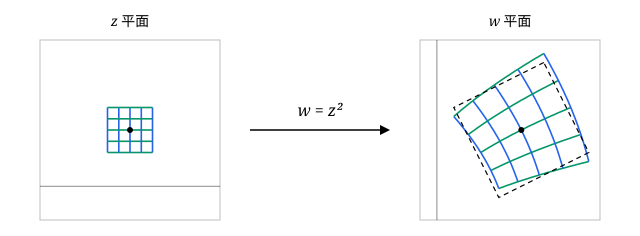

## 这一节要回答的问题

实函数的导数是差商（difference quotient）$\frac{f(x+h)-f(x)}h$的极限，$h$只能从左右两边趋于$0$。:term[复变函数]{id="math.complex-analysis.complex-function"}（function of a complex variable）的差商里$h$是:term[复数]{id="math.complex-analysis.complex-number"}（complex number），可以从平面上任何方向趋于$0$。这样的极限什么时候存在？存在的话，它说明函数在这一点附近是什么样子？

## 讲解

### 开集与区域

::anchor{id="def-open-set"}
以$z_0$为圆心、$r$为半径的:term[开圆盘]{id="math.complex-analysis.open-disc"}（open disc）是$\{z:|z-z_0|<r\}$。:term[复平面]{id="math.complex-analysis.complex-plane"}（complex plane）上的集合$D$，如果它的每一点都有一个以这点为圆心的开圆盘整个含在$D$里，就叫作:term[开集]{id="math.complex-analysis.open-set"}（open set）；任意两点都能用一条落在$D$里的折线连起来的开集，叫作:term[区域]{id="math.complex-analysis.domain"}（domain）。

为什么这样定义：求导要比较$f(z_0+h)$和$f(z_0)$，$h$从各个方向趋于$0$，所以$f$要在$z_0$周围一整圈都有定义；开集正是每一点周围都留有余地的集合。区域还要求连成一片，以后像「导数处处为$0$的函数是常数」这样的结论，只在区域上成立。边界情况：闭圆盘$\{|z|\le1\}$不是开集，圆周上的点周围的圆盘总有一部分在外面；$\{z:\Re z\ne0\}$是开集，可它分成左右两半，不是区域；去掉原点的平面$\{z:z\ne0\}$是区域。

### 极限与连续

::anchor{id="def-complex-limit"}
设$f$在$z_0$附近有定义，$z_0$处可以没有定义，$L$是:term[复数]{id="math.complex-analysis.complex-number"}。如果只要$|z-z_0|$足够小但不为$0$，$|f(z)-L|$就能小于任意给定的正数，就说$z\to z_0$时$f(z)$的极限是$L$，记作$\lim_{z\to z_0}f(z)=L$；如果$f$在$z_0$处有定义，并且$\lim_{z\to z_0}f(z)=f(z_0)$，就说$f$在$z_0$处连续（continuous）。

为什么这样定义：$|z-z_0|$就是平面上两点的距离，所以这正是$u$、$v$作为$x$、$y$的函数的二重极限（double limit）：由$|\Re(f-L)|\le|f-L|\le|\Re(f-L)|+|\Im(f-L)|$，$f(z)\to L$当且仅当$u\to\Re L$且$v\to\Im L$。极限的四则运算法则（limit laws）照样成立，证明和实函数的一样，只把绝对值换成:term[模]{id="math.complex-analysis.modulus"}（modulus），:term[三角不等式]{id="math.complex-analysis.triangle-inequality"}（triangle inequality）照用；于是多项式处处连续，分式在分母不为$0$处连续，$e^z$、$\sin z$也处处连续。边界情况：$f(z)=\frac{\bar z}z$在$0$处没有极限，沿:term[正实轴]{id="math.complex-analysis.real-axis"}（positive real axis）趋近时它是$1$，沿:term[虚轴]{id="math.complex-analysis.imaginary-axis"}（imaginary axis）趋近时它是$-1$。

### 复导数

::anchor{id="def-complex-derivative"}
设$f$在$z_0$附近有定义。如果极限$\lim_{h\to0}\frac{f(z_0+h)-f(z_0)}h$存在，$h$取:term[复数]{id="math.complex-analysis.complex-number"}，就说$f$在$z_0$处复可导（complex differentiable），这个极限叫作$f$在$z_0$处的:term[复导数]{id="math.complex-analysis.complex-derivative"}（complex derivative），记作$f'(z_0)$。

为什么这样定义：形式和实函数的导数一模一样，可$h$要从平面上所有方向趋于$0$，沿每个方向的极限都得相同，这是很强的要求。多项式经得起：由二项式展开，$(z+h)^n-z^n=nz^{n-1}h+h^2q(z,h)$，$q$是$z$、$h$的多项式，除以$h$再令$h\to0$，得$(z^n)'=nz^{n-1}$。边界情况：$f(z)=\bar z$的差商是$\frac{\bar h}h$，$h$取正实数时是$1$，取:term[纯虚数]{id="math.complex-analysis.purely-imaginary"}（purely imaginary number）时是$-1$，所以$\bar z$处处不复可导，尽管$u=x$、$v=-y$再光滑不过。

### 求导法则

::anchor{id="thm-derivative-rules"}
**定理**　设$f$、$g$在$z_0$处:term[复可导]{id="math.complex-analysis.complex-derivative"}。则$(f\pm g)'=f'\pm g'$，$(fg)'=f'g+fg'$，$g(z_0)\ne0$时$\bigl(\frac fg\bigr)'=\frac{f'g-fg'}{g^2}$，等式左边的函数都在$z_0$处复可导。若$F$在$f(z_0)$处复可导，则$(F\circ f)'(z_0)=F'(f(z_0))f'(z_0)$；若实变量的:term[复值函数]{id="math.complex-analysis.complex-valued-function"}（complex-valued function）$z(t)$在$t_0$处可导，$f$在$z(t_0)$处复可导，则$f(z(t))$在$t_0$处的导数是$f'(z(t_0))z'(t_0)$。

**证明**：先看复可导推出连续：$f(z_0+h)-f(z_0)=h\cdot\frac{f(z_0+h)-f(z_0)}h\to0\cdot f'(z_0)=0$；和、积、商的法则，证明和一元实函数的一字不差，只用到极限的四则运算和这个连续性。复合的法则：记$w_0=f(z_0)$，令$w\ne w_0$时$\varphi(w)=\frac{F(w)-F(w_0)}{w-w_0}$，$\varphi(w_0)=F'(w_0)$，则$\varphi$在$w_0$处连续，并且对一切$w$都有$F(w)-F(w_0)=\varphi(w)(w-w_0)$。取$w=f(z_0+h)$，除以$h$，

$$
\frac{F(f(z_0+h))-F(w_0)}h=\varphi\bigl(f(z_0+h)\bigr)\cdot\frac{f(z_0+h)-f(z_0)}h,
$$

令$h\to0$，右边趋于$F'(w_0)f'(z_0)$。沿曲线的法则同理，把$h$换成实数$t-t_0$，把$f(z_0+h)$换成$f(z(t))$。

为什么有用：于是多项式、分式在有定义的地方都复可导，求导公式和实数时一样，例如$\bigl(\frac1z\bigr)'=-\frac1{z^2}$（例 1）。沿曲线的法则，以后用:term[原函数]{id="math.complex-analysis.antiderivative"}（antiderivative）算:term[复积分]{id="math.complex-analysis.contour-integral"}（contour integral）、看:term[映射]{id="math.logic-sets.map"}（map）是否保持角度时都要用。边界情况：$e^z$、$\sin z$也复可导，可它们不是由$z$做有限次加减乘除得来的，这些法则管不到，要等[柯西-黎曼方程与全纯函数](lesson:math.complex-analysis.holomorphic)一节。

### 复导数的几何意义

::anchor{id="thm-local-linear"}
**定理**　$f$在$z_0$处:term[复可导]{id="math.complex-analysis.complex-derivative"}，当且仅当有:term[复数]{id="math.complex-analysis.complex-number"}$A$，使$f(z_0+h)=f(z_0)+Ah+\varepsilon(h)h$，其中$h\to0$时$\varepsilon(h)\to0$；这时$A=f'(z_0)$。

**证明**：复可导时，取$\varepsilon(h)=\frac{f(z_0+h)-f(z_0)}h-f'(z_0)$即可。反过来，有这样的$A$时，差商等于$A+\varepsilon(h)$，趋于$A$。

为什么有用：它说$z_0$附近$f$近似于$h\mapsto f(z_0)+f'(z_0)h$，而乘以复数$f'(z_0)$就是转$\arg f'(z_0)$角、伸缩为$|f'(z_0)|$倍，见[乘法是旋转加伸缩](lesson:math.complex-analysis.complex-numbers#thm-multiplication)。所以$f'(z_0)\ne0$时，$z_0$附近很小的正方形被$f$变成近似的正方形，只是转了一个角、放大了一个倍数。这比二元函数的可微（differentiable）强得多：可微只要求有线性的近似，它可以把正方形变成随便什么平行四边形，复可导要求这个线性近似恰好是旋转加伸缩。边界情况：$f'(z_0)=0$时线性部分消失，$z^2$在$0$处把从$0$出发的两条射线的夹角加倍，这时的样子由更高次的项决定。

## 几何图像

左边是$z_0=1+0.5i$附近边长$0.4$的小方格，蓝色的是竖线，绿色的是横线；右边是它在$w=z^2$下的像（image），两边刻度相同。$f'(z_0)=2z_0=2+i$，:term[模]{id="math.complex-analysis.modulus"}是$\sqrt5\approx2.24$，:term[辐角]{id="math.complex-analysis.argument"}（argument）约是$26.6^\circ$。虚线正方形是线性近似$w=f(z_0)+f'(z_0)(z-z_0)$下大方格的像，弯曲的网格和它几乎重合；方格越小，重合得越好。

## 例题

### 例 1　$\frac1z$的导数

用定义求$f(z)=\frac1z$在$z_0\ne0$处的:term[复导数]{id="math.complex-analysis.complex-derivative"}。

**为什么想到这么做**：差商通分以后，分子里的$h$能约掉。

**推导**：

$$
\frac{f(z_0+h)-f(z_0)}h=\frac1h\Bigl(\frac1{z_0+h}-\frac1{z_0}\Bigr)=-\frac1{z_0(z_0+h)}.
$$

$h\to0$时$z_0+h\to z_0$，由极限的四则运算，差商趋于$-\frac1{z_0^2}$，所以$f'(z_0)=-\frac1{z_0^2}$，和实数时的公式一样。

### 例 2　$|z|^2$在哪里复可导

求$f(z)=|z|^2$:term[复可导]{id="math.complex-analysis.complex-derivative"}的点。

**为什么想到这么做**：$|z|^2=z\bar z$，差商里会出现$\frac{\bar h}h$，它沿不同方向的极限不同，要看它前面的系数能不能为$0$。

**推导**：$|z_0+h|^2-|z_0|^2=(z_0+h)(\bar z_0+\bar h)-z_0\bar z_0=\bar z_0h+z_0\bar h+h\bar h$，所以

$$
\frac{f(z_0+h)-f(z_0)}h=\bar z_0+z_0\frac{\bar h}h+\bar h.
$$

$h\to0$时$\bar h\to0$，而$\frac{\bar h}h$沿:term[实轴]{id="math.complex-analysis.real-axis"}是$1$、沿:term[虚轴]{id="math.complex-analysis.imaginary-axis"}是$-1$。$z_0\ne0$时，差商沿这两个方向的极限分别是$\bar z_0+z_0$和$\bar z_0-z_0$，不相等，所以不可导；$z_0=0$时差商就是$\bar h$，趋于$0$。所以$|z|^2$只在$0$处复可导，$f'(0)=0$。

## 常见误区

- 「$u$、$v$都可微，$f$就:term[复可导]{id="math.complex-analysis.complex-derivative"}。」$\bar z$的$u=x$、$v=-y$处处可微，它却处处不复可导；还要满足:term[柯西-黎曼方程]{id="math.complex-analysis.cauchy-riemann-equations"}（Cauchy-Riemann equations），见[柯西-黎曼方程与全纯函数](lesson:math.complex-analysis.holomorphic)。
- 「沿:term[实轴]{id="math.complex-analysis.real-axis"}方向的差商有极限，$f$就复可导。」$\bar z$沿实轴的差商恒为$1$，沿:term[虚轴]{id="math.complex-analysis.imaginary-axis"}却是$-1$；复可导要求$h$不管沿什么路线趋于$0$，差商都趋于同一个数。
- 「复可导的函数在$z_0$附近把小正方形变成近似的正方形。」要$f'(z_0)\ne0$才行；$f'(z_0)=0$时，比如$z^2$在$0$处，夹角会加倍。
