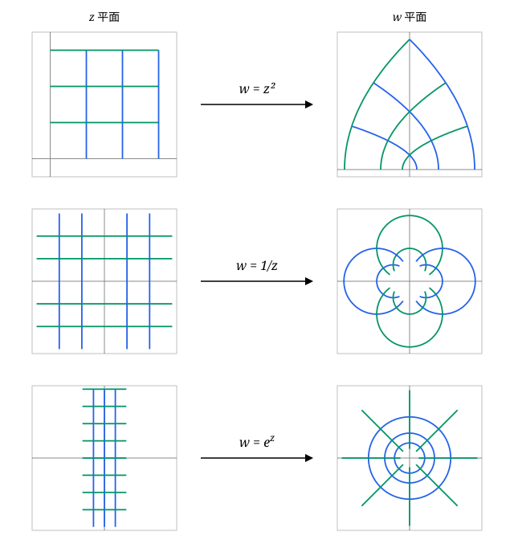

## 这一节要回答的问题

实函数$y=f(x)$可以画成平面上的曲线。:term[复变函数]{id="math.complex-analysis.complex-function"}（function of a complex variable）$w=f(z)$的自变量和函数值各占一个平面，它的图像要四维空间才放得下，怎样「看」它？$\sin x$、$\cos x$能不能推广到:term[复数]{id="math.complex-analysis.complex-number"}（complex number）上，推广以后还有界吗？

## 讲解

### 复变函数

::anchor{id="def-complex-function"}
设$D$是:term[复数]{id="math.complex-analysis.complex-number"}组成的集合。如果对$D$里的每个$z$，都有唯一的复数$w$和它对应，就说$w=f(z)$是定义在$D$上的:term[复变函数]{id="math.complex-analysis.complex-function"}。记$z=x+iy$、$w=u+iv$，则$u$、$v$都随$x$、$y$而定，$f(z)=u(x,y)+iv(x,y)$。

为什么这样定义：它和实函数的定义一字不差，只是把数换成了复数；写成$u+iv$以后，一个复变函数就是一对实函数$u(x,y)$、$v(x,y)$，例如$f(z)=z^2$时$u=x^2-y^2$，$v=2xy$。$f$把$z$平面上的点送到$w$平面上的点，是平面到平面的:term[映射]{id="math.logic-sets.map"}（mapping）：图像画不出来，就看它把一组曲线，比如方格网，变成什么。边界情况：$f(z)=\bar z$也是复变函数，$u=x$、$v=-y$，它把平面关于:term[实轴]{id="math.complex-analysis.real-axis"}（real axis）翻过来；$f(z)=|z|$只取实数值，同样是复变函数。

### $z^2$和$\frac1z$

用:term[指数形式]{id="math.complex-analysis.exponential-form"}（exponential form）看最清楚：$z=re^{i\theta}$时$z^2=r^2e^{2i\theta}$，:term[模]{id="math.complex-analysis.modulus"}（modulus）平方，:term[辐角]{id="math.complex-analysis.argument"}（argument）加倍。所以$z^2$把第一象限映成上半平面，把上半平面映成去掉射线$[0,+\infty)$以后的整个平面。竖线$x=c$（$c>0$）上的点$c+it$映成$(c^2-t^2)+2ct\,i$，消去$t$得$u=c^2-\frac{v^2}{4c^2}$，是开口向左的抛物线；横线$y=c$同样映成开口向右的抛物线$u=\frac{v^2}{4c^2}-c^2$。

$\frac1z=\frac1re^{-i\theta}$：模取倒数，辐角变号，单位圆的里外对调。竖线$x=c$（$c\ne0$）上的点映成$\frac1{c+it}=\frac{c-it}{c^2+t^2}$，于是$u^2+v^2=\frac1{c^2+t^2}=\frac uc$，即$\bigl(u-\frac1{2c}\bigr)^2+v^2=\frac1{4c^2}$：直线映成了过原点的圆，只是去掉了原点；横线同理。两族直线变成两族曲线，可像曲线（image curve）交成的角看上去仍是直角，[共形映射](lesson:math.complex-analysis.conformal-maps)一节会解释为什么。

### $e^z$

:term[复指数函数]{id="math.complex-analysis.complex-exponential"}（complex exponential function）$e^{x+iy}=e^xe^{iy}$里，:term[实部]{id="math.complex-analysis.real-part"}（real part）$x$决定:term[模]{id="math.complex-analysis.modulus"}$e^x$，:term[虚部]{id="math.complex-analysis.imaginary-part"}（imaginary part）$y$决定:term[辐角]{id="math.complex-analysis.argument"}。所以竖线$x=c$映成圆$|w|=e^c$，$y$每增加$2\pi$绕一圈；横线$y=c$映成从原点出发、辐角为$c$的射线，原点不在上面。带形$\{-\pi<\Im z\le\pi\}$里的点和$w$平面上除原点以外的点一一对应：每个$w\ne0$恰好是带形里$\ln|w|+i\Arg w$这一点的像，上下平移$2\pi$的带形映到的又是同一个平面。

### $\sin z$和$\cos z$

::anchor{id="def-complex-sin-cos"}
对:term[复数]{id="math.complex-analysis.complex-number"}$z$，规定$\cos z=\frac{e^{iz}+e^{-iz}}2$，$\sin z=\frac{e^{iz}-e^{-iz}}{2i}$。

为什么这样定义：$z=x$是实数时，由:term[欧拉公式]{id="math.complex-analysis.euler-formula"}（Euler's formula）$e^{\pm ix}=\cos x\pm i\sin x$，两式相加、相减正得到这两个式子，所以这是和欧拉公式一致的推广，并且$e^{iz}=\cos z+i\sin z$对一切复数$z$成立。三角恒等式也照样成立，因为它们都是指数法则的推论；例如把定义代进去展开，

$$
\begin{aligned}
\sin z\cos w+\cos z\sin w&=\frac{(e^{iz}-e^{-iz})(e^{iw}+e^{-iw})+(e^{iz}+e^{-iz})(e^{iw}-e^{-iw})}{4i}\\
&=\frac{e^{i(z+w)}-e^{-i(z+w)}}{2i},
\end{aligned}
$$

正是$\sin(z+w)$。同样可以验证$\sin^2z+\cos^2z=1$、$\cos(z+w)=\cos z\cos w-\sin z\sin w$，以及$2\pi$是周期。边界情况：恒等式照旧，不等式却不一定，下面就会看到$|\sin z|\le1$不再成立。

::anchor{id="thm-sin-modulus"}
**定理**　设$z=x+iy$，则$\cos(iy)=\cosh y$，$\sin(iy)=i\sinh y$，$\sin z=\sin x\cosh y+i\cos x\sinh y$，并且$|\sin z|^2=\sin^2x+\sinh^2y$。

**证明**：由定义，$\cos(iy)=\frac{e^{-y}+e^y}2=\cosh y$，$\sin(iy)=\frac{e^{-y}-e^y}{2i}=i\,\frac{e^y-e^{-y}}2$，正是$i\sinh y$。用加法公式，$\sin(x+iy)=\sin x\cos(iy)+\cos x\sin(iy)$，代入即得第三式。于是$|\sin z|^2=\sin^2x\cosh^2y+\cos^2x\sinh^2y$，再用$\cosh^2y=1+\sinh^2y$和$\sin^2x+\cos^2x=1$，得第四式。

为什么有用：$|\sin z|\ge|\sinh y|$，沿:term[虚轴]{id="math.complex-analysis.imaginary-axis"}（imaginary axis）走，$|\sin(iy)|=|\sinh y|$随$|y|$无限增大，复数里$\sin z$无界，和实数里$|\sin x|\le1$截然不同。零点却没有变多：$|\sin z|^2=0$迫使$\sin x=0$且$\sinh y=0$，即$z=k\pi$。$\cos(iy)=\cosh y$、$\sin(iy)=i\sinh y$还说明，双曲函数（hyperbolic functions）就是虚变量的三角函数。边界情况：在水平带形$|\Im z|\le M$里$|\sin z|^2\le1+\sinh^2M$，仍然有界，无界只发生在离:term[实轴]{id="math.complex-analysis.real-axis"}越来越远的地方。

## 几何图像

每行左边是$z$平面上的一组网格线，蓝色的是竖线，绿色的是横线；右边是它们在$w$平面上的像，颜色对应。$z^2$把第一象限的方格变成两族抛物线，$\frac1z$把直线变成过原点的圆，:term[复指数函数]{id="math.complex-analysis.complex-exponential"}$e^z$把竖线变成圆、横线变成射线。三行里蓝线的像和绿线的像都交成直角，和左边的方格一样；以后会看到，这是因为这几个函数都能求导，并且导数在这些交点处都不为$0$。

## 例题

### 例 1　$e^z$把带形映成什么

求$e^z$把带形$\{z:0<\Im z<\pi\}$映成的集合。

**为什么想到这么做**：$e^{x+iy}$的:term[模]{id="math.complex-analysis.modulus"}由$x$决定，:term[辐角]{id="math.complex-analysis.argument"}由$y$决定；带形里$x$任意，$y$在$0$和$\pi$之间。

**推导**：带形里的点$z=x+iy$映成$e^xe^{iy}$，模$e^x$取遍一切正数，辐角$y$取遍$(0,\pi)$，所以像落在上半平面$\{\Im w>0\}$里。反过来，上半平面里的$w$可以写成$|w|e^{i\theta}$，$0<\theta<\pi$，它是带形里$\ln|w|+i\theta$的像，而且只来自这一点。所以$e^z$把这个带形一一地映成整个上半平面。

### 例 2　解$\cos z=2$

求所有满足$\cos z=2$的:term[复数]{id="math.complex-analysis.complex-number"}$z$。

**为什么想到这么做**：实数里$|\cos x|\le1$，方程无解；复数里按定义，它是关于$e^{iz}$的二次方程。

**推导**：记$t=e^{iz}$，方程变成$\frac{t+t^{-1}}2=2$，即$t^2-4t+1=0$，$t=2\pm\sqrt3$。$e^{iz}=a$（$a>0$）时$e^{iz-\ln a}=1$，所以$iz=\ln a+2k\pi i$，$k$是整数。因为$(2+\sqrt3)(2-\sqrt3)=1$，$\ln(2-\sqrt3)=-\ln(2+\sqrt3)$，所以

$$
z=2k\pi\pm i\ln(2+\sqrt3)\approx2k\pi\pm1.317i.
$$

## 常见误区

- 「$|\sin z|\le1$。」对实数成立，对:term[复数]{id="math.complex-analysis.complex-number"}不一定：$|\sin(iy)|=|\sinh y|$可以任意大，例如$|\sin3i|=\sinh3\approx10.02$。
- 「$e^z$把直线映成直线。」竖线映成圆，横线映成从原点出发的射线（不含原点），斜线映成绕着原点转的螺线。
- 「复数里$\sin z$的零点比实数里多。」只有$z=k\pi$：$|\sin z|^2=\sin^2x+\sinh^2y=0$迫使$\sin x=0$、$y=0$。
