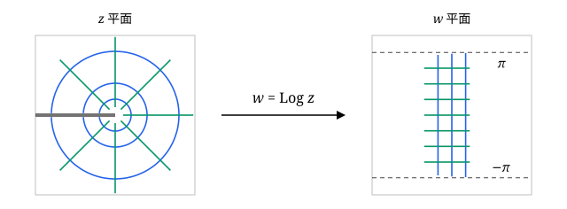

## 这一节要回答的问题

实数里$e^x=a$（$a>0$）只有一个解$\ln a$。:term[复指数函数]{id="math.complex-analysis.complex-exponential"}（complex exponential function）以$2\pi i$为周期，$e^w=z$在:term[复数]{id="math.complex-analysis.complex-number"}（complex number）里有多少个解？能不能从中挑出一个，像$\ln x$那样连续、可导？$i^i$、$(-8)^{1/3}$这样的式子又该怎样算？

## 讲解

### 多值的对数

::anchor{id="def-complex-log"}
设$z\ne0$。满足$e^w=z$的:term[复数]{id="math.complex-analysis.complex-number"}$w$都叫作$z$的:term[复对数]{id="math.complex-analysis.complex-logarithm"}（complex logarithm），记作$\log z$。

为什么这样定义：仿照实数里$\ln$是$e^x$的反函数。写$w=u+iv$，$e^ue^{iv}=z$当且仅当$e^u=|z|$、$v$是$z$的一个:term[辐角]{id="math.complex-analysis.argument"}（argument），所以$\log z=\ln|z|+i\arg z$，有无穷多个值，两两相差$2\pi i$的整数倍。例如$\log(-1)=(2k+1)\pi i$，$\log1=2k\pi i$（$k$是整数）。边界情况：$0$没有对数，因为$|e^w|=e^{\Re w}>0$；正实数$x$的对数里，:term[虚部]{id="math.complex-analysis.imaginary-part"}（imaginary part）为$0$的那一个正是$\ln x$。

::anchor{id="def-principal-log"}
取:term[辐角主值]{id="math.complex-analysis.principal-argument"}（principal argument）得到的$\Log z=\ln|z|+i\Arg z$叫作$z$的:term[对数主值]{id="math.complex-analysis.principal-logarithm"}（principal logarithm），它的虚部在$(-\pi,\pi]$里。

为什么这样定义：从无穷多个值里固定挑一个，才能当函数用；和辐角主值配套，正实数$x$的对数主值就是$\ln x$，又如$\Log(-1)=\pi i$，$\Log i=\frac{\pi i}2$。$\Log$是$e^z$在带形$-\pi<\Im z\le\pi$上的反函数（这个带形和$w\ne0$一一对应，见[复变函数与映射](lesson:math.complex-analysis.complex-functions)）：$e^{\Log z}=z$总成立，$\Log e^w=w$却只在$w$落在这个带形里时成立。边界情况：$\Log(z_1z_2)$和$\Log z_1+\Log z_2$可以不相等，比如$\Log(-1)+\Log(-1)=2\pi i$，而$\Log1=0$；两者只差$2\pi i$的整数倍。

### 分支与支割线

::anchor{id="thm-arg-continuous"}
**定理**　记$D=\C\setminus(-\infty,0]$，即去掉原点和:term[负实轴]{id="math.complex-analysis.real-axis"}（negative real axis）的平面。对$D$里的$z=x+iy$，$\Arg z=2\arctan\frac y{|z|+x}$，所以$\Arg z$和$\Log z$都在$D$上连续；在负实轴上的每一点，$\Arg z$都不连续。

**证明**：设$z=re^{i\theta}$，$\theta=\Arg z$。$z$在$D$里时$\theta\in(-\pi,\pi)$，$\cos\theta\ne-1$，由半角公式，$\tan\frac\theta2=\frac{\sin\theta}{1+\cos\theta}=\frac y{r+x}$；又$\frac\theta2$落在$\bigl(-\frac\pi2,\frac\pi2\bigr)$里，正是反正切函数（arctangent）的值域，所以$\theta=2\arctan\frac y{r+x}$。$D$里$r+x>0$：$x>0$时显然，$x\le0$时$y\ne0$，$r>|x|$。

所以$\Arg z$是连续函数复合而成，连续；$\ln|z|$也连续，$\Log z$连续。负实轴上的点$-a$（$a>0$）处$\Arg(-a)=\pi$，可$\varepsilon\to0^+$时$\Arg(-a-i\varepsilon)\to-\pi$，所以$\Arg z$在那里不连续。

::anchor{id="def-branch"}
设$G$是:term[区域]{id="math.complex-analysis.domain"}（domain），$F$在$G$上连续，并且对$G$里的每个$z$都有$e^{F(z)}=z$，就说$F$是$\log z$在$G$上的一个:term[分支]{id="math.complex-analysis.branch"}（branch）。为了得到分支而从平面上去掉的曲线叫作:term[支割线]{id="math.complex-analysis.branch-cut"}（branch cut）。

为什么这样定义：多值的$\log z$没法直接谈连续、求导，挑出连续的一个值就可以。由上面的定理，$\Log$是$\log z$在$D$上的一个分支，支割线是负实轴；$\Log z+2k\pi i$也是。换一条支割线，比如去掉原点和:term[负虚轴]{id="math.complex-analysis.imaginary-axis"}（negative imaginary axis），让:term[辐角]{id="math.complex-analysis.argument"}取在$\bigl(-\frac\pi2,\frac{3\pi}2\bigr)$里，又得到别的分支。边界情况：去掉原点的整个平面上没有分支：要是有，$\Im F(e^{it})-t$在$[0,2\pi]$上连续、只取$2\pi$的整数倍，由介值定理（intermediate value theorem）它是常数，可$t=0$、$t=2\pi$对应同一点$1$，算出的值却相差$2\pi$，矛盾。

### 对数的导数

::anchor{id="thm-log-derivative"}
**定理**　$\log z$在:term[区域]{id="math.complex-analysis.domain"}$G$上的任何一个:term[分支]{id="math.complex-analysis.branch"}$F$都在$G$上:term[全纯]{id="math.complex-analysis.holomorphic-function"}（holomorphic），并且$F'(z)=\frac1z$。特别地，$\Log$在$D$上全纯，$(\Log z)'=\frac1z$。

**证明**：设$z_0\in G$，$w_0=F(z_0)$。$z\in G$、$z\ne z_0$时记$w=F(z)$，则$e^w=z\ne z_0$，所以$w\ne w_0$，

$$
\frac{F(z)-F(z_0)}{z-z_0}=\frac{w-w_0}{e^w-e^{w_0}}.
$$

$z\to z_0$时，由$F$连续，$w\to w_0$；$e^w$在$w_0$处的:term[复导数]{id="math.complex-analysis.complex-derivative"}（complex derivative）是$e^{w_0}\ne0$（见[$e^z$全纯](lesson:math.complex-analysis.holomorphic#thm-exp-holomorphic)），所以右边趋于$\frac1{e^{w_0}}$，即$\frac1{z_0}$。

为什么有用：这和实数里的反函数的求导法则（inverse function rule）是同一个道理，只是要先有连续的分支，「$w\to w_0$」才说得通。于是在$D$里，$\Log z$是一个导数为$\frac1z$的全纯函数；在去掉原点的整个平面上，由上面的边界情况，$\log z$连一个分支都没有。边界情况：$\Log$在:term[负实轴]{id="math.complex-analysis.real-axis"}上不连续，更谈不上可导，尽管$\frac1z$在那里好好的。

### 复数的幂

::anchor{id="def-power"}
设$a$是:term[复数]{id="math.complex-analysis.complex-number"}。对$z\ne0$，规定$z^a=e^{a\log z}$，它的值随$\log z$的取法而定；$z\mapsto z^a$叫作:term[幂函数]{id="math.complex-analysis.power-function"}（power function），取$\Log z$得到的$e^{a\Log z}$叫作$z^a$的主值。

为什么这样定义：实数里$x^a=e^{a\ln x}$（$x>0$），这里把$\ln$换成:term[复对数]{id="math.complex-analysis.complex-logarithm"}。主值在$D$上:term[全纯]{id="math.complex-analysis.holomorphic-function"}：由[求导法则](lesson:math.complex-analysis.complex-derivative#thm-derivative-rules)，$(e^{a\Log z})'=e^{a\Log z}\cdot\frac az=ae^{(a-1)\Log z}$，即$az^{a-1}$（都取主值）。边界情况：$a$不是整数时，主值在:term[负实轴]{id="math.complex-analysis.real-axis"}上不连续，比如$z^{1/2}$的主值从上方趋于$-1$时趋于$i$，从下方趋于$-1$时趋于$-i$。

::anchor{id="thm-power-values"}
**定理**　设$z\ne0$。$a$是整数时，$z^a$只有一个值，就是$z$（或$\frac1z$）自乘的结果；$a=\frac pq$（$q\ge2$，$p$、$q$互素）时，$z^a$恰有$q$个值，就是$z^p$的全部:term[$q$次方根]{id="math.complex-analysis.nth-root"}（nth root）；$a$是无理数或者不是实数时，$z^a$有无穷多个值。

**证明**：$z^a$的各个值是$e^{a(\Log z+2k\pi i)}=e^{a\Log z}e^{2k\pi ia}$（$k$是整数）。$k$、$m$给出的值相同，当且仅当$e^{2(k-m)\pi ia}=1$，即$(k-m)a$是整数，因为$e^w=1$当且仅当$w$是$2\pi i$的整数倍（见[指数法则](lesson:math.complex-analysis.complex-exponential#thm-exp-addition)）。$a$是整数时这对一切$k$、$m$成立，只有一个值，由指数法则它是$(e^{\Log z})^a$；$a=\frac pq$时它成立当且仅当$q$整除$k-m$，恰有$q$个不同的值，它们的$q$次方都是$e^{p\Log z}$，即$z^p$。$a$是无理数或不是实数时，只有$k=m$才成立，值两两不同。

为什么有用：例如$i^i=e^{i\log i}=e^{-\frac\pi2-2k\pi}$，每个值都是正实数，主值是$e^{-\pi/2}\approx0.208$。$a=\frac1n$时，$z^{1/n}$的$n$个值正是[复数的$n$次方根](lesson:math.complex-analysis.complex-roots#thm-nth-roots)一节的$n$个方根，主值是:term[辐角]{id="math.complex-analysis.argument"}在$\bigl(-\frac\pi n,\frac\pi n\bigr]$里的那一个。边界情况：$z^az^b=z^{a+b}$对主值成立，两边都是$e^{(a+b)\Log z}$；$(z^a)^b=z^{ab}$却不一定，见常见误区。

## 几何图像

左边是去掉:term[负实轴]{id="math.complex-analysis.real-axis"}以后的$z$平面，蓝色的圆是$|z|=\frac12,1,2$，绿色的射线:term[辐角]{id="math.complex-analysis.argument"}是$\frac{k\pi}4$（$k=-3,\dots,3$）；右边是它们在$\Log$下的像。圆变成竖直线段$\Re w=\ln|z|$，从$-\pi$走到$\pi$；射线变成水平线段$\Im w=\theta$。负实轴的上岸、下岸分别贴到带形的上边$\Im w=\pi$和下边$\Im w=-\pi$，相距$2\pi$，所以$\Log$在那里断开。

## 例题

### 例 1　解$e^z=1+\sqrt3i$

**为什么想到这么做**：满足$e^z=w$的$z$正是$w$的:term[复对数]{id="math.complex-analysis.complex-logarithm"}，先把$w$写成:term[指数形式]{id="math.complex-analysis.exponential-form"}（exponential form）。

**推导**：$1+\sqrt3i=2e^{i\pi/3}$，所以$z=\log(1+\sqrt3i)=\ln2+i\bigl(\frac\pi3+2k\pi\bigr)$，$k$是整数；主值是$\ln2+\frac{\pi i}3$。验算：$e^{\ln2+\pi i/3}=2\bigl(\cos\frac\pi3+i\sin\frac\pi3\bigr)=1+\sqrt3i$。

### 例 2　$(-8)^{1/3}$的主值

**为什么想到这么做**：照定义，主值是$e^{\frac13\Log(-8)}$；全部的值是$-8$的三个立方根。

**推导**：$\Log(-8)=\ln8+\pi i$，所以主值是$e^{\frac13\ln8+\frac{\pi i}3}=2e^{\pi i/3}=1+\sqrt3i$。全部三个值是$2e^{i(\pi+2k\pi)/3}$，$k=0,1,2$，即$1+\sqrt3i$、$-2$、$1-\sqrt3i$，和[复数的$n$次方根](lesson:math.complex-analysis.complex-roots)一节的例 1 一致。实数立方根$-2$不是主值：主值的:term[辐角]{id="math.complex-analysis.argument"}是$\frac13\Arg(-8)=\frac\pi3$。

## 常见误区

- 「$\Log(z_1z_2)=\Log z_1+\Log z_2$。」只能说两边差$2\pi i$的整数倍：$\Log(-1)+\Log(-1)=2\pi i$，而$\Log\bigl((-1)(-1)\bigr)=0$。
- 「$(z^a)^b=z^{ab}$。」对主值不一定成立：$\bigl((-1)^2\bigr)^{1/2}$的主值是$1^{1/2}=1$，而$(-1)^1=-1$。
- 「$(-8)^{1/3}=-2$。」当作:term[复数]{id="math.complex-analysis.complex-number"}的幂，$(-8)^{1/3}$有三个值，$-2$只是其中一个，主值是$1+\sqrt3i$（例 2）；在实数里约定立方根取实数，才把它写成$-2$。
