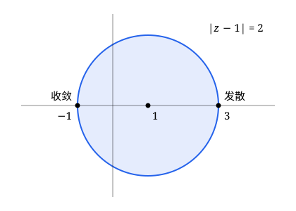

## 这一节要回答的问题

实数的幂级数（power series）$\sum a_n(x-x_0)^n$在一个区间里收敛。把$x$换成:term[复数]{id="math.complex-analysis.complex-number"}（complex number）$z$，系数也允许是复数，收敛的范围是什么形状？和函数（sum function）在复数的意义下可导吗，导数是不是逐项求导？

## 讲解

### 收敛圆盘

::anchor{id="thm-complex-abel"}
**定理**　设$a$、$z_1$、$a_n$都是:term[复数]{id="math.complex-analysis.complex-number"}，$z_1\ne a$，并且数列$\{a_n(z_1-a)^n\}$有界，比如$\sum a_n(z_1-a)^n$收敛。则对满足$|z-a|<|z_1-a|$的每个$z$，$\sum a_n(z-a)^n$绝对收敛（absolute convergence）。这是复数版的阿贝尔引理（Abel's lemma）。

**证明**：设$|a_n(z_1-a)^n|\le M$。记$q=\frac{|z-a|}{|z_1-a|}<1$，则$|a_n(z-a)^n|=|a_n(z_1-a)^n|q^n\le Mq^n$。由比较判别法（comparison test），$\sum|a_n(z-a)^n|$收敛；各项取:term[模]{id="math.complex-analysis.modulus"}（modulus）以后收敛的:term[复数项级数]{id="math.complex-analysis.complex-series"}（complex series）一定收敛（见[欧拉公式与复指数](lesson:math.complex-analysis.complex-exponential#def-complex-series)）。

::anchor{id="def-disc-of-convergence"}
对复系数的幂级数$\sum a_n(z-a)^n$，取实幂级数$\sum|a_n|x^n$的收敛半径（radius of convergence）$R$（$0\le R\le+\infty$），圆盘$\{z:|z-a|<R\}$叫作它的:term[收敛圆盘]{id="math.complex-analysis.disc-of-convergence"}（disc of convergence），$R$也叫这个复幂级数的收敛半径。

为什么这样定义：由下面的定理，$|z-a|<R$时级数绝对收敛，$|z-a|>R$时发散，收敛的点都在这个圆盘和它的边界上，「收敛半径」这个名字正是由此而来。由柯西-阿达马公式（Cauchy-Hadamard formula），$R=\frac1\rho$，$\rho=\limsup\sqrt[n]{|a_n|}$，只和$|a_n|$有关。边界情况：圆周$|z-a|=R$上什么都可能发生：$\sum z^n$在$|z|=1$上处处发散（通项的模是$1$），$\sum\frac{z^n}{n^2}$处处收敛，例 1 的级数有的点收敛、有的点发散。

::anchor{id="thm-disc-of-convergence"}
**定理**　设$R$是$\sum a_n(z-a)^n$的收敛半径。$|z-a|<R$时级数绝对收敛，$|z-a|>R$时级数发散。

**证明**：$|z-a|<R$时，由实幂级数收敛半径的定义，有使$\sum|a_n|x_1^n$收敛的$x_1>|z-a|$，再由[阿贝尔引理](lesson:math.analysis.power-series-theory#thm-abel-lemma)，$\sum|a_n||z-a|^n$收敛，即原级数绝对收敛。$|z-a|>R$时，假如原级数收敛，取$r$满足$R<r<|z-a|$，由上面的定理（把$z_1$取成这个$z$，把$z$取成$a+r$），$\sum|a_n|r^n$收敛，和$r>R$矛盾。

### 逐项求导

::anchor{id="thm-termwise-complex"}
**定理**　设$\sum a_n(z-a)^n$的收敛半径$R>0$，和函数是$f(z)$。则$f$在:term[收敛圆盘]{id="math.complex-analysis.disc-of-convergence"}里:term[全纯]{id="math.complex-analysis.holomorphic-function"}（holomorphic），$f'(z)=\sum_{n\ge1}na_n(z-a)^{n-1}$，右边的收敛半径也是$R$。

**证明**：不妨设$a=0$。由[逐项求导的定理](lesson:math.analysis.power-series-theory#thm-termwise)的（1），实级数$\sum n|a_n|x^{n-1}$、$\sum n(n-1)|a_n|x^{n-2}$的收敛半径都是$R$，所以右边级数的收敛半径是$R$。取定$|z|<R$，再取$r$满足$|z|<r<R$。$0<|h|\le r-|z|$时，由二项式定理，

$$
\frac{(z+h)^n-z^n}h-nz^{n-1}=\sum_{k=2}^n\binom nkz^{n-k}h^{k-1}.
$$

$k\ge2$时$\binom nk=\frac{n(n-1)}{k(k-1)}\binom{n-2}{k-2}\le\frac{n(n-1)}2\binom{n-2}{k-2}$，所以右边的:term[模]{id="math.complex-analysis.modulus"}不超过$|h|\cdot\frac{n(n-1)}2(|z|+|h|)^{n-2}$，也就不超过$|h|\cdot\frac{n(n-1)}2r^{n-2}$。于是

$$
\Bigl|\frac{f(z+h)-f(z)}h-\sum_{n\ge1}na_nz^{n-1}\Bigr|\le|h|\sum_{n\ge2}\frac{n(n-1)}2|a_n|r^{n-2},
$$

右边的级数收敛，$h\to0$时整个式子趋于$0$。

为什么有用：幂级数在收敛圆盘里不光可导，导数还是幂级数，可以一直求下去：$f$无穷次可导，逐项求导$k$次再令$z=a$，得$f^{(k)}(a)=k!\,a_k$。所以系数由和函数决定：两个幂级数在$a$附近的和函数相同，系数就相同。边界情况：逐项求导可能让圆周上的收敛性变坏，$\sum\frac{z^n}{n^2}$在$|z|=1$上处处收敛，求导以后的$\sum\frac{z^{n-1}}n$在$z=1$处发散。

### 指数函数的幂级数

::anchor{id="thm-exp-power-series"}
**定理**　对一切:term[复数]{id="math.complex-analysis.complex-number"}$z$，$e^z=\sum_{n=0}^\infty\frac{z^n}{n!}$。

**证明**：记右边为$E(z)$。它对每个$z$绝对收敛（见[欧拉公式与复指数](lesson:math.complex-analysis.complex-exponential#thm-exp-series)），收敛半径是$+\infty$；由上面的定理，$E$处处:term[全纯]{id="math.complex-analysis.holomorphic-function"}，$E'(z)=\sum_{n\ge1}\frac{z^{n-1}}{(n-1)!}=E(z)$。令$g(z)=E(z)e^{-z}$，则$g'(z)=E(z)e^{-z}-E(z)e^{-z}=0$。对任一$z$，$\varphi(t)=g(tz)$（$0\le t\le1$）的导数是$g'(tz)z=0$，它的:term[实部]{id="math.complex-analysis.real-part"}（real part）、:term[虚部]{id="math.complex-analysis.imaginary-part"}（imaginary part）都是导数为$0$的实函数，是常数，所以$g(z)=g(0)=1$，即$E(z)=e^z$。

为什么有用：:term[复指数函数]{id="math.complex-analysis.complex-exponential"}（complex exponential function）先用$e^x(\cos y+i\sin y)$定义，这里证明它和级数$\sum\frac{z^n}{n!}$是同一个函数，兑现了[欧拉公式与复指数](lesson:math.complex-analysis.complex-exponential#def-complex-exp)一节说的「两种定义给出同一个函数」。由$e^{iz}$、$e^{-iz}$的级数相加减，又得$\cos z=\sum\frac{(-1)^nz^{2n}}{(2n)!}$、$\sin z=\sum\frac{(-1)^nz^{2n+1}}{(2n+1)!}$，对一切复数成立。边界情况：这里用的是$E'=E$、$E(0)=1$在整个:term[复平面]{id="math.complex-analysis.complex-plane"}（complex plane）上成立；只凭一段:term[实轴]{id="math.complex-analysis.real-axis"}（real axis）上$E(x)=e^x$，现在还推不出整个复平面上相等，以后[零点的孤立性与唯一性定理](lesson:math.complex-analysis.identity-theorem)一节会说明其实推得出。

## 几何图像

例 1 的级数$\sum\frac{(z-1)^n}{n\cdot2^n}$的:term[收敛圆盘]{id="math.complex-analysis.disc-of-convergence"}是$|z-1|<2$（淡蓝色）。圆盘里每一点都绝对收敛，外面每一点都发散；边界圆周上，$z=3$处是调和级数（harmonic series），发散，$z=-1$处是交错调和级数（alternating harmonic series），收敛。实数的收敛区间$(-1,3)$正是这个圆盘和:term[实轴]{id="math.complex-analysis.real-axis"}相交的那一段。

## 例题

### 例 1　求收敛圆盘

求$\sum_{n=1}^\infty\frac{(z-1)^n}{n\cdot2^n}$的:term[收敛圆盘]{id="math.complex-analysis.disc-of-convergence"}，并判断它在$z=3$、$z=-1$处是否收敛。

**为什么想到这么做**：收敛半径只看$|a_n|=\frac1{n\cdot2^n}$，用柯西-阿达马公式；圆周上的点要单独判断。

**推导**：$\sqrt[n]{|a_n|}=\frac1{2\sqrt[n]n}\to\frac12$，所以$R=2$，收敛圆盘是$|z-1|<2$。$z=3$时级数是$\sum\frac1n$，发散；$z=-1$时是$\sum\frac{(-1)^n}n$，收敛。两点都在圆周上，结果却不同。

### 例 2　用逐项求导求和

求$\sum_{n=1}^\infty nz^n$的:term[收敛圆盘]{id="math.complex-analysis.disc-of-convergence"}和它的和。

**为什么想到这么做**：$nz^n=z\cdot nz^{n-1}$，而$nz^{n-1}$是$z^n$的导数；先求$\sum z^n$的和，再逐项求导。

**推导**：$|z|<1$时$\sum_{n=0}^\infty z^n=\frac1{1-z}$，因为部分和是$\frac{1-z^{N+1}}{1-z}$，而$|z^{N+1}|\to0$；收敛半径是$1$。由逐项求导的定理，$|z|<1$时$\sum_{n\ge1}nz^{n-1}=\bigl(\frac1{1-z}\bigr)'$，即$\frac1{(1-z)^2}$，乘以$z$得$\sum_{n=1}^\infty nz^n=\frac z{(1-z)^2}$，收敛半径仍是$1$。例如$z=\frac12$时和是$2$。

## 常见误区

- 「复幂级数在收敛圆周上要么处处收敛，要么处处发散。」例 1 的级数在$z=3$处发散、在$z=-1$处收敛。
- 「实幂级数在$(-R,R)$里收敛，复幂级数收敛的范围也只是:term[实轴]{id="math.complex-analysis.real-axis"}上的这一段。」复幂级数在整个圆盘$|z-a|<R$里都收敛，实轴上的区间只是圆盘的一条直径。
- 「逐项求导以后，收敛的范围连圆周上的点也不变。」收敛半径不变，圆周上却可能变：$\sum\frac{z^n}{n^2}$在$|z|=1$上处处收敛，逐项求导得$\sum\frac{z^{n-1}}n$，在$z=1$处发散。
