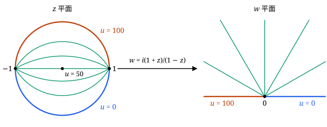

## 这一节要回答的问题

平板上不再随时间变化的温度，电磁学里没有:term[电荷]{id="physics.electromagnetism.electric-charge"}（electric charge）的地方的:term[电势]{id="physics.electromagnetism.electric-potential"}（electric potential），都是调和函数（harmonic function），由边界上的值决定。边界是两段直线、一个圆周时，怎样写出:term[区域]{id="math.complex-analysis.domain"}（domain）里的解？能不能先把区域变成简单的形状，在那里解完再变回来？

## 讲解

### 调和函数在共形映射下仍调和

::anchor{id="thm-harmonic-composition"}
**定理**　设$\varphi$在:term[开集]{id="math.complex-analysis.open-set"}（open set）$D$上:term[全纯]{id="math.complex-analysis.holomorphic-function"}（holomorphic），把$D$映进开集$G$，$U$在$G$上调和。则$u=U\circ\varphi$在$D$上调和。

**证明**：任取$z_0\in D$，取以$\varphi(z_0)$为圆心、含在$G$里的:term[开圆盘]{id="math.complex-analysis.open-disc"}（open disc）$\Delta$。由[圆盘里一定有共轭调和函数](lesson:math.complex-analysis.harmonic-functions#thm-conjugate-disc)，$\Delta$上$U=\Re F$，$F$全纯。$\varphi$连续，$z_0$附近有一个开圆盘被$\varphi$映进$\Delta$，在那里$u=\Re(F\circ\varphi)$，而$F\circ\varphi$全纯，由[全纯函数的实部和虚部](lesson:math.complex-analysis.harmonic-functions#thm-real-part-harmonic)，$u$在$z_0$附近调和。

为什么有用：要在复杂的:term[区域]{id="math.complex-analysis.domain"}$D$上解调和问题，先找一个全纯的一一映射$\varphi$把$D$映成简单的区域$G$，在$G$上写出解$U$，再拉回来，$u=U\circ\varphi$就是$D$上的解，边界上的值也跟着对应过去。常用的简单区域是上半平面：圆盘可以用:term[分式线性变换]{id="math.complex-analysis.mobius-transformation"}（Möbius transformation）映成上半平面，扇形、带形可以用[共形映射](lesson:math.complex-analysis.conformal-maps#thm-sector-strip)一节的$z^n$、$e^z$映成上半平面。边界情况：光滑的一一映射不行：$U=x$调和，$(x,y)\mapsto(x^2,y)$是右半平面到自身的光滑的一一映射，复合以后的$x^2$却不调和。

### 上半平面上的台阶

::anchor{id="thm-half-plane-step"}
**定理**　设$x_0$是实数，$s(z)=\frac1\pi\Arg(z-x_0)$。则$s$在上半平面上调和，$0<s<1$；$z$在上半平面里趋于:term[实轴]{id="math.complex-analysis.real-axis"}（real axis）上的点$x$时，$x>x_0$则$s(z)\to0$，$x<x_0$则$s(z)\to1$。

**证明**：$z$在上半平面时$z-x_0$也在上半平面，不在负实轴上，$\Log(z-x_0)$:term[全纯]{id="math.complex-analysis.holomorphic-function"}，它的:term[虚部]{id="math.complex-analysis.imaginary-part"}（imaginary part）$\Arg(z-x_0)$调和，取值在$0$和$\pi$之间。由$\Arg w=2\arctan\frac{\Im w}{|w|+\Re w}$（[复对数与幂函数](lesson:math.complex-analysis.complex-logarithm#thm-arg-continuous)一节），$w$从上半平面趋于正实轴上的点时$\Arg w\to0$；趋于负实轴上的点时，分母比分子小得多，$\frac{\Im w}{|w|+\Re w}\to+\infty$，$\Arg w\to\pi$。

为什么有用：实轴上$x<x_0$处为$T_1$、$x>x_0$处为$T_2$时，有界的解是$T_2+(T_1-T_2)s(z)$；边界值分成几段常数，就把几个这样的台阶加起来（例 1）。它的等值线是从$x_0$出发的射线。边界情况：$x_0$这一点本身，温度从$T_1$跳到$T_2$，$s$在那里没有极限，沿不同的射线趋于$x_0$，得到$0$和$1$之间不同的值。

### 解的唯一性

::anchor{id="thm-uniqueness"}
**定理**　设$D$是有界的:term[区域]{id="math.complex-analysis.domain"}，$u_1$、$u_2$在$D$连同边界上连续、在$D$里调和，在边界上相等。则$u_1=u_2$。

**证明**：$w=u_1-u_2$在$D$里调和，在$D$连同边界组成的有界闭区域（bounded closed region）上连续，边界上为$0$。由最值定理（extreme value theorem），$w$取到最大值和最小值；在$D$里取到时，由[调和函数的最大值原理](lesson:math.complex-analysis.maximum-modulus#thm-min-harmonic)，$w$在$D$里是常数，由连续性边界上也取这个值。所以最大值、最小值都能在边界上取到，都是$0$，$w=0$。

为什么有用：边界值定了，找到的解就是唯一的解；物理上，边界上的温度决定了内部的温度。边界情况：区域无界时要加条件：上半平面里$u=0$和$u=y$都调和、在:term[实轴]{id="math.complex-analysis.real-axis"}上都为$0$。可以证明，再要求解有界，上半平面上的解就唯一了，这里不证；前面的台阶都是有界的。

## 几何图像

左边是例 2 的圆盘，上半圆周（橙）温度$100$，下半圆周（蓝）温度$0$；右边是它在$w=i\frac{1+z}{1-z}$下的像（image），:term[负实轴]{id="math.complex-analysis.real-axis"}上$100$、正实轴上$0$。右边的等温线是从原点出发的射线，:term[辐角]{id="math.complex-analysis.argument"}（argument）为$\frac\pi6,\frac\pi3,\dots,\frac{5\pi}6$，温度约为$17$、$33$、$50$、$67$、$83$。拉回左边，射线变成经过$\pm1$的圆弧，因为:term[分式线性变换]{id="math.complex-analysis.mobius-transformation"}把直线映成圆或直线；温度$50$的那条是直径。

## 例题

### 例 1　中间一段是冷的

:term[实轴]{id="math.complex-analysis.real-axis"}上$|x|<1$处温度为$0$，$|x|>1$处为$100$。求上半平面里有界的温度分布，并求$z=i$处的温度。

**为什么想到这么做**：边界值分三段常数，用两个台阶相加。

**推导**：记$s_a(z)=\frac1\pi\Arg(z-a)$。$100s_{-1}$在$x<-1$处趋于$100$、$x>-1$处趋于$0$；$100(1-s_1)$在$x>1$处趋于$100$、$x<1$处趋于$0$。所以$u=100s_{-1}+100(1-s_1)$，即$u=100+\frac{100}\pi\bigl(\Arg(z+1)-\Arg(z-1)\bigr)$。$z=i$时$\Arg(i+1)=\frac\pi4$，$\Arg(i-1)=\frac{3\pi}4$，所以$u(i)=50$；$\Arg(z-1)-\Arg(z+1)$正是线段$[-1,1]$在$z$处张开的角，温度是$100$减去这个角的$\frac{100}\pi$倍。

### 例 2　上半圆周热、下半圆周冷

单位圆周上，上半圆周温度为$100$，下半圆周温度为$0$。求圆盘里的温度分布和圆心的温度。

**为什么想到这么做**：$w=i\frac{1+z}{1-z}$把单位圆盘映成上半平面，它是[分式线性变换](lesson:math.complex-analysis.mobius)一节例 1 那个:term[映射]{id="math.logic-sets.map"}（map）的逆映射；先看圆周映到哪里。

**推导**：$z=e^{it}$时，$i\frac{1+e^{it}}{1-e^{it}}=i\frac{e^{-it/2}+e^{it/2}}{e^{-it/2}-e^{it/2}}=-\cot\frac t2$，上半圆周（$0<t<\pi$）映成:term[负实轴]{id="math.complex-analysis.real-axis"}，下半圆周映成正实轴。上半平面里负实轴上为$100$、正实轴上为$0$的解是$\frac{100}\pi\Arg w$，所以$u(z)=\frac{100}\pi\Arg\Bigl(i\frac{1+z}{1-z}\Bigr)$。圆心$z=0$映成$i$，$u(0)=50$，正是边界温度的平均值，和:term[平均值性质]{id="math.complex-analysis.mean-value-property"}（mean value property）的说法一致。

## 常见误区

- 「拉回原:term[区域]{id="math.complex-analysis.domain"}以后，等温线还是直线。」一般不是：例 2 的等温线是经过$\pm1$的圆弧，只有中间那条是直径。
- 「$\frac1\pi\Arg z$在原点的值是$\frac12$。」原点是两段边界的交点，那里没有定义，也没有极限：沿:term[辐角]{id="math.complex-analysis.argument"}为$\theta$的射线趋于原点，极限是$\frac\theta\pi$。
- 「圆盘里每一点的温度都是边界温度的平均值。」一般只有圆心是（:term[平均值性质]{id="math.complex-analysis.mean-value-property"}）：例 2 里$z=\frac i2$处的温度约是$79.5$，不是$50$（第 4 题）。
