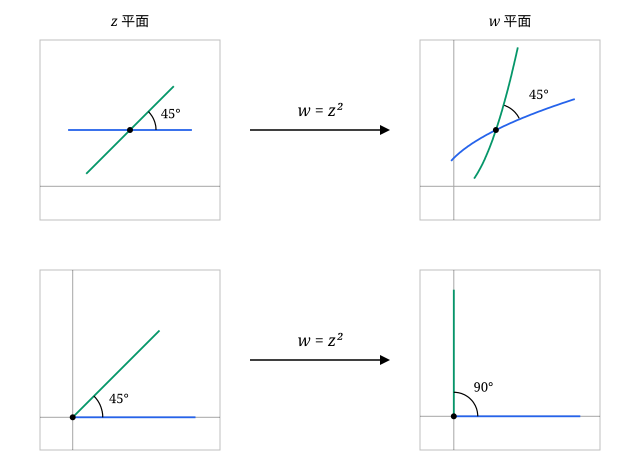

## 这一节要回答的问题

[复变函数与映射](lesson:math.complex-analysis.complex-functions)一节的图里，$z^2$、$\frac1z$、$e^z$把方格变成两族曲线，交出的角看上去都是直角。这是巧合，还是:term[全纯]{id="math.complex-analysis.holomorphic-function"}（holomorphic）函数的共性？$z^2$在原点处为什么例外？给定一个:term[区域]{id="math.complex-analysis.domain"}（domain），比如扇形、带形，怎样求它在这些函数下的像？

## 讲解

### 曲线在一点的夹角

::anchor{id="def-curve-angle"}
设两条曲线$z_1(t)$、$z_2(t)$在$t=0$时都经过$z_0$，在$t=0$处可导，并且$z_1'(0)\ne0$、$z_2'(0)\ne0$。从$z_1'(0)$逆时针转到$z_2'(0)$的角，也就是$\arg\frac{z_2'(0)}{z_1'(0)}$，叫作第一条曲线到第二条曲线在$z_0$处的夹角。

为什么这样定义：$z'(0)$是曲线在$z_0$处的切向量（tangent vector），指出曲线从$z_0$出发的方向，两条曲线的夹角就是两个切向量的夹角。用商的:term[辐角]{id="math.complex-analysis.argument"}（argument）来定义，既记下角的大小，也记下转向：逆时针为正，两条曲线交换次序，夹角变号。这里只用到$t=0$这一点的导数，不要求曲线是光滑曲线（smooth curve）。边界情况：$z'(0)=0$时没有方向，比如$z(t)=t^3(1+i)$在$t=0$处导数为$0$，这样的曲线不在定义里；夹角只确定到$2\pi$的整数倍。

### 全纯函数保角

::anchor{id="thm-conformal"}
**定理**　设$f$在$z_0$附近:term[全纯]{id="math.complex-analysis.holomorphic-function"}，$f'(z_0)\ne0$。经过$z_0$的曲线$z(t)$（$z(0)=z_0$，$z'(0)\ne0$）的像$w(t)=f(z(t))$在$t=0$处可导，$w'(0)=f'(z_0)z'(0)$：切向量转了$\arg f'(z_0)$，长度乘$|f'(z_0)|$。所以任意两条这样的曲线，它们的像在$f(z_0)$处的夹角和原来的夹角相等，大小和转向都不变。

**证明**：由沿曲线的[求导法则](lesson:math.complex-analysis.complex-derivative#thm-derivative-rules)，$w'(0)=f'(z(0))z'(0)=f'(z_0)z'(0)$，它不为$0$。两条曲线的像在$t=0$处的切向量之比是$\frac{f'(z_0)z_2'(0)}{f'(z_0)z_1'(0)}=\frac{z_2'(0)}{z_1'(0)}$，:term[辐角]{id="math.complex-analysis.argument"}不变，所以夹角不变。乘以:term[复数]{id="math.complex-analysis.complex-number"}（complex number）$f'(z_0)$就是转$\arg f'(z_0)$角、伸缩为$|f'(z_0)|$倍（见[乘法是旋转加伸缩](lesson:math.complex-analysis.complex-numbers#thm-multiplication)）。

为什么有用：这就是$z^2$、$\frac1z$、$e^z$的网格交成直角的原因：方格的两族线在每个交点处成直角，这几个函数在那些交点处导数都不为$0$。它也是[局部线性近似](lesson:math.complex-analysis.complex-derivative#thm-local-linear)的另一种说法：$z_0$附近$f$像是先转一个角、再伸缩，小图形的形状大致不变。边界情况：$\bar z$保持夹角的大小，却把转向反过来（切向量都取:term[共轭]{id="math.complex-analysis.conjugate"}（complex conjugate），商的辐角变号）；它也不全纯。

::anchor{id="def-conformal"}
设$f$在:term[区域]{id="math.complex-analysis.domain"}$G$上全纯，并且处处$f'(z)\ne0$，就说$f$是$G$上的:term[共形映射]{id="math.complex-analysis.conformal-map"}（conformal map），也叫保角映射。

为什么这样定义：由上面的定理，这样的$f$在$G$的每一点都保持夹角的大小和转向，「共形」说的正是小处的形状不变。很多书还要求$f$是一一的；这里不要求，需要时另外说明。边界情况：$e^z$在整个:term[复平面]{id="math.complex-analysis.complex-plane"}（complex plane）上是共形映射，因为$(e^z)'=e^z\ne0$，可它不是一一的；$z^2$在去掉原点的平面上是共形映射，在含原点的区域上不是。

### 导数为零的点

$f'(z_0)=0$时上面的定理不管用。$f(z)=z^n$（$n\ge2$）在原点：从原点出发、:term[辐角]{id="math.complex-analysis.argument"}为$\alpha$的射线$z(t)=te^{i\alpha}$（$t\ge0$）映成$w(t)=t^ne^{in\alpha}$，是辐角为$n\alpha$的射线，所以两条射线的夹角放大成$n$倍。这时$w'(0)=0$，像的方向要看$\frac{w(t)}{|w(t)|}=e^{in\alpha}$。以后在[全纯函数的幂级数展开](lesson:math.complex-analysis.power-series)一节会看到，一般的:term[全纯]{id="math.complex-analysis.holomorphic-function"}函数在$f'(z_0)=0$的点附近，$f(z)-f(z_0)$像$c(z-z_0)^n$（$c\ne0$，$n\ge2$），夹角同样放大$n$倍。

### 求区域的像

::anchor{id="thm-sector-strip"}
**定理**　（1）设$n$是正整数，$0<\beta\le\frac{2\pi}n$，$R>0$，则$z^n$把扇形$\{re^{i\theta}:0<r<R,\ 0<\theta<\beta\}$一一地映成扇形$\{\rho e^{i\varphi}:0<\rho<R^n,\ 0<\varphi<n\beta\}$。（2）设$a<b\le a+2\pi$，则$e^z$把带形$\{z:a<\Im z<b\}$一一地映成扇形$\{\rho e^{i\varphi}:\rho>0,\ a<\varphi<b\}$。两者都是:term[共形映射]{id="math.complex-analysis.conformal-map"}。

**证明**：（1）$re^{i\theta}$映成$r^ne^{in\theta}$，:term[模]{id="math.complex-analysis.modulus"}（modulus）$r^n$取遍$(0,R^n)$，角$n\theta$取遍$(0,n\beta)$。两个点的像相同，要模相同、角差$2\pi$的整数倍，可两个角都在长度不超过$2\pi$的开区间$(0,n\beta)$里，差的绝对值小于$2\pi$，所以角相同、原来就是同一点。（2）$x+iy$映成$e^xe^{iy}$，$e^x$取遍一切正数，$y$取遍$(a,b)$，同样由$b-a\le2\pi$得一一。导数$nz^{n-1}$、$e^z$在这两个:term[区域]{id="math.complex-analysis.domain"}里都不为$0$。

为什么有用：求区域的像，先看边界的每一段映成什么，再看一个内点落在哪一边；有了一一性，像就是这些边界围成的那一块。扇形和带形是最常用的标准区域：$z^n$把角拉开$n$倍，$e^z$把带形卷成扇形；[复变函数与映射](lesson:math.complex-analysis.complex-functions)一节的例 1 就是（2）取$a=0$、$b=\pi$。边界情况：$\beta>\frac{2\pi}n$时$z^n$不再一一，比如$z^2$把扇形$\{0<\theta<\frac{3\pi}2\}$映成整个平面去掉原点，上半平面里的点都盖了两层。

## 几何图像

两行都是$w=z^2$。上一行：经过$z_0=1+0.5i$的两条直线，蓝色的水平、绿色的斜$45^\circ$，映成两条曲线，在$z_0^2$处的夹角仍是$45^\circ$，两条切线都转了$\arg(2z_0)\approx26.6^\circ$。下一行：从原点出发、夹角$45^\circ$的两条射线映成夹角$90^\circ$的两条射线，因为$z^2$在原点的导数是$0$。圆点是$z_0$、原点和它们的像。

## 例题

### 例 1　$e^z$把半带形映成什么

求$e^z$把半带形$\{z:\Re z<0,\ 0<\Im z<\pi\}$映成的:term[区域]{id="math.complex-analysis.domain"}。

**为什么想到这么做**：$e^{x+iy}$的:term[模]{id="math.complex-analysis.modulus"}（modulus）由$x$决定，:term[辐角]{id="math.complex-analysis.argument"}由$y$决定；限制$x<0$就是限制模小于$1$。

**推导**：$x+iy$映成$e^xe^{iy}$。$x<0$时模$e^x$取遍$(0,1)$，辐角$y$取遍$(0,\pi)$，所以像是上半单位圆盘$\{w:|w|<1,\ \Im w>0\}$；由定理的（2），这是一一的:term[共形映射]{id="math.complex-analysis.conformal-map"}。边界上，$x=0$的竖线段映成上半单位圆周，$y=0$、$y=\pi$的两条射线分别映成线段$(0,1)$和$(-1,0)$。

### 例 2　$z^2$在三个角上的作用

扇形$\{re^{i\theta}:0<r<2,\ 0<\theta<\frac\pi4\}$在$z^2$下映成什么？它的三个角上的夹角怎样变？

**为什么想到这么做**：用定理的（1）求像；每个角上的夹角变不变，看那里导数是不是$0$。

**推导**：由定理的（1），$n=2$、$\beta=\frac\pi4$，像是$\{\rho e^{i\varphi}:0<\rho<4,\ 0<\varphi<\frac\pi2\}$，即四分之一圆盘。原点处两条边的夹角$\frac\pi4$变成$\frac\pi2$，因为$(z^2)'=2z$在原点为$0$。另两个角在$2$和$2e^{i\pi/4}$，那里圆弧和射线成直角，$2z\ne0$，像在$4$和$4i$处仍成直角。

## 常见误区

- 「:term[全纯]{id="math.complex-analysis.holomorphic-function"}函数处处保角。」只在导数不为$0$的点：$z^2$在原点把夹角放大一倍（例 2）。
- 「:term[共形映射]{id="math.complex-analysis.conformal-map"}把直线映成直线。」它保的是夹角，不保证直线仍是直线：$z^2$把竖线$x=c$（$c\ne0$）映成抛物线，$e^z$把竖线映成圆。
- 「$\bar z$也保角，因为它保持夹角的大小。」$\bar z$把每个夹角变成相反的转向，不是共形映射，它也不全纯。
