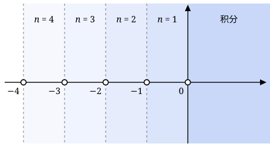

## 这一节要回答的问题

[伽马函数](lesson:math.analysis.gamma-function)一节用积分$\int_0^{+\infty}t^{x-1}e^{-t}\dd t$定义了伽马函数（gamma function）$\Gamma(x)$，这个积分只在$x>0$时收敛；那一节第 7 题又用递推公式把$\Gamma$「另行定义」到负数上，比如$\Gamma\bigl(-\frac12\bigr)=-2\sqrt\pi$。这些值只是一种约定，还是只能这样取？把$x$换成:term[复数]{id="math.complex-analysis.complex-number"}（complex number）$z$，$\Gamma$能推广到多大的范围，$0,-1,-2,\dots$又是什么样的点？

## 讲解

### 复变量的伽马函数

设$z=x+iy$。$t>0$时，$t^{z-1}$取:term[幂函数]{id="math.complex-analysis.power-function"}（power function）的主值$e^{(z-1)\Log t}$（见[复数的幂](lesson:math.complex-analysis.complex-logarithm#def-power)），正实数的:term[对数主值]{id="math.complex-analysis.principal-logarithm"}（principal logarithm）就是$\ln t$，所以$t^{z-1}=t^{x-1}e^{iy\ln t}$，:term[模]{id="math.complex-analysis.modulus"}（modulus）是$t^{x-1}$。$|t^{z-1}e^{-t}|$正是实的$\Gamma(x)$的被积函数（integrand）；要把积分搬到:term[复数]{id="math.complex-analysis.complex-number"}上，先说清:term[复值函数]{id="math.complex-analysis.complex-valued-function"}（complex-valued function）的反常积分（improper integral）。

::anchor{id="def-complex-improper"}
设$g$是$(0,+\infty)$上连续的复值函数。如果$\Re g$、$\Im g$在$(0,+\infty)$上的反常积分都收敛，就规定$\int_0^{+\infty}g\,\dd t=\int_0^{+\infty}\Re g\,\dd t+i\int_0^{+\infty}\Im g\,\dd t$；如果$\int_0^{+\infty}|g|\,\dd t$收敛，就说$\int_0^{+\infty}g\,\dd t$绝对收敛（absolutely convergent）。

为什么这样定义：有限区间上就是把:term[实部]{id="math.complex-analysis.real-part"}（real part）、:term[虚部]{id="math.complex-analysis.imaginary-part"}（imaginary part）分开积分（见[实变量的复值函数](lesson:math.complex-analysis.complex-exponential#def-complex-valued-function)）。$|\Re g|$、$|\Im g|$都不超过$|g|$，由比较判别法（comparison test），绝对收敛时积分有定义；在$[\varepsilon,A]$上用[积分的模不超过模的积分](lesson:math.complex-analysis.contour-integrals#thm-integral-modulus)，再取极限，还有$\bigl|\int_0^{+\infty}g\,\dd t\bigr|\le\int_0^{+\infty}|g|\,\dd t$。

边界情况：积分收敛不一定绝对收敛，实值的$\frac{\sin t}t$就是例子（见[无穷区间上的反常积分](lesson:math.calculus.improper-integrals#def-absolute-convergence)）。

::anchor{id="thm-gamma-holomorphic"}
**定理**　设$\Re z>0$。则$\int_0^{+\infty}t^{z-1}e^{-t}\dd t$绝对收敛，记作$\Gamma(z)$；这样得到的$\Gamma$在右半平面$\Re z>0$上:term[全纯]{id="math.complex-analysis.holomorphic-function"}（holomorphic），$\Gamma'(z)=\int_0^{+\infty}t^{z-1}\ln t\,e^{-t}\dd t$。

**证明**：记$x=\Re z$。由[伽马函数](lesson:math.analysis.gamma-function#thm-gamma-converges)一节的定理 1，$s>0$时$\int_0^{+\infty}t^{s-1}e^{-t}\dd t$收敛，取$s=x$就知道$\Gamma(z)$绝对收敛。先准备两个不等式：对复数$w$，由$e^w=\sum_{n\ge0}\frac{w^n}{n!}$（见[指数函数的幂级数](lesson:math.complex-analysis.complex-power-series#thm-exp-power-series)），$|e^w-1-w|\le\sum_{n\ge2}\frac{|w|^n}{n!}\le|w|^2e^{|w|}$；由$e^u\ge1+u>u$（[微分中值定理](lesson:math.calculus.mean-value-theorem)第 5 题）取$u=\frac x8|\ln t|$，这时$e^u$是$t^{x/8}$、$t^{-x/8}$中较大的那个，得$|\ln t|<\frac8x\bigl(t^{x/8}+t^{-x/8}\bigr)$。

取$0<|h|\le\frac x2$。由[指数法则](lesson:math.complex-analysis.complex-exponential#thm-exp-addition)，$t^{z+h-1}=t^{z-1}e^{h\ln t}$；在第一个不等式里取$w=h\ln t$，用$e^{|h||\ln t|}\le t^{x/2}+t^{-x/2}$，再把第二个不等式平方（$(a+b)^2\le2a^2+2b^2$），得

$$
\Bigl|t^{z-1}e^{-t}\,\frac{e^{h\ln t}-1-h\ln t}h\Bigr|\le\frac{128|h|}{x^2}\,t^{x-1}e^{-t}\bigl(t^{\frac x4}+t^{-\frac x4}\bigr)\bigl(t^{\frac x2}+t^{-\frac x2}\bigr).
$$

右边乘开是四项，各是$t^{s-1}e^{-t}$乘常数，$s$依次取$\frac{7x}4$、$\frac{5x}4$、$\frac{3x}4$、$\frac x4$，都是正数，所以右边的积分收敛，记作$K|h|$。同样由第二个不等式，候选的导数$\int_0^{+\infty}t^{z-1}\ln t\,e^{-t}\dd t$也绝对收敛。左边正是差商（difference quotient）和候选导数之差的被积函数，所以差的模不超过$K|h|$，$h\to0$时趋于$0$：$\Gamma$在$z$处:term[复可导]{id="math.complex-analysis.complex-derivative"}（complex differentiable），导数就是这个积分。

为什么想到这么做：伽马函数一节定理 4 用的积分号下求导（differentiation under the integral sign）只管实参数，这里照[高阶导数与莫雷拉定理](lesson:math.complex-analysis.higher-derivatives#thm-cauchy-type)一节第一个定理的证明，把差商和候选导数之差对所有$t$统一地用$|h|$乘一个和$h$无关的可积函数控制住。

为什么有用：右半平面是:term[区域]{id="math.complex-analysis.domain"}（domain），:term[唯一性定理]{id="math.complex-analysis.identity-theorem"}（identity theorem）和:term[解析延拓]{id="math.complex-analysis.analytic-continuation"}（analytic continuation）都用得上了；$z$取正实数时，积分和导数就是伽马函数一节的$\Gamma(x)$和定理 4。边界情况：$\Re z\le0$时，不但$|t^{z-1}e^{-t}|$的积分发散（定理 1），积分本身也发散（$t\to0^+$那一端，这里不证），所以积分只在右半平面上给出$\Gamma$。

### 递推公式

::anchor{id="thm-gamma-recursion-complex"}
**定理**　$\Re z>0$时$\Gamma(z+1)=z\Gamma(z)$。

**证明**：$\Re(z+1)>1$，由[求导法则](lesson:math.complex-analysis.complex-derivative#thm-derivative-rules)，$\Gamma(z+1)$和$z\Gamma(z)$都在右半平面上:term[全纯]{id="math.complex-analysis.holomorphic-function"}。右半平面是:term[区域]{id="math.complex-analysis.domain"}，由[伽马函数](lesson:math.analysis.gamma-function#thm-gamma-recursion)一节的定理 2，两者在:term[正实轴]{id="math.complex-analysis.real-axis"}（positive real axis）上相等，特别是在收敛到$1$的点$1+\frac1k$（$k=1,2,\dots$）上相等；由:term[唯一性定理]{id="math.complex-analysis.identity-theorem"}，两者在整个右半平面上相等。

为什么这样证：两边都全纯，唯一性定理把正实轴上的等式推到整个右半平面，不必对:term[复数]{id="math.complex-analysis.complex-number"}$z$再做一遍:term[分部积分]{id="math.calculus.integration-by-parts"}（integration by parts）。

### 延拓到去掉非正整数的平面

::anchor{id="thm-gamma-continuation"}
**定理**　对正整数$n$，记$D_n$是半平面$\Re z>-n$去掉$0,-1,\dots,-(n-1)$得到的集合，$\Gamma_n(z)=\frac{\Gamma(z+n)}{z(z+1)\cdots(z+n-1)}$。则$\Gamma_n$在$D_n$上:term[全纯]{id="math.complex-analysis.holomorphic-function"}，在右半平面上等于$\Gamma$，并且在$D_n$上$\Gamma_{n+1}=\Gamma_n$。于是在$D=\C\setminus\{0,-1,-2,\dots\}$上令$\Gamma(z)=\Gamma_n(z)$（$n$取任何一个使$\Re z>-n$的正整数），就得到$\Gamma$到$D$的:term[解析延拓]{id="math.complex-analysis.analytic-continuation"}，它是唯一的，并且在整个$D$上$\Gamma(z+1)=z\Gamma(z)$。

**证明**：$z\in D_n$时$\Re(z+n)>0$，分母不为$0$，由求导法则$\Gamma_n$在$D_n$上全纯。$\Re z>0$时，依次对$z+n-1$、…、$z$用递推公式，得$\Gamma(z+n)=(z+n-1)\cdots(z+1)z\,\Gamma(z)$，即$\Gamma_n(z)=\Gamma(z)$；$z\in D_n$时由$\Gamma(z+n+1)=(z+n)\Gamma(z+n)$，$\Gamma_{n+1}(z)$的分子、分母约去$z+n\ne0$就是$\Gamma_n(z)$。所以$D$上的$\Gamma$不依赖$n$的取法，在每个$D_n$上等于$\Gamma_n$，因而全纯。

$D$是:term[区域]{id="math.complex-analysis.domain"}：每一点离$0,-1,-2,\dots$都有一段正的距离，以它为圆心的小:term[开圆盘]{id="math.complex-analysis.open-disc"}（open disc）落在$D$里；每一点都能先竖直移到:term[虚部]{id="math.complex-analysis.imaginary-part"}为$1$或$-1$的直线上（不越过:term[实轴]{id="math.complex-analysis.real-axis"}），再水平移进右半平面。由[延拓的唯一性](lesson:math.complex-analysis.analytic-continuation#thm-continuation-unique)，这个解析延拓是唯一的；$\Gamma(z+1)$和$z\Gamma(z)$都在$D$上全纯（$z\in D$时$z+1\in D$），在右半平面上相等，由:term[唯一性定理]{id="math.complex-analysis.identity-theorem"}在$D$上处处相等。

为什么有用：在实轴上，延拓给出的正是伽马函数一节第 7 题「另行定义」的值，比如$\Gamma\bigl(-\frac12\bigr)=\frac{\Gamma(1/2)}{-1/2}=-2\sqrt\pi$。那里的定义不是随手的约定：在$D$上全纯、在正实轴上等于积分的函数只有这一个，用什么办法找到它都一样（本节第 5 题是另一种写法）。

边界情况：唯一的是在正实轴上（甚至只在收敛到$D$中一点的一列互不相同的点上）等于$\Gamma$的全纯函数，递推公式本身定不出$\Gamma$。伽马函数一节第 8 题的例子换成复变量，$f(z)=\Gamma(z)\bigl(1+\frac12\sin2\pi z\bigr)$也在$D$上全纯，满足$f(z+1)=zf(z)$、$f(1)=1$，却不是$\Gamma$；那道题要补上的对数凸（logarithmically convex）这个条件，全纯代替不了。

### 极点和留数

::anchor{id="thm-gamma-poles"}
**定理**　对每个自然数$k$，$-k$是$\Gamma$的:term[一阶极点]{id="math.complex-analysis.pole"}（simple pole），:term[留数]{id="math.complex-analysis.residue"}（residue）$\Res_{z=-k}\Gamma(z)=\frac{(-1)^k}{k!}$。所以$\Gamma$是$\C$上的:term[亚纯函数]{id="math.complex-analysis.meromorphic-function"}（meromorphic function）。

**证明**：取$n=k+1$，在$-k$附近$\Gamma(z)=\frac{g(z)}{z+k}$，$g(z)=\frac{\Gamma(z+k+1)}{z(z+1)\cdots(z+k-1)}$（$k=0$时分母是$1$）。$g$在:term[开圆盘]{id="math.complex-analysis.open-disc"}$|z+k|<1$上:term[全纯]{id="math.complex-analysis.holomorphic-function"}，$g(-k)=\frac{\Gamma(1)}{(-k)(-k+1)\cdots(-1)}=\frac{(-1)^k}{k!}\ne0$。$\Gamma$在$0<|z+k|<1$上全纯，由[极点的阶](lesson:math.complex-analysis.singularities#thm-pole-order)的定理（2），:term[孤立奇点]{id="math.complex-analysis.isolated-singularity"}（isolated singularity）$-k$是一阶极点，由[极点处的留数](lesson:math.complex-analysis.residue-theorem#thm-residue-poles)的定理（1）（$m=1$），留数是$g(-k)$；$\Gamma$在其余各点全纯，所以亚纯。

为什么有用：有了留数，就能用:term[留数定理]{id="math.complex-analysis.residue-theorem"}（residue theorem）算$\Gamma$沿不经过极点的简单闭曲线（simple closed curve）的积分（例 2）。

边界情况：$0$仍不在定义域里：$z\to0$时$z\Gamma(z)=\Gamma(z+1)\to1$，$|\Gamma(z)|\to+\infty$，补上什么值都不连续，和伽马函数一节在:term[正实轴]{id="math.complex-analysis.real-axis"}上看到的一致。延拓去掉的只是「积分发散」这一层限制，极点处的毛病是$\Gamma$自己的。

## 几何图像

浅蓝色的右半平面上，$\Gamma$由积分给出。延拓公式取$n=1$，把它推到$\Re z>-1$，只去掉$0$；取$n=2$再往左推一条，又去掉$-1$……每一步多出一条宽为$1$的带子，去掉的点（空心圆点）都是$\Gamma$的:term[极点]{id="math.complex-analysis.pole"}。

:::anim{component="function-plot"}
range: { x: [-3.4, 4.4], y: [-5, 6] }
functions:
  - expr: "sum(j, 0, 699, 0.02 * (0.01*(j + 0.5))^(2*x + 7) * exp(-(0.01*(j + 0.5))^2)) / (x*(x + 1)*(x + 2)*(x + 3))"
    label: |
      $\Gamma(x)$
  - expr: "(-1)^m / (prod(j, 1, m, j) * (x + m))"
    label: |
      $\frac{(-1)^m}{m!\,(x+m)}$
sliders:
  - name: m
    min: 0
    max: 3
    step: 1
    default: 1
    label: |
      看哪一个极点：$-m$
:::

在:term[实轴]{id="math.complex-analysis.real-axis"}上看$\Gamma$。蓝线是$\Gamma(x)$，照延拓公式取$n=4$画出：分子$\Gamma(x+4)$的自变量不小于$0.6$，由积分直接数值算出；它在$0,-1,-2,-3$处断开、冲出画面。橙线是$\frac{(-1)^m}{m!\,(x+m)}$，拖动$m$，橙线在$-m$附近和蓝线贴在一起：$-m$是一阶极点，:term[留数]{id="math.complex-analysis.residue"}是$\frac{(-1)^m}{m!}$。

## 例题

### 例 1　$\Gamma\bigl(-\frac32\bigr)$

求$\Gamma\bigl(-\frac32\bigr)$。

**为什么想到这么做**：$-\frac32$在左半平面，积分在那里不收敛，要用延拓公式；取使$-\frac32+n>0$的最小正整数$n=2$，分子正好是$\Gamma\bigl(\frac12\bigr)=\sqrt\pi$。

**推导**：由延拓的定理，取$n=2$，

$$
\Gamma\Bigl(-\frac32\Bigr)=\frac{\Gamma(\frac12)}{(-\frac32)(-\frac12)}=\frac{\sqrt\pi}{\frac34}=\frac43\sqrt\pi.
$$

### 例 2　$\Gamma$沿圆周$|z|=\frac52$的积分

求$\oint_{|z|=5/2}\Gamma(z)\,\dd z$，圆周取逆时针方向。

**为什么想到这么做**：$\Gamma$在$\C$上:term[亚纯]{id="math.complex-analysis.meromorphic-function"}，圆周不经过:term[极点]{id="math.complex-analysis.pole"}，正好用:term[留数定理]{id="math.complex-analysis.residue-theorem"}；:term[留数]{id="math.complex-analysis.residue"}已经有公式，不必写出:term[洛朗级数]{id="math.complex-analysis.laurent-series"}（Laurent series）。

**推导**：非正整数里:term[模]{id="math.complex-analysis.modulus"}小于$\frac52$的只有$0$、$-1$、$-2$；$\Gamma$在包含圆周和圆内部的:term[开集]{id="math.complex-analysis.open-set"}（open set）$|z|<3$上，除这三点外处处:term[全纯]{id="math.complex-analysis.holomorphic-function"}。这三点处的留数依次是$1$、$-1$、$\frac12$，由留数定理，

$$
\oint_{|z|=5/2}\Gamma(z)\,\dd z=2\pi i\Bigl(1-1+\frac12\Bigr)=\pi i.
$$

## 常见误区

- 「负数处的$\Gamma$只是用递推公式规定出来的；换一种办法把$\Gamma$推广成$D=\C\setminus\{0,-1,-2,\dots\}$上的:term[全纯函数]{id="math.complex-analysis.holomorphic-function"}，可能得到别的值。」只要推广出的函数在$D$上全纯、在:term[正实轴]{id="math.complex-analysis.real-axis"}上等于积分，由:term[唯一性定理]{id="math.complex-analysis.identity-theorem"}，它就处处等于这一节的$\Gamma$，本节第 5 题的式子就是一例。不要求全纯，才谈得上「规定」：那样负数处的值可以随便取。
- 「$x>0$时$|\Gamma(x+iy)|=\Gamma(x)$，因为$|t^{z-1}|=t^{x-1}$。」由被积函数的:term[模]{id="math.complex-analysis.modulus"}只能推出$|\Gamma(x+iy)|\le\Gamma(x)$，积分的模不超过模的积分，等号一般不成立。假如$y=2$时等号总成立，递推公式$|\Gamma(2+2i)|=|1+2i|\,|\Gamma(1+2i)|$就成了$\Gamma(2)=\sqrt5\,\Gamma(1)$，即$1=\sqrt5$，矛盾。
