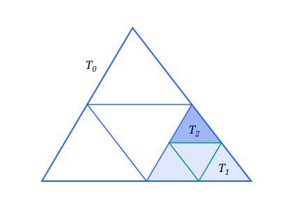

## 这一节要回答的问题

[柯西积分定理](lesson:math.complex-analysis.cauchy-theorem#thm-cauchy)（Cauchy's integral theorem）要求$f'$连续，这是借用格林公式（Green's theorem）付出的代价。:term[全纯]{id="math.complex-analysis.holomorphic-function"}（holomorphic）只要求处处:term[复可导]{id="math.complex-analysis.complex-derivative"}（complex differentiable），并没有要求导数连续。不假设$f'$连续，沿闭曲线的积分还是$0$吗？

## 讲解

### 古尔萨定理

::anchor{id="thm-goursat"}
**定理（:term[古尔萨定理]{id="math.complex-analysis.goursat-theorem"}，Goursat's theorem）**　设$f$在:term[开集]{id="math.complex-analysis.open-set"}（open set）$D$上:term[全纯]{id="math.complex-analysis.holomorphic-function"}，三角形$T$连同内部都在$D$里，$\partial T$是$T$的边界，取逆时针方向。则$\oint_{\partial T}f(z)\,\dd z=0$。这里不假设$f'$连续。

**证明**：记$I=\bigl|\oint_{\partial T}f\,\dd z\bigr|$，$T$的周长为$L$，直径（最长的边）为$d$。连接三边的中点，把$T$分成四个小三角形，各取逆时针方向；三条中位线上，相邻的两个小三角形各走一遍、方向相反，积分抵消，所以$\oint_{\partial T}f\,\dd z$等于四个小三角形边界上的积分之和，其中至少有一个，记作$T_1$，满足$\bigl|\oint_{\partial T_1}f\,\dd z\bigr|\ge\frac I4$。对$T_1$重复这个做法，得到一个套一个的三角形$T\supset T_1\supset T_2\supset\cdots$，$\bigl|\oint_{\partial T_n}f\,\dd z\bigr|\ge\frac I{4^n}$，而$T_n$的周长是$\frac L{2^n}$，直径是$\frac d{2^n}$。

这些三角形缩向一点。取$T_n$的一个顶点$p_n$，$m\ge n$时$p_m$在$T_n$里，所以$p_m$的:term[实部]{id="math.complex-analysis.real-part"}（real part）都落在$T_n$的点的实部组成的闭区间里；这些闭区间一个套一个，长度不超过$\frac d{2^n}$，由闭区间套定理（nested interval theorem），$\Re p_n$趋于一个数$x_0$，同样$\Im p_n$趋于$y_0$。记$z_0=x_0+iy_0$，它是$p_n,p_{n+1},\dots$的极限，这些点都在闭三角形$T_n$里，所以$z_0$在每个$T_n$里。

$f$在$z_0$处:term[复可导]{id="math.complex-analysis.complex-derivative"}：$f(z)=f(z_0)+f'(z_0)(z-z_0)+\varepsilon(z)(z-z_0)$，其中$z\to z_0$时$\varepsilon(z)\to0$。一次函数$f(z_0)+f'(z_0)(z-z_0)$是多项式$P(z)=f(z_0)z+\frac12f'(z_0)(z-z_0)^2$的导数；由沿曲线的[求导法则](lesson:math.complex-analysis.complex-derivative#thm-derivative-rules)，$\frac{\dd}{\dd t}P(z(t))=P'(z(t))z'(t)$，沿闭曲线积分得$P$在终点和起点的值之差，即$0$。所以$\oint_{\partial T_n}f\,\dd z=\oint_{\partial T_n}\varepsilon(z)(z-z_0)\,\dd z$。

任给$\eta>0$，$n$足够大时$T_n$上处处$|\varepsilon(z)|<\eta$；$\partial T_n$上$|z-z_0|\le\frac d{2^n}$，由:term[ML 不等式]{id="math.complex-analysis.ml-inequality"}（ML inequality），

$$
\frac I{4^n}\le\Bigl|\oint_{\partial T_n}f\,\dd z\Bigr|\le\eta\cdot\frac d{2^n}\cdot\frac L{2^n},
$$

即$I\le\eta dL$。$\eta$可以任意小，所以$I=0$。

为什么想到这么做：积分没法直接估计，就把三角形越分越小，把它「挤」到一点$z_0$附近；在$z_0$附近$f$几乎是一次函数，一次函数沿闭曲线的积分为$0$，剩下的余项（remainder）比$|z-z_0|$小得多。积分的:term[模]{id="math.complex-analysis.modulus"}（modulus）每步至多缩成$\frac14$，余项给出的界却比$\frac1{4^n}$还小得多，于是原来的积分只能是$0$。证明里只用了$f$在每一点复可导，既没用格林公式，也没用$f'$的连续性。

### 允许一个例外点

::anchor{id="thm-goursat-point"}
**定理**　设$f$在:term[开集]{id="math.complex-analysis.open-set"}$D$上连续，在$D$里除一点$p$外都:term[全纯]{id="math.complex-analysis.holomorphic-function"}，三角形$T$连同内部都在$D$里。则$\oint_{\partial T}f\,\dd z=0$。

**证明**：$p$不在$T$上时，$T$在开集$D$去掉$p$以后的部分里，由:term[古尔萨定理]{id="math.complex-analysis.goursat-theorem"}即得。$p$是$T$的一个顶点时，设另两个顶点是$b$、$c$，在边$[p,b]$、$[p,c]$上取靠近$p$的点$b'$、$c'$，$T$分成三个三角形$pb'c'$、$b'bc$、$b'cc'$。后两个不含$p$，积分为$0$，内部的边上积分抵消，所以$\oint_{\partial T}f\,\dd z=\oint_{\partial(pb'c')}f\,\dd z$；$f$在$p$处连续，$p$附近$|f|\le|f(p)|+1$，由:term[ML 不等式]{id="math.complex-analysis.ml-inequality"}，右边的:term[模]{id="math.complex-analysis.modulus"}不超过$(|f(p)|+1)$乘三角形$pb'c'$的周长，让$b'$、$c'$趋于$p$，它趋于$0$。$p$在边上或内部时，把$T$分成两个或三个以$p$为顶点的三角形，各用上面的结论（第 5 题）。

为什么需要它：[柯西积分公式](lesson:math.complex-analysis.cauchy-integral-formula)一节要对$\frac{f(\zeta)-f(z)}{\zeta-z}$用这个结论，这个函数在$\zeta=z$处补上值$f'(z)$以后连续，可那里是不是全纯还不知道。边界情况：定理要求例外点上$f$连续，这个条件不能干脆去掉：$\frac1z$在原点补什么值都不连续，沿绕原点的三角形，它的积分不是$0$，而是$2\pi i$（见[变形积分路径](lesson:math.complex-analysis.cauchy-theorem#thm-deformation)）。

### 圆盘里的原函数

::anchor{id="thm-disc-antiderivative"}
**定理**　设$\Delta$是:term[开圆盘]{id="math.complex-analysis.open-disc"}（open disc），圆心为$a$，$f$在$\Delta$上连续，并且沿$\Delta$里每个三角形的边界积分为$0$（例如$f$在$\Delta$上:term[全纯]{id="math.complex-analysis.holomorphic-function"}，或者除一点外全纯）。令$F(z)=\int_{[a,z]}f(\zeta)\,\dd\zeta$，积分沿从$a$到$z$的线段。则$F$在$\Delta$上全纯，$F'=f$，即$F$是$f$在$\Delta$上的:term[原函数]{id="math.complex-analysis.antiderivative"}（antiderivative），因而沿$\Delta$里任何分段光滑（piecewise smooth）的闭曲线，$\oint f\,\dd z=0$。

**证明**：设$z$、$z+h$都在$\Delta$里。圆盘里两点间的线段都在圆盘里，所以三角形$a,z,z+h$在$\Delta$里，沿它边界的积分为$0$，即$F(z+h)-F(z)=\int_{[z,z+h]}f(\zeta)\,\dd\zeta$。又$\int_{[z,z+h]}\dd\zeta=h$，所以

$$
\frac{F(z+h)-F(z)}h-f(z)=\frac1h\int_{[z,z+h]}\bigl(f(\zeta)-f(z)\bigr)\,\dd\zeta,
$$

由:term[ML 不等式]{id="math.complex-analysis.ml-inequality"}，它的:term[模]{id="math.complex-analysis.modulus"}不超过线段$[z,z+h]$上$|f(\zeta)-f(z)|$的上界（upper bound），$h\to0$时由$f$的连续性趋于$0$，所以$F'(z)=f(z)$。沿闭曲线$z(t)$，$\frac{\dd}{\dd t}F(z(t))=f(z(t))z'(t)$，积分得$F$在终点和起点的值之差，为$0$。

为什么有用：在圆盘里，:term[全纯函数]{id="math.complex-analysis.holomorphic-function"}沿任何闭曲线的积分都是$0$，不需要$f'$连续，:term[柯西积分定理]{id="math.complex-analysis.cauchy-theorem"}在圆盘上有了不带附加条件的版本。边界情况：圆盘里「三角形$a,z,z+h$在里面」这一步要紧。在去掉原点的平面上，$\frac1z$沿每个不含原点的三角形积分为$0$，可那里的三角形$a,z,z+h$可能把原点围进去；$\frac1z$在那里也确实没有原函数，否则沿单位圆的积分该是$0$，而它是$2\pi i$。

## 几何图像

大三角形$T_0$连接三边中点分成四个，选积分的:term[模]{id="math.complex-analysis.modulus"}最大的一个作$T_1$（浅蓝色）；$T_1$再用绿色的中位线分成四个，选出$T_2$（深一些的蓝色）。一直分下去，三角形缩向一点$z_0$，每分一次，周长减半，积分的模至少剩下上一个的$\frac14$。在$z_0$附近$f$几乎是一次函数，这些小三角形上的积分其实比$\frac1{4^n}$小得多，逼得原来的积分只能是$0$。

## 例题

### 例 1　条件不能少

$T$是以$0$、$1$、$i$为顶点的三角形，取逆时针方向。求$\oint_{\partial T}\bar z\,\dd z$。

**为什么想到这么做**：三条边都是线段，分别写出参数直接算；$\bar z$不:term[全纯]{id="math.complex-analysis.holomorphic-function"}，结果不必是$0$。

**推导**：在$[0,1]$上$z=t$，积分是$\int_0^1t\,\dd t=\frac12$。在$[1,i]$上$z=1+t(i-1)$，$\bar z=1-t-it$，被积式$(1-t-it)(i-1)=i-1+2t$，积分是$i$。在$[i,0]$上$z=i(1-t)$，$\bar z\,z'=(-i)(1-t)(-i)=-(1-t)$，积分是$-\frac12$。三段相加，$\oint_{\partial T}\bar z\,\dd z=i$，不是$0$，所以:term[古尔萨定理]{id="math.complex-analysis.goursat-theorem"}的「全纯」不能去掉。

### 例 2　看起来不全纯的点

求$\oint_{|z|=1}f(z)\,\dd z$，其中$z\ne0$时$f(z)=\frac{\sin z}z$，$f(0)=1$。

**为什么想到这么做**：$f$在$z\ne0$处:term[全纯]{id="math.complex-analysis.holomorphic-function"}，只有$0$可疑；只要$f$在$0$处连续，就能用允许一个例外点的定理和圆盘里的:term[原函数]{id="math.complex-analysis.antiderivative"}。

**推导**：$\frac{\sin z}z=\frac{\sin z-\sin0}{z-0}$，$z\to0$时趋于$\sin z$在$0$处的导数$\cos0=1$，所以$f$在$0$处连续。$f$在:term[开圆盘]{id="math.complex-analysis.open-disc"}$|z|<2$上连续、除$0$外全纯，由上面两个定理，它在这个圆盘里有原函数，沿单位圆的积分是$0$。以后会知道，$f$在$0$处其实也全纯。

## 常见误区

- 「:term[古尔萨定理]{id="math.complex-analysis.goursat-theorem"}只是:term[柯西积分定理]{id="math.complex-analysis.cauchy-theorem"}换了个证法。」它去掉了$f'$连续这个条件；后面证明:term[全纯函数]{id="math.complex-analysis.holomorphic-function"}可以无穷次求导，靠的正是它，用格林公式的版本会循环论证。
- 「沿三角形的积分都为$0$，就一定有:term[原函数]{id="math.complex-analysis.antiderivative"}。」证明要用到圆盘：三角形$a,z,z+h$要落在定义域里。在去掉原点的平面上，沿不含原点的三角形，$\frac1z$的积分都是$0$，可它没有原函数，因为沿单位圆的积分是$2\pi i$。
- 「例外点处$f$怎样都行。」定理要求$f$在例外点连续，只在别处全纯不够：$\frac1z$在原点补上什么值都不连续；要是这样的点也能当例外点，单位圆盘里它就有原函数，沿单位圆的积分该是$0$，可实际是$2\pi i$。
