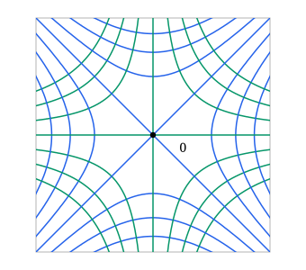

## 这一节要回答的问题

满足$\lap u=u_{xx}+u_{yy}=0$的实函数叫作调和函数（harmonic function），平板上不再随时间变化的温度分布就是这样的函数。:term[全纯函数]{id="math.complex-analysis.holomorphic-function"}（holomorphic function）的:term[实部]{id="math.complex-analysis.real-part"}（real part）、:term[虚部]{id="math.complex-analysis.imaginary-part"}（imaginary part）是不是调和函数？反过来，给了一个调和函数，能不能找到以它为实部的全纯函数？

## 讲解

### 全纯函数的实部和虚部

::anchor{id="thm-real-part-harmonic"}
**定理**　设$f=u+iv$在:term[开集]{id="math.complex-analysis.open-set"}（open set）$D$上:term[全纯]{id="math.complex-analysis.holomorphic-function"}。则$u$、$v$在$D$上有各阶连续的偏导数（partial derivative），并且$\lap u=0$、$\lap v=0$，即$u$、$v$都是调和函数。

**证明**：由[导数自动连续](lesson:math.complex-analysis.higher-derivatives#thm-derivative-continuous)，$f'$、$f''$、……都在$D$上全纯。由:term[柯西-黎曼方程]{id="math.complex-analysis.cauchy-riemann-equations"}（Cauchy-Riemann equations），$u_x=\Re f'$，$u_y=-\Im f'$，$v_x=\Im f'$，$v_y=\Re f'$；对$f'$再用一次，二阶偏导数都是$\pm\Re f''$或$\pm\Im f''$，依此类推，各阶偏导数都是某个$f^{(k)}$的:term[实部]{id="math.complex-analysis.real-part"}或:term[虚部]{id="math.complex-analysis.imaginary-part"}，都连续。由施瓦茨定理（Schwarz's theorem），$v_{xy}=v_{yx}$，而$u_{xx}=(v_y)_x$、$u_{yy}=(-v_x)_y$，所以$u_{xx}+u_{yy}=v_{yx}-v_{xy}=0$；同样$v_{xx}+v_{yy}=-u_{yx}+u_{xy}=0$。

为什么有用：由此得到大量调和函数：$z^2$给出$x^2-y^2$和$2xy$，$e^z$给出$e^x\cos y$和$e^x\sin y$，在去掉:term[负实轴]{id="math.complex-analysis.real-axis"}（negative real axis）的平面上，$\Log z$给出$\ln|z|$和$\Arg z$。边界情况：反过来，两个调和函数凑在一起不一定是全纯函数：$u=x$、$v=-y$都调和，可$x-iy$就是$\bar z$，处处不全纯。

### 共轭调和函数

::anchor{id="def-harmonic-conjugate"}
设$u$是:term[开集]{id="math.complex-analysis.open-set"}$D$上的实值调和函数。如果实函数$v$使$u+iv$在$D$上:term[全纯]{id="math.complex-analysis.holomorphic-function"}，就说$v$是$u$在$D$上的:term[共轭调和函数]{id="math.complex-analysis.harmonic-conjugate"}（harmonic conjugate）。

为什么这样定义：找$u$的共轭调和函数，就是找以$u$为:term[实部]{id="math.complex-analysis.real-part"}的全纯函数，调和函数的问题就能交给全纯函数处理。在:term[区域]{id="math.complex-analysis.domain"}（domain）上，共轭调和函数只能差一个常数：$v_1$、$v_2$都是时，$i(v_1-v_2)$全纯、实部为$0$，由:term[柯西-黎曼方程]{id="math.complex-analysis.cauchy-riemann-equations"}，它的导数为$0$，是常数（[柯西-黎曼方程与全纯函数](lesson:math.complex-analysis.holomorphic)第 5 题）。边界情况：这个关系不:term[对称]{id="math.logic-sets.symmetric"}（symmetric）：$-i(u+iv)=v-iu$全纯，所以$v$的共轭调和函数是$-u$，不是$u$。

### 圆盘里一定有共轭调和函数

::anchor{id="thm-conjugate-disc"}
**定理**　设$u$在:term[开圆盘]{id="math.complex-analysis.open-disc"}（open disc）$\Delta$上有连续的二阶偏导数，并且$\lap u=0$。则有$\Delta$上的:term[全纯函数]{id="math.complex-analysis.holomorphic-function"}$f$使$\Re f=u$，即$u$在$\Delta$上有:term[共轭调和函数]{id="math.complex-analysis.harmonic-conjugate"}。

**证明**：令$g=u_x-iu_y$。它的:term[实部]{id="math.complex-analysis.real-part"}$P=u_x$、:term[虚部]{id="math.complex-analysis.imaginary-part"}$Q=-u_y$有连续的偏导数，$P_x-Q_y=u_{xx}+u_{yy}=0$，由施瓦茨定理$P_y+Q_x=u_{xy}-u_{yx}=0$，满足:term[柯西-黎曼方程]{id="math.complex-analysis.cauchy-riemann-equations"}，所以$g$在$\Delta$上全纯。由[圆盘里的原函数](lesson:math.complex-analysis.goursat#thm-disc-antiderivative)，$g$在$\Delta$上有:term[原函数]{id="math.complex-analysis.antiderivative"}（antiderivative）$F=U+iV$。

由柯西-黎曼方程，$F'=U_x-iU_y$，和$g$比较得$U_x=u_x$、$U_y=u_y$。所以$U-u$的梯度（gradient）处处为$0$，沿圆盘里的线段求导可知它是常数$c$，$f=F-c$就满足$\Re f=u$。

为什么有用：求共轭调和函数可以照证明做：算出$g=u_x-iu_y$，写成$z$的函数，求原函数，取虚部（例 1）。证明里用到圆盘的地方，是$g$在圆盘里一定有原函数。边界情况：圆盘不能换成任意:term[开集]{id="math.complex-analysis.open-set"}，$\ln|z|$在去掉原点的平面上调和，却没有共轭调和函数（例 2）。

### 两族等值线正交

::anchor{id="thm-orthogonal"}
**定理**　设$f=u+iv$在:term[开集]{id="math.complex-analysis.open-set"}$D$上:term[全纯]{id="math.complex-analysis.holomorphic-function"}，$z_0\in D$，$f'(z_0)\ne0$。则在$z_0$处，$u$、$v$的梯度都不为$0$并且互相垂直，所以经过$z_0$的等值线（level curve）$u=u(z_0)$和$v=v(z_0)$在$z_0$处正交。

**证明**：由:term[柯西-黎曼方程]{id="math.complex-analysis.cauchy-riemann-equations"}，$\nabla u=(u_x,u_y)$，$\nabla v=(-u_y,u_x)$，所以$\nabla u\cdot\nabla v=-u_xu_y+u_yu_x=0$，而$|\nabla u|=|\nabla v|=|f'(z_0)|\ne0$。等值线在一点的切线和那里的梯度垂直，两条等值线的切线也就互相垂直。

为什么有用：$u$、$v$的等值线织成一张处处直角相交的网；平板上的稳恒温度$u$有:term[共轭调和函数]{id="math.complex-analysis.harmonic-conjugate"}$v$时，$u$的等值线是等温线，$v$的等值线就是热流的路线（第 8 题）。边界情况：$f'(z_0)=0$时可能不正交，见下面的图。

## 几何图像

蓝线是$u=x^2-y^2$的等值线，绿线是$v=2xy$的等值线，它们是$z^2$的:term[实部]{id="math.complex-analysis.real-part"}和:term[虚部]{id="math.complex-analysis.imaginary-part"}。原点以外，蓝线和绿线处处正交。原点处$(z^2)'=0$，$u=0$的两条对角线和$v=0$的两条坐标轴交成$45^\circ$的角，不再正交。

## 例题

### 例 1　求共轭调和函数

求$u=x^2-y^2+2x$的:term[共轭调和函数]{id="math.complex-analysis.harmonic-conjugate"}。

**为什么想到这么做**：$\lap u=2-2=0$，$u$在整个平面上调和，照圆盘上的证明，$g=u_x-iu_y$:term[全纯]{id="math.complex-analysis.holomorphic-function"}，求它的:term[原函数]{id="math.complex-analysis.antiderivative"}。

**推导**：$u_x=2x+2$，$u_y=-2y$，所以$g=2x+2+2iy=2z+2$。它的一个原函数是$z^2+2z$，:term[实部]{id="math.complex-analysis.real-part"}正是$x^2-y^2+2x$，所以$v=\Im(z^2+2z)=2xy+2y$，再加任意实常数。

### 例 2　$\ln|z|$没有共轭调和函数

证明$\ln|z|$在去掉原点的平面上调和，但在那里没有:term[共轭调和函数]{id="math.complex-analysis.harmonic-conjugate"}；在去掉:term[负实轴]{id="math.complex-analysis.real-axis"}的平面上，$\Arg z$是它的共轭调和函数。

**为什么想到这么做**：有共轭调和函数$v$时，$f=\ln|z|+iv$:term[全纯]{id="math.complex-analysis.holomorphic-function"}，$f'=u_x-iu_y$可以直接算出来；再看$f'$有没有:term[原函数]{id="math.complex-analysis.antiderivative"}。

**推导**：$u=\frac12\ln(x^2+y^2)$，$u_x=\frac x{x^2+y^2}$，$u_y=\frac y{x^2+y^2}$，$u_{xx}+u_{yy}=\frac{y^2-x^2}{(x^2+y^2)^2}+\frac{x^2-y^2}{(x^2+y^2)^2}=0$。假如有共轭调和函数$v$，$f=u+iv$全纯，$f'=u_x-iu_y$，即$\frac{x-iy}{x^2+y^2}=\frac1z$，于是$f$是$\frac1z$在去掉原点的平面上的原函数，沿单位圆周$\oint\frac{\dd z}z$该是$0$（[柯西积分定理](lesson:math.complex-analysis.cauchy-theorem#thm-antiderivative-integral)一节），而它是$2\pi i$，矛盾。在去掉负实轴的平面上，$\Log z=\ln|z|+i\Arg z$全纯，所以$\Arg z$是共轭调和函数；它绕原点一圈要跳$2\pi$，正说明在整个去掉原点的平面上接不起来。

## 常见误区

- 「$u$、$v$都调和，$u+iv$就:term[全纯]{id="math.complex-analysis.holomorphic-function"}。」还要满足:term[柯西-黎曼方程]{id="math.complex-analysis.cauchy-riemann-equations"}：$x$和$x$都调和，可$x+ix$的$u_x=1$、$v_y=0$，不全纯。
- 「调和函数在它有定义的任何:term[开集]{id="math.complex-analysis.open-set"}上都有:term[共轭调和函数]{id="math.complex-analysis.harmonic-conjugate"}。」:term[开圆盘]{id="math.complex-analysis.open-disc"}上一定有；$\ln|z|$在去掉原点的平面上就没有（例 2）。
- 「$v$是$u$的共轭调和函数，$u$也就是$v$的共轭调和函数。」$v$的共轭调和函数是$-u$（在:term[区域]{id="math.complex-analysis.domain"}上可以差一个常数）：$x+iy$全纯，$y+ix$却不全纯，$y-ix$才全纯。
