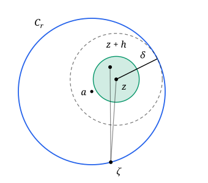

## 这一节要回答的问题

:term[全纯]{id="math.complex-analysis.holomorphic-function"}（holomorphic）只要求处处:term[复可导]{id="math.complex-analysis.complex-derivative"}（complex differentiable），导数$f'$还全纯吗？能不能一直求导下去？:term[柯西积分定理]{id="math.complex-analysis.cauchy-theorem"}（Cauchy's integral theorem）和变形积分路径都假设了$f'$连续，这个条件能不能去掉？反过来，不求导数，怎样判断一个函数全纯？

## 讲解

### 柯西型积分

::anchor{id="thm-cauchy-type"}
**定理**　设$C_r$是圆周$|\zeta-a|=r$，$\varphi$在$C_r$上连续，$n$是正整数。令$F_n(z)=\oint_{C_r}\frac{\varphi(\zeta)}{(\zeta-z)^n}\,\dd\zeta$，则$F_n$在:term[开圆盘]{id="math.complex-analysis.open-disc"}（open disc）$|z-a|<r$上:term[全纯]{id="math.complex-analysis.holomorphic-function"}，并且$F_n'=nF_{n+1}$。这样的积分叫作柯西型积分（Cauchy-type integral）。

**证明**：固定$z$，记$\delta=r-|z-a|$，则$C_r$上的$\zeta$满足$|\zeta-z|\ge\delta$。取$0<|h|<\frac\delta2$，则$|\zeta-z-h|>\frac\delta2$。记$A=\zeta-z$、$B=\zeta-z-h$，$A-B=h$。对正整数$m$，由$A^m-B^m=(A-B)\sum_{j=0}^{m-1}A^{m-1-j}B^j$，

$$
\frac1{B^m}-\frac1{A^m}=\frac{A^m-B^m}{A^mB^m}=h\sum_{j=0}^{m-1}\frac1{A^{j+1}B^{m-j}}.
$$

右边每一项的:term[模]{id="math.complex-analysis.modulus"}（modulus）不超过$\frac1{\delta^{j+1}}\bigl(\frac2\delta\bigr)^{m-j}$，也就不超过$\frac{2^m}{\delta^{m+1}}$，所以$\bigl|\frac1{B^m}-\frac1{A^m}\bigr|\le\frac{m2^m}{\delta^{m+1}}|h|$。取$m=n$、两边除以$h$，再减去$\frac n{A^{n+1}}$，也就是$n$个$\frac1{A^{k+1}A^{n-k}}$（$k=0,1,\dots,n-1$）之和，得

$$
\frac1h\Bigl(\frac1{B^n}-\frac1{A^n}\Bigr)-\frac n{A^{n+1}}=\sum_{k=0}^{n-1}\frac1{A^{k+1}}\Bigl(\frac1{B^{n-k}}-\frac1{A^{n-k}}\Bigr).
$$

对每个括号用刚才的估计（$m$取$n-k$），第$k$项的模不超过$\frac1{\delta^{k+1}}\cdot\frac{(n-k)2^{n-k}}{\delta^{n-k+1}}|h|$，也就不超过$\frac{n2^n}{\delta^{n+2}}|h|$，所以右边的模不超过$\frac{n^22^n}{\delta^{n+2}}|h|$，记作$K|h|$，$K$和$\zeta$无关。$\varphi(a+re^{it})$是$[0,2\pi]$上的连续函数，有界，设$|\varphi|\le M$。由:term[ML 不等式]{id="math.complex-analysis.ml-inequality"}（ML inequality），

$$
\Bigl|\frac{F_n(z+h)-F_n(z)}h-nF_{n+1}(z)\Bigr|=\Bigl|\oint_{C_r}\varphi(\zeta)\Bigl[\frac1h\Bigl(\frac1{B^n}-\frac1{A^n}\Bigr)-\frac n{A^{n+1}}\Bigr]\dd\zeta\Bigr|\le MK|h|\cdot2\pi r,
$$

$h\to0$时趋于$0$，所以$F_n'(z)=nF_{n+1}(z)$。

为什么想到这么做：求导就是让$h\to0$，难处在把极限搬进积分号里。被积函数里只有$\frac1{(\zeta-z)^n}$含$z$，而$\zeta$在圆周上、$z$在圆内，两者的距离至少是$\delta$，所以差商和它的极限之差能对所有$\zeta$统一地用$K|h|$控制，ML 不等式再把这个界带到积分上。

为什么有用：把$\varphi$取成全纯函数在圆周上的值，就得到下面的:term[高阶导数公式]{id="math.complex-analysis.higher-derivative-formula"}（Cauchy's integral formula for derivatives）。边界情况：$\varphi$只要连续，不必是哪个全纯函数在圆周上的值，$F_n$照样全纯，只是和$\varphi$没有简单的关系：$\varphi(\zeta)=\bar\zeta$、$r=1$、$a=0$时，$F_1$在单位圆内恒为$0$（[柯西积分公式](lesson:math.complex-analysis.cauchy-integral-formula)第 7 题）。

### 高阶导数公式

::anchor{id="thm-higher-derivatives"}
**定理（:term[高阶导数公式]{id="math.complex-analysis.higher-derivative-formula"}）**　设$f$在以$a$为圆心、半径为$R$的:term[开圆盘]{id="math.complex-analysis.open-disc"}$\Delta$上:term[全纯]{id="math.complex-analysis.holomorphic-function"}，$0<r<R$，$C_r$是圆周$|\zeta-a|=r$，取逆时针方向。则$f$在$\Delta$上无穷次:term[复可导]{id="math.complex-analysis.complex-derivative"}，并且对满足$|z-a|<r$的$z$和每个正整数$n$，$f^{(n)}(z)=\frac{n!}{2\pi i}\oint_{C_r}\frac{f(\zeta)}{(\zeta-z)^{n+1}}\,\dd\zeta$。

**证明**：由:term[柯西积分公式]{id="math.complex-analysis.cauchy-integral-formula"}（Cauchy's integral formula），$|z-a|<r$时$f(z)=\frac1{2\pi i}F_1(z)$，这里$\varphi$取$f$在$C_r$上的值。由上面的定理，$F_1'=F_2$，$F_2'=2F_3$，……，一步步得$F_1^{(n)}=n!\,F_{n+1}$，所以在$|z-a|<r$里$f$无穷次复可导，$f^{(n)}=\frac{n!}{2\pi i}F_{n+1}$。$\Delta$里每一点$z$都满足$|z-a|<R$，取$r$在$|z-a|$和$R$之间，$z$就在$C_r$里面，所以$f$在整个$\Delta$上无穷次复可导。

为什么有用：它把全纯函数的各阶导数写成圆周上的积分，反过来可以用来算积分：$\oint_{C_r}\frac{f(\zeta)}{(\zeta-z)^{n+1}}\dd\zeta=\frac{2\pi i}{n!}f^{(n)}(z)$（例 1）；[刘维尔定理与代数基本定理](lesson:math.complex-analysis.liouville)一节还要用它估计导数的大小。把$n=0$代进去（$0!=1$），就是柯西积分公式。边界情况：公式要$z$在圆内；$z$在圆周外面时，被积函数在开圆盘$|\zeta-a|<\min\{|z-a|,R\}$上全纯，右边的积分是$0$。

### 导数自动连续

::anchor{id="thm-derivative-continuous"}
**定理**　设$f$在:term[开集]{id="math.complex-analysis.open-set"}（open set）$D$上:term[全纯]{id="math.complex-analysis.holomorphic-function"}。则$f$在$D$上无穷次可导，每一阶导数都在$D$上全纯，特别地$f'$连续。

**证明**：$D$里每一点$z_0$都是某个含在$D$里的:term[开圆盘]{id="math.complex-analysis.open-disc"}的圆心，对这个圆盘用上面的定理（$a$取$z_0$），$f$在$z_0$附近无穷次:term[复可导]{id="math.complex-analysis.complex-derivative"}。所以每一阶导数$f^{(n)}$在$D$上处处复可导，即全纯；复可导的函数是连续的，所以$f^{(n)}$连续。

为什么有用：:term[柯西积分定理]{id="math.complex-analysis.cauchy-theorem"}、[变形积分路径](lesson:math.complex-analysis.cauchy-theorem#thm-deformation)和[柯西积分公式](lesson:math.complex-analysis.cauchy-integral-formula#thm-cauchy-formula-curve)一节换成一般闭曲线的定理，都假设了$f'$连续，现在这个条件自动满足，可以删掉：$f$在包含分段光滑的简单闭曲线$C$和它围成的部分的开集上全纯，就有$\oint_Cf\,\dd z=0$。这兑现了[柯西积分定理](lesson:math.complex-analysis.cauchy-theorem)一节「导数自动连续」的说法。边界情况：实函数没有这个性质，$x|x|$在$\R$上可导，导数$2|x|$连续，却在$0$处不可导。

### 莫雷拉定理

::anchor{id="thm-morera"}
**定理（:term[莫雷拉定理]{id="math.complex-analysis.morera-theorem"}，Morera's theorem）**　设$f$在:term[开集]{id="math.complex-analysis.open-set"}$D$上连续，并且对每个连同内部都在$D$里的三角形$T$，$\oint_{\partial T}f\,\dd z=0$。则$f$在$D$上:term[全纯]{id="math.complex-analysis.holomorphic-function"}。

**证明**：任取$z_0\in D$，再取以$z_0$为圆心、含在$D$里的:term[开圆盘]{id="math.complex-analysis.open-disc"}$\Delta$。由[圆盘里的原函数](lesson:math.complex-analysis.goursat#thm-disc-antiderivative)，$F(z)=\int_{[z_0,z]}f(\zeta)\,\dd\zeta$在$\Delta$上全纯，$F'=f$。由上面的定理，$F$的导数$f$在$\Delta$上也全纯，特别地在$z_0$处:term[复可导]{id="math.complex-analysis.complex-derivative"}。

为什么有用：它是:term[古尔萨定理]{id="math.complex-analysis.goursat-theorem"}（Goursat's theorem）倒过来的说法，不用求导，只看积分就能判断函数全纯。和[允许一个例外点](lesson:math.complex-analysis.goursat#thm-goursat-point)的定理合起来：$f$在开集$D$上连续、除一点外全纯，就在整个$D$上全纯，那个点其实并不例外（例 2）。边界情况：连续不能去掉：$z\ne0$时$f(z)=0$、$f(0)=1$，沿每个三角形的积分都是$0$（被积函数至多在一点不为$0$），可$f$在$0$处不连续，当然不全纯。

## 几何图像

证明柯西型积分可导时，$z$固定在圆周$C_r$里面，到圆周的最短距离是$\delta$，也就是虚线圆的半径；$z+h$落在半径为$\frac\delta2$的绿色小圆盘里。圆周上任何一点$\zeta$到$z$的距离至少是$\delta$，到$z+h$的距离大于$\frac\delta2$，两条灰色线段都不会太短。所以被积函数的分母离$0$有一段统一的距离，差商和它的极限之差对所有$\zeta$都不超过$K|h|$。

## 例题

### 例 1　用高阶导数公式算积分

设$C$是圆周$|z|=2$，取逆时针方向。求$\oint_C\frac{e^{2z}}{(z-1)^3}\,\dd z$。

**为什么想到这么做**：分母是$(z-1)^3$，$1$在$C$里面，分子$e^{2z}$是:term[整函数]{id="math.complex-analysis.entire-function"}（entire function），正是:term[高阶导数公式]{id="math.complex-analysis.higher-derivative-formula"}里$n=2$的形状。

**推导**：记$f(z)=e^{2z}$，$f''(z)=4e^{2z}$。由高阶导数公式（$a=0$、$r=2$），

$$
\oint_C\frac{e^{2z}}{(z-1)^3}\,\dd z=\frac{2\pi i}{2!}f''(1)=\pi i\cdot4e^2=4\pi ie^2.
$$

### 例 2　$\frac{\sin z}z$在$0$处也全纯

设$z\ne0$时$f(z)=\frac{\sin z}z$，$f(0)=1$。证明$f$是:term[整函数]{id="math.complex-analysis.entire-function"}，并求$f'(0)$。

**为什么想到这么做**：[古尔萨定理](lesson:math.complex-analysis.goursat)一节例 2 已经证明$f$在$0$处连续、在别处:term[全纯]{id="math.complex-analysis.holomorphic-function"}，正好用:term[莫雷拉定理]{id="math.complex-analysis.morera-theorem"}；求$f'(0)$用:term[高阶导数公式]{id="math.complex-analysis.higher-derivative-formula"}，把$f$在圆周上的值换回$\frac{\sin\zeta}\zeta$。

**推导**：由[允许一个例外点](lesson:math.complex-analysis.goursat#thm-goursat-point)的定理，$f$沿每个三角形的边界积分为$0$；$f$在$\C$上连续，由莫雷拉定理，$f$在$\C$上全纯。由高阶导数公式（$a=0$、$r=1$、$n=1$），

$$
f'(0)=\frac1{2\pi i}\oint_{|\zeta|=1}\frac{f(\zeta)}{\zeta^2}\,\dd\zeta=\frac1{2\pi i}\oint_{|\zeta|=1}\frac{\sin\zeta}{\zeta^3}\,\dd\zeta.
$$

右边又是高阶导数公式的形状（对$\sin\zeta$，$n=2$），等于$\frac{\sin''(0)}{2!}=-\frac{\sin0}2=0$。这兑现了[古尔萨定理](lesson:math.complex-analysis.goursat)一节「以后会知道，$f$在$0$处其实也全纯」的说法。

## 常见误区

- 「$\oint_{C_r}\frac{f(\zeta)}{(\zeta-z)^{n+1}}\dd\zeta=2\pi if^{(n)}(z)$。」少了$\frac1{n!}$：$f(\zeta)=\zeta^2$、$z=0$、$n=2$时，左边是$\oint_{|\zeta|=1}\frac{\dd\zeta}\zeta=2\pi i$，$2\pi if''(0)$却是$4\pi i$。
- 「沿一条闭曲线积分为$0$，函数就:term[全纯]{id="math.complex-analysis.holomorphic-function"}。」:term[莫雷拉定理]{id="math.complex-analysis.morera-theorem"}要的是沿每个三角形的积分都为$0$。$|z|^2$沿单位圆周的积分是$\oint_{|z|=1}\dd z=0$，可它只在原点:term[复可导]{id="math.complex-analysis.complex-derivative"}，不全纯。
- 「:term[高阶导数公式]{id="math.complex-analysis.higher-derivative-formula"}只对圆周成立。」导数自动连续以后，变形积分路径对$\frac{f(\zeta)}{(\zeta-z)^{n+1}}$也能用，圆周可以换成任何绕着$z$的分段光滑简单闭曲线（第 6 题）。
