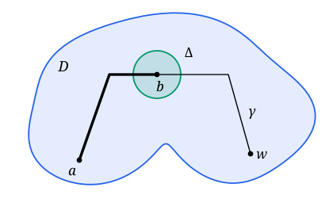

## 这一节要回答的问题

[复幂级数](lesson:math.complex-analysis.complex-power-series)一节留下一个问题：只知道在:term[实轴]{id="math.complex-analysis.real-axis"}（real axis）上$\sum\frac{x^n}{n!}=e^x$，能不能推出在整个:term[复平面]{id="math.complex-analysis.complex-plane"}（complex plane）上$\sum\frac{z^n}{n!}=e^z$？更一般地，两个:term[全纯函数]{id="math.complex-analysis.holomorphic-function"}（holomorphic function）要在多少个点上相等，才能断定处处相等？不恒为$0$的多项式只有有限个零点，全纯函数的零点能不能无限地挤在一起？

## 讲解

### 零点的阶

先看$\sin z$在$\pi$处。由$\sin z=-\sin(z-\pi)$和$\sin$的幂级数（power series），$\sin z=(z-\pi)g(z)$，$g(z)=-1+\frac{(z-\pi)^2}{3!}-\cdots$，$g(\pi)=-1\ne0$。零点处提出的因子是几次方，说明函数在那里贴着$0$贴得多紧。

::anchor{id="def-zero-order"}
设$f$在以$a$为圆心的:term[开圆盘]{id="math.complex-analysis.open-disc"}（open disc）$\Delta$上:term[全纯]{id="math.complex-analysis.holomorphic-function"}，$f(a)=0$，并且$f$在$\Delta$上不恒为$0$。如果$m$是使$f^{(m)}(a)\ne0$的最小正整数，就说$a$是$f$的:term[$m$阶零点]{id="math.complex-analysis.order-of-zero"}（zero of order m），$m$叫作这个零点的阶（order），$m=1$时$a$叫作单零点（simple zero）。由[导数为零的点附近](lesson:math.complex-analysis.power-series#thm-local-form)的定理（那里的$n$就是$f-f(z_0)$在$z_0$处零点的阶），这时$f(z)=(z-a)^mg(z)$，$g$在$\Delta$上全纯，$g(a)=\frac{f^{(m)}(a)}{m!}\ne0$。

为什么这样定义：$f$在$\Delta$上等于它在$a$处的泰勒级数（Taylor series，见[泰勒展开的定理](lesson:math.complex-analysis.power-series#thm-taylor)），$f$不恒为$0$，系数就不全为$0$，所以$m$存在。反过来，$f(z)=(z-a)^mg(z)$、$g$在$a$附近全纯且$g(a)\ne0$时，$g$的泰勒级数乘以$(z-a)^m$就是$f$的泰勒级数（系数由和函数（sum function）决定，见[逐项求导的定理](lesson:math.complex-analysis.complex-power-series#thm-termwise-complex)），所以$a$是$m$阶零点；多项式的$m$重根正是$m$阶零点。边界情况：实函数$e^{-1/x^2}$（在$0$处补上$0$）不恒为$0$，在$0$处各阶导数却都是$0$（[泰勒级数](lesson:math.calculus.taylor-series#thm-taylor-series-sum)一节），找不到$m$；:term[区域]{id="math.complex-analysis.domain"}（domain）上的全纯函数不会这样（下面的引理）。

### 零点的孤立性

::anchor{id="thm-flat-zero"}
**引理**　设$f$在:term[区域]{id="math.complex-analysis.domain"}$D$上:term[全纯]{id="math.complex-analysis.holomorphic-function"}，$a\in D$，$f(a)$和$f$在$a$处的各阶导数都是$0$。则$f$在$D$上恒为$0$。

**证明**：记$E$是$D$里$f$和各阶导数都为$0$的点的集合，$a\in E$。任取$w\in D$，由区域的定义，有落在$D$里的折线$\gamma(s)$（$0\le s\le1$）从$a$连到$w$；记$s^*$是使$\gamma(s)$（$0\le s\le t$）都在$E$里的$t$的上确界（supremum）。$f$的各阶导数都:term[复可导]{id="math.complex-analysis.complex-derivative"}（complex differentiable），因而连续（见[泰勒展开的定理](lesson:math.complex-analysis.power-series#thm-taylor)），它们在$s<s^*$的$\gamma(s)$处为$0$，所以在$b=\gamma(s^*)$处也为$0$，$b\in E$（$s^*=0$时$b=a$）。

取以$b$为圆心、含在$D$里的:term[开圆盘]{id="math.complex-analysis.open-disc"}$\Delta$。$f$在$\Delta$上等于它在$b$处的泰勒级数，系数全是$0$，所以$f$和各阶导数在$\Delta$上都是$0$，$\Delta\subset E$。假如$s^*<1$，由$\gamma$连续，比$s^*$稍大的$s$也有$\gamma(s)\in\Delta\subset E$，和上确界矛盾；所以$s^*=1$，$w=b\in E$。

实函数$e^{-1/x^2}$做不到的，只有证明里「$f$在$\Delta$上等于泰勒级数」这一步。

::anchor{id="thm-isolated-zeros"}
**定理（:term[零点的孤立性]{id="math.complex-analysis.isolated-zeros"}，principle of isolated zeros）**　设$f$在区域$D$上全纯，在$D$上不恒为$0$，$a\in D$，$f(a)=0$。则$a$是$f$的某个:term[$m$阶零点]{id="math.complex-analysis.order-of-zero"}，并且以$a$为圆心的某个开圆盘里，除$a$以外$f$没有零点。

**证明**：由引理，$f$在$a$处有某阶导数不为$0$，$a$是某个$m$阶零点，$f(z)=(z-a)^mg(z)$，$g(a)\ne0$。$g$在$a$处连续，在以$a$为圆心的某个开圆盘里不为$0$，那里$z\ne a$时$f(z)=(z-a)^mg(z)\ne0$。

为什么有用：零点可以有无穷多个（如$\sin z$的$k\pi$），但彼此隔开；[复幂级数](lesson:math.complex-analysis.complex-power-series)第 8 题（3）在一个圆盘里用过这个想法。

### 唯一性定理

回到开头的问题：$E(z)=\sum\frac{z^n}{n!}$和$e^z$都是:term[整函数]{id="math.complex-analysis.entire-function"}（entire function），在:term[实轴]{id="math.complex-analysis.real-axis"}上相等（[泰勒级数](lesson:math.calculus.taylor-series#thm-exp-sin-cos-series)一节），差$E-e^z$在收敛到$0$的点$\frac1n$处都是$0$。由下面的定理，$E(z)=e^z$对一切:term[复数]{id="math.complex-analysis.complex-number"}（complex number）成立，换了一条路得到[复幂级数](lesson:math.complex-analysis.complex-power-series#thm-exp-power-series)一节的结论。

::anchor{id="thm-identity"}
**定理（:term[唯一性定理]{id="math.complex-analysis.identity-theorem"}，identity theorem）**　设$f$、$g$在:term[区域]{id="math.complex-analysis.domain"}$D$上:term[全纯]{id="math.complex-analysis.holomorphic-function"}，并且下面两条有一条成立：（1）$D$里有一列互不相同的点$z_n$，$f(z_n)=g(z_n)$，$z_n\to z^*\in D$；（2）在$D$里的一点$a$处，$f$和$g$的函数值、各阶导数都分别相等。则$f$、$g$在$D$上处处相等。

**证明**：令$h=f-g$。条件（2）下，由引理$h$恒为$0$。条件（1）下，$h(z^*)=\lim h(z_n)=0$；假如$h$不恒为$0$，由:term[零点的孤立性]{id="math.complex-analysis.isolated-zeros"}，以$z^*$为圆心的某个:term[开圆盘]{id="math.complex-analysis.open-disc"}里除$z^*$外没有$h$的零点。可$n$足够大时$z_n$都落在这个圆盘里，它们互不相同，至多一项等于$z^*$，其余都是$h$在圆盘里异于$z^*$的零点，矛盾。

为什么有用：在一条线段、一段圆弧上相等就够了，[柯西积分公式](lesson:math.complex-analysis.cauchy-integral-formula)一节还要整个圆周。[复变函数与映射](lesson:math.complex-analysis.complex-functions)一节展开验证的$\sin^2z+\cos^2z=1$，两边都是整函数，在实轴上成立就处处成立；那一节说「不等式却不一定」，原因见本节第 7 题。

边界情况：「区域」和「$z^*\in D$」都不能少。在两个:term[不相交]{id="math.logic-sets.disjoint"}（disjoint）的开圆盘上，一个取$0$、另一个取$1$的函数全纯（[柯西积分定理](lesson:math.complex-analysis.cauchy-theorem#def-antiderivative)一节讲:term[原函数]{id="math.complex-analysis.antiderivative"}时用过），在第一个圆盘上和$0$相等，却不恒为$0$。$\sin\frac\pi z$在去掉原点的平面上全纯、不恒为$0$，零点$\frac1k$（$k$是非零整数）却收敛到不在定义域里的$0$。

### 两个推论

::anchor{id="thm-local-constant"}
**推论**　设$f$在:term[区域]{id="math.complex-analysis.domain"}$D$上:term[全纯]{id="math.complex-analysis.holomorphic-function"}，在$D$里某个:term[开圆盘]{id="math.complex-analysis.open-disc"}上恒等于常数$c$。则$f$在$D$上恒等于$c$。

**证明**：沿这个开圆盘的一条半径取一列互不相同、收敛到圆心的点，对$f$和常数$c$用:term[唯一性定理]{id="math.complex-analysis.identity-theorem"}。

为什么有用：[平均值性质与最大模原理](lesson:math.complex-analysis.maximum-modulus)一节证明了$|f|$在$z_0$附近不超过$|f(z_0)|$时$f$在$z_0$附近是常数；有了这条推论，$f$在整个区域上是常数。

::anchor{id="thm-finite-zeros"}
**推论**　设$f$在区域$D$上全纯，在$D$上不恒为$0$，$K$是含在$D$里的有界闭区域（bounded closed region），即包括边界在内、能放进某个圆盘里的集合（它不是:term[开集]{id="math.complex-analysis.open-set"}（open set））。则$f$在$K$里只有有限个零点。

**证明**：否则取$K$里一列互不相同的零点$z_n$，$K$有界，由平面上的致密性定理（Bolzano-Weierstrass theorem，见[子列与致密性定理](lesson:math.analysis.subsequences)第 7 题），有子列（subsequence）收敛到某一点$z^*$。以$z^*$为圆心的每个圆盘里都有$K$的点，$z^*$不在$K$里就在$K$的边界上，而$K$包括边界，所以$z^*\in K\subset D$。由唯一性定理，$f$在$D$上恒为$0$，矛盾。

为什么有用：[辐角原理](lesson:math.complex-analysis.argument-principle)一节要数闭曲线里有几个零点，这条推论保证个数有限。边界情况：$\sin\frac\pi z$在$0<|z|\le1$里有无穷多个零点$\frac1k$，这个集合缺了边界上的$0$。

## 几何图像

图上是引理证明里的情形：粗线是折线上已经知道落在$E$里的一段，假设它停在$b=\gamma(s^*)$，没到$w$。:term[全纯函数]{id="math.complex-analysis.holomorphic-function"}$f$在绿色的:term[开圆盘]{id="math.complex-analysis.open-disc"}$\Delta$上等于它在$b$处的泰勒级数，系数全是$0$，所以$\Delta$整个在$E$里，粗线还能越过$b$往前推，和$s^*$是上确界矛盾。所以粗线一直推到$w$。

:::anim{component="function-plot"}
range: { x: [-2, 4], y: [-0.1, 1] }
functions:
  - expr: "exp(-1/max(x, 1e-9))"
    label: |
      $\varphi(x)$
  - expr: "exp(-1/max(x^2, 1e-12))"
    label: |
      $e^{-1/x^2}$
:::

和实函数对照：蓝线是$\varphi$，$x>0$时$\varphi(x)=e^{-1/x}$，$x\le0$时$\varphi(x)=0$。可以验证它无穷次可导，在$0$处各阶导数都是$0$（道理和$e^{-1/x^2}$一样，这里不证）；它在整个负半轴上是$0$，却不恒为$0$。橙线是$e^{-1/x^2}$（在$0$处补上$0$），只在$0$处为$0$，那里各阶导数也都是$0$。全纯函数在一段上为$0$，或在一点各阶导数都为$0$，就在整个:term[区域]{id="math.complex-analysis.domain"}上恒为$0$，这样接不起来。

## 例题

### 例 1　求零点的阶

求$\sin z-z$在$0$处:term[零点的阶]{id="math.complex-analysis.order-of-zero"}。

**为什么想到这么做**：阶就是泰勒级数里第一个不为$0$的系数的次数，用已知的幂级数最快。

**推导**：$\sin z-z=-\frac{z^3}{3!}+\frac{z^5}{5!}-\cdots=z^3g(z)$，$g(0)=-\frac16\ne0$，所以$0$是三阶零点。

### 例 2　一列点上的值

是否存在在$|z|<1$上:term[全纯]{id="math.complex-analysis.holomorphic-function"}的函数$f$，使对一切$n\ge2$，都有$f\bigl(\frac1n\bigr)=f\bigl(-\frac1n\bigr)=\frac1n$？

**为什么想到这么做**：点$\frac1n$收敛到圆盘里的$0$，由:term[唯一性定理]{id="math.complex-analysis.identity-theorem"}，这些点上的值定死了$f$：用一半条件找出$f$，再拿另一半检验。

**推导**：假如$f$存在。$g(z)=z$在$|z|<1$上全纯，在互不相同、收敛到$0$的点$\frac1n$处和$f$相等，由唯一性定理，$f(z)=z$。于是$f\bigl(-\frac1n\bigr)=-\frac1n\ne\frac1n$，矛盾，所以不存在。只要求连续的话，$|z|$就满足这些条件。

## 常见误区

- 「两个:term[全纯函数]{id="math.complex-analysis.holomorphic-function"}在无穷多个点上相等，就处处相等。」$\sin z$和$0$在一切$k\pi$处相等，却不是同一个函数：:term[唯一性定理]{id="math.complex-analysis.identity-theorem"}的条件（1）要一列互不相同、收敛到定义域中一点的点，这些$k\pi$里取不出来。
- 「唯一性定理对任何:term[开集]{id="math.complex-analysis.open-set"}都成立。」开集还要连成一片，是:term[区域]{id="math.complex-analysis.domain"}：在两个:term[不相交]{id="math.logic-sets.disjoint"}的:term[开圆盘]{id="math.complex-analysis.open-disc"}上，一个取$0$、另一个取$1$的函数，在第一个圆盘上和常数$0$相等，在整个开集上却不相等。
- 「不恒为$0$的全纯函数只有有限个零点。」$\sin z$有无穷多个零点$k\pi$；定义域是区域时，保证有限的是含在定义域里的有界闭区域里的零点（上面的第二个推论）。
