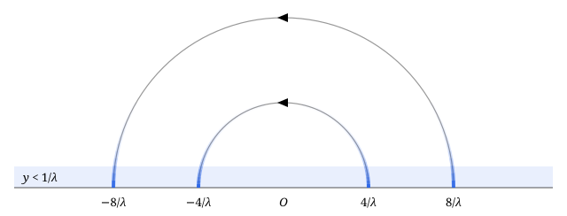

## 这一节要回答的问题

[用留数计算实积分](lesson:math.complex-analysis.real-integrals)一节例 2 算$\int_{-\infty}^{+\infty}\frac{\cos x}{x^2+1}\,\dd x$时，把$\cos x$换成$e^{ix}$，在上半圆周$C_R$：$z=Re^{it}$（$0\le t\le\pi$）上有$|e^{iz}|\le1$；分母又比分子高两次，:term[ML 不等式]{id="math.complex-analysis.ml-inequality"}（ML inequality）就说明了$C_R$上的积分趋于$0$。$\int_{-\infty}^{+\infty}\frac{x\sin x}{x^2+1}\,\dd x$的分母只比分子高一次，同样的估计给出的界是$\pi R\cdot\frac R{R^2-1}$，$R\to+\infty$时趋于$\pi$，不趋于$0$。

这是估计得太粗，还是$\int_{C_R}\frac{ze^{iz}}{z^2+1}\,\dd z$真的不趋于$0$？没有$e^{iz}$时它确实不趋于$0$，$\int_{C_R}\frac z{z^2+1}\,\dd z$对每个$R>1$都是$\pi i$（那一节第 8 题）。可$|e^{iz}|=e^{-y}$在上半平面（upper half-plane）里随高度$y$很快变小，怎样把这一点算进估计里？

## 讲解

### 若尔当不等式

$z=x+iy$时$|e^{iz}|=|e^{ix}e^{-y}|=e^{-y}$；在上半圆周$C_R$上$y=R\sin t$，所以$|e^{iz}|=e^{-R\sin t}$。取$R=10$，它在顶点$t=\frac\pi2$处是$e^{-10}\approx4.5\times10^{-5}$，只在两个端点$t=0$、$t=\pi$附近接近$1$。:term[ML 不等式]{id="math.complex-analysis.ml-inequality"}只用了它的最大值$1$，相当于把整个半圆周上都当成$1$。要用上中间那一大段很小，需要给$\sin t$找一个容易积分的下界。

::anchor{id="thm-jordan-inequality"}
**定理（若尔当不等式，Jordan's inequality）**　$0\le t\le\frac\pi2$时，$\sin t\ge\frac{2t}\pi$。

**证明**：在区间$\bigl[0,\frac\pi2\bigr]$上$(\sin t)''=-\sin t\le0$，由[凹凸性与拐点](lesson:math.calculus.concavity#thm-convex-second-derivative)一节的定理，$\sin t$在这个区间上是凹函数（concave function）。按[定义](lesson:math.calculus.concavity#def-convex)，区间里的曲线不低于连接两个端点$(0,0)$、$\bigl(\frac\pi2,1\bigr)$的弦，而这条弦上横坐标为$t$的点高$\frac{2t}\pi$。

为什么有用：它给出$e^{-R\sin t}\le e^{-2Rt/\pi}$，右边积得出来；和$t$很小时$\sin t\approx t$给出的$e^{-Rt}$相比，指数里只多乘了一个$\frac2\pi$。边界情况：$t>\frac\pi2$时不等式不成立，比如$t=\pi$时左边是$0$、右边是$2$；所以下面把半圆周在$t=\frac\pi2$处分成两半，后一半用$\sin(\pi-t)=\sin t$翻到前一半。

### 若尔当引理

::anchor{id="thm-jordan-lemma"}
**定理（:term[若尔当引理]{id="math.complex-analysis.jordan-lemma"}，Jordan's lemma）**　设$\lambda>0$，$g$在上半圆周$C_R$：$z=Re^{it}$（$0\le t\le\pi$）上连续，并且$C_R$上处处$|g(z)|\le M$。则$\Bigl|\int_{C_R}g(z)e^{i\lambda z}\,\dd z\Bigr|\le\frac{\pi M}\lambda$。所以，如果$R$足够大时$g$都在$C_R$上连续，$C_R$上处处$|g(z)|\le M(R)$，并且$R\to+\infty$时$M(R)\to0$，那么$\int_{C_R}g(z)e^{i\lambda z}\,\dd z\to0$。

**证明**：$z=x+iy$时，$e^{i\lambda z}$的:term[模]{id="math.complex-analysis.modulus"}（modulus）是$|e^{i\lambda x}e^{-\lambda y}|=e^{-\lambda y}$；在$C_R$上$y=R\sin t$，又$|z'(t)|=|iRe^{it}|=R$。由[积分的模不超过模的积分](lesson:math.complex-analysis.contour-integrals#thm-integral-modulus)，

$$
\Bigl|\int_{C_R}g(z)e^{i\lambda z}\,\dd z\Bigr|\le\int_0^\pi Me^{-\lambda R\sin t}R\,\dd t=2MR\int_0^{\pi/2}e^{-\lambda R\sin t}\,\dd t,
$$

后一步是对$\bigl[\frac\pi2,\pi\bigr]$上的那一半换元$t=\pi-s$，由$\sin(\pi-s)=\sin s$，它等于$\bigl[0,\frac\pi2\bigr]$上的那一半。在$\bigl[0,\frac\pi2\bigr]$上，由若尔当不等式，$e^{-\lambda R\sin t}\le e^{-2\lambda Rt/\pi}$，所以

$$
2MR\int_0^{\pi/2}e^{-\lambda R\sin t}\,\dd t\le2MR\int_0^{\pi/2}e^{-2\lambda Rt/\pi}\,\dd t=\frac{\pi M}\lambda\bigl(1-e^{-\lambda R}\bigr)\le\frac{\pi M}\lambda.
$$

取$M=M(R)$，令$R\to+\infty$，就得到后一半。

为什么有用：$|e^{i\lambda z}|$在$C_R$上的最大值是$1$，:term[ML 不等式]{id="math.complex-analysis.ml-inequality"}给的界是$\pi R\cdot M$，要$M(R)$比$\frac1R$衰减得快才趋于$0$（[复积分](lesson:math.complex-analysis.contour-integrals)一节例 2）。若尔当引理的界里没有$R$（见几何图像）。分母只比分子高一次的有理函数（rational function）在$C_R$上的模像$\frac1R$，ML 不等式差一点，若尔当引理正好够用。

边界情况：$\lambda>0$不能少。$\lambda<0$时$|e^{i\lambda z}|=e^{-\lambda y}$在上半平面里随$y$增大，要改用下半圆周（第 5 题）；$\lambda=0$时没有这个因子帮忙，$\int_{C_R}\frac z{z^2+1}\,\dd z$就不趋于$0$。

### 傅里叶型积分

例 1 要算的$\frac{x\sin x}{x^2+1}$、[用留数计算实积分](lesson:math.complex-analysis.real-integrals)一节例 2 的$\frac{\cos x}{x^2+1}$，都是有理函数乘上$\cos\lambda x$或$\sin\lambda x$。这一类积分可以一起处理。

::anchor{id="def-fourier-type"}
设$P$、$Q$是实系数多项式，$Q$没有实根，$\lambda$是不为$0$的实数。$\int_{-\infty}^{+\infty}\frac{P(x)}{Q(x)}\cos\lambda x\,\dd x$和$\int_{-\infty}^{+\infty}\frac{P(x)}{Q(x)}\sin\lambda x\,\dd x$这样的积分叫作傅里叶型积分（Fourier-type integral）。两个都收敛时，把前一个加上$i$乘后一个记作$\int_{-\infty}^{+\infty}\frac{P(x)}{Q(x)}e^{i\lambda x}\,\dd x$，这和:term[复值函数]{id="math.complex-analysis.complex-valued-function"}（complex-valued function）在有限区间上的积分一样，是:term[实部]{id="math.complex-analysis.real-part"}（real part）、:term[虚部]{id="math.complex-analysis.imaginary-part"}（imaginary part）分别积分。

为什么这样定义：$f$的:term[傅里叶变换]{id="math.pde.fourier-transform"}（Fourier transform）常取成$\int_{-\infty}^{+\infty}f(x)e^{-i\omega x}\,\dd x$（见[傅里叶变换](lesson:math.pde.fourier-transform)；有的书多一个常数因子或把指数的正负号反过来），$f=\frac PQ$、$\omega=-\lambda$时就是这里的积分。合成$e^{i\lambda x}$，是因为$\lambda>0$时$|e^{i\lambda z}|$在上半平面里不超过$1$，$\cos\lambda z$、$\sin\lambda z$的:term[模]{id="math.complex-analysis.modulus"}却随$|y|$指数增长（[复变函数与映射](lesson:math.complex-analysis.complex-functions#thm-sin-modulus)一节）；合起来还能一次算出两个积分（例 2）。边界情况：$\lambda=0$时分母只高一次的积分发散，如$\int_{-\infty}^{+\infty}\frac{x\,\dd x}{x^2+1}$；$\lambda\ne0$时它能收敛，靠$\cos\lambda x$、$\sin\lambda x$不断变号的抵消（下面的定理）。

::anchor{id="thm-fourier-type"}
**定理**　设$P$、$Q$是实系数多项式，$Q$的次数至少比$P$的次数高$1$，$Q$没有实根，$\lambda>0$。则$\int_{-\infty}^{+\infty}\frac{P(x)}{Q(x)}\cos\lambda x\,\dd x$、$\int_{-\infty}^{+\infty}\frac{P(x)}{Q(x)}\sin\lambda x\,\dd x$都收敛，并且$\int_{-\infty}^{+\infty}\frac{P(x)}{Q(x)}e^{i\lambda x}\,\dd x=2\pi i\sum_{k=1}^n\Res_{z=z_k}\frac{P(z)}{Q(z)}e^{i\lambda z}$，其中$z_1,\dots,z_n$是$Q$在上半平面里互不相同的全部根。

**证明**：记$f=\frac PQ$，$q$是$Q$的次数。照[有理函数那条定理](lesson:math.complex-analysis.real-integrals#thm-rational-real)证明里的估计（那里$P$的次数不超过$q-2$，这里不超过$q-1$），有正数$\rho_0$、$K$，使$|z|\ge\rho_0$时$|f(z)|\le\frac K{|z|}$，并且$Q$的根都满足$|z|<\rho_0$。$f'=\frac{P'Q-PQ'}{Q^2}$的分子的次数不超过$2q-2$，分母是$2q$次、没有实根，同样的估计给出正数$\rho_1$、$K'$，使$|x|\ge\rho_1$时$|f'(x)|\le\frac{K'}{x^2}$。

收敛：由乘积法则（product rule，见[实变量的复值函数](lesson:math.complex-analysis.complex-exponential#def-complex-valued-function)）和[求导公式](lesson:math.complex-analysis.complex-exponential#thm-exp-derivative)$(e^{i\lambda x})'=i\lambda e^{i\lambda x}$，对实数$x$有$\Bigl(\frac{f(x)e^{i\lambda x}}{i\lambda}\Bigr)'=f(x)e^{i\lambda x}+\frac{f'(x)e^{i\lambda x}}{i\lambda}$。在$[0,b]$上用牛顿-莱布尼茨公式（Newton-Leibniz formula），得

$$
\int_0^bf(x)e^{i\lambda x}\,\dd x=\frac{f(b)e^{i\lambda b}-f(0)}{i\lambda}-\frac1{i\lambda}\int_0^bf'(x)e^{i\lambda x}\,\dd x.
$$

$b\to+\infty$时，$|f(b)e^{i\lambda b}|=|f(b)|\le\frac Kb\to0$；右边最后一个积分的实部、虚部的被积函数（integrand）$f'(x)\cos\lambda x$、$f'(x)\sin\lambda x$的绝对值都不超过$|f'(x)|$，由[比较判别法](lesson:math.calculus.improper-integrals#thm-improper-comparison)（comparison test），它们都绝对收敛（absolutely convergent）。所以左边的实部$\int_0^bf(x)\cos\lambda x\,\dd x$、虚部$\int_0^bf(x)\sin\lambda x\,\dd x$在$b\to+\infty$时都有极限。在$[a,0]$上同样做，令$a\to-\infty$，两端各自收敛，按[定义](lesson:math.calculus.improper-integrals#def-improper-both-ends)两个傅里叶型积分都收敛。

求值：取$R>\rho_0$，线段$[-R,R]$和$C_R$拼成的:term[围道]{id="math.complex-analysis.contour"}（contour）围着$z_1,\dots,z_n$，$Q$在下半平面的根都在外面，围道上没有根。$e^{i\lambda z}$是:term[整函数]{id="math.complex-analysis.entire-function"}（entire function），由:term[留数定理]{id="math.complex-analysis.residue-theorem"}（residue theorem），

$$
\int_{-R}^Rf(x)e^{i\lambda x}\,\dd x+\int_{C_R}f(z)e^{i\lambda z}\,\dd z=2\pi i\sum_{k=1}^n\Res_{z=z_k}f(z)e^{i\lambda z}.
$$

$C_R$上$|f(z)|\le\frac KR$，由:term[若尔当引理]{id="math.complex-analysis.jordan-lemma"}，第二个积分趋于$0$。傅里叶型积分已经证明收敛，$\int_{-R}^R$的实部、虚部各自趋于它们（同有理函数那条定理的证明），所以等式左边趋于$\int_{-\infty}^{+\infty}f(x)e^{i\lambda x}\,\dd x$，它就等于右边。

为什么要先证收敛：同有理函数那条定理后面的说明。分母只比分子高一次时，比较判别法又不能直接用：例如$x\ge1$时$\bigl|\frac{x\sin x}{x^2+1}\bigr|\ge\frac{|\sin x|}{2x}$，而$\int_1^{+\infty}\frac{|\sin x|}x\,\dd x$发散（[无穷区间上的反常积分](lesson:math.calculus.improper-integrals)一节第 6 题）。这样的积分收敛而不绝对收敛，和级数里的条件收敛（conditional convergence）是同一种情形；上面先验证乘积的导数、再积分，正是那道题证$\int_1^{+\infty}\frac{\sin x}x\,\dd x$收敛的办法。

边界情况：$Q$有实根时围道穿过:term[极点]{id="math.complex-analysis.pole"}（pole），见[柯西主值与实轴上的极点](lesson:math.complex-analysis.cauchy-principal-value)一节。

## 几何图像

两条上半圆周的半径是$\frac4\lambda$和$\frac8\lambda$（$\lambda>0$），蓝色越深，$|e^{i\lambda z}|=e^{-\lambda y}$越大；浅蓝色横条是:term[实轴]{id="math.complex-analysis.real-axis"}（real axis）上方高度不到$\frac1\lambda$的地方。深色只出现在两端靠近实轴的两小段弧上；半径加倍，这两小段几乎一样长，变长的只是几乎是$0$的部分。所以积分由$|g|$的上界乘一个只和$\lambda$有关的长度控制，:term[若尔当引理]{id="math.complex-analysis.jordan-lemma"}的界$\frac{\pi M}\lambda$里没有$R$。

:::anim{component="function-plot"}
range: { x: [0, 3.1416], y: [0, 1.1] }
functions:
  - expr: "exp(-R*sin(x))"
    label: |
      $e^{-R\sin t}$
  - expr: "exp(-2*R*min(x, pi - x)/pi)"
    label: |
      若尔当不等式给的上界
  - expr: "1"
    label: |
      ML 不等式用的最大值$1$
sliders:
  - name: R
    min: 1
    max: 20
    step: 1
    default: 4
    label: |
      半径$R$（$\lambda=1$）
:::

取$\lambda=1$，横轴是$C_R$的参数$t$（图上写作 x）：蓝线是$|e^{iz}|=e^{-R\sin t}$，橙线是若尔当不等式给的上界，绿线是 :term[ML 不等式]{id="math.complex-analysis.ml-inequality"}用的最大值$1$。$C_R$上积分的界是$M$乘曲线下的面积再乘$R$。拖动$R$：蓝线、橙线越来越窄地缩到两端，橙线下的面积乘$R$是$\pi(1-e^{-R})$，不超过$\pi$；绿线下的面积乘$R$是$\pi R$，随$R$无限增大。

## 例题

### 例 1　分母只比分子高一次

求$\int_{-\infty}^{+\infty}\frac{x\sin x}{x^2+1}\,\dd x$。

**为什么想到这么做**：分母只比分子高一次，没有实根，$\sin x$是$e^{ix}$的:term[虚部]{id="math.complex-analysis.imaginary-part"}，正好用讲解里傅里叶型积分的定理（$\lambda=1$）。$C_R$上的积分已经由:term[若尔当引理]{id="math.complex-analysis.jordan-lemma"}在定理里处理好了。

**推导**：$\frac{ze^{iz}}{z^2+1}$在上半平面里只有:term[一阶极点]{id="math.complex-analysis.pole"}（simple pole）$i$，由[极点处留数的定理](lesson:math.complex-analysis.residue-theorem#thm-residue-poles)，:term[留数]{id="math.complex-analysis.residue"}（residue）是$\frac{ie^{i\cdot i}}{2i}=\frac1{2e}$。由定理，

$$
\int_{-\infty}^{+\infty}\frac{xe^{ix}}{x^2+1}\,\dd x=2\pi i\cdot\frac1{2e}=\frac{\pi i}e.
$$

取虚部，$\int_{-\infty}^{+\infty}\frac{x\sin x}{x^2+1}\,\dd x=\frac\pi e$；:term[实部]{id="math.complex-analysis.real-part"}是$\int_{-\infty}^{+\infty}\frac{x\cos x}{x^2+1}\,\dd x=0$，和被积函数是奇函数（odd function）相符。$\frac\pi e$和[用留数计算实积分](lesson:math.complex-analysis.real-integrals)一节例 2 的$\int_{-\infty}^{+\infty}\frac{\cos x}{x^2+1}\,\dd x$得数相同，却是两个不同的积分：那里分母比分子高两次，:term[ML 不等式]{id="math.complex-analysis.ml-inequality"}就够；这里分母只高一次，要靠若尔当引理。

### 例 2　一次算出两个积分

求$\int_{-\infty}^{+\infty}\frac{x\cos x}{x^2-2x+2}\,\dd x$和$\int_{-\infty}^{+\infty}\frac{x\sin x}{x^2-2x+2}\,\dd x$。

**为什么想到这么做**：分母比分子高一次，$x^2-2x+2=(x-1)^2+1$没有实根。被积函数没有奇偶性，两个积分都不必是$0$；它们正是$\int_{-\infty}^{+\infty}\frac{xe^{ix}}{x^2-2x+2}\,\dd x$的:term[实部]{id="math.complex-analysis.real-part"}和:term[虚部]{id="math.complex-analysis.imaginary-part"}，用定理可以一次算出。

**推导**：$x^2-2x+2$的根是$1\pm i$，上半平面里只有$1+i$，它是分母的:term[单零点]{id="math.complex-analysis.order-of-zero"}（simple zero）。$\frac{ze^{iz}}{z^2-2z+2}$在$1+i$处的:term[留数]{id="math.complex-analysis.residue"}是$\frac{(1+i)e^{i(1+i)}}{2(1+i)-2}=\frac{(1+i)e^{-1}e^i}{2i}$，由定理和:term[欧拉公式]{id="math.complex-analysis.euler-formula"}（Euler's formula）$e^i=\cos1+i\sin1$，

$$
\int_{-\infty}^{+\infty}\frac{xe^{ix}}{x^2-2x+2}\,\dd x=\frac\pi e(1+i)(\cos1+i\sin1)=\frac\pi e\bigl[(\cos1-\sin1)+i(\cos1+\sin1)\bigr].
$$

所以$\int_{-\infty}^{+\infty}\frac{x\cos x}{x^2-2x+2}\,\dd x=\frac\pi e(\cos1-\sin1)\approx-0.348$，$\int_{-\infty}^{+\infty}\frac{x\sin x}{x^2-2x+2}\,\dd x=\frac\pi e(\cos1+\sin1)\approx1.597$。

## 常见误区

- 「分母只比分子高一次时，在整个$C_R$上用 :term[ML 不等式]{id="math.complex-analysis.ml-inequality"}也能说明$C_R$上的积分趋于$0$。」这样给的界不趋于$0$。带着$e^{i\lambda z}$（$\lambda>0$）时要用:term[若尔当引理]{id="math.complex-analysis.jordan-lemma"}，它用上了$|e^{i\lambda z}|$在半圆周中间很小；不带时积分确实不趋于$0$，$\int_{C_R}\frac z{z^2+1}\,\dd z$对每个$R>1$都是$\pi i$。
- 「$\lambda<0$时也用上半圆周。」这时$|e^{i\lambda z}|=e^{-\lambda y}$在上半平面里随$y$指数增长，若尔当引理用不上。$\frac x{x^2+1}$是实的，所以$\int_{-\infty}^{+\infty}\frac{xe^{-ix}}{x^2+1}\,\dd x$是例 1 结果的:term[共轭]{id="math.complex-analysis.conjugate"}（complex conjugate），即$-\frac{\pi i}e$；照搬上半平面的:term[留数]{id="math.complex-analysis.residue"}会得到$2\pi i\Res_{z=i}\frac{ze^{-iz}}{z^2+1}=\pi ie$，差得很远。
- 「被积函数是奇函数，在整条:term[实轴]{id="math.complex-analysis.real-axis"}上的积分就是$0$。」先要收敛：$\frac{x^2\sin x}{x^2+1}$是奇函数，$\int_{-R}^R$恒为$0$，可分母和分子一样高，$\int_0^b\frac{x^2\sin x}{x^2+1}\,\dd x=1-\cos b-\int_0^b\frac{\sin x}{x^2+1}\,\dd x$没有极限，积分发散。例 1 的:term[实部]{id="math.complex-analysis.real-part"}能说是$0$，是因为定理先保证了它收敛。
