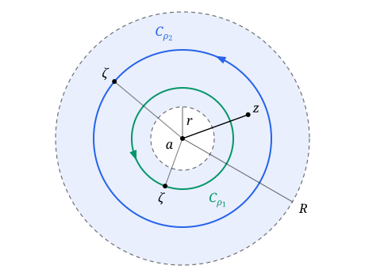

## 这一节要回答的问题

$\frac1{z(1-z)}$在$0$处没有定义，$z\to0$时它的:term[模]{id="math.complex-analysis.modulus"}（modulus）趋于$+\infty$，没有以$0$为中心的泰勒级数（Taylor series）。可在$0<|z|<1$里，由等比级数（geometric series），$\frac1{z(1-z)}=\frac1z\sum_{n=0}^\infty z^n=z^{-1}+1+z+\cdots$，只多出一个负次幂；在$|z|>1$里它又是另一个级数。:term[全纯函数]{id="math.complex-analysis.holomorphic-function"}（holomorphic function）什么时候能写成这种正负次幂都有的级数，在哪里成立，写法唯一吗？

## 讲解

### 圆环

$|z|>1$时$\bigl|\frac1z\bigr|<1$，同样用等比级数，得$\frac1{z(1-z)}=-\frac1{z^2}\cdot\frac1{1-\frac1z}=-\sum_{n=2}^\infty z^{-n}$。两个展开式成立的范围$0<|z|<1$、$|z|>1$，都以$0$为中心，只限制$|z|$的大小。

::anchor{id="def-annulus"}
设$0\le r<R\le+\infty$。集合$\{z:r<|z-a|<R\}$叫作以$a$为中心的:term[圆环]{id="math.complex-analysis.annulus"}（annulus）；$r=0$时它是$0<|z-a|<R$，叫作:term[去心圆盘]{id="math.complex-analysis.punctured-disc"}（punctured disc），$R$有限时是:term[开圆盘]{id="math.complex-analysis.open-disc"}（open disc）去掉圆心，$R=+\infty$时是去掉$a$的整个平面。

为什么这样定义：展开式成立的范围里不能有函数出毛病的点，以$a$为中心避开它们，就得到一圈一圈的圆环；去心圆盘相当于[函数极限的严格定义](lesson:math.analysis.function-limits)一节的去心邻域（punctured neighborhood）搬到了平面上。边界情况：圆环不含边界上的点，$r=0$时挖掉的只是圆心；它总是:term[区域]{id="math.complex-analysis.domain"}（domain）。

### 洛朗级数

::anchor{id="def-laurent-series"}
形如$\sum_{n=-\infty}^{\infty}a_n(z-a)^n$的级数叫作以$a$为中心的:term[洛朗级数]{id="math.complex-analysis.laurent-series"}（Laurent series），$n$取一切整数。它在$z$处收敛，指非负次幂的部分$\sum_{n\ge0}a_n(z-a)^n$和负次幂的部分$\sum_{n\ge1}a_{-n}(z-a)^{-n}$在$z$处都收敛，和就是两部分的和相加。

为什么这样定义：负次幂的部分是$w=\frac1{z-a}$的幂级数（power series），两部分都能用幂级数的办法处理（为什么要各自收敛，见第 8 题）。边界情况：$\sum_{n\ne0}\frac{z^n}{n^2}$只在圆周$|z|=1$上收敛，非负次幂的部分要$|z|\le1$，负次幂的部分要$|z|\ge1$。

::anchor{id="thm-laurent-convergence"}
**定理**　设洛朗级数$\sum_{n=-\infty}^{\infty}a_n(z-a)^n$在:term[圆环]{id="math.complex-analysis.annulus"}$r<|z-a|<R$里处处收敛。则它在圆环里绝对收敛（absolute convergence），和在圆环上:term[全纯]{id="math.complex-analysis.holomorphic-function"}。$r<\rho_1<\rho_2<R$时，非负次幂的部分在$|z-a|\le\rho_2$上、负次幂的部分在$|z-a|\ge\rho_1$上都一致收敛（uniform convergence），所以沿$\rho_1\le|z-a|\le\rho_2$里的分段光滑（piecewise smooth）曲线$C$，乘上$C$上的连续函数以后可以逐项积分。

**证明**：非负次幂的部分是在圆环里处处收敛的幂级数，由[复幂级数](lesson:math.complex-analysis.complex-power-series#thm-disc-of-convergence)一节的定理，收敛半径（radius of convergence）不小于$R$（否则圆环里比收敛半径更远的点处它发散）；负次幂的部分是$\frac1{z-a}$的幂级数，同理收敛半径不小于$\frac1r$（$r=0$时是$+\infty$）。由[逐项求导的定理](lesson:math.complex-analysis.complex-power-series#thm-termwise-complex)和复合函数的[求导法则](lesson:math.complex-analysis.complex-derivative#thm-derivative-rules)，两部分的和都全纯。$|z-a|\le\rho_2$时，余项（remainder）的:term[模]{id="math.complex-analysis.modulus"}不超过和$z$无关、趋于$0$的$\sum_{n>N}|a_n|\rho_2^n$，负次幂的部分同理；再用 :term[ML 不等式]{id="math.complex-analysis.ml-inequality"}（ML inequality）估计积分之差，就能逐项积分。

为什么有用：幂级数在圆盘里收敛，洛朗级数在圆环里收敛；下面求系数、证唯一性，以后的[留数定理](lesson:math.complex-analysis.residue-theorem)一节，都要沿圆环里的曲线逐项积分。边界情况：一般只能保证离开边界的地方一致收敛，$\sum_{n\ge0}z^n$在$|z|<1$里处处收敛，余项$\frac{z^{N+1}}{1-z}$却在$z\to1$时模趋于$+\infty$。

### 洛朗展开

::anchor{id="thm-laurent"}
**定理**　设$f$在:term[圆环]{id="math.complex-analysis.annulus"}$r<|z-a|<R$上:term[全纯]{id="math.complex-analysis.holomorphic-function"}。则在这个圆环里$f(z)=\sum_{n=-\infty}^{\infty}a_n(z-a)^n$，其中$a_n=\frac1{2\pi i}\oint_{C_\rho}\frac{f(\zeta)}{(\zeta-a)^{n+1}}\,\dd\zeta$，$n$取一切整数，$C_\rho$是逆时针的圆周$|\zeta-a|=\rho$，$r<\rho<R$，$a_n$和$\rho$的取法无关。这样的展开是唯一的，它叫作$f$在这个圆环里的:term[洛朗级数]{id="math.complex-analysis.laurent-series"}。

**证明**：[柯西积分公式](lesson:math.complex-analysis.cauchy-integral-formula)一节的定理都要$f$在曲线围成的整块上全纯，套不上圆环，所以先证两圈的积分表示。固定圆环里的$z$，取$r<\rho_1<|z-a|<\rho_2<R$；令$g(\zeta)=\frac{f(\zeta)-f(z)}{\zeta-z}$（$\zeta\ne z$），$g(z)=f'(z)$，它在圆环上连续、除$z$外全纯，由[高阶导数与莫雷拉定理](lesson:math.complex-analysis.higher-derivatives#thm-morera)一节的结论，在圆环上全纯。由[变形积分路径](lesson:math.complex-analysis.cauchy-theorem#thm-deformation)（$g'$[自动连续](lesson:math.complex-analysis.higher-derivatives#thm-derivative-continuous)），$\oint_{C_{\rho_2}}g\,\dd\zeta=\oint_{C_{\rho_1}}g\,\dd\zeta$；$z$在$C_{\rho_2}$里面、在$C_{\rho_1}$外面，$\oint_{C_{\rho_2}}\frac{\dd\zeta}{\zeta-z}=2\pi i$，$\oint_{C_{\rho_1}}\frac{\dd\zeta}{\zeta-z}=0$（两个都见[变形积分路径](lesson:math.complex-analysis.cauchy-theorem#thm-deformation)后面的说明），所以

$$
f(z)=\frac1{2\pi i}\oint_{C_{\rho_2}}\frac{f(\zeta)}{\zeta-z}\,\dd\zeta-\frac1{2\pi i}\oint_{C_{\rho_1}}\frac{f(\zeta)}{\zeta-z}\,\dd\zeta.
$$

外圈$C_{\rho_2}$上$\bigl|\frac{z-a}{\zeta-a}\bigr|<1$，照[全纯函数的幂级数展开](lesson:math.complex-analysis.power-series#thm-taylor)一节的证明，第一个积分展开成$\sum_{n\ge0}a_n(z-a)^n$，$a_n$按$C_{\rho_2}$算。内圈$C_{\rho_1}$上反过来$\bigl|\frac{\zeta-a}{z-a}\bigr|<1$，由等比数列求和，

$$
-\frac1{\zeta-z}=\frac1{z-a}\cdot\frac1{1-\frac{\zeta-a}{z-a}}=\sum_{k=1}^{N}\frac{(\zeta-a)^{k-1}}{(z-a)^k}+\frac{(\zeta-a)^N}{(z-a)^N(z-\zeta)}.
$$

乘以$\frac{f(\zeta)}{2\pi i}$、沿$C_{\rho_1}$积分，$(z-a)^{-k}$的系数正是按$C_{\rho_1}$算的$a_{-k}$。设$C_{\rho_1}$上$|f|\le M$，由 :term[ML 不等式]{id="math.complex-analysis.ml-inequality"}，余项的积分不超过$\frac{M\rho_1}{|z-a|-\rho_1}\bigl(\frac{\rho_1}{|z-a|}\bigr)^N$，趋于$0$，所以第二项等于$\sum_{k\ge1}a_{-k}(z-a)^{-k}$。

最后，$\frac{f(\zeta)}{(\zeta-a)^{n+1}}$在圆环上全纯，由变形积分路径，沿任意两个$C_\rho$的积分相等（同[柯西积分定理](lesson:math.complex-analysis.cauchy-theorem)一节第 5 题（1）），所以两组系数都可以改按同一个$C_\rho$算。唯一性：圆环里若$f(\zeta)=\sum_nb_n(\zeta-a)^n$，乘以$\frac{(\zeta-a)^{-k-1}}{2\pi i}$沿$C_\rho$逐项积分（[收敛的定理](lesson:math.complex-analysis.laurent-series#thm-laurent-convergence)），由[一个最重要的例子](lesson:math.complex-analysis.contour-integrals#thm-power-integral)，只剩$n=k$的一项，得$b_k=a_k$。

为什么有用：有了唯一性，就能像[全纯函数的幂级数展开](lesson:math.complex-analysis.power-series)一节误区 3 那样，借已知的级数凑出洛朗级数（例 1、例 2）。$n=-1$时系数公式是$\oint_{C_\rho}f\,\dd\zeta=2\pi ia_{-1}$，绕一圈的积分只由一个系数决定，以后[留数定理](lesson:math.complex-analysis.residue-theorem)一节专门讲它。边界情况：$f$在整个$|z-a|<R$上全纯时，$n<0$的被积函数（integrand）也全纯，积分是$0$，洛朗级数就是泰勒级数。

### 主部

::anchor{id="def-principal-part"}
设$f$在:term[去心圆盘]{id="math.complex-analysis.punctured-disc"}$0<|z-a|<R$上:term[全纯]{id="math.complex-analysis.holomorphic-function"}，它在这个去心圆盘里的:term[洛朗级数]{id="math.complex-analysis.laurent-series"}是$\sum_{n=-\infty}^{\infty}a_n(z-a)^n$。负次幂的部分$\sum_{n\ge1}a_{-n}(z-a)^{-n}$叫作$f$在$a$处的:term[主部]{id="math.complex-analysis.principal-part"}（principal part）。

为什么这样定义：非负次幂的部分是收敛半径不小于$R$的幂级数，和在$|z-a|<R$上全纯，所以$f$减去主部、在$a$处补上$a_0$，就在整个$|z-a|<R$上全纯，$f$在$a$处的毛病全在主部里。主部作为$\frac1{z-a}$的幂级数，收敛半径是$+\infty$（$|z-a|$任意小时都收敛），由[收敛的定理](lesson:math.complex-analysis.laurent-series#thm-laurent-convergence)，它在去掉$a$的整个平面上处处收敛、全纯，在每个$|z-a|\ge\delta$（$\delta>0$）上一致收敛。系数公式里的$\rho$可以任意小，所以主部只由$a$附近的$f$决定。

边界情况：$\frac{\sin z}z$在$0$处的主部是$0$，$\frac1{z(1-z)}$的是$\frac1z$，$e^{1/z}=\sum_{n\ge0}\frac{z^{-n}}{n!}$的有无穷多项；[孤立奇点的分类](lesson:math.complex-analysis.singularities)一节就按这三种情形分类。

## 几何图像

浅蓝色的是:term[圆环]{id="math.complex-analysis.annulus"}$r<|z-a|<R$，蓝、绿两个圆周是证明里的$C_{\rho_2}$、$C_{\rho_1}$，都取逆时针方向，$z$夹在中间。外圈上的$\zeta$离$a$比$z$远，按$\frac{z-a}{\zeta-a}$的幂展开，得到非负次幂；内圈上的$\zeta$离$a$比$z$近，只能按$\frac{\zeta-a}{z-a}$的幂展开，得到负次幂。

## 例题

### 例 1　同一个函数的两个洛朗级数

把$\frac1{(z-1)(z-2)}$分别在:term[圆环]{id="math.complex-analysis.annulus"}$1<|z|<2$和$|z|>2$里展开成:term[洛朗级数]{id="math.complex-analysis.laurent-series"}。

**为什么想到这么做**：拆成两项，每一项$\frac1{z-c}$用等比级数展开：$|z|<|c|$时按$\frac zc$的幂，$|z|>|c|$时按$\frac cz$的幂；由唯一性，凑出来的就是洛朗级数。

**推导**：写成$\frac A{z-1}+\frac B{z-2}$，通分以后比较分子：$1=A(z-2)+B(z-1)$，所以$A+B=0$、$-2A-B=1$，$A=-1$，$B=1$。在$1<|z|<2$里，

$$
\frac1{z-1}=\frac1z\cdot\frac1{1-\frac1z}=\sum_{n=1}^\infty z^{-n},\qquad\frac1{z-2}=-\frac12\cdot\frac1{1-\frac z2}=-\sum_{n=0}^\infty\frac{z^n}{2^{n+1}},
$$

所以$\frac1{(z-1)(z-2)}=-\sum_{n=1}^\infty z^{-n}-\sum_{n=0}^\infty\frac{z^n}{2^{n+1}}$。在$|z|>2$里$\frac1{z-1}$的展开式照旧，而$\frac1{z-2}=\frac1z\cdot\frac1{1-\frac2z}=\sum_{n=1}^\infty2^{n-1}z^{-n}$，所以$\frac1{(z-1)(z-2)}=\sum_{n=2}^\infty(2^{n-1}-1)z^{-n}$，只有负次幂。

### 例 2　$\frac{\sin z}{z^4}$的洛朗级数

求$\frac{\sin z}{z^4}$在:term[去心圆盘]{id="math.complex-analysis.punctured-disc"}$0<|z|<+\infty$里的:term[洛朗级数]{id="math.complex-analysis.laurent-series"}和它在$0$处的:term[主部]{id="math.complex-analysis.principal-part"}，并求$\oint_{|z|=1}\frac{\sin z}{z^4}\,\dd z$，圆周取逆时针方向。

**为什么想到这么做**：$\sin z$的级数除以$z^4$，就是一个在去心圆盘里处处成立的洛朗级数，由唯一性就是要求的；积分只看$z^{-1}$的系数。

**推导**：由$\sin z=z-\frac{z^3}{3!}+\frac{z^5}{5!}-\frac{z^7}{7!}+\cdots$，$z\ne0$时

$$
\frac{\sin z}{z^4}=z^{-3}-\frac{z^{-1}}6+\frac z{120}-\frac{z^3}{5040}+\cdots,
$$

主部是$z^{-3}-\frac{z^{-1}}6$。$a_{-1}=-\frac16$，由系数公式（$\rho=1$），$\oint_{|z|=1}\frac{\sin z}{z^4}\dd z=2\pi i\cdot\bigl(-\frac16\bigr)=-\frac{\pi i}3$。[高阶导数与莫雷拉定理](lesson:math.complex-analysis.higher-derivatives)一节第 6 题用:term[高阶导数公式]{id="math.complex-analysis.higher-derivative-formula"}（Cauchy's integral formula for derivatives）沿正方形算出的也是这个数。

## 常见误区

- 「同一个函数只有一个:term[洛朗级数]{id="math.complex-analysis.laurent-series"}。」唯一性说的是在同一个:term[圆环]{id="math.complex-analysis.annulus"}里；中心相同、圆环不同，展开式可以不同：例 1 的函数在$1<|z|<2$里正负次幂都有，在$|z|>2$里只有负次幂。
- 「洛朗级数的系数就是$\frac{f^{(n)}(a)}{n!}$。」$n<0$时这个式子没有意义，$f$在$a$处也可能没有定义；就算$f$在$a$附近:term[全纯]{id="math.complex-analysis.holomorphic-function"}，也可能不对：$\frac1{z-2}$在$0$附近全纯，可它在$|z|>2$里的洛朗级数$\sum_{n\ge1}2^{n-1}z^{-n}$没有非负次幂。
