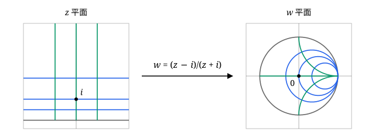

## 这一节要回答的问题

[复变函数与映射](lesson:math.complex-analysis.complex-functions)一节里，$\frac1z$把直线映成过原点的圆。有没有一类:term[映射]{id="math.logic-sets.map"}（map），专门在圆和直线之间互相转换？能不能找到一个映射，把上半平面映成单位圆盘，或者把任意给定的三个点送到另外三个点？

## 讲解

### 扩充复平面

::anchor{id="def-extended-plane"}
在:term[复平面]{id="math.complex-analysis.complex-plane"}（complex plane）上添一个点$\infty$，得到的$\C\cup\{\infty\}$叫作:term[扩充复平面]{id="math.complex-analysis.extended-complex-plane"}（extended complex plane）。$z\to\infty$指$|z|\to+\infty$。

为什么这样定义：分式$\frac{az+b}{cz+d}$在$z=-\frac dc$处分母为$0$，那里的值越来越大；添上$\infty$，就可以说它映成$\infty$，变换成了扩充复平面到自身的一一映射。直线向两头无限延伸，也可以看成经过$\infty$的「圆」，这样「圆和直线」可以一起处理。边界情况：$\infty$不是:term[复数]{id="math.complex-analysis.complex-number"}（complex number），$\infty-\infty$、$0\cdot\infty$这些式子没有意义，下面只在定义变换的值时用到它。

### 分式线性变换

::anchor{id="def-mobius"}
设$a$、$b$、$c$、$d$是:term[复数]{id="math.complex-analysis.complex-number"}，$ad-bc\ne0$。$T(z)=\frac{az+b}{cz+d}$叫作:term[分式线性变换]{id="math.complex-analysis.mobius-transformation"}（Möbius transformation），也叫默比乌斯变换。$c\ne0$时规定$T\bigl(-\frac dc\bigr)=\infty$、$T(\infty)=\frac ac$；$c=0$时规定$T(\infty)=\infty$。

为什么这样定义：条件$ad-bc\ne0$保证$T$是一一的：$T(z)-T(w)=\frac{(ad-bc)(z-w)}{(cz+d)(cw+d)}$，$z\ne w$时不为$0$；$ad-bc=0$时分子分母成比例，$T$是常数。解$w=\frac{az+b}{cz+d}$得$z=\frac{dw-b}{-cw+a}$，所以:term[逆映射]{id="math.logic-sets.inverse-map"}（inverse map）也是分式线性变换；直接代入可以验证，两个分式线性变换的复合仍是分式线性变换。导数$T'(z)=\frac{ad-bc}{(cz+d)^2}\ne0$，所以$T$在去掉$-\frac dc$的:term[复平面]{id="math.complex-analysis.complex-plane"}上是:term[共形映射]{id="math.complex-analysis.conformal-map"}（conformal map）。边界情况：$c=0$时$T$就是一次函数$\frac adz+\frac bd$，它把$\infty$映成$\infty$，在整个复平面上共形。

### 分解成三种简单变换

::anchor{id="thm-mobius-decomposition"}
**定理**　每个:term[分式线性变换]{id="math.complex-analysis.mobius-transformation"}都由平移$z\mapsto z+\beta$、旋转伸缩$z\mapsto\alpha z$（$\alpha\ne0$）和倒数$z\mapsto\frac1z$复合而成。

**证明**：$c=0$时$d\ne0$，$T(z)=\frac adz+\frac bd$，先旋转伸缩、再平移。$c\ne0$时，

$$
T(z)=\frac ac-\frac{ad-bc}{c^2}\cdot\frac1{z+\frac dc},
$$

依次做平移$z\mapsto z+\frac dc$、倒数、乘以$-\frac{ad-bc}{c^2}$、平移$z\mapsto z+\frac ac$。

### 圆和直线的像

::anchor{id="thm-circles"}
**定理**　:term[分式线性变换]{id="math.complex-analysis.mobius-transformation"}把圆或直线映成圆或直线。$c\ne0$时，原来的圆或直线经过$-\frac dc$，像（image）就是直线，否则是圆；$c=0$时，圆映成圆，直线映成直线。

**证明**：由上面的分解，只要对三种简单变换分别证。平移、旋转伸缩把圆映成圆、直线映成直线。倒数：圆和直线都能写成$A|z|^2+\bar Bz+B\bar z+C=0$，其中$A$、$C$是实数，$|B|^2>AC$（$A\ne0$时配方得圆$\bigl|z+\frac BA\bigr|^2=\frac{|B|^2-AC}{A^2}$，$A=0$时是直线$2\Re(\bar Bz)+C=0$）。令$z=\frac1w$，乘以$|w|^2$得$C|w|^2+Bw+\bar B\bar w+A=0$，形状相同，系数满足同样的不等式，所以像也是圆或直线；$C=0$即原来经过$0$时像是直线。

为什么有用：判断像是圆还是直线，只看原来的圆或直线经不经过使分母为$0$的点，经过就成直线。确定像的位置，取原来曲线上三个点算出像，三点定一个圆（或一条直线）；再取一个内点，看:term[区域]{id="math.complex-analysis.domain"}（domain）映到哪一边。边界情况：圆心一般不映成像的圆心，比如$\frac1z$把圆$|z-2|=1$映成以$\frac23$为圆心的圆（第 3 题），圆心$2$却映成$\frac12$。

### 三点确定一个变换

::anchor{id="def-cross-ratio"}
设$z_1$、$z_2$、$z_3$是:term[扩充复平面]{id="math.complex-analysis.extended-complex-plane"}上互不相同的三点。$(z,z_1,z_2,z_3)=\frac{(z-z_1)(z_2-z_3)}{(z-z_3)(z_2-z_1)}$叫作$z$、$z_1$、$z_2$、$z_3$的:term[交比]{id="math.complex-analysis.cross-ratio"}（cross-ratio）；某个$z_k$是$\infty$时，把含它的两个因子去掉。

为什么这样定义：作为$z$的函数，交比是一个:term[分式线性变换]{id="math.complex-analysis.mobius-transformation"}，把$z_1$、$z_2$、$z_3$分别映成$0$、$1$、$\infty$，它的$ad-bc=(z_2-z_3)(z_2-z_1)(z_1-z_3)\ne0$。所以三个点总能先送到标准位置$0$、$1$、$\infty$。边界情况：两点重合时分子分母同时出现$0$，交比没有意义，定义里要求三点互不相同。

::anchor{id="thm-three-points"}
**定理**　设$z_1$、$z_2$、$z_3$是扩充复平面上互不相同的三点，$w_1$、$w_2$、$w_3$也是。则恰有一个分式线性变换$T$，使$T(z_k)=w_k$，$k=1,2,3$。

**证明**：存在：记$S(z)=(z,z_1,z_2,z_3)$、$S'(w)=(w,w_1,w_2,w_3)$，$T=S'^{-1}\circ S$把$z_k$先映成$0$、$1$、$\infty$，再映成$w_k$。唯一：设$T_1$、$T_2$都满足，$U=T_2^{-1}\circ T_1$把三个点都映成自己。$U(z)=z$化为$cz^2+(d-a)z-b=0$：$c\ne0$时$U(\infty)=\frac ac\ne\infty$，不动点至多两个；$c=0$时$\infty$是不动点，有限的不动点满足$(a-d)z+b=0$，除非$a=d$、$b=0$，至多一个。三个不动点只能是$c=b=0$、$a=d$，即$U$是:term[恒等映射]{id="math.logic-sets.identity-map"}（identity map），$T_1=T_2$。

为什么有用：求变换只要写出$(w,w_1,w_2,w_3)=(z,z_1,z_2,z_3)$，解出$w$。三个点又确定一个圆，所以任何一个圆或直线都能映成任何另一个圆或直线；再看一个内点，就知道:term[区域]{id="math.complex-analysis.domain"}映到哪一边。边界情况：分式线性变换只有四个系数、差一个公共倍数，自由度正好是三个点，再多指定一个点的像一般就做不到。

## 几何图像

左边是上半平面里的横线$y=\frac12,1,2$（蓝）和竖线$x=-1,0,1$（绿），右边是它们在$w=\frac{z-i}{z+i}$下的像（例 1）。:term[实轴]{id="math.complex-analysis.real-axis"}（real axis）映成单位圆周，$\infty$映成$1$；横线不经过$-i$，映成圆，又都经过$\infty$，所以都过点$1$；竖线只画了上半段，映成以$1$为终点的圆弧，$x=0$的那条成了沿实轴的直径；竖线和横线的像仍交成直角。$i$映成圆心$0$，整个上半平面落在单位圆里面。

## 例题

### 例 1　把上半平面映成单位圆盘

证明$T(z)=\frac{z-i}{z+i}$把上半平面$\{\Im z>0\}$一一地映成单位圆盘$\{|w|<1\}$。

**为什么想到这么做**：$|T(z)|$是$z$到$i$、到$-i$的距离之比；上半平面里的点离$i$更近。

**推导**：$|z-i|^2-|z+i|^2=-4\Im z$，所以$\Im z>0$时$|z-i|<|z+i|$，$|T(z)|<1$；$\Im z=0$时$|T(z)|=1$。反过来，$|w|<1$时解出$z=\frac{i(1+w)}{1-w}$，算得$\Im z=\frac{1-|w|^2}{|1-w|^2}>0$，所以单位圆盘里每一点都恰好来自上半平面的一点。

### 例 2　把三个点映到$0$、$1$、$\infty$

求把$1$、$i$、$-1$分别映成$0$、$1$、$\infty$的:term[分式线性变换]{id="math.complex-analysis.mobius-transformation"}，并说出它把单位圆盘映成什么。

**为什么想到这么做**：映成$0$、$1$、$\infty$的变换就是:term[交比]{id="math.complex-analysis.cross-ratio"}$(z,1,i,-1)$。

**推导**：$T(z)=\frac{(z-1)(i+1)}{(z+1)(i-1)}$，而$\frac{1+i}{-1+i}=\frac{(1+i)(-1-i)}{(-1+i)(-1-i)}=-i$，所以$T(z)=-i\cdot\frac{z-1}{z+1}$。$1$、$i$、$-1$在单位圆周上，所以单位圆周映成经过$0$、$1$、$\infty$的直线，即:term[实轴]{id="math.complex-analysis.real-axis"}；$T(0)=i$在上半平面，所以单位圆盘映成上半平面。它和例 1 的方向相反：例 1 把上半平面映成单位圆盘，这里把单位圆盘映成上半平面。

## 常见误区

- 「:term[分式线性变换]{id="math.complex-analysis.mobius-transformation"}把圆映成圆。」也可能映成直线：经过$-\frac dc$的圆映成直线，比如$\frac1z$把经过原点的圆映成直线。
- 「圆心映成像的圆心。」一般不对：$\frac1z$把圆$|z-2|=1$映成以$\frac23$为圆心的圆，圆心$2$却映成$\frac12$。
- 「$\frac{az+b}{cz+d}$只要分母不恒为$0$就是分式线性变换。」还要$ad-bc\ne0$：$\frac{2z+2}{z+1}$在$z\ne-1$处恒等于$2$，不是一一的。
