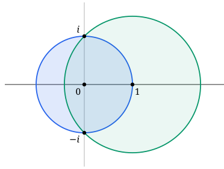

## 这一节要回答的问题

[复幂级数](lesson:math.complex-analysis.complex-power-series)一节说明，幂级数（power series）在:term[收敛圆盘]{id="math.complex-analysis.disc-of-convergence"}（disc of convergence）里:term[全纯]{id="math.complex-analysis.holomorphic-function"}（holomorphic）。反过来，全纯函数能不能在每一点附近写成幂级数？实函数$\frac1{1+x^2}$在整个:term[实轴]{id="math.complex-analysis.real-axis"}（real axis）上无穷次可导，它在$0$处的展开式$\sum(-1)^nx^{2n}$却只在$|x|<1$里成立，毛病出在哪里？

## 讲解

### 全纯函数的泰勒展开

::anchor{id="thm-taylor"}
**定理**　设$f$在以$a$为圆心、半径为$R$的:term[开圆盘]{id="math.complex-analysis.open-disc"}（open disc）$\Delta$上:term[全纯]{id="math.complex-analysis.holomorphic-function"}。则$f$在$\Delta$上无穷次可导，并且对$\Delta$里的每个$z$，$f(z)=\sum_{n=0}^\infty a_n(z-a)^n$，其中$a_n=\frac{f^{(n)}(a)}{n!}$。右边叫作$f$在$a$处的泰勒级数（Taylor series），系数也可以写成$a_n=\frac1{2\pi i}\oint_{C_r}\frac{f(\zeta)}{(\zeta-a)^{n+1}}\,\dd\zeta$，$C_r$是圆周$|\zeta-a|=r$，$0<r<R$。

**证明**：取定$r$，设$|z-a|=\rho<r$。对$C_r$上的$\zeta$，记$q=\frac{z-a}{\zeta-a}$，则$|q|=\frac\rho r<1$。由$\frac1{\zeta-z}=\frac1{\zeta-a}\cdot\frac1{1-q}$和等比数列求和$\frac1{1-q}=\sum_{n=0}^{N-1}q^n+\frac{q^N}{1-q}$，

$$
\frac1{\zeta-z}=\sum_{n=0}^{N-1}\frac{(z-a)^n}{(\zeta-a)^{n+1}}+\frac{(z-a)^N}{(\zeta-a)^N(\zeta-z)}.
$$

乘以$\frac{f(\zeta)}{2\pi i}$、沿$C_r$积分，由:term[柯西积分公式]{id="math.complex-analysis.cauchy-integral-formula"}（Cauchy's integral formula），$f(z)=\sum_{n=0}^{N-1}c_n(z-a)^n+E_N$，其中$c_n$是上面写的圆周上的积分，$E_N$是最后一项的积分。$f$在$C_r$上连续，有界，设$|f|\le M$；又$|\zeta-z|\ge r-\rho$，由:term[ML 不等式]{id="math.complex-analysis.ml-inequality"}（ML inequality），$|E_N|\le\frac M{2\pi}\cdot\frac{\rho^N}{r^N(r-\rho)}\cdot2\pi r$，$N\to\infty$时趋于$0$。所以$|z-a|<r$时$f(z)=\sum_{n=0}^\infty c_n(z-a)^n$。

这个级数在$|z-a|<r$里收敛，收敛半径（radius of convergence）至少是$r$。由[逐项求导的定理](lesson:math.complex-analysis.complex-power-series#thm-termwise-complex)，它的和$f$在$|z-a|<r$里无穷次可导，$f^{(n)}(a)=n!\,c_n$，所以$c_n=\frac{f^{(n)}(a)}{n!}$，和$r$无关。$\Delta$里的每个$z$，只要取$r$在$|z-a|$和$R$之间，就落在上面的范围里，所以展开式在整个$\Delta$里成立。

为什么有用：柯西积分公式里$z$只出现在$\frac1{\zeta-z}$里，把它展开成等比级数、逐项积分，就得到幂级数；全纯函数在圆盘里由它在圆心的各阶导数完全决定，这也顺带又证明了全纯函数无穷次可导。边界情况：展开式只在以$a$为圆心、整个落在全纯范围里的圆盘里一定成立：$\frac1z$在去掉原点的平面上全纯，它在$1$处的展开式$\sum(-1)^n(z-1)^n$只在$|z-1|<1$里收敛。

### 全纯与解析

::anchor{id="def-analytic"}
设$D$是:term[开集]{id="math.complex-analysis.open-set"}（open set）。如果对$D$里每一点$z_0$，$f$在以$z_0$为圆心的某个:term[开圆盘]{id="math.complex-analysis.open-disc"}里等于一个幂级数$\sum b_n(z-z_0)^n$的和，就说$f$在$D$上解析，$f$叫作$D$上的:term[解析函数]{id="math.complex-analysis.analytic-function"}（analytic function）。

为什么这样定义：「解析」说的是函数在每一点附近都能用幂级数表示；一个级数的:term[收敛圆盘]{id="math.complex-analysis.disc-of-convergence"}可能盖不住整个$D$（像上面的$\frac1z$），所以只要求每一点附近各有一个级数。边界情况：实函数无穷次可导还不能保证这样表示，比如[泰勒级数](lesson:math.calculus.taylor-series)一节边界情况里的$e^{-1/x^2}$；本节第 7 题看它换成复变量以后，在原点附近出了什么问题。

::anchor{id="thm-holomorphic-analytic"}
**定理**　$f$在开集$D$上:term[全纯]{id="math.complex-analysis.holomorphic-function"}，当且仅当$f$在$D$上解析。

**证明**：全纯时，$D$里每一点$z_0$都是某个含在$D$里的开圆盘的圆心，由上面的定理，$f$在这个圆盘里等于它在$z_0$处的泰勒级数，所以解析。解析时，$z_0$附近$f$等于一个幂级数的和，由[逐项求导的定理](lesson:math.complex-analysis.complex-power-series#thm-termwise-complex)，这个和在收敛圆盘里全纯，所以$f$在$z_0$处全纯。

为什么有用：这兑现了[柯西-黎曼方程与全纯函数](lesson:math.complex-analysis.holomorphic)一节说的「两者等价」，从此「全纯」和「解析」可以互换。边界情况：等价说的是在开集上；$|z|^2$只在$0$处:term[复可导]{id="math.complex-analysis.complex-derivative"}（complex differentiable），在$0$附近不全纯，由定理也不等于任何幂级数的和。

### 收敛半径和最近的不全纯点

::anchor{id="thm-radius-nearest"}
**定理**　设$f$在以$a$为圆心、半径为$R$的:term[开圆盘]{id="math.complex-analysis.open-disc"}上:term[全纯]{id="math.complex-analysis.holomorphic-function"}，则$f$在$a$处的泰勒级数的收敛半径至少是$R$。如果圆周$|z-a|=R$上有一点$p$，使$z$在圆盘里趋于$p$时$|f(z)|\to+\infty$，收敛半径就恰好是$R$。

**证明**：由上面的定理，级数在整个圆盘里收敛，收敛半径至少是$R$。假如收敛半径$\rho>R$，级数的和$S$在$|z-a|<\rho$里全纯，在$p$处连续，所以$p$附近$|S|\le|S(p)|+1$；而圆盘里$S=f$，于是$z$在圆盘里趋于$p$时$|f(z)|$有界，矛盾。

为什么有用：要知道泰勒级数在哪里收敛，不必求系数，只要找离$a$最近的、$f$不全纯的点（例 1）；实函数的展开式在:term[实轴]{id="math.complex-analysis.real-axis"}上停下来，原因常常是:term[复平面]{id="math.complex-analysis.complex-plane"}（complex plane）上的这种点。边界情况：公式没有定义的点不一定不全纯：$z\ne0$时$\frac{\sin z}z=\sum_{n=0}^\infty\frac{(-1)^nz^{2n}}{(2n+1)!}$，右边在$0$处等于$1$，补上$f(0)=1$以后$f$是:term[整函数]{id="math.complex-analysis.entire-function"}（entire function），收敛半径是$+\infty$（参看[古尔萨定理](lesson:math.complex-analysis.goursat)一节例 2）。

### 导数为零的点附近

::anchor{id="thm-local-form"}
**定理**　设$f$在以$z_0$为圆心的:term[开圆盘]{id="math.complex-analysis.open-disc"}$\Delta$上:term[全纯]{id="math.complex-analysis.holomorphic-function"}，不是常数，$n$是使$f^{(n)}(z_0)\ne0$的最小正整数。则$f(z)-f(z_0)=(z-z_0)^ng(z)$，其中$g$在$\Delta$上全纯，$g(z_0)=\frac{f^{(n)}(z_0)}{n!}\ne0$。

**证明**：在$\Delta$里$f(z)-f(z_0)=\sum_{k\ge1}a_k(z-z_0)^k$，$a_k=\frac{f^{(k)}(z_0)}{k!}$。$a_k$全是$0$时$f$在$\Delta$上是常数，所以这样的$n$存在，$a_1,\dots,a_{n-1}$都是$0$。令$g(z)=\sum_{k\ge n}a_k(z-z_0)^{k-n}$，$z\ne z_0$时它就是$\frac{f(z)-f(z_0)}{(z-z_0)^n}$，所以在$\Delta$里处处收敛，由逐项求导的定理在$\Delta$上全纯，$g(z_0)=a_n$。

为什么有用：对从$z_0$出发、$z'(0)\ne0$的光滑曲线（smooth curve）$z(t)$，由$\frac{z(t)-z_0}t\to z'(0)$，像$w(t)$满足$\frac{w(t)-f(z_0)}{t^n}\to z'(0)^ng(z_0)$，像的方向的:term[辐角]{id="math.complex-analysis.argument"}（argument）趋于$n\arg z'(0)+\arg g(z_0)$。所以两条曲线的夹角放大成$n$倍，兑现了[共形映射](lesson:math.complex-analysis.conformal-maps)一节的说法。边界情况：$n=1$即$f'(z_0)\ne0$，夹角不变，回到共形的情形。

## 几何图像

$\frac1{1+z^2}$在$\pm i$处分母为$0$，别处:term[全纯]{id="math.complex-analysis.holomorphic-function"}。以$0$为中心，离它最近的这种点是$\pm i$，距离$1$，泰勒级数在蓝色圆盘里收敛；以$1$为中心，最近的距离是$\sqrt2$，泰勒级数在绿色圆盘里收敛。两个圆周都正好碰到$\pm i$，$z\to\pm i$时$|f(z)|\to+\infty$，所以半径不能再大。在:term[实轴]{id="math.complex-analysis.real-axis"}上看，两个展开式分别在$(-1,1)$和$(1-\sqrt2,1+\sqrt2)$里成立，挡住它们的点却不在实轴上。

## 例题

### 例 1　$\frac1{1+z^2}$的收敛半径

求$\frac1{1+z^2}$在$0$处和在$1$处的泰勒级数的收敛半径，并写出它在$0$处的泰勒级数。

**为什么想到这么做**：不必求系数，找离中心最近的、函数不:term[全纯]{id="math.complex-analysis.holomorphic-function"}的点。

**推导**：$1+z^2=0$只在$z=\pm i$处成立，$f$在别处全纯，$z\to\pm i$时$|f(z)|\to+\infty$。$\pm i$到$0$的距离是$1$，到$1$的距离是$\sqrt2$，所以两个收敛半径分别是$1$和$\sqrt2$。$|z|<1$时$\frac1{1+z^2}=\sum_{n=0}^\infty(-z^2)^n$，即$\sum(-1)^nz^{2n}$；展开式是唯一的，这就是$f$在$0$处的泰勒级数。

### 例 2　$e^z$的泰勒级数

求$e^z$在$0$处的泰勒级数。

**为什么想到这么做**：$e^z$是:term[整函数]{id="math.complex-analysis.entire-function"}，各阶导数都是$e^z$，展开式在整个平面上成立。

**推导**：$(e^z)^{(n)}=e^z$，在$0$处是$1$，所以对一切$z$，$e^z=\sum_{n=0}^\infty\frac{z^n}{n!}$，收敛半径是$+\infty$。这就是[欧拉公式与复指数](lesson:math.complex-analysis.complex-exponential)一节说的另一条路：只用$e^z$:term[全纯]{id="math.complex-analysis.holomorphic-function"}、$(e^z)'=e^z$，就得到它等于级数$\sum\frac{z^n}{n!}$。

## 常见误区

- 「实函数在整个:term[实轴]{id="math.complex-analysis.real-axis"}上无穷次可导，泰勒级数就在整个实轴上收敛。」$\frac1{1+x^2}$在$0$处的泰勒级数只在$|x|<1$里收敛，挡住它的是:term[复平面]{id="math.complex-analysis.complex-plane"}上的$\pm i$。
- 「泰勒级数在整个:term[收敛圆盘]{id="math.complex-analysis.disc-of-convergence"}里都等于原来的函数。」只有在以中心为圆心、整个落在:term[全纯]{id="math.complex-analysis.holomorphic-function"}范围里的圆盘里才一定相等：$\Log z$在$-1+i$处的泰勒级数在$|z-(-1+i)|<\sqrt2$里收敛（第 8 题），可在这个圆盘里负实轴下方的点处，它的和比$\Log z$大$2\pi i$。
- 「泰勒级数的系数要先求出各阶导数才能算。」也可以借已知的级数：$\frac1{1+z^2}$由等比级数得到，$\frac{\sin z}z$由$\sin z$的级数除以$z$得到；展开式是唯一的，它们就是泰勒级数。
