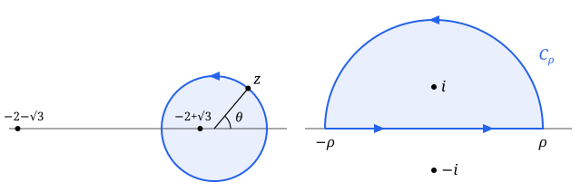

## 这一节要回答的问题

[三角函数的积分](lesson:math.calculus.trig-integrals)一节第 6 题用万能代换（universal substitution）求$\int_0^{2\pi}\frac{\dd x}{2+\cos x}$：$t=\tan\frac x2$在$x=\pi$处从$+\infty$跳到$-\infty$，直接把上下限换成$t=0$、$t=0$会得到$0$，正好漏掉了这一跳。$\int_{-\infty}^{+\infty}\frac{\dd x}{(x^2+1)^2}$也要先费一番功夫求出原函数。能不能不求原函数，把这样的实积分变成闭曲线（closed curve）上的积分，交给:term[留数定理]{id="math.complex-analysis.residue-theorem"}（residue theorem）去算？

## 讲解

### 三角函数有理式的周期积分

先换个办法算开头那个积分。令$z=e^{i\theta}$，$\theta$从$0$增加到$2\pi$时，$z$沿单位圆周逆时针走一圈。由:term[欧拉公式]{id="math.complex-analysis.euler-formula"}（Euler's formula），$e^{\pm i\theta}=\cos\theta\pm i\sin\theta$，所以在单位圆周上$\cos\theta=\frac12(z+z^{-1})$；又由:term[复积分]{id="math.complex-analysis.contour-integral"}（contour integral）的[定义](lesson:math.complex-analysis.contour-integrals#def-contour-integral)，$\oint_{|z|=1}F(z)\,\dd z=\int_0^{2\pi}F(e^{i\theta})\,ie^{i\theta}\,\dd\theta$。取$F(z)=\frac1{2+\frac12(z+z^{-1})}\cdot\frac1{iz}$，右边的被积函数（integrand）正好是$\frac1{2+\cos\theta}$，所以

$$
\int_0^{2\pi}\frac{\dd\theta}{2+\cos\theta}=\oint_{|z|=1}\frac{2\,\dd z}{i(z^2+4z+1)}.
$$

$z^2+4z+1$的根是$-2\pm\sqrt3$，只有$z_1=-2+\sqrt3$在单位圆里。它是分母的:term[单零点]{id="math.complex-analysis.order-of-zero"}（simple zero），所以是被积函数的:term[一阶极点]{id="math.complex-analysis.pole"}（simple pole），它的:term[留数]{id="math.complex-analysis.residue"}（residue）由[极点处留数的定理](lesson:math.complex-analysis.residue-theorem#thm-residue-poles)算得$\frac2{i(2z_1+4)}=\frac1{\sqrt3i}$。由:term[留数定理]{id="math.complex-analysis.residue-theorem"}，积分是$2\pi i\cdot\frac1{\sqrt3i}=\frac{2\pi}{\sqrt3}$，和[三角函数的积分](lesson:math.calculus.trig-integrals)一节第 6 题算出的一样。$z$沿圆周连续地走，不会像$t=\tan\frac\theta2$那样在$\theta=\pi$处跳过整条数轴。

::anchor{id="thm-trig-period"}
**定理**　设$R(\sin\theta,\cos\theta)$是三角函数有理式（rational function of sine and cosine），对每个实数$\theta$都有定义（算的时候不出现除以$0$）。令$F(z)=\frac1{iz}R\Bigl(\frac{z-z^{-1}}{2i},\frac{z+z^{-1}}2\Bigr)$，则$F$在单位圆周上处处:term[全纯]{id="math.complex-analysis.holomorphic-function"}（holomorphic），在单位圆里只有有限个:term[孤立奇点]{id="math.complex-analysis.isolated-singularity"}（isolated singularity）$z_1,\dots,z_n$，并且$\int_0^{2\pi}R(\sin\theta,\cos\theta)\,\dd\theta=2\pi i\sum_{k=1}^n\Res_{z=z_k}F(z)$。

**证明**：$F$由$z$和常数经有限次四则运算得到，是$z$的有理函数（rational function），奇点只能是分母的有限个根。$z=e^{i\theta}$时，由欧拉公式，$\frac{z-z^{-1}}{2i}=\sin\theta$，$\frac{z+z^{-1}}2=\cos\theta$，算$F(z)$的各步就是算$R(\sin\theta,\cos\theta)$的各步再除以$iz$，都不出现除以$0$；各个分母连续，在圆周上每点附近也不为$0$，所以$F$在单位圆周上全纯。由复积分的定义，

$$
\oint_{|z|=1}F(z)\,\dd z=\int_0^{2\pi}F(e^{i\theta})\,ie^{i\theta}\,\dd\theta=\int_0^{2\pi}R(\sin\theta,\cos\theta)\,\dd\theta.
$$

平面去掉$F$在圆外的奇点，是包含单位圆周和它围成的部分的:term[开集]{id="math.complex-analysis.open-set"}（open set），$F$在上面除$z_1,\dots,z_n$外全纯，由留数定理，左边等于$2\pi i\sum_{k=1}^n\Res_{z=z_k}F(z)$。

为什么有用：三角函数有理式处处有定义时，它在一个周期上的积分就化成了$z$的有理函数的留数之和，只要解代数方程、求导数，不用求原函数。[柯西积分定理](lesson:math.complex-analysis.cauchy-theorem)一节第 6 题反过来用过这个代换：把$\oint_{|z|=1}e^z\,\dd z$化成实积分。

边界情况：$R$在某个$\theta$处没有定义时，定理不管。比如$\frac1{1+\cos\theta}$在$\theta=\pi$处没有定义，化出来的$F(z)=\frac2{i(z+1)^2}$在圆周上的$-1$处有二阶极点；这时被积函数在$\pi$附近无界，$\int_0^{2\pi}\frac{\dd\theta}{1+\cos\theta}$连定积分（definite integral）都不是。

### 有理函数在实轴上的积分

再看$\int_{-\infty}^{+\infty}\frac{\dd x}{x^2+1}$，用反正切函数（arctangent）算，它等于$\frac\pi2+\frac\pi2=\pi$，正好拿来检验新办法。:term[实轴]{id="math.complex-analysis.real-axis"}（real axis）不是闭曲线，就补上一段：取$\rho>1$，从$-\rho$沿实轴走到$\rho$，再沿上半圆周$C_\rho$：$z=\rho e^{it}$（$0\le t\le\pi$）回到$-\rho$。

这条闭曲线围着$i$，不围着$-i$；$i$是$\frac1{z^2+1}$的:term[一阶极点]{id="math.complex-analysis.pole"}，:term[留数]{id="math.complex-analysis.residue"}是$\lim_{z\to i}\frac{z-i}{z^2+1}=\frac1{2i}$。沿实轴那一段取$z=x$，就是普通的定积分，由:term[留数定理]{id="math.complex-analysis.residue-theorem"}，

$$
\int_{-\rho}^{\rho}\frac{\dd x}{x^2+1}+\int_{C_\rho}\frac{\dd z}{z^2+1}=2\pi i\cdot\frac1{2i}=\pi.
$$

在$C_\rho$上，由:term[三角不等式]{id="math.complex-analysis.triangle-inequality"}（triangle inequality），$|z^2+1|\ge|z|^2-1=\rho^2-1$，而$C_\rho$长$\pi\rho$，由 :term[ML 不等式]{id="math.complex-analysis.ml-inequality"}（ML inequality），第二个积分的:term[模]{id="math.complex-analysis.modulus"}（modulus）不超过$\frac{\pi\rho}{\rho^2-1}$，$\rho\to+\infty$时趋于$0$（同[复积分](lesson:math.complex-analysis.contour-integrals)一节例 2）。所以$\int_{-\rho}^{\rho}\frac{\dd x}{x^2+1}\to\pi$，和反正切算出的一样。

::anchor{id="def-contour"}
为了用留数定理算积分而选取的分段光滑（piecewise smooth）的简单闭曲线（simple closed curve），叫作:term[围道]{id="math.complex-analysis.contour"}（contour）。上面由线段$[-\rho,\rho]$和上半圆周$C_\rho$拼成的就是一个围道。

为什么这样定义：留数定理只管简单闭曲线，要算的实积分只是其中一段，其余各段要选得让上面的积分能算出来，或者能估计出它趋于什么。边界情况：「8」字形的闭曲线不是围道，它自己相交，留数要乘上绕的圈数（[留数定理](lesson:math.complex-analysis.residue-theorem)一节第 8 题）。

::anchor{id="thm-rational-real"}
**定理**　设$P$、$Q$是实系数多项式，$Q$的次数至少比$P$的次数高$2$，$Q$没有实根。则$\int_{-\infty}^{+\infty}\frac{P(x)}{Q(x)}\,\dd x$绝对收敛（absolutely convergent），并且等于$2\pi i\sum_{k=1}^n\Res_{z=z_k}\frac{P(z)}{Q(z)}$，其中$z_1,\dots,z_n$是$Q$在上半平面（upper half-plane）$\Im z>0$里互不相同的全部根。

**证明**：设$Q(z)=b_qz^q+\dots+b_1z+b_0$，$b_q\ne0$，记$B=|b_0|+\dots+|b_{q-1}|$，$A$是$P$的各系数的模之和。$|z|\ge\rho_0=\max\bigl\{1,\frac{2B}{|b_q|}\bigr\}$时，$|Q(z)-b_qz^q|\le B|z|^{q-1}\le\frac{|b_q|}2|z|^q$，由三角不等式，$|Q(z)|\ge\frac{|b_q|}2|z|^q$；又$|P(z)|\le A|z|^{q-2}$。所以

$$
\Bigl|\frac{P(z)}{Q(z)}\Bigr|\le\frac K{|z|^2}\qquad\Bigl(|z|\ge\rho_0,\ K=\frac{2A}{|b_q|}\Bigr).
$$

收敛：$x\ge\rho_0$时$\bigl|\frac{P(x)}{Q(x)}\bigr|\le\frac K{x^2}$，由[比较判别法](lesson:math.calculus.improper-integrals#thm-improper-comparison)（comparison test），$\int_{\rho_0}^{+\infty}\bigl|\frac{P(x)}{Q(x)}\bigr|\,\dd x$收敛；把$x$换成$-x$，$\int_{-\infty}^{-\rho_0}$同理。$Q$没有实根，$\frac PQ$在$[-\rho_0,\rho_0]$上连续，所以这个反常积分（improper integral）绝对收敛，因而收敛。

求值：由上面的估计，$Q$的根都满足$|z|<\rho_0$。取$\rho>\rho_0$，由线段$[-\rho,\rho]$和$C_\rho$拼成的围道围着$z_1,\dots,z_n$，$Q$在下半平面的根都在外面，围道上没有根。由留数定理，

$$
\int_{-\rho}^{\rho}\frac{P(x)}{Q(x)}\,\dd x+\int_{C_\rho}\frac{P(z)}{Q(z)}\,\dd z=2\pi i\sum_{k=1}^n\Res_{z=z_k}\frac{P(z)}{Q(z)}.
$$

由 ML 不等式，第二个积分的模不超过$\frac K{\rho^2}\cdot\pi\rho=\frac{\pi K}\rho$，$\rho\to+\infty$时趋于$0$。积分收敛，$\int_{-\rho}^{\rho}=\int_{-\rho}^0+\int_0^\rho$的两项各自趋于$\int_{-\infty}^0$和$\int_0^{+\infty}$，所以第一个积分趋于$\int_{-\infty}^{+\infty}\frac{P(x)}{Q(x)}\,\dd x$，它就等于右边。

为什么要先证收敛：围道直接给出的只是对称的极限$\lim_{\rho\to+\infty}\int_{-\rho}^{\rho}$，而$\int_{-\infty}^{+\infty}$收敛要求两端各自收敛（[无穷区间上的反常积分](lesson:math.calculus.improper-integrals#def-improper-both-ends)一节）。$\frac x{1+x^2}$的分母只比分子高一次，$\int_{-\rho}^{\rho}\frac{x\,\dd x}{1+x^2}$对每个$\rho$都是$0$，积分却发散（那一节的常见误区）。

边界情况：分母只比分子高一次时，大半圆上的积分不再趋于$0$（第 8 题）；这时被积函数若还带着$e^{ix}$这样的因子，大半圆上的积分仍可能趋于$0$，只是要用比 ML 不等式更细的估计，见[若尔当引理与傅里叶型积分](lesson:math.complex-analysis.jordan-lemma)一节。$Q$有实根时，围道正好穿过极点，见[柯西主值与实轴上的极点](lesson:math.complex-analysis.cauchy-principal-value)一节。

## 几何图像

左图里$z=e^{i\theta}$随$\theta$从$0$增加到$2\pi$，沿单位圆周逆时针连续地转一圈，不像$t=\tan\frac\theta2$那样在$\theta=\pi$处跳过整条数轴。讲解开头的积分化成的有理函数有两个:term[一阶极点]{id="math.complex-analysis.pole"}$-2\pm\sqrt3$，只有圆里的那个参与计算。右图是有理函数在:term[实轴]{id="math.complex-analysis.real-axis"}上的积分用的:term[围道]{id="math.complex-analysis.contour"}（图里是$\frac1{z^2+1}$的两个极点$\pm i$）：$\rho$足够大时，上半平面的极点都在里面，下半平面的都在外面；分母比分子至少高$2$次时，圆弧上的积分在$\rho\to+\infty$时趋于$0$，剩下的就是实轴上的积分。

## 例题

### 例 1　分母是平方

求$\int_{-\infty}^{+\infty}\frac{\dd x}{(x^2+1)^2}$。

**为什么想到这么做**：分母比分子高$4$次，没有实根，正好用讲解里有理函数的那条定理。上半平面里只有:term[二阶极点]{id="math.complex-analysis.pole"}$i$，:term[留数]{id="math.complex-analysis.residue"}用[极点处留数的定理](lesson:math.complex-analysis.residue-theorem#thm-residue-poles)算，只要求一次导数，比先求原函数省事。

**推导**：$\frac1{(z^2+1)^2}=\frac1{(z-i)^2(z+i)^2}$，$i$是二阶极点。令$g(z)=\frac1{(z+i)^2}$，它在$i$附近:term[全纯]{id="math.complex-analysis.holomorphic-function"}，由极点处留数的定理（$m=2$），留数是$g'(i)=-\frac2{(2i)^3}=\frac1{4i}$。所以

$$
\int_{-\infty}^{+\infty}\frac{\dd x}{(x^2+1)^2}=2\pi i\cdot\frac1{4i}=\frac\pi2.
$$

### 例 2　分子带余弦

求$\int_{-\infty}^{+\infty}\frac{\cos x}{x^2+1}\,\dd x$。

**为什么想到这么做**：被积函数不是有理函数，讲解里的定理用不上，但可以照它的证明，用同一个:term[围道]{id="math.complex-analysis.contour"}。直接换成$\frac{\cos z}{z^2+1}$不行：由[复变函数与映射](lesson:math.complex-analysis.complex-functions#thm-sin-modulus)一节，$\cos(iy)=\cosh y$，$\cos z$在$C_\rho$的顶点$i\rho$处等于$\cosh\rho$，比$\rho^2$大得多，:term[ML 不等式]{id="math.complex-analysis.ml-inequality"}给的界不趋于$0$。改用$e^{iz}$：$\cos x$是$e^{ix}$的:term[实部]{id="math.complex-analysis.real-part"}（real part），而在$y\ge0$处$|e^{iz}|=|e^{ix}e^{-y}|=e^{-y}\le1$。

**推导**：$\bigl|\frac{\cos x}{x^2+1}\bigr|\le\frac1{x^2+1}$，由比较判别法，积分绝对收敛。$\frac{e^{iz}}{z^2+1}$在围道里只有:term[一阶极点]{id="math.complex-analysis.pole"}$i$，:term[留数]{id="math.complex-analysis.residue"}是$\frac{e^{i\cdot i}}{2i}=\frac1{2ie}$，由:term[留数定理]{id="math.complex-analysis.residue-theorem"}，

$$
\int_{-\rho}^{\rho}\frac{e^{ix}}{x^2+1}\,\dd x+\int_{C_\rho}\frac{e^{iz}}{z^2+1}\,\dd z=2\pi i\cdot\frac1{2ie}=\frac\pi e.
$$

在$C_\rho$上$|e^{iz}|\le1$，$|z^2+1|\ge\rho^2-1$，由 ML 不等式，第二个积分的:term[模]{id="math.complex-analysis.modulus"}不超过$\frac{\pi\rho}{\rho^2-1}\to0$，这正是[复积分](lesson:math.complex-analysis.contour-integrals)一节第 5 题。左边第一个积分是:term[复值函数]{id="math.complex-analysis.complex-valued-function"}（complex-valued function）的积分，按[定义](lesson:math.complex-analysis.complex-exponential#def-complex-valued-function)，它的实部、:term[虚部]{id="math.complex-analysis.imaginary-part"}（imaginary part）分别是$\int_{-\rho}^{\rho}\frac{\cos x}{x^2+1}\,\dd x$和$\int_{-\rho}^{\rho}\frac{\sin x}{x^2+1}\,\dd x$。取实部，令$\rho\to+\infty$（积分收敛，同讲解里定理的证明），

$$
\int_{-\infty}^{+\infty}\frac{\cos x}{x^2+1}\,\dd x=\frac\pi e.
$$

虚部趋于$0$，和$\frac{\sin x}{x^2+1}$是奇函数（odd function）相符。以后[若尔当引理与傅里叶型积分](lesson:math.complex-analysis.jordan-lemma)一节算的$\int_{-\infty}^{+\infty}\frac{x\sin x}{x^2+1}\,\dd x$也等于$\frac\pi e$，那是另一个积分：它的分母只比分子高一次，在整个$C_\rho$上用 ML 不等式不够。

## 常见误区

- 「三角函数有理式化成$z$的有理函数以后，单位圆里的:term[极点]{id="math.complex-analysis.pole"}只来自原来的分母。」$\frac1{iz}$和$z^{-1}$的各次幂还可能在$0$处带来极点：$\cos^2\theta$根本没有分母，化成$\frac{(z+z^{-1})^2}{4iz}=\frac{z^2+2+z^{-2}}{4iz}$以后，$0$是三阶极点，:term[留数]{id="math.complex-analysis.residue"}是$\frac1{2i}$，所以$\int_0^{2\pi}\cos^2\theta\,\dd\theta=\pi$，不是$0$。
- 「算有理函数在:term[实轴]{id="math.complex-analysis.real-axis"}上的积分，上半平面、下半平面的极点都要算。」只算:term[围道]{id="math.complex-analysis.contour"}里面的，用上半圆周时就是上半平面的。分母比分子至少高$2$次时，全部极点处的留数之和是$0$（[留数定理](lesson:math.complex-analysis.residue-theorem)一节第 5 题），全都算上只会得到$0$：$\frac1{z^2+1}$在$\pm i$处的留数是$\pm\frac1{2i}$。
