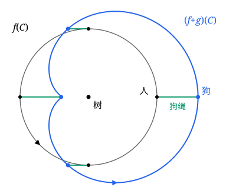

## 这一节要回答的问题

[辐角原理](lesson:math.complex-analysis.argument-principle)一节数$z^3+3z+1$在右半平面（right half-plane）里的根，要沿整条边界跟踪:term[辐角]{id="math.complex-analysis.argument"}（argument）的变化。换成$p(z)=z^5+3z+1$在单位圆盘$|z|<1$里的根：单位圆周上$|3z|=3$，另外两项加起来$|z^5+1|\le2$，比$3$小。能不能不算积分、也不跟踪辐角，只凭这一点就断定$p$和$3z$在圆里的根一样多，都是一个？

## 讲解

### 儒歇定理

设$C$是逆时针的单位圆周，取$f(z)=3z$、$g(z)=z^5+1$，$p=f+g$。$C$上$|g(z)|\le2<3=|f(z)|$，所以$p(z)$到$f(z)$的距离，总比$f(z)$到原点的距离短。好比人牵着狗绕一棵树走：人沿像曲线（image curve）$f(C)$绕树一圈，狗沿$p(C)$走，狗绳比人到树的距离短，狗没法从树的另一侧绕回来，只能跟着人绕树一圈（见几何图像）。

由:term[辐角原理]{id="math.complex-analysis.argument-principle"}（argument principle）和[像曲线绕原点的圈数](lesson:math.complex-analysis.argument-principle#thm-argument-winding)那条定理，$p$在$C$里面的零点个数就是$p(C)$绕原点的圈数，$3z$的零点个数就是$f(C)$绕原点的圈数。狗跟着人绕了一圈，这两个数应该相同，都是$1$。下面的定理把「狗绳比人到树的距离短」这件事说准确。

::anchor{id="thm-rouche"}
**定理（:term[儒歇定理]{id="math.complex-analysis.rouche-theorem"}，Rouché's theorem）**　设$C$是分段光滑（piecewise smooth）的简单闭曲线（simple closed curve），$f$、$g$在一个包含$C$和它围成的部分的:term[开集]{id="math.complex-analysis.open-set"}（open set）上:term[全纯]{id="math.complex-analysis.holomorphic-function"}（holomorphic），在$C$上处处$|g(z)|<|f(z)|$。则$f+g$和$f$在$C$里面的零点个数相同，零点都按阶计，:term[$m$阶零点]{id="math.complex-analysis.order-of-zero"}（zero of order m）算$m$个。

**证明**：让$C$取逆时针方向，零点个数和方向无关。$C$上$|f|>|g|\ge0$，$f$不为$0$；由:term[三角不等式]{id="math.complex-analysis.triangle-inequality"}（triangle inequality），$|f+g|\ge|f|-|g|>0$，$f+g$也不为$0$。$f$、$f+g$都没有:term[极点]{id="math.complex-analysis.pole"}（pole），由辐角原理，它们在$C$里面的零点个数分别是$\frac1{2\pi i}\oint_C\frac{f'}f\,\dd z$和$\frac1{2\pi i}\oint_C\frac{(f+g)'}{f+g}\,\dd z$，只要证明这两个积分相等。

记定理里的开集为$D$，令$U$是$D$里满足$|g(z)|<|f(z)|$的点组成的集合，它包含$C$，并且在它上面$f\ne0$。$|f|-|g|$连续，在$U$的每一点为正，就在以这一点为圆心、含在$D$里的某个:term[开圆盘]{id="math.complex-analysis.open-disc"}（open disc）上为正，所以$U$是开集。在$U$上令$h=1+\frac gf$，它全纯，并且$\Re h\ge1-\bigl|\frac gf\bigr|>0$：$h$的值都在右半平面里，碰不到原点和:term[负实轴]{id="math.complex-analysis.real-axis"}（negative real axis）。

由[对数的导数](lesson:math.complex-analysis.complex-logarithm#thm-log-derivative)，:term[对数主值]{id="math.complex-analysis.principal-logarithm"}（principal logarithm）$\Log$在去掉原点和负实轴的平面上全纯，导数是$\frac1w$；再由复合函数的[求导法则](lesson:math.complex-analysis.complex-derivative#thm-derivative-rules)，$\Log h$在$U$上全纯，导数是$\frac{h'}h$。$h'$也全纯（[导数自动连续](lesson:math.complex-analysis.higher-derivatives#thm-derivative-continuous)），$h$在$U$上不为$0$，所以$\frac{h'}h$在$U$上连续，$\Log h$是它的:term[原函数]{id="math.complex-analysis.antiderivative"}（antiderivative）；$C$是$U$里的闭曲线，由[有原函数时的积分](lesson:math.complex-analysis.cauchy-theorem#thm-antiderivative-integral)那条定理，$\oint_C\frac{h'}h\,\dd z=0$。而$h=\frac{f+g}f$，直接求导可得$\frac{h'}h=\frac{(f+g)'}{f+g}-\frac{f'}f$，:term[对数导数]{id="math.complex-analysis.logarithmic-derivative"}（logarithmic derivative）把商变成了差，所以两个积分相等。

为什么有用：要数某个函数在$C$里面的零点，把它拆成$f+g$，$f$取在$C$上占上风、零点又好数的那一部分，就不用解方程，也不用跟踪:term[辐角]{id="math.complex-analysis.argument"}（例 1、例 2）。

边界情况：$f$、$g$要在$C$围成的整块上全纯。单位圆周上$f(z)=1$、$g(z)=\frac1{2z}$满足$|g|=\frac12<|f|$，可$f+g=\frac{2z+1}{2z}$在圆里有零点$-\frac12$，$f$却没有零点；毛病出在$g$在$0$处有极点，这时辐角原理数出的是零点个数减极点个数，两边都是$0$。$C$上的不等号也要严格，见常见误区。

### 再证代数基本定理

[刘维尔定理与代数基本定理](lesson:math.complex-analysis.liouville#thm-fundamental-algebra)一节用:term[刘维尔定理]{id="math.complex-analysis.liouville-theorem"}（Liouville's theorem）证明了:term[代数基本定理]{id="math.complex-analysis.fundamental-theorem-of-algebra"}（fundamental theorem of algebra）：$n$次复系数多项式至少有一个根，再一次次提出一次因式，才知道恰好有$n$个。把多项式和它的最高次项比一比，:term[儒歇定理]{id="math.complex-analysis.rouche-theorem"}一步就数出了个数，记号照那一节。

::anchor{id="thm-fta-rouche"}
**定理**　设$p(z)=a_nz^n+\dots+a_1z+a_0$是复系数多项式，$n\ge1$，$a_n\ne0$；记$A=|a_0|+\dots+|a_{n-1}|$，$\rho=\max\bigl\{1,\frac{2A}{|a_n|}\bigr\}$。则$p$恰好有$n$个根，重根按重数计，并且都在:term[开圆盘]{id="math.complex-analysis.open-disc"}$|z|<\rho$里。

**证明**：设$R\ge\rho$，取$f(z)=a_nz^n$、$g=p-f$。在圆周$|z|=R$上，因为$R\ge1$，$k\le n-1$时$|a_kz^k|\le|a_k|R^{n-1}$，所以$|g(z)|\le AR^{n-1}$。$A>0$时$|a_n|R\ge|a_n|\rho\ge2A>A$，于是$|g(z)|<|a_n|R^n=|f(z)|$；$A=0$时$g=0$，这个不等式也成立。

$f$在$|z|<R$里只有:term[$n$阶零点]{id="math.complex-analysis.order-of-zero"}$0$，由儒歇定理，$p=f+g$在$|z|<R$里恰有$n$个零点，按阶计；多项式的$m$重根正是$m$阶零点（见[零点的阶](lesson:math.complex-analysis.identity-theorem#def-zero-order)），所以这就是重根按重数计的$n$个根。取$R=\rho$，它们都在$|z|<\rho$里；$R>\rho$时$|z|<R$里也只有这$n$个，圆周$|z|=\rho$上又没有根（$|p|\ge|f|-|g|>0$），所以$|z|\ge\rho$处没有根。

为什么有用：刘维尔定理与代数基本定理一节的常见误区说，证明里的估计「只说明根都在圆盘$|z|<\rho$里」，现在连圆盘里有几个根也知道了。[平均值性质与最大模原理](lesson:math.complex-analysis.maximum-modulus)一节第 6 题用$|p|$在圆盘上的最小值又证了一次，三种证法的比较见本节第 8 题。

边界情况：圆周取小了，占上风的可能换成别的项。$z^2-2$的$\rho=4$，根$\pm\sqrt2$在$|z|<4$里；可在$|z|=1$上常数项占上风（$|z^2|=1<2$），常数$-2$没有零点，所以$|z|<1$里没有根。

一般地，如果圆周$|z|=r$上某一项$a_jz^j$的:term[模]{id="math.complex-analysis.modulus"}（modulus）大于其余各项的模之和，即$|a_j|r^j>\sum_{k\ne j}|a_k|r^k$，那么由儒歇定理，$p$在$|z|<r$里恰有$j$个根，圆周上没有根。在两个圆周上各这样数一次，相减就得到两个圆周之间的:term[圆环]{id="math.complex-analysis.annulus"}（annulus）里有几个根（例 1）。把$a_nz^n$换成别的多项式来比，还能说明多项式的根随系数连续地变（第 5 题）。

## 几何图像

细的圆周是人走的路$f(C)$，$f(z)=2z$，$C$是逆时针的单位圆周；蓝色曲线是狗走的路$(f+g)(C)$，$g(z)=0.9z^2+0.3$；四段绿色短线是四个时刻的狗绳，从人（圆周上的圆点）连到狗（蓝色圆点），长度是$|g(z)|$。$C$上$|g|\le1.2<2=|f|$：在左边，狗离树（原点）只有$0.8$，比人离得还近，可狗绳总比人到树的距离短，狗绕不到树的另一侧，两条路都绕树一圈。由:term[儒歇定理]{id="math.complex-analysis.rouche-theorem"}，$f+g$和$f$一样，在单位圆里只有一个零点。

## 例题

### 例 1　根落在哪个圆环里

$p(z)=z^5+3z+1$在$|z|<1$里、在:term[圆环]{id="math.complex-analysis.annulus"}$1<|z|<2$里各有几个根？

**为什么想到这么做**：照讲解最后一段，在两个圆周上各数一次；半径变了，占上风的项也会变：单位圆周上是$3z$，$|z|=2$上$z^5$大得多。

**推导**：单位圆周上$|z^5+1|\le2<3=|3z|$，$3z$在圆里有一个根，由:term[儒歇定理]{id="math.complex-analysis.rouche-theorem"}，$p$在$|z|<1$里有$1$个根，并且单位圆周上$|p|\ge3-2>0$，没有根。$|z|=2$上$|3z+1|\le7<32=|z^5|$，$z^5$在圆里有:term[五阶零点]{id="math.complex-analysis.order-of-zero"}$0$，所以$p$在$|z|<2$里有$5$个根。相减，圆环$1<|z|<2$里有$4$个根。$p$一共只有$5$个根（:term[代数基本定理]{id="math.complex-analysis.fundamental-theorem-of-algebra"}），所以它的根一个在单位圆里，其余四个都在这个圆环里。

### 例 2　右半平面里的根

方程$z+e^{-z}=2$在右半平面$\Re z>0$里有几个根？

**为什么想到这么做**：右半平面里$|e^{-z}|=e^{-\Re z}<1$，离$2$稍远就比$|z-2|$小，而$z-2$在右半平面里只有一个根$2$。右半平面无界，照[辐角原理](lesson:math.complex-analysis.argument-principle)一节例 1 的办法，先换成一个大的右半圆盘，在它的边界上比较:term[模]{id="math.complex-analysis.modulus"}。

**推导**：取$f(z)=z-2$、$g(z)=e^{-z}$，$\rho>3$，$C$是右半圆盘$|z|<\rho$、$\Re z>0$的边界。:term[虚轴]{id="math.complex-analysis.imaginary-axis"}（imaginary axis）上$z=iy$，$|g|=1<2\le|iy-2|$；半圆周上$\Re z\ge0$，$|g|\le1<\rho-2\le|z-2|$。$f$在$C$里面只有一个根$2$，由:term[儒歇定理]{id="math.complex-analysis.rouche-theorem"}，$f+g$在$C$里面也只有一个根。

$\rho$可以任意大，右半平面里的每个根都在某个这样的$C$里面，所以右半平面里只有一个根。$\varphi(x)=x+e^{-x}-2$满足$\varphi(1)=e^{-1}-1<0$、$\varphi(2)=e^{-2}>0$，由零点定理（Bolzano's theorem），这个根是$(1,2)$里的实数。

## 常见误区

- 「$C$上$|g|\le|f|$就够了。」等号会出问题：单位圆周上$f(z)=z$、$g(z)=-z$满足$|g|=|f|$，$f+g$恒为$0$，零点个数无从谈起。
- 「$|g|<|f|$要在$C$围成的整块上都成立。」只要求在$C$上成立：讲解开头的$f(z)=3z$、$g(z)=z^5+1$在$z=0$处$|g|=1>0=|f|$，结论照样成立。
- 「:term[儒歇定理]{id="math.complex-analysis.rouche-theorem"}说明了$f+g$的根在哪里。」它只说根的个数一样多，不说位置一样：$z^5+3z+1$在单位圆里的根约是$-0.33$，不是$3z$的根$0$。要把根的位置定得更准，可以换更小的圆周或别的曲线去夹（例 1）。
