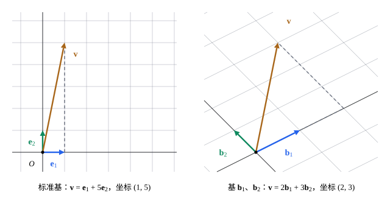

## 这一节要回答的问题

[向量与线性运算](lesson:math.linear-algebra.vectors)里，每个向量都能唯一地写成:term[标准基向量]{id="math.linear-algebra.standard-basis-vector"}（standard basis vector）$\vb e_1,\dots,\vb e_n$的组合，系数就是它的各个:term[分量]{id="math.linear-algebra.component"}（component）。$\R^3$里一个过原点的平面也能这样吗：拿哪几个向量当「坐标轴」，平面上每个向量的坐标（coordinates）是什么？这样的向量要几个，是不是不论怎么选都一样多？

## 讲解

### 基与坐标

::anchor{id="def-basis"}
设$V$是$\R^n$的:term[子空间]{id="math.linear-algebra.subspace"}（subspace）。如果$V$里的向量$\vb b_1,\dots,\vb b_k$:term[线性无关]{id="math.linear-algebra.linearly-independent"}（linearly independent），并且:term[生成]{id="math.linear-algebra.span"}（span）$V$，就说它们是$V$的一组:term[基]{id="math.linear-algebra.basis"}（basis）。$\vb e_1,\dots,\vb e_n$是$\R^n$的一组基，叫作标准基（standard basis）。

为什么这样定义：生成$V$，保证$V$里每个向量都能写成它们的:term[线性组合]{id="math.linear-algebra.linear-combination"}（linear combination）；线性无关，保证写法只有一种（[写法唯一](lesson:math.linear-algebra.linear-independence#thm-unique-coefficients)）。两条合起来，$V$里的每个向量都恰好对应一组系数，就像$\R^n$里的向量对应它的各个:term[分量]{id="math.linear-algebra.component"}。边界情况：一个子空间的基不止一组，例如$(1,0)$、$(1,1)$也是$\R^2$的一组基；$\{\vb 0\}$约定以「一个向量也不取」为基。

::anchor{id="def-coordinates"}
设$\mathcal B=(\vb b_1,\dots,\vb b_k)$是$V$的一组基，排好了顺序。$V$里每个向量$\vb v$都唯一地写成$\vb v=c_1\vb b_1+\dots+c_k\vb b_k$，数组$(c_1,\dots,c_k)$叫作$\vb v$在基$\mathcal B$下的:term[坐标向量]{id="math.linear-algebra.coordinate-vector"}（coordinate vector），记作$[\vb v]_{\mathcal B}$。

为什么这样定义：这是把$\R^n$里「沿坐标轴分解」推广到任何子空间、任何一组基。基的顺序也算在内，换了顺序，坐标也跟着换顺序。边界情况：在标准基下，$\vb v$的坐标向量就是$\vb v$自己。

### 维数

::anchor{id="thm-exchange"}
**个数的上限**　若:term[子空间]{id="math.linear-algebra.subspace"}$V$由$k$个向量:term[生成]{id="math.linear-algebra.span"}，那么$V$里任何多于$k$个的向量都:term[线性相关]{id="math.linear-algebra.linearly-dependent"}（linearly dependent）。

**证明思路**：设$V=\Span\{\vb v_1,\dots,\vb v_k\}$，$\vb w_1,\dots,\vb w_m\in V$，$m>k$，每个$\vb w_j=a_{1j}\vb v_1+\dots+a_{kj}\vb v_k$。:term[齐次线性方程组]{id="math.linear-algebra.homogeneous-system"}（homogeneous linear system）$\sum_{j=1}^ma_{ij}x_j=0$（$i=1,\dots,k$）方程比未知数少，有不全为零的解（[线性方程组与高斯消元](lesson:math.linear-algebra.linear-systems)第 6 题）。于是$\sum_jx_j\vb w_j=\sum_i\bigl(\sum_ja_{ij}x_j\bigr)\vb v_i=\vb 0$，$\vb w_1,\dots,\vb w_m$线性相关。

::anchor{id="def-dimension"}
子空间$V$的任何两组:term[基]{id="math.linear-algebra.basis"}含有同样多的向量；这个个数叫作$V$的:term[维数]{id="math.linear-algebra.dimension"}（dimension），记作$\dim V$。

为什么这样定义：两组基$\mathcal B$、$\mathcal C$里，$\mathcal C$:term[线性无关]{id="math.linear-algebra.linearly-independent"}而$\mathcal B$生成$V$，由上面的定理，$\mathcal C$的个数不超过$\mathcal B$的；反过来也一样，所以两者相等。维数说的是这个子空间有几个「独立的方向」：$\dim\R^n=n$，过原点的直线是$1$维的，过原点的平面是$2$维的。边界情况：$\dim\{\vb 0\}=0$。

::anchor{id="thm-basis-exists"}
**基总是存在**　$\R^n$的每个子空间$V$都有一组基，并且$\dim V\le n$。

**证明思路**：$V=\{\vb 0\}$时没什么可说。否则从$V$里一个非零向量开始，只要当前这组向量还生成不了$V$，就从$V$里再取一个不在已生成的子空间里的向量加进去，由[线性无关](lesson:math.linear-algebra.linear-independence)第 5 题，每一步仍线性无关。$\R^n$里多于$n$个向量一定线性相关，所以至多加到$n$个就停，停下时这组向量生成$V$，是一组基。

::anchor{id="thm-basis-criteria"}
**个数对了，只需查一条**　设$\dim V=k$。$V$里的$k$个向量只要线性无关，就是$V$的一组基；只要生成$V$，也是$V$的一组基。

**证明思路**：线性无关的$k$个向量若生成不了$V$，再加一个不在已生成的子空间里的向量，得到$V$里$k+1$个线性无关的向量；可$V$由一组基的$k$个向量生成，这和上面的定理矛盾。生成$V$的$k$个向量若线性相关，去掉一个多余的，剩下$k-1$个仍生成$V$，而基的$k$个向量线性无关，又和上面的定理矛盾。

### 求一组基

::anchor{id="thm-pivot-basis"}
**挑出一组:term[基]{id="math.linear-algebra.basis"}的办法**　以$\vb v_1,\dots,\vb v_k$为各列化成:term[行阶梯形]{id="math.linear-algebra.row-echelon-form"}（row echelon form），有:term[主元]{id="math.linear-algebra.pivot"}（pivot）的那些列对应的原来的向量，是$\Span\{\vb v_1,\dots,\vb v_k\}$的一组基。

**证明思路**：由[按列消元判断](lesson:math.linear-algebra.linear-independence#thm-independence-pivots)，没有主元的列对应的向量能用它前面的主元列表示，去掉它们，:term[生成]{id="math.linear-algebra.span"}的:term[子空间]{id="math.linear-algebra.subspace"}不变。只看主元列时，化成的行阶梯形每一列都有主元，所以它们:term[线性无关]{id="math.linear-algebra.linearly-independent"}。注意取的是原来的向量，不是行阶梯形里的那些列：行变换改变了各列，却不改变各列之间的线性关系（linear relation）。

::anchor{id="thm-solution-basis"}
**齐次解的基**　:term[齐次线性方程组]{id="math.linear-algebra.homogeneous-system"}的:term[通解]{id="math.linear-algebra.general-solution"}（general solution）$t_1\vb v_1+\dots+t_k\vb v_k$里的$\vb v_1,\dots,\vb v_k$，是它的:term[解集]{id="math.linear-algebra.solution-set"}（solution set）的一组基；解集的:term[维数]{id="math.linear-algebra.dimension"}等于:term[自由变量]{id="math.linear-algebra.free-variable"}（free variable）的个数。

**证明思路**：齐次方程组的全部解正是这些向量的:term[线性组合]{id="math.linear-algebra.linear-combination"}（[解集的结构](lesson:math.linear-algebra.solution-sets#thm-homogeneous-combinations)），所以它们生成解集；每个$\vb v_i$在自己的自由变量的位置上是$1$、在别的自由变量的位置上是$0$，所以线性无关。

## 几何图像

同一个向量$\vb v=(1,5)$，在:term[标准基]{id="math.linear-algebra.basis"}下的坐标是$(1,5)$；换成基$\vb b_1=(2,1)$、$\vb b_2=(-1,1)$，网格线改成沿$\vb b_1$、$\vb b_2$的方向，$\vb v=2\vb b_1+3\vb b_2$，:term[坐标向量]{id="math.linear-algebra.coordinate-vector"}变成$(2,3)$。向量没变，变的是用来量它的那把「尺子」；两种坐标之间怎样换算，在[坐标与基变换](lesson:math.linear-algebra.change-of-basis)里讲。

## 例题

### 例 1　平面的基与坐标

求$\R^3$里的平面$V=\{(x,y,z):x+y-2z=0\}$的一组:term[基]{id="math.linear-algebra.basis"}和:term[维数]{id="math.linear-algebra.dimension"}，并求$\vb v=(3,1,2)$在这组基下的坐标。

**为什么想到这么做**：$V$是齐次方程的:term[解集]{id="math.linear-algebra.solution-set"}，:term[通解]{id="math.linear-algebra.general-solution"}里的向量就是一组基；坐标就是把$\vb v$写成基向量的组合时的系数。

**推导**：$y$、$z$是:term[自由变量]{id="math.linear-algebra.free-variable"}，令$y=s$、$z=t$，得$x=-s+2t$，通解是$s(-1,1,0)+t(2,0,1)$，所以$\vb b_1=(-1,1,0)$、$\vb b_2=(2,0,1)$是一组基，$\dim V=2$。$\vb v$满足$3+1-4=0$，在$V$里；设$\vb v=c_1\vb b_1+c_2\vb b_2=(-c_1+2c_2,\ c_1,\ c_2)$，比较后两个:term[分量]{id="math.linear-algebra.component"}得$c_1=1$、$c_2=2$，第一个分量$-1+4=3$也对上。所以$[\vb v]_{\mathcal B}=(1,2)$。

### 例 2　从生成组里挑出一组基

求$\Span\{(1,2,1),(2,4,2),(1,0,1),(3,4,3)\}$的一组:term[基]{id="math.linear-algebra.basis"}和:term[维数]{id="math.linear-algebra.dimension"}。

**为什么想到这么做**：以四个向量为各列化成:term[行阶梯形]{id="math.linear-algebra.row-echelon-form"}，有:term[主元]{id="math.linear-algebra.pivot"}的列对应的原来的向量就是一组基。

**推导**：三行是$(1,2,1,3)$、$(2,4,0,4)$、$(1,2,1,3)$。做$R_2-2R_1$得$(0,0,-2,-2)$，做$R_3-R_1$得全零的行，主元在第一、三列。所以$(1,2,1)$、$(1,0,1)$是一组基，维数是$2$。验算：$(2,4,2)=2(1,2,1)$，$(3,4,3)=2(1,2,1)+(1,0,1)$。

## 常见误区

- 「一个:term[子空间]{id="math.linear-algebra.subspace"}只有一组:term[基]{id="math.linear-algebra.basis"}。」基有无穷多组，例如$(1,0)$、$(0,1)$和$(1,0)$、$(1,1)$都是$\R^2$的基；不变的是基里向量的个数。
- 「$\R^3$里的平面是$2$维的，所以它就是$\R^2$。」平面上的向量仍有三个:term[分量]{id="math.linear-algebra.component"}（component），它是$\R^3$的子空间；借助一组基的坐标，它才和$\R^2$一一对应。
- 「:term[维数]{id="math.linear-algebra.dimension"}就是向量分量的个数。」例 1 的平面里每个向量有三个分量，维数却是$2$。
- 「用:term[主元]{id="math.linear-algebra.pivot"}列找基，取:term[行阶梯形]{id="math.linear-algebra.row-echelon-form"}里的那几列。」行变换改变了列本身，要取原来的向量；例 2 里行阶梯形的第一列是$(1,0,0)$，并不在原来:term[生成]{id="math.linear-algebra.span"}的子空间里。
- 「坐标和基的顺序无关。」$\mathcal B=(\vb b_1,\vb b_2)$与$(\vb b_2,\vb b_1)$给出的坐标顺序相反。
