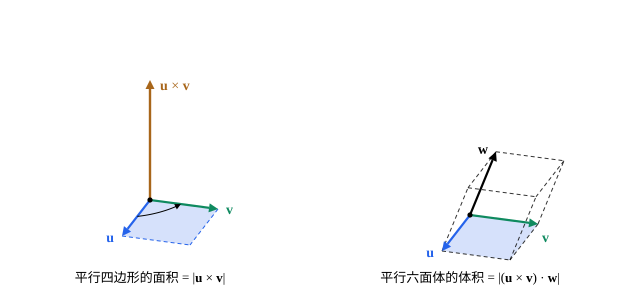

## 这一节要回答的问题

用扳手拧螺丝，扳手越长、用力的方向越接近垂直于扳手，就越容易拧动，螺丝却沿着和扳手、力都垂直的方向前进。给定空间里的两个向量，怎样找一个同时垂直于它们的向量？以它们为邻边的平行四边形，面积怎样直接从:term[分量]{id="math.linear-algebra.component"}（component）算出来？

## 讲解

### 叉积

要找同时垂直于$\vb u$、$\vb v$的向量$\vb w$，就要$\vb w\cdot\vb u=0$、$\vb w\cdot\vb v=0$。下面定义的向量满足这两个条件，而且它的:term[长度]{id="math.linear-algebra.length"}（length）正好是那个平行四边形的面积。

::anchor{id="def-cross-product"}
$\R^3$中的向量$\vb u=(u_1,u_2,u_3)$与$\vb v=(v_1,v_2,v_3)$的:term[叉积]{id="math.linear-algebra.cross-product"}（cross product）是向量$\vb u\times\vb v=(u_2v_3-u_3v_2,\ u_3v_1-u_1v_3,\ u_1v_2-u_2v_1)$，也叫向量积（vector product）。

为什么这样定义：第一个:term[分量]{id="math.linear-algebra.component"}只用第二、三个分量，第二个只用第三、一个，第三个只用第一、二个，下标按$1\to2\to3\to1$轮换，每个分量都是「顺着轮换的乘积减去逆着的乘积」。按这个式子，$\vb e_1\times\vb e_2=\vb e_3$、$\vb e_2\times\vb e_3=\vb e_1$、$\vb e_3\times\vb e_1=\vb e_2$。边界情况：叉积只在$\R^3$里有定义，结果是向量；:term[点积]{id="math.linear-algebra.dot-product"}（dot product）在每个$\R^n$里都有，结果是数。

::anchor{id="thm-cross-laws"}
**叉积的运算律**　对$\R^3$中的向量$\vb u$、$\vb v$、$\vb w$和数$c$：(1) $\vb v\times\vb u=-(\vb u\times\vb v)$；(2) $\vb u\times(\vb v+\vb w)=\vb u\times\vb v+\vb u\times\vb w$，$(c\vb u)\times\vb v=c(\vb u\times\vb v)=\vb u\times(c\vb v)$；(3) $\vb u\times\vb u=\vb 0$。

**证明思路**：叉积的每个分量都形如$u_iv_j-u_jv_i$。交换$\vb u$、$\vb v$，每个分量都变号，这是 (1)；它对$\vb u$的分量、$\vb v$的分量都是一次的，这是 (2)；$\vb u=\vb v$时每个分量都是$u_iu_j-u_ju_i=0$，这是 (3)。(2) 说的是叉积对每个因子都是线性的，(1) 说明换了次序要变号，叉积不满足交换律。

### 几何意义

::anchor{id="thm-cross-geometry"}
**:term[叉积]{id="math.linear-algebra.cross-product"}的几何意义**　设$\vb u$、$\vb v$是$\R^3$中的向量：(1) $\vb u\times\vb v$与$\vb u$、$\vb v$都:term[正交]{id="math.linear-algebra.orthogonal"}（orthogonal）；(2) $|\vb u\times\vb v|^2=|\vb u|^2|\vb v|^2-(\vb u\cdot\vb v)^2$；两者都不为零时，设它们的:term[夹角]{id="math.linear-algebra.angle"}（angle）是$\theta$，则$|\vb u\times\vb v|=|\vb u||\vb v|\sin\theta$，等于以$\vb u$、$\vb v$为邻边的平行四边形的面积；(3) $\vb u\times\vb v=\vb 0$当且仅当$\vb u$与$\vb v$:term[平行]{id="math.linear-algebra.parallel"}（parallel）。

**证明思路**：(1) 直接计算，$\vb u\cdot(\vb u\times\vb v)=u_1(u_2v_3-u_3v_2)+u_2(u_3v_1-u_1v_3)+u_3(u_1v_2-u_2v_1)$，六项两两相消，$\vb v$同样。(2) 第一个式子把两边按:term[分量]{id="math.linear-algebra.component"}展开可以验证（第 5 题），再代入$\vb u\cdot\vb v=|\vb u||\vb v|\cos\theta$得$|\vb u|^2|\vb v|^2\sin^2\theta$，而$\theta\in[0,\pi]$时$\sin\theta\ge0$。平行四边形以$|\vb u|$为底，高是$|\vb v|\sin\theta$。(3) 由 (2)，$\vb u\times\vb v=\vb 0$当且仅当$|\vb u\cdot\vb v|=|\vb u||\vb v|$，由:term[柯西-施瓦茨不等式]{id="math.linear-algebra.cauchy-schwarz-inequality"}（Cauchy-Schwarz inequality）的等号条件，这正是两者平行。

::anchor{id="def-right-hand-rule"}
$\vb u$、$\vb v$不平行时，$\vb u\times\vb v$的方向由:term[右手定则]{id="math.linear-algebra.right-hand-rule"}（right-hand rule）确定：右手四指从$\vb u$经过小于$\pi$的角弯向$\vb v$，伸直的拇指就指向$\vb u\times\vb v$；这里的坐标系取右手系（right-handed coordinate system），即$x$轴、$y$轴、$z$轴的正方向依次符合右手定则。

为什么这样定义：:term[长度]{id="math.linear-algebra.length"}和「同时垂直于$\vb u$、$\vb v$」只确定了一条直线上相反的两个方向，还得说清是哪一个。$\vb e_1\times\vb e_2=\vb e_3$：四指从$x$轴弯向$y$轴，拇指指向$z$轴，和右手系的约定一致；可以证明（这里不证），对一般的$\vb u$、$\vb v$也是这样。边界情况：$\vb v\times\vb u=-(\vb u\times\vb v)$，四指反过来弯，拇指也反过来。

开头的扳手：从转轴指向用力点的向量是$\vb r$，力是$\vb F$，物理里的力矩（torque）就是$\vb r\times\vb F$（见以后的[力矩与角动量](lesson:physics.newtonian-mechanics.angular-momentum)）。它的长度$|\vb r||\vb F|\sin\theta$说的正是「扳手越长、力越垂直，越容易拧动」，它的方向就是螺丝前进的方向。

### 混合积

::anchor{id="def-triple-product"}
三个向量$\vb u$、$\vb v$、$\vb w$的:term[混合积]{id="math.linear-algebra.scalar-triple-product"}（scalar triple product）是数$(\vb u\times\vb v)\cdot\vb w$；它的绝对值等于以$\vb u$、$\vb v$、$\vb w$为棱的平行六面体（parallelepiped）的体积。

为什么这样定义：平行六面体的底是以$\vb u$、$\vb v$为邻边的平行四边形，面积是$|\vb u\times\vb v|$；高是$\vb w$在垂直于底面的方向（即$\vb u\times\vb v$的方向）上的:term[投影]{id="math.linear-algebra.projection"}（projection）的:term[长度]{id="math.linear-algebra.length"}$|\vb w||\cos\varphi|$，$\varphi$是$\vb w$与$\vb u\times\vb v$的:term[夹角]{id="math.linear-algebra.angle"}。两者相乘正是$|(\vb u\times\vb v)\cdot\vb w|$。边界情况：混合积为零，当且仅当$\vb u\times\vb v=\vb 0$或$\vb w$与它:term[正交]{id="math.linear-algebra.orthogonal"}，也就是三个向量落在同一个过原点的平面上，平行六面体被压扁成体积为零；以后在[行列式：有向面积与体积](lesson:math.linear-algebra.determinant)里会看到，混合积正是三阶:term[行列式]{id="math.linear-algebra.determinant"}（determinant）。

## 几何图像

左图：$\vb u=(1.6,0.4,0)$、$\vb v=(0.4,1.6,0)$都在底面上，$\vb u\times\vb v=(0,0,2.4)$竖直向上，和两者都垂直，它的:term[长度]{id="math.linear-algebra.length"}$2.4$就是阴影平行四边形的面积；底面上的小弧表示右手四指从$\vb u$弯向$\vb v$，拇指朝上。右图：再加一个$\vb w$，三条棱围成平行六面体，体积是:term[混合积]{id="math.linear-algebra.scalar-triple-product"}的绝对值。

## 例题

### 例 1　求叉积并验证垂直

求$\vb u=(1,2,3)$与$\vb v=(4,5,6)$的:term[叉积]{id="math.linear-algebra.cross-product"}，并验证它与$\vb u$、$\vb v$都:term[正交]{id="math.linear-algebra.orthogonal"}。

**为什么想到这么做**：按定义逐个:term[分量]{id="math.linear-algebra.component"}算，每个分量都是「顺着轮换的乘积减去逆着的乘积」；验证正交就是算:term[点积]{id="math.linear-algebra.dot-product"}。

**推导**：$\vb u\times\vb v=(2\cdot6-3\cdot5,\ 3\cdot4-1\cdot6,\ 1\cdot5-2\cdot4)=(-3,6,-3)$。验算：$\vb u\cdot(\vb u\times\vb v)=-3+12-9=0$，$\vb v\cdot(\vb u\times\vb v)=-12+30-18=0$。

### 例 2　三角形的面积

求以$A(1,0,0)$、$B(0,2,0)$、$C(0,0,3)$为顶点的三角形的面积。

**为什么想到这么做**：三角形是以$\overrightarrow{AB}$、$\overrightarrow{AC}$为邻边的平行四边形的一半，平行四边形的面积是:term[叉积]{id="math.linear-algebra.cross-product"}的:term[长度]{id="math.linear-algebra.length"}。

**推导**：$\overrightarrow{AB}=(-1,2,0)$，$\overrightarrow{AC}=(-1,0,3)$，$\overrightarrow{AB}\times\overrightarrow{AC}=(2\cdot3-0\cdot0,\ 0\cdot(-1)-(-1)\cdot3,\ (-1)\cdot0-2\cdot(-1))=(6,3,2)$。它的长度是$\sqrt{36+9+4}=7$，所以三角形的面积是$\frac72$。

## 常见误区

- 「$\vb u\times\vb v=\vb v\times\vb u$。」:term[叉积]{id="math.linear-algebra.cross-product"}换了次序要变号，$\vb v\times\vb u=-(\vb u\times\vb v)$。
- 「$(\vb u\times\vb v)\times\vb w=\vb u\times(\vb v\times\vb w)$。」叉积不满足结合律：$(\vb e_1\times\vb e_1)\times\vb e_2=\vb 0$，可$\vb e_1\times(\vb e_1\times\vb e_2)=\vb e_1\times\vb e_3=-\vb e_2$。
- 「$|\vb u\times\vb v|=|\vb u||\vb v|\cos\theta$。」叉积的:term[长度]{id="math.linear-algebra.length"}带的是$\sin\theta$：两个向量:term[平行]{id="math.linear-algebra.parallel"}时叉积是零，垂直时它的长度最大；带$\cos\theta$的是:term[点积]{id="math.linear-algebra.dot-product"}。
- 「平面上的向量也有叉积。」叉积只对$\R^3$定义；把平面向量写成$(u_1,u_2,0)$、$(v_1,v_2,0)$，叉积是$(0,0,u_1v_2-u_2v_1)$，第三个:term[分量]{id="math.linear-algebra.component"}带符号地给出平行四边形的面积。
