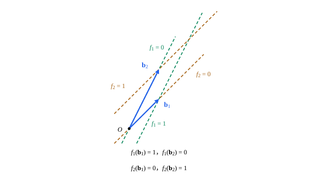

## 这一节要回答的问题

在$P_2$上取值$p\mapsto p(1)$，在$\R^3$上算$2x-y+3z$，都是把向量变成一个数的:term[线性映射]{id="math.linear-algebra.linear-map"}（linear map）。这样的映射本身能不能相加、:term[数乘]{id="math.linear-algebra.scalar-multiplication"}（scalar multiplication），组成一个新的:term[向量空间]{id="math.linear-algebra.vector-space"}（vector space）？[坐标与基变换](lesson:math.linear-algebra.change-of-basis)讲了换一组:term[基]{id="math.linear-algebra.basis"}（basis）时向量的坐标怎样变，这些「把向量变成数」的东西，坐标又怎样变？

## 讲解

### 线性函数与对偶空间

$f(x,y,z)=2x-y+3z$满足$f(\vb u+\vb v)=f(\vb u)+f(\vb v)$、$f(c\vb u)=cf(\vb u)$，它在三个:term[标准基向量]{id="math.linear-algebra.standard-basis-vector"}（standard basis vectors）上的值是$2$、$-1$、$3$，正好是三个系数。反过来，$\R^n$上任何一个这样的$f$，都由它在标准基向量上的值决定。

::anchor{id="def-dual-space"}
从:term[向量空间]{id="math.linear-algebra.vector-space"}$V$到$\R$的:term[线性映射]{id="math.linear-algebra.linear-map"}，叫作$V$上的:term[线性函数]{id="math.linear-algebra.linear-functional"}（linear functional），也叫:term[余向量]{id="math.linear-algebra.covector"}（covector）。$V$上全体线性函数按$(f+g)(\vb v)=f(\vb v)+g(\vb v)$、$(cf)(\vb v)=cf(\vb v)$相加、:term[数乘]{id="math.linear-algebra.scalar-multiplication"}，组成一个向量空间，叫作$V$的:term[对偶空间]{id="math.linear-algebra.dual-space"}（dual space），记作$V^*$。

为什么这样定义：线性函数是目标只有一维的线性映射，把它们放在一起，就能把它们当作向量来处理。在$\R^n$上，$f(\vb x)=a_1x_1+\dots+a_nx_n$，$a_i=f(\vb e_i)$，所以$f$就是一个$1\times n$矩阵，即一个行向量（row vector），乘列向量（column vector）$\vb x$得到一个数。边界情况：处处为$0$的零函数是$V^*$的:term[零向量]{id="math.linear-algebra.zero-vector"}（zero vector）；中学里的一次函数$y=kx+b$，$b\ne0$时不把$0$送到$0$，不是这里说的线性函数。

### 对偶基

在$\R^2$里取:term[基]{id="math.linear-algebra.basis"}$\vb b_1=(1,1)$、$\vb b_2=(1,2)$。由[坐标与向量](lesson:math.linear-algebra.change-of-basis#thm-basis-matrix)，$\vb v=(x,y)$的坐标是$P_{\mathcal B}^{-1}\vb v$，$P_{\mathcal B}^{-1}=\begin{pmatrix}2&-1\\-1&1\end{pmatrix}$，所以$\vb v=(2x-y)\vb b_1+(-x+y)\vb b_2$。两个坐标$2x-y$、$-x+y$都是$\vb v$的:term[线性函数]{id="math.linear-algebra.linear-functional"}。

::anchor{id="def-dual-basis"}
设$\mathcal B=(\vb b_1,\dots,\vb b_n)$是$V$的一组基。满足$f_i(\vb b_i)=1$、$f_i(\vb b_j)=0$（$j\ne i$）的线性函数$f_1,\dots,f_n$，叫作$\mathcal B$的:term[对偶基]{id="math.linear-algebra.dual-basis"}（dual basis）。

为什么这样定义：$\vb v=c_1\vb b_1+\dots+c_n\vb b_n$时，$f_i(\vb v)=c_i$，对偶基里的$f_i$正是「取第$i$个坐标」这个函数，上面的例子里就是$f_1=2x-y$、$f_2=-x+y$。所以$f_i$不只和$\vb b_i$有关，而是和整组基有关：换掉$\vb b_2$，$f_1$一般也会变（常见误区）。

::anchor{id="thm-dual-basis"}
**对偶基是一组基**　对偶基存在而且唯一，是$V^*$的一组基，所以$\dim V^*=\dim V$；每个线性函数都写成$f=f(\vb b_1)f_1+\dots+f(\vb b_n)f_n$。在$\R^n$里，$f_i$就是矩阵$P_{\mathcal B}^{-1}$的第$i$行（乘列向量$\vb x$）。

**证明思路**：一个线性函数由它在一组基上的值完全决定，这些值也可以随便指定：要$f(\vb b_j)=a_j$，令$f(\vb v)=a_1c_1+\dots+a_nc_n$即可，所以满足条件的$f_i$存在而且唯一。$a_1f_1+\dots+a_nf_n=0$时，两边作用在$\vb b_j$上得$a_j=0$，所以它们:term[线性无关]{id="math.linear-algebra.linearly-independent"}（linearly independent）；$f$和$f(\vb b_1)f_1+\dots+f(\vb b_n)f_n$在每个$\vb b_j$上的值相同，所以相等，于是对偶基:term[生成]{id="math.linear-algebra.span"}（span）$V^*$。在$\R^n$里，$P_{\mathcal B}^{-1}P_{\mathcal B}=I$说的正是：$P_{\mathcal B}^{-1}$的第$i$行乘$\vb b_j$，$i=j$时得$1$，否则得$0$。

### 换基时，向量和余向量反着变

由上面的定理，:term[线性函数]{id="math.linear-algebra.linear-functional"}$f$在:term[对偶基]{id="math.linear-algebra.dual-basis"}下的坐标是$\bigl(f(\vb b_1),\dots,f(\vb b_n)\bigr)$，把它写成一行$[f]_{\mathcal B}$；于是$f(\vb v)=[f]_{\mathcal B}[\vb v]_{\mathcal B}$，行乘列。换一组:term[基]{id="math.linear-algebra.basis"}时，这一行怎样变？

::anchor{id="thm-dual-change"}
**:term[余向量]{id="math.linear-algebra.covector"}的坐标跟着基变**　设$\mathcal C$是$V$的另一组基。则$[f]_{\mathcal C}=[f]_{\mathcal B}P_{\mathcal B\leftarrow\mathcal C}$，而$[\vb v]_{\mathcal C}=P_{\mathcal B\leftarrow\mathcal C}^{-1}[\vb v]_{\mathcal B}$：余向量的坐标用$P_{\mathcal B\leftarrow\mathcal C}$去乘，向量的坐标用它的逆去乘，两者正好相反。

**证明思路**：记$P_{\mathcal B\leftarrow\mathcal C}=(p_{jk})$，它的第$k$列是$[\vb c_k]_{\mathcal B}$，即$\vb c_k=\sum_jp_{jk}\vb b_j$，所以$f(\vb c_k)=\sum_jf(\vb b_j)p_{jk}$，正是行$[f]_{\mathcal B}$乘矩阵的第$k$列。向量那一边就是[换算坐标](lesson:math.linear-algebra.change-of-basis#thm-change-of-basis)，$P_{\mathcal C\leftarrow\mathcal B}=P_{\mathcal B\leftarrow\mathcal C}^{-1}$。两者一乘，$[f]_{\mathcal C}[\vb v]_{\mathcal C}=[f]_{\mathcal B}[\vb v]_{\mathcal B}$，$f(\vb v)$这个数和基无关。

举个例子：在一条直线上，把基向量从$1$米换成$1$厘米，新基向量是旧的$\frac1{100}$。一段$2$米的位移，坐标从$2$变成$200$，是原来的$100$倍；「每米升高$5$摄氏度」这个线性函数，在新基向量上的值是$0.05$，坐标是原来的$\frac1{100}$。两者一乘，温度升高的度数还是$10$。

## 几何图像

图里是上面例子里的:term[基]{id="math.linear-algebra.basis"}$\vb b_1=(1,1)$、$\vb b_2=(1,2)$和它的:term[对偶基]{id="math.linear-algebra.dual-basis"}$f_1=2x-y$、$f_2=-x+y$。一个:term[线性函数]{id="math.linear-algebra.linear-functional"}取同一个值的点在一条直线上，图中每条虚线旁标出了是哪个函数取哪个值。$f_1$的这些直线都:term[平行]{id="math.linear-algebra.parallel"}（parallel）于$\vb b_2$，所以$\vb b_2$躺在$f_1=0$上；$\vb b_1$从$f_1=0$走到$f_1=1$，却一直留在$f_2=0$上：$f_i(\vb b_j)$是$1$还是$0$，在图上一眼就能读出来。

## 例题

### 例 1　求对偶基

求$\R^3$的:term[基]{id="math.linear-algebra.basis"}$\vb b_1=(1,0,0)$、$\vb b_2=(1,1,0)$、$\vb b_3=(1,1,1)$的:term[对偶基]{id="math.linear-algebra.dual-basis"}。

**为什么想到这么做**：对偶基就是$P_{\mathcal B}^{-1}$的各行；$P_{\mathcal B}$的左下角全是$0$，逆很好求。

**推导**：$P_{\mathcal B}=\begin{pmatrix}1&1&1\\0&1&1\\0&0&1\end{pmatrix}$，由[用初等行变换求逆](lesson:math.linear-algebra.matrix-inverse#thm-gauss-jordan)得$P_{\mathcal B}^{-1}=\begin{pmatrix}1&-1&0\\0&1&-1\\0&0&1\end{pmatrix}$。所以$f_1(x,y,z)=x-y$，$f_2=y-z$，$f_3=z$。验算：$f_1(\vb b_2)=1-1=0$，$f_2(\vb b_3)=1-1=0$，$f_2(\vb b_2)=1$；也就是$(x,y,z)=(x-y)\vb b_1+(y-z)\vb b_2+z\vb b_3$。

### 例 2　反过来：由线性函数找基

取$P_2$上的三个:term[线性函数]{id="math.linear-algebra.linear-functional"}$E_0(p)=p(0)$、$E_1(p)=p(1)$、$E_2(p)=p(2)$。求$P_2$的一组:term[基]{id="math.linear-algebra.basis"}$p_0,p_1,p_2$，使$E_0,E_1,E_2$正好是它的:term[对偶基]{id="math.linear-algebra.dual-basis"}。

**为什么想到这么做**：要$E_i(p_j)$在$i=j$时为$1$、否则为$0$，就是说$p_j$在$0$、$1$、$2$三个点里，只在$x=j$处取$1$，在另两点取$0$；在两点为零，就有两个已知的因式。

**推导**：$p_0$在$1$、$2$处为零，$p_0=c(x-1)(x-2)$，由$p_0(0)=2c=1$得$p_0=\frac12(x-1)(x-2)$；同样$p_1=-x(x-2)$，$p_2=\frac12x(x-1)$。若$a_0p_0+a_1p_1+a_2p_2=0$，在$0$、$1$、$2$处取值得$a_0=a_1=a_2=0$，所以它们是一组基，$E_i(p_j)$也正是所要的值。对偶基里的$E_i$正是「取第$i$个坐标」，所以每个$p\in P_2$都是$p=p(0)p_0+p(1)p_1+p(2)p_2$，[线性映射的核与像](lesson:math.linear-algebra.kernel-image)第 7 题说的插值多项式（interpolation polynomial），就是这样写出来的。

## 常见误区

- 「:term[对偶基]{id="math.linear-algebra.dual-basis"}里的$f_1$只由$\vb b_1$决定。」$\vb b_1=(1,0)$配$\vb b_2=(0,1)$时，$f_1=x$；配$\vb b_2=(1,1)$时，$f_1=x-y$，因为$f_1$要在新的$\vb b_2$上取$0$。
- 「:term[余向量]{id="math.linear-algebra.covector"}的坐标和向量的坐标用同一个矩阵换算。」一个用$P_{\mathcal B\leftarrow\mathcal C}$，一个用它的逆，正好相反，所以$f(\vb v)$才和:term[基]{id="math.linear-algebra.basis"}无关。
- 「$V^*$和$V$是同一个空间。」两者:term[维数]{id="math.linear-algebra.dimension"}（dimension）相同，却是不同的东西：$P_2^*$里的元素是$p\mapsto p(1)$这样的函数，不是多项式。把$f_i$对应到$\vb b_i$可以得到一个:term[同构]{id="math.linear-algebra.isomorphism"}（isomorphism），可这个对应随基的选法而变。
- 「$f(\vb v)$的值随着基变。」变的只是坐标，$f(\vb v)$是一个数，和基无关。
