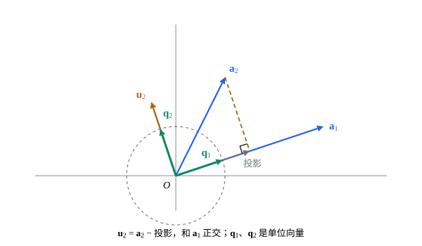

## 这一节要回答的问题

[正交补与正交投影](lesson:math.linear-algebra.orthogonal-projection)里，:term[基]{id="math.linear-algebra.basis"}（basis）两两:term[正交]{id="math.linear-algebra.orthogonal"}（orthogonal）时，:term[正交投影]{id="math.linear-algebra.orthogonal-projection"}（orthogonal projection）只要分别算、再相加，不用解方程组。[点积、长度与夹角](lesson:math.linear-algebra.dot-product)第 7 题说，斜着的坐标轴下，「对应:term[分量]{id="math.linear-algebra.component"}（component）相乘再相加」算出的不是:term[点积]{id="math.linear-algebra.dot-product"}（dot product）。什么样的基让这些都变得简单？任给一组基，怎样把它改造成这样的基？

## 讲解

### 正交规范基

::anchor{id="def-orthonormal-basis"}
设$V$是:term[内积空间]{id="math.linear-algebra.inner-product-space"}（inner product space）。一组向量两两:term[正交]{id="math.linear-algebra.orthogonal"}、:term[范数]{id="math.linear-algebra.norm"}（norm）都是$1$时，说它们是正交规范的（orthonormal）。由两两正交的非零向量组成的:term[基]{id="math.linear-algebra.basis"}叫作:term[正交基]{id="math.linear-algebra.orthogonal-basis"}（orthogonal basis），正交规范的基叫作:term[正交规范基]{id="math.linear-algebra.orthonormal-basis"}（orthonormal basis）。

为什么这样定义：$\R^n$里的:term[标准基向量]{id="math.linear-algebra.standard-basis-vector"}（standard basis vectors）就是一组正交规范基，坐标轴互相垂直、单位一样长。正交基除以各自的范数，就成了正交规范基，所以两者只差一步。边界情况：$\R^2$里$\bigl(\frac35,\frac45\bigr)$、$\bigl(-\frac45,\frac35\bigr)$也是正交规范基，正交规范基远不止一组。

::anchor{id="thm-orthogonal-independent"}
**正交的非零向量:term[线性无关]{id="math.linear-algebra.linearly-independent"}（linearly independent）**　两两正交、都不为$\vb 0$的向量$\vb u_1,\dots,\vb u_k$线性无关。

**证明思路**：若$c_1\vb u_1+\dots+c_k\vb u_k=\vb 0$，两边和$\vb u_j$作:term[内积]{id="math.linear-algebra.inner-product"}（inner product），其余各项都是$0$，剩下$c_j\|\vb u_j\|^2=0$，而$\|\vb u_j\|\ne0$，所以$c_j=0$。

::anchor{id="thm-orthonormal-coordinates"}
**正交规范基下的坐标**　设$\vb q_1,\dots,\vb q_n$是$V$的正交规范基。则每个$\vb v=\langle\vb v,\vb q_1\rangle\vb q_1+\dots+\langle\vb v,\vb q_n\rangle\vb q_n$；若$\vb v$、$\vb w$的坐标是$(a_1,\dots,a_n)$、$(b_1,\dots,b_n)$，则$\langle\vb v,\vb w\rangle=a_1b_1+\dots+a_nb_n$，$\|\vb v\|^2=a_1^2+\dots+a_n^2$。

**证明思路**：$\vb v=\sum a_i\vb q_i$两边和$\vb q_j$作内积，得$a_j=\langle\vb v,\vb q_j\rangle$。再把$\langle\sum a_i\vb q_i,\sum b_j\vb q_j\rangle$按线性展开，$i\ne j$的项都是$0$，$i=j$的项是$a_ib_i$。

所以在正交规范基下，求坐标不用解方程组，内积就是坐标的:term[点积]{id="math.linear-algebra.dot-product"}：[点积、长度与夹角](lesson:math.linear-algebra.dot-product)第 7 题里的斜坐标轴不行，正交规范的坐标轴就行。函数空间里同样的式子要有无穷多项，见[贝塞尔不等式与帕塞瓦尔等式](lesson:math.analysis.parseval)。

### 施密特正交化

有了一组:term[基]{id="math.linear-algebra.basis"}，怎样得到:term[正交规范基]{id="math.linear-algebra.orthonormal-basis"}？[正交补与正交投影](lesson:math.linear-algebra.orthogonal-projection)给了办法：一个向量减去它在一个:term[子空间]{id="math.linear-algebra.subspace"}（subspace）上的:term[正交投影]{id="math.linear-algebra.orthogonal-projection"}，剩下的部分和这个子空间:term[正交]{id="math.linear-algebra.orthogonal"}。把基向量一个一个取来，每次减去在前面那些向量:term[生成]{id="math.linear-algebra.span"}（span）的子空间上的投影就行。

::anchor{id="thm-gram-schmidt"}
**:term[施密特正交化]{id="math.linear-algebra.gram-schmidt"}（Gram-Schmidt process）**　设$\vb a_1,\dots,\vb a_k$:term[线性无关]{id="math.linear-algebra.linearly-independent"}。令$\vb u_1=\vb a_1$，依次令$\vb u_j=\vb a_j-\sum_{i<j}\frac{\langle\vb a_j,\vb u_i\rangle}{\langle\vb u_i,\vb u_i\rangle}\vb u_i$（$j=2,\dots,k$）。则$\vb u_1,\dots,\vb u_k$两两正交、都不为$\vb 0$，并且对每个$j$，$\Span\{\vb u_1,\dots,\vb u_j\}=\Span\{\vb a_1,\dots,\vb a_j\}$；再令$\vb q_j=\frac{\vb u_j}{\|\vb u_j\|}$，就得到正交规范的$\vb q_1,\dots,\vb q_k$。

**证明思路**：对$j$归纳。设$\vb u_1,\dots,\vb u_{j-1}$两两正交、和$\vb a_1,\dots,\vb a_{j-1}$生成同一个子空间$W$。它们是$W$的:term[正交基]{id="math.linear-algebra.orthogonal-basis"}，所以减去的和式正是$\vb a_j$在$W$上的正交投影，$\vb u_j$和$W$正交。$\vb a_j$不在$W$里，否则$\vb a_1,\dots,\vb a_j$:term[线性相关]{id="math.linear-algebra.linearly-dependent"}（linearly dependent），所以$\vb u_j\ne\vb 0$；$\vb u_j$是$\vb a_1,\dots,\vb a_j$的组合，$\vb a_j$又是$\vb u_1,\dots,\vb u_j$的组合，两组生成同一个子空间。

所以每个:term[有限维]{id="math.linear-algebra.finite-dimensional"}（finite-dimensional）的:term[内积空间]{id="math.linear-algebra.inner-product-space"}都有正交规范基：任取一组基做施密特正交化就行。$\vb u_j$用到的是前面已经正交化的$\vb u_i$，不是原来的$\vb a_i$；每一步都要减去在前面所有$\vb u_i$上的投影，不只是上一个。

### QR 分解

把:term[施密特正交化]{id="math.linear-algebra.gram-schmidt"}写成矩阵。设$m\times n$矩阵$A$的各列$\vb a_1,\dots,\vb a_n$:term[线性无关]{id="math.linear-algebra.linearly-independent"}，在:term[点积]{id="math.linear-algebra.dot-product"}下做施密特正交化，得到$\vb q_1,\dots,\vb q_n$。由构造，$\vb a_j$只用到$\vb q_1,\dots,\vb q_j$：$\vb a_j=r_{1j}\vb q_1+\dots+r_{jj}\vb q_j$，其中$r_{ij}=\vb a_j\cdot\vb q_i$，$r_{jj}=\|\vb u_j\|>0$。

::anchor{id="thm-qr"}
**:term[QR 分解]{id="math.linear-algebra.qr-decomposition"}（QR decomposition）**　各列线性无关的$m\times n$矩阵$A$可以写成$A=QR$：$Q$是$m\times n$矩阵，各列在点积下是正交规范的；$R$是$n$阶:term[方阵]{id="math.linear-algebra.square-matrix"}（square matrix），主对角线（main diagonal）以下全是$0$，主对角元（diagonal entries）都是正数。

**证明思路**：$Q$的各列取$\vb q_1,\dots,\vb q_n$，$R$的第$j$列取$(r_{1j},\dots,r_{jj},0,\dots,0)$。按:term[矩阵乘法]{id="math.linear-algebra.matrix-multiplication"}（matrix multiplication），$QR$的第$j$列是$Q$的各列以$R$的第$j$列为系数的:term[线性组合]{id="math.linear-algebra.linear-combination"}（linear combination），正是$\vb a_j$。

$R$的形状来自施密特正交化的次序：$\vb a_1$只用$\vb q_1$，$\vb a_2$只用$\vb q_1$、$\vb q_2$，依此类推。$Q$的各列正交规范，$R$又容易反着解，以后解[最小二乘问题](lesson:math.linear-algebra.least-squares)（least-squares problem）时也常用这个分解。

## 几何图像

图里$\vb a_1=(3,1)$、$\vb a_2=(1,2)$不:term[正交]{id="math.linear-algebra.orthogonal"}。$\vb a_2$在$\vb a_1$上的:term[投影]{id="math.linear-algebra.projection"}（projection）是$\frac{5}{10}(3,1)=(1.5,0.5)$，减去它得到$\vb u_2=(-0.5,1.5)$，和$\vb a_1$:term[正交]{id="math.linear-algebra.orthogonal"}；$\vb a_1$、$\vb u_2$各自除以:term[长度]{id="math.linear-algebra.length"}（length），得到落在单位圆上的$\vb q_1$、$\vb q_2$。$\vb q_1$总是沿着$\vb a_1$，$\vb q_2$在$\vb a_1$、$\vb a_2$所在的平面里，指向和$\vb a_2$同一侧。

## 例题

### 例 1　三个向量正交化，写出$QR$

在$\R^3$里取:term[点积]{id="math.linear-algebra.dot-product"}，对$\vb a_1=(1,1,0)$、$\vb a_2=(1,0,1)$、$\vb a_3=(0,1,1)$做:term[施密特正交化]{id="math.linear-algebra.gram-schmidt"}，并写出以它们为各列的矩阵$A$的 :term[QR 分解]{id="math.linear-algebra.qr-decomposition"}。

**为什么想到这么做**：照定理一步一步减去:term[投影]{id="math.linear-algebra.orthogonal-projection"}；$R$的元素是$\vb a_j\cdot\vb q_i$，对角元是$\|\vb u_j\|$。

**推导**：$\vb u_1=(1,1,0)$。$\vb a_2\cdot\vb u_1=1$，$\vb u_1\cdot\vb u_1=2$，$\vb u_2=\vb a_2-\frac12\vb u_1=\bigl(\frac12,-\frac12,1\bigr)$。$\vb a_3\cdot\vb u_1=1$，$\vb a_3\cdot\vb u_2=\frac12$，$\vb u_2\cdot\vb u_2=\frac32$，$\vb u_3=\vb a_3-\frac12\vb u_1-\frac13\vb u_2=\bigl(-\frac23,\frac23,\frac23\bigr)$，和$\vb u_1$、$\vb u_2$的点积都是$0$。单位化得$\vb q_1=\frac1{\sqrt2}(1,1,0)$，$\vb q_2=\frac1{\sqrt6}(1,-1,2)$，$\vb q_3=\frac1{\sqrt3}(-1,1,1)$；$Q$的各列是它们，$R=\begin{pmatrix}\sqrt2&\frac1{\sqrt2}&\frac1{\sqrt2}\\0&\sqrt{\frac32}&\frac1{\sqrt6}\\0&0&\frac2{\sqrt3}\end{pmatrix}$。

### 例 2　把$1,x,x^2$正交化

在$C[-1,1]$里取:term[积分内积]{id="math.linear-algebra.inner-product"}，对$1$、$x$、$x^2$做:term[施密特正交化]{id="math.linear-algebra.gram-schmidt"}（不单位化）。

**为什么想到这么做**：多项式也是向量，定理只用到内积；$[-1,1]$关于原点对称，奇函数的积分是$0$，很多内积直接为$0$。

**推导**：$u_1=1$。$\langle x,1\rangle=\int_{-1}^1x\dd x=0$，所以$u_2=x$。$\langle x^2,1\rangle=\frac23$，$\langle1,1\rangle=2$，$\langle x^2,x\rangle=0$，所以$u_3=x^2-\frac{2/3}2=x^2-\frac13$。三个多项式两两:term[正交]{id="math.linear-algebra.orthogonal"}，乘上适当的常数，就是解偏微分方程（partial differential equation）时会遇到的勒让德多项式（Legendre polynomials，见[球坐标分离变量与勒让德多项式](lesson:math.pde.legendre-polynomials)）。

## 常见误区

- 「:term[施密特正交化]{id="math.linear-algebra.gram-schmidt"}每一步只要减去在上一个向量上的:term[投影]{id="math.linear-algebra.projection"}。」要减去在前面所有$\vb u_i$上的投影。例 1 里$\vb u_3$若只减去在$\vb u_2$上的投影，得到$\bigl(-\frac16,\frac76,\frac23\bigr)$，和$\vb u_1$的:term[点积]{id="math.linear-algebra.dot-product"}是$1$，不:term[正交]{id="math.linear-algebra.orthogonal"}。
- 「用原来的$\vb a_i$去做投影也一样。」$\vb a_1,\dots,\vb a_{j-1}$一般不正交，分别投影再相加不是在它们:term[生成]{id="math.linear-algebra.span"}的:term[子空间]{id="math.linear-algebra.subspace"}上的投影；要用已经正交化的$\vb u_i$。
- 「换一个次序，得到的:term[正交规范基]{id="math.linear-algebra.orthonormal-basis"}一样。」$\vb q_1$总是沿着第一个向量，次序变了，结果一般不同（第 7 题）。
- 「$QR$分解里的$Q$一定是:term[方阵]{id="math.linear-algebra.square-matrix"}。」$A$是$m\times n$的，$Q$也是$m\times n$的，只是各列正交规范；$m=n$时才是方阵，那就是下一节的[正交矩阵](lesson:math.linear-algebra.orthogonal-matrices)（orthogonal matrix）。
