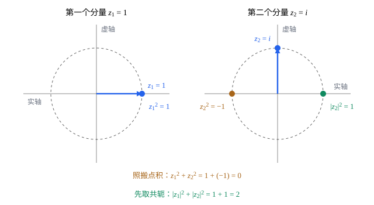

## 这一节要回答的问题

[复特征值与旋转](lesson:math.linear-algebra.complex-eigenvalues)里，:term[特征向量]{id="math.linear-algebra.eigenvector"}（eigenvector）的:term[分量]{id="math.linear-algebra.component"}（component）可以是复数。复向量有没有:term[长度]{id="math.linear-algebra.length"}（length）？照搬:term[点积]{id="math.linear-algebra.dot-product"}（dot product），$(1,i)$和自己相乘再相加是$1+i^2=0$，一个非零向量的长度成了$0$。一个复数的大小是它的模$|z|=\sqrt{\bar zz}$；复向量的长度该怎样规定，:term[对称矩阵]{id="math.linear-algebra.symmetric-matrix"}（symmetric matrix）、:term[正交矩阵]{id="math.linear-algebra.orthogonal-matrix"}（orthogonal matrix）在复数里又对应什么？

## 讲解

### 复内积

::anchor{id="def-complex-inner-product"}
设$V$是复数上的:term[向量空间]{id="math.linear-algebra.vector-space"}（vector space）。如果对$V$中任意两个向量$\vb u$、$\vb v$规定了一个复数$\langle\vb u,\vb v\rangle$，并且对任意$\vb u,\vb v,\vb w\in V$和复数$c$满足：(1) $\langle\vb u,\vb v\rangle=\overline{\langle\vb v,\vb u\rangle}$；(2) $\langle\vb u,\vb v+\vb w\rangle=\langle\vb u,\vb v\rangle+\langle\vb u,\vb w\rangle$，$\langle\vb u,c\vb v\rangle=c\langle\vb u,\vb v\rangle$；(3) $\langle\vb v,\vb v\rangle$是非负实数，并且只有$\vb v=\vb 0$时等于$0$，就说它是$V$上的:term[复内积]{id="math.linear-algebra.complex-inner-product"}（complex inner product），带着复内积的复向量空间（complex vector space）叫作复内积空间（complex inner product space）。$\C^n$里的标准复内积是$\langle\vb u,\vb v\rangle=\bar u_1v_1+\dots+\bar u_nv_n$。

为什么这样定义：$\langle\vb v,\vb v\rangle=|v_1|^2+\dots+|v_n|^2$，$\vb v\ne\vb 0$时这才是正实数，$\|\vb v\|=\sqrt{\langle\vb v,\vb v\rangle}$当:term[长度]{id="math.linear-algebra.length"}，$(1,i)$的长度是$\sqrt2$。由 (1)、(2)，$\langle c\vb u,\vb v\rangle=\bar c\langle\vb u,\vb v\rangle$：对第二个变量线性，对第一个变量共轭线性（conjugate-linear），这和[希尔伯特空间与狄拉克符号](lesson:physics.quantum-mechanics.hilbert-space)里的$\langle u|v\rangle$一致（有的书约定反过来）。边界情况：:term[分量]{id="math.linear-algebra.component"}都是实数时，复内积就是:term[点积]{id="math.linear-algebra.dot-product"}；(1) 说明$\langle\vb u,\vb v\rangle$和$\langle\vb v,\vb u\rangle$互为共轭，交换次序不再不变。

:term[正交]{id="math.linear-algebra.orthogonal"}（orthogonal）、:term[范数]{id="math.linear-algebra.norm"}（norm）、:term[正交规范基]{id="math.linear-algebra.orthonormal-basis"}（orthonormal basis）、:term[正交补]{id="math.linear-algebra.orthogonal-complement"}（orthogonal complement）照实数的样子定义；:term[柯西-施瓦茨不等式]{id="math.linear-algebra.cauchy-schwarz-inequality"}（Cauchy-Schwarz inequality）、勾股定理（Pythagorean theorem）、[施密特正交化](lesson:math.linear-algebra.gram-schmidt#thm-gram-schmidt)（Gram-Schmidt process）、:term[正交分解]{id="math.linear-algebra.orthogonal-decomposition"}（orthogonal decomposition）照样成立，只是$\vb v$在$\vb u$上的:term[投影]{id="math.linear-algebra.projection"}（projection）要写成$\frac{\langle\vb u,\vb v\rangle}{\langle\vb u,\vb u\rangle}\vb u$，共轭落在$\vb u$上。

### 共轭转置与厄米矩阵

::anchor{id="def-hermitian"}
矩阵$A$的各元素取共轭再:term[转置]{id="math.linear-algebra.transpose"}（transpose），叫作$A$的:term[共轭转置]{id="math.linear-algebra.conjugate-transpose"}（conjugate transpose），记作$A\HT$。满足$A\HT=A$的:term[方阵]{id="math.linear-algebra.square-matrix"}（square matrix）叫作:term[厄米矩阵]{id="math.linear-algebra.hermitian-matrix"}（Hermitian matrix）。

为什么这样定义：列向量（column vector）$\vb u$的共轭转置是一行$\vb u\HT$，于是$\langle\vb u,\vb v\rangle=\vb u\HT\vb v$，而$\langle A\vb u,\vb v\rangle=\vb u\HT A\HT\vb v=\langle\vb u,A\HT\vb v\rangle$。所以$A$是厄米矩阵，正是说$A$能从:term[内积]{id="math.linear-algebra.complex-inner-product"}的一边挪到另一边，和:term[实对称矩阵]{id="math.linear-algebra.symmetric-matrix"}在:term[点积]{id="math.linear-algebra.dot-product"}里一样；实的厄米矩阵就是对称矩阵。边界情况：厄米矩阵的主对角元（diagonal entries）满足$a_{ii}=\bar a_{ii}$，都是实数，主对角线（main diagonal）外的元素可以是复数，例如$\begin{pmatrix}2&1-i\\1+i&3\end{pmatrix}$。

::anchor{id="thm-hermitian-real"}
**:term[厄米矩阵]{id="math.linear-algebra.hermitian-matrix"}的:term[特征值]{id="math.linear-algebra.eigenvalue"}（eigenvalue）是实数**　厄米矩阵的特征值都是实数，属于不同特征值的:term[特征向量]{id="math.linear-algebra.eigenvector"}:term[正交]{id="math.linear-algebra.orthogonal"}。

**证明思路**：设$A\vb v=\lambda\vb v$，$\vb v\ne\vb 0$。$\lambda\langle\vb v,\vb v\rangle=\langle\vb v,A\vb v\rangle=\langle A\vb v,\vb v\rangle=\bar\lambda\langle\vb v,\vb v\rangle$，$\langle\vb v,\vb v\rangle>0$，所以$\lambda=\bar\lambda$。设$A\vb x=\lambda_1\vb x$、$A\vb y=\lambda_2\vb y$，$\lambda_2\langle\vb x,\vb y\rangle=\langle\vb x,A\vb y\rangle=\langle A\vb x,\vb y\rangle=\lambda_1\langle\vb x,\vb y\rangle$（$\lambda_1$是实数，取共轭不变），$\lambda_1\ne\lambda_2$时$\langle\vb x,\vb y\rangle=0$。

### 酉矩阵

::anchor{id="def-unitary"}
满足$U\HT U=I$的:term[复方阵]{id="math.linear-algebra.square-matrix"}$U$叫作:term[酉矩阵]{id="math.linear-algebra.unitary-matrix"}（unitary matrix）。

为什么这样定义：$U\HT U$的第$i$行第$j$列是$\langle\vb u_i,\vb u_j\rangle$，$\vb u_i$是$U$的第$i$列，所以$U\HT U=I$正是说各列是$\C^n$的:term[正交规范基]{id="math.linear-algebra.orthonormal-basis"}，和:term[正交矩阵]{id="math.linear-algebra.orthogonal-matrix"}一样，$U^{-1}=U\HT$，$\langle U\vb x,U\vb y\rangle=\langle\vb x,\vb y\rangle$，:term[长度]{id="math.linear-algebra.length"}不变。实的酉矩阵就是正交矩阵。酉矩阵的乘积、逆仍是酉矩阵：$(U_1U_2)\HT U_1U_2=U_2\HT U_1\HT U_1U_2=I$，$U^{-1}=U\HT$也满足$(U\HT)\HT U\HT=UU\HT=I$。边界情况：一阶的酉矩阵是模为$1$的复数$e^{i\theta}$，乘上它，复平面转了$\theta$；酉矩阵的:term[特征值]{id="math.linear-algebra.eigenvalue"}的模都是$1$（第 5 题）。

::anchor{id="thm-hermitian-spectral"}
**:term[厄米矩阵]{id="math.linear-algebra.hermitian-matrix"}的:term[谱定理]{id="math.linear-algebra.spectral-theorem"}（spectral theorem）**　设$A$是厄米矩阵。则$\C^n$有一组由$A$的:term[特征向量]{id="math.linear-algebra.eigenvector"}组成的正交规范基；也就是说，有酉矩阵$U$和:term[实对角矩阵]{id="math.linear-algebra.diagonal-matrix"}（diagonal matrix）$D$，使$A=UDU\HT$。

**证明思路**：和[实对称矩阵的谱定理](lesson:math.linear-algebra.spectral-theorem#thm-spectral)一样对$n$归纳：取一个特征值$\lambda_1$和单位特征向量$\vb u_1$，$\vb x$与$\vb u_1$:term[正交]{id="math.linear-algebra.orthogonal"}时，$\langle\vb u_1,A\vb x\rangle=\langle A\vb u_1,\vb x\rangle=\lambda_1\langle\vb u_1,\vb x\rangle=0$，所以$A$把$\vb u_1$的:term[正交补]{id="math.linear-algebra.orthogonal-complement"}送回自己，在正交补里重复这一步。复数范围里:term[特征多项式]{id="math.linear-algebra.characteristic-polynomial"}（characteristic polynomial）总有根，这里不必先证明特征值存在于实数里。

以后在[希尔伯特空间与狄拉克符号](lesson:physics.quantum-mechanics.hilbert-space)里会看到，量子力学用厄米矩阵（以及无穷维的类似物）描述可观测量（observable），这一节的两条结论在那里都要用到。

## 几何图像

图里把向量$(1,i)$的两个:term[分量]{id="math.linear-algebra.component"}各画在一个复平面上。不取共轭，第二个分量自乘得$i^2=-1$，落在实轴的负半边，和第一个分量的$1$正好抵消，「:term[长度]{id="math.linear-algebra.length"}的平方」成了$0$。取共轭以后，$\bar z_2z_2=|z_2|^2=1$，每个分量贡献的都是自己模的平方，加起来是$2$：这就是:term[复内积]{id="math.linear-algebra.complex-inner-product"}要先取共轭的原因。

## 例题

### 例 1　一个二阶厄米矩阵

$A=\begin{pmatrix}2&1-i\\1+i&3\end{pmatrix}$。求它的:term[特征值]{id="math.linear-algebra.eigenvalue"}和一组正交规范的:term[特征向量]{id="math.linear-algebra.eigenvector"}，写出$A=UDU\HT$。

**为什么想到这么做**：$A\HT=A$，是:term[厄米矩阵]{id="math.linear-algebra.hermitian-matrix"}，特征值一定是实数，属于不同特征值的特征向量自动:term[正交]{id="math.linear-algebra.orthogonal"}，只要各自单位化。

**推导**：$\tr A=5$，$\det A=6-(1-i)(1+i)=4$，特征值是$1$、$4$。$\lambda=1$时，$A-I$的第一行是$(1,1-i)$，取$\vb v_1=(-1+i,1)$；$\lambda=4$时，第一行是$(-2,1-i)$，取$\vb v_2=(1-i,2)$。$\langle\vb v_1,\vb v_2\rangle=(-1-i)(1-i)+1\cdot2=-2+2=0$；$\|\vb v_1\|^2=2+1=3$，$\|\vb v_2\|^2=2+4=6$。所以$U=\begin{pmatrix}\frac{-1+i}{\sqrt3}&\frac{1-i}{\sqrt6}\\\frac1{\sqrt3}&\frac2{\sqrt6}\end{pmatrix}$，$D=\begin{pmatrix}1&0\\0&4\end{pmatrix}$。

### 例 2　一个酉矩阵

$U=\frac1{\sqrt2}\begin{pmatrix}1&i\\i&1\end{pmatrix}$。验证它是:term[酉矩阵]{id="math.linear-algebra.unitary-matrix"}，并求它的:term[特征值]{id="math.linear-algebra.eigenvalue"}和:term[特征向量]{id="math.linear-algebra.eigenvector"}。

**为什么想到这么做**：验证各列在:term[复内积]{id="math.linear-algebra.complex-inner-product"}下正交规范；特征值照常由:term[特征多项式]{id="math.linear-algebra.characteristic-polynomial"}求。

**推导**：两列$\frac1{\sqrt2}(1,i)$、$\frac1{\sqrt2}(i,1)$的:term[长度]{id="math.linear-algebra.length"}都是$\frac1{\sqrt2}\sqrt{1+1}=1$，内积是$\frac12(1\cdot i+\bar i\cdot1)=\frac12(i-i)=0$，是酉矩阵。$\tr U=\sqrt2$，$\det U=\frac12(1-i^2)=1$，特征多项式$\lambda^2-\sqrt2\lambda+1$的根是$\frac{1\pm i}{\sqrt2}$，模都是$1$。$U(1,1)=\frac{1+i}{\sqrt2}(1,1)$，$U(1,-1)=\frac{1-i}{\sqrt2}(1,-1)$；两个特征向量$(1,1)$、$(1,-1)$:term[正交]{id="math.linear-algebra.orthogonal"}。$U$等于自己的:term[转置]{id="math.linear-algebra.transpose"}，却不是:term[厄米矩阵]{id="math.linear-algebra.hermitian-matrix"}：对称和厄米在复数里是两回事。

## 常见误区

- 「复向量的:term[复内积]{id="math.linear-algebra.complex-inner-product"}就是对应:term[分量]{id="math.linear-algebra.component"}相乘再相加。」那样$(1,i)$和自己的「内积」是$0$；要先给第一个向量取共轭。
- 「$\langle c\vb u,\vb v\rangle=\langle\vb u,c\vb v\rangle$。」第一个变量要取共轭：$\langle i\vb u,\vb v\rangle=-i\langle\vb u,\vb v\rangle$，$\langle\vb u,i\vb v\rangle=i\langle\vb u,\vb v\rangle$。
- 「元素复数的:term[对称矩阵]{id="math.linear-algebra.symmetric-matrix"}就是:term[厄米矩阵]{id="math.linear-algebra.hermitian-matrix"}。」$\begin{pmatrix}0&i\\i&0\end{pmatrix}$对称，:term[共轭转置]{id="math.linear-algebra.conjugate-transpose"}却是$\begin{pmatrix}0&-i\\-i&0\end{pmatrix}$，:term[特征值]{id="math.linear-algebra.eigenvalue"}是$\pm i$，不是实数。
- 「厄米矩阵的元素都是实数。」只有主对角元一定是实数，例 1 里主对角线外是$1\mp i$。
