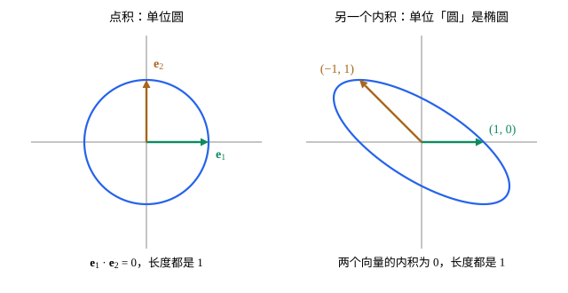

## 这一节要回答的问题

[点积、长度与夹角](lesson:math.linear-algebra.dot-product)用:term[点积]{id="math.linear-algebra.dot-product"}（dot product）量出了$\R^n$里的:term[长度]{id="math.linear-algebra.length"}（length）、:term[夹角]{id="math.linear-algebra.angle"}（angle），也判断了垂直。[抽象向量空间](lesson:math.linear-algebra.vector-spaces)里的多项式、函数也是向量，可它们没有排成一列的:term[分量]{id="math.linear-algebra.component"}（component），两个函数能不能「垂直」，一个函数有多「长」？平面上换一种算法代替点积，哪些向量会变得互相垂直？量长度和夹角，究竟要用到点积的哪几条性质？

## 讲解

### 内积

[点积的运算律](lesson:math.linear-algebra.dot-product#thm-dot-laws)说，:term[点积]{id="math.linear-algebra.dot-product"}对两个向量是对称的，对每个变量是线性的，并且$\vb v\cdot\vb v\ge0$，只有$\vb 0$和自己的点积是$0$。:term[长度]{id="math.linear-algebra.length"}、:term[夹角]{id="math.linear-algebra.angle"}、:term[正交]{id="math.linear-algebra.orthogonal"}（orthogonal）、:term[投影]{id="math.linear-algebra.projection"}（projection），都是从这几条推出来的。所以在别的:term[向量空间]{id="math.linear-algebra.vector-space"}（vector space）里，只要规定一种满足这几条的运算，就能照样量长度、判断垂直。

::anchor{id="def-inner-product"}
设$V$是向量空间。如果对$V$中任意两个向量$\vb u$、$\vb v$规定了一个实数$\langle\vb u,\vb v\rangle$，并且对任意$\vb u,\vb v,\vb w\in V$和数$c$满足：(1) $\langle\vb u,\vb v\rangle=\langle\vb v,\vb u\rangle$；(2) $\langle\vb u+\vb w,\vb v\rangle=\langle\vb u,\vb v\rangle+\langle\vb w,\vb v\rangle$，$\langle c\vb u,\vb v\rangle=c\langle\vb u,\vb v\rangle$；(3) $\langle\vb v,\vb v\rangle\ge0$，并且只有$\vb v=\vb 0$时等于$0$，就说$\langle\ ,\ \rangle$是$V$上的一个:term[内积]{id="math.linear-algebra.inner-product"}（inner product），$V$连同这个内积叫作:term[内积空间]{id="math.linear-algebra.inner-product-space"}（inner product space）。

为什么这样定义：这三条正是点积的运算律，在$\R^n$里取$\langle\vb u,\vb v\rangle=\vb u\cdot\vb v$，就是一个内积。由 (1)、(2)，内积对第二个变量也是线性的。第 (3) 条最要紧，它保证非零向量和自己的内积是正数，才能开平方当长度。边界情况：在$\R^2$里，$\langle\vb u,\vb v\rangle=u_1v_1-u_2v_2$满足 (1)、(2)，可$\langle(1,1),(1,1)\rangle=0$，不满足 (3)，不是内积。

同一个向量空间可以有不同的内积。在$\R^2$里，只要$a>0$、$b>0$，$\langle\vb u,\vb v\rangle=au_1v_1+bu_2v_2$就是内积，第 (3) 条成立是因为$au_1^2+bu_2^2$只在$u_1=u_2=0$时为$0$。$\langle\vb u,\vb v\rangle=u_1v_1+u_1v_2+u_2v_1+2u_2v_2$也是内积（例 1），它让$(1,0)$和$(-1,1)$互相正交（几何图像）。

### 函数的积分内积

多项式、函数组成的:term[向量空间]{id="math.linear-algebra.vector-space"}里没有:term[分量]{id="math.linear-algebra.component"}，:term[内积]{id="math.linear-algebra.inner-product"}要换一种写法。把$\R^n$里的$u_1v_1+\dots+u_nv_n$换成积分，就得到函数的内积：在区间上取的点越密，$\sum f(x_i)g(x_i)\Delta x$越接近$\int fg\dd x$。

::anchor{id="thm-integral-inner-product"}
**积分给出内积**　在$[a,b]$上连续的函数全体记作$C[a,b]$，它是一个向量空间。对$f,g\in C[a,b]$，$\langle f,g\rangle=\int_a^bf(x)g(x)\dd x$是$C[a,b]$上的内积。

**证明思路**：(1)、(2) 来自积分的线性性质。(3)：$f^2\ge0$，所以$\int_a^bf^2\dd x\ge0$；若某个$f(x_0)\ne0$，由连续，在$x_0$附近的一小段上$f(x)^2>\frac12f(x_0)^2$，积分就大于$0$，所以积分为$0$时$f$处处为$0$。

这里要求连续，是为了第 (3) 条：允许不连续的函数，只在一个点不为$0$的函数，平方的积分也是$0$。在$[-\pi,\pi]$上，$\langle\sin x,\cos x\rangle=\int_{-\pi}^{\pi}\sin x\cos x\dd x=0$，这两个函数:term[正交]{id="math.linear-algebra.orthogonal"}；$\langle\sin x,\sin x\rangle=\int_{-\pi}^{\pi}\sin^2x\dd x=\pi$。[傅里叶级数](lesson:math.analysis.fourier-series)里三角函数两两正交，说的正是这个内积。

### 范数、柯西-施瓦茨不等式与夹角

::anchor{id="def-norm"}
设$V$是:term[内积空间]{id="math.linear-algebra.inner-product-space"}。$\|\vb v\|=\sqrt{\langle\vb v,\vb v\rangle}$叫作$\vb v$的:term[范数]{id="math.linear-algebra.norm"}（norm），也叫:term[长度]{id="math.linear-algebra.length"}；$\|\vb v\|=1$的向量叫作:term[单位向量]{id="math.linear-algebra.unit-vector"}（unit vector）。$\langle\vb u,\vb v\rangle=0$时，说$\vb u$与$\vb v$:term[正交]{id="math.linear-algebra.orthogonal"}。

为什么这样定义：在$\R^n$里取:term[点积]{id="math.linear-algebra.dot-product"}，$\|\vb v\|$就是长度$|\vb v|$，这里用双竖线，是为了和数的绝对值区分。由 (2)、(3)，$\|c\vb v\|=|c|\,\|\vb v\|$，只有$\vb 0$的范数是$0$。在$C[a,b]$里，$\|f-g\|^2=\int_a^b(f-g)^2\dd x$，量的是两个函数在整个区间上差多少，而不只是某一点的差。边界情况：正交不要求两个向量非零，$\vb 0$和每个向量都正交。

::anchor{id="thm-pythagorean"}
**勾股定理（Pythagorean theorem）**　若$\vb u$与$\vb v$正交，则$\|\vb u+\vb v\|^2=\|\vb u\|^2+\|\vb v\|^2$。

**证明思路**：$\|\vb u+\vb v\|^2=\langle\vb u+\vb v,\vb u+\vb v\rangle=\|\vb u\|^2+2\langle\vb u,\vb v\rangle+\|\vb v\|^2$，中间一项是$0$。

::anchor{id="thm-cauchy-schwarz"}
**:term[柯西-施瓦茨不等式]{id="math.linear-algebra.cauchy-schwarz-inequality"}（Cauchy-Schwarz inequality）**　在内积空间里，$|\langle\vb u,\vb v\rangle|\le\|\vb u\|\,\|\vb v\|$，等号当且仅当$\vb u$、$\vb v$:term[线性相关]{id="math.linear-algebra.linearly-dependent"}（linearly dependent）时成立。

**证明思路**：$\vb v=\vb 0$时两边都是$0$。$\vb v\ne\vb 0$时取$t=\frac{\langle\vb u,\vb v\rangle}{\|\vb v\|^2}$，$t\vb v$就是$\vb u$在$\vb v$上的:term[投影]{id="math.linear-algebra.projection"}，$\vb u-t\vb v$和$\vb v$正交，由勾股定理，$\|\vb u\|^2=\|\vb u-t\vb v\|^2+t^2\|\vb v\|^2\ge t^2\|\vb v\|^2=\frac{\langle\vb u,\vb v\rangle^2}{\|\vb v\|^2}$。等号成立，当且仅当$\vb u-t\vb v=\vb 0$，即$\vb u$是$\vb v$的倍数。

用到$C[a,b]$上，这个不等式说$\bigl(\int_a^bfg\dd x\bigr)^2\le\int_a^bf^2\dd x\cdot\int_a^bg^2\dd x$，单看积分不容易想到（第 6 题用它）。它还说明$\vb u$、$\vb v$都不为$\vb 0$时，$\frac{\langle\vb u,\vb v\rangle}{\|\vb u\|\,\|\vb v\|}$在$-1$和$1$之间，所以可以照点积的办法规定:term[夹角]{id="math.linear-algebra.angle"}：$\cos\theta=\frac{\langle\vb u,\vb v\rangle}{\|\vb u\|\,\|\vb v\|}$，$0\le\theta\le\pi$。

::anchor{id="thm-triangle"}
**三角不等式（triangle inequality）**　在内积空间里，$\|\vb u+\vb v\|\le\|\vb u\|+\|\vb v\|$：两个向量之和的长度，不超过各自长度之和。

**证明思路**：$\|\vb u+\vb v\|^2=\|\vb u\|^2+2\langle\vb u,\vb v\rangle+\|\vb v\|^2\le\|\vb u\|^2+2\|\vb u\|\,\|\vb v\|+\|\vb v\|^2=\bigl(\|\vb u\|+\|\vb v\|\bigr)^2$，中间一步用的是柯西-施瓦茨不等式。

## 几何图像

左图是$\R^2$里的:term[点积]{id="math.linear-algebra.dot-product"}：:term[长度]{id="math.linear-algebra.length"}为$1$的向量组成单位圆，$\vb e_1$、$\vb e_2$长度都是$1$、互相:term[正交]{id="math.linear-algebra.orthogonal"}。右图换成:term[内积]{id="math.linear-algebra.inner-product"}$\langle\vb u,\vb v\rangle=u_1v_1+u_1v_2+u_2v_1+2u_2v_2$，长度为$1$的向量组成椭圆$u_1^2+2u_1u_2+2u_2^2=1$；$(1,0)$和$(-1,1)$都在椭圆上，内积是$1\cdot(-1)+1\cdot1+0+0=0$，在这个内积下它们是一对互相正交的:term[单位向量]{id="math.linear-algebra.unit-vector"}，尽管在纸面上:term[夹角]{id="math.linear-algebra.angle"}是$135^\circ$。换了内积，长度、垂直都跟着换；画在纸上的样子，只是点积的看法。

## 例题

### 例 1　验证一个内积

在$\R^2$里规定$\langle\vb u,\vb v\rangle=u_1v_1+u_1v_2+u_2v_1+2u_2v_2$。验证它是:term[内积]{id="math.linear-algebra.inner-product"}，并求$\vb e_1$、$\vb e_2$在这个内积下的:term[长度]{id="math.linear-algebra.length"}和:term[夹角]{id="math.linear-algebra.angle"}。

**为什么想到这么做**：(1)、(2) 看式子就能验证；第 (3) 条要说明$\langle\vb u,\vb u\rangle$只在$\vb u=\vb 0$时为$0$，配方最直接。

**推导**：交换$\vb u$、$\vb v$，$u_1v_2$和$u_2v_1$互换，式子不变，(1) 成立；每一项对$\vb u$都是一次的，(2) 成立。$\langle\vb u,\vb u\rangle=u_1^2+2u_1u_2+2u_2^2=(u_1+u_2)^2+u_2^2\ge0$，等于$0$时$u_2=0$、$u_1+u_2=0$，即$\vb u=\vb 0$，(3) 成立。$\|\vb e_1\|^2=1$，$\|\vb e_2\|^2=2$，$\langle\vb e_1,\vb e_2\rangle=1$，所以$\cos\theta=\frac{1}{1\cdot\sqrt2}$，$\theta=45^\circ$：两个:term[标准基向量]{id="math.linear-algebra.standard-basis-vector"}（standard basis vectors）在这个内积下不再互相垂直。

### 例 2　函数的长度和夹角

在$C[0,1]$里取:term[积分内积]{id="math.linear-algebra.inner-product"}$\langle f,g\rangle=\int_0^1f(x)g(x)\dd x$。求$1$和$x$的:term[长度]{id="math.linear-algebra.length"}、:term[夹角]{id="math.linear-algebra.angle"}，再求常数$c$，使$x-c$和$1$:term[正交]{id="math.linear-algebra.orthogonal"}。

**为什么想到这么做**：按定义算积分就行；正交就是内积为$0$，这给出$c$的一次方程。

**推导**：$\|1\|^2=\int_0^11\dd x=1$，$\|x\|^2=\int_0^1x^2\dd x=\frac13$，$\langle1,x\rangle=\int_0^1x\dd x=\frac12$，所以$\cos\theta=\frac{1/2}{1\cdot1/\sqrt3}=\frac{\sqrt3}2$，$\theta=30^\circ$。$\langle x-c,1\rangle=\frac12-c=0$，得$c=\frac12$：$x-\frac12$和常数函数正交，它在区间上的平均值是$0$。:term[柯西-施瓦茨不等式]{id="math.linear-algebra.cauchy-schwarz-inequality"}也对得上：$\langle1,x\rangle^2=\frac14\le1\cdot\frac13$。

## 常见误区

- 「:term[内积]{id="math.linear-algebra.inner-product"}就是对应:term[分量]{id="math.linear-algebra.component"}相乘再相加。」那只是$\R^n$里的:term[点积]{id="math.linear-algebra.dot-product"}；同一个$\R^2$上有许多内积（例 1），函数组成的空间里根本没有分量，内积用积分来算。
- 「满足对称和线性，就是内积。」还要第 (3) 条：$u_1v_1-u_2v_2$对称、线性，却有$\langle(1,1),(1,1)\rangle=0$，量出来的「:term[长度]{id="math.linear-algebra.length"}」不是正数。
- 「两个函数:term[正交]{id="math.linear-algebra.orthogonal"}，说明它们总有一个在每一点都等于$0$。」$\sin x$、$\cos x$在$[-\pi,\pi]$上大多数点都不为$0$，内积却是$0$：正交说的是积分里正负抵消，不是逐点为$0$。
- 「两个向量正交不正交，和内积无关。」$(1,0)$、$(-1,1)$在例 1 的内积下正交，在点积下:term[夹角]{id="math.linear-algebra.angle"}是$135^\circ$。
