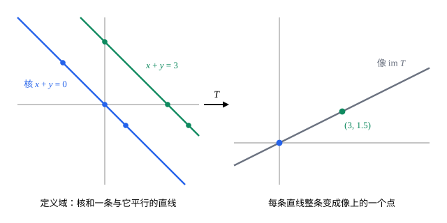

## 这一节要回答的问题

[秩与秩-零化度定理](lesson:math.linear-algebra.rank-nullity)讲的是矩阵：:term[零空间]{id="math.linear-algebra.null-space"}（null space）与:term[列空间]{id="math.linear-algebra.column-space"}（column space）的:term[维数]{id="math.linear-algebra.dimension"}（dimension）之和等于列数。对多项式求导、在几个点上取值，这些运算也保持加法和:term[数乘]{id="math.linear-algebra.scalar-multiplication"}（scalar multiplication），它们有没有类似的两个:term[子空间]{id="math.linear-algebra.subspace"}（subspace）？怎样判断这样一个运算会不会把两个不同的向量送到同一处，又能不能到达目标空间里的每个向量？

## 讲解

### 一般的线性映射

先看两个例子。对多项式求导，$D(p)=p'$把$P_3$里的多项式送到$P_2$里，而且$(p+q)'=p'+q'$、$(cp)'=cp'$。在一个点上取值，$E(p)=p(1)$把$P_2$送到$\R$，而且$(p+q)(1)=p(1)+q(1)$、$(cp)(1)=cp(1)$。它们和:term[线性变换]{id="math.linear-algebra.linear-transformation"}（linear transformation）一样保持加法和:term[数乘]{id="math.linear-algebra.scalar-multiplication"}，只是作用在多项式上。

::anchor{id="def-linear-map"}
设$V$、$W$是:term[向量空间]{id="math.linear-algebra.vector-space"}（vector space）。对应$T:V\to W$如果对任意$\vb u,\vb v\in V$和数$c$都满足$T(\vb u+\vb v)=T(\vb u)+T(\vb v)$、$T(c\vb u)=cT(\vb u)$，就叫作从$V$到$W$的:term[线性映射]{id="math.linear-algebra.linear-map"}（linear map）。$V=\R^n$、$W=\R^m$时，它就是线性变换。

为什么这样定义：两条合起来，$T(c_1\vb v_1+\dots+c_k\vb v_k)=c_1T(\vb v_1)+\dots+c_kT(\vb v_k)$，所以线性映射由一组:term[基]{id="math.linear-algebra.basis"}（basis）的:term[像]{id="math.linear-algebra.image"}（image）完全决定：知道每个基向量送到哪里，每个向量送到哪里也就知道了。边界情况：$T(\vb 0)=T(0\,\vb 0)=0\,T(\vb 0)=\vb 0$，所以把$\vb 0$送到别处的对应都不是线性映射，例如$p\mapsto p+1$；从$P_2$到$P_4$的$p\mapsto p^2$也不是，因为$(2p)^2=4p^2\ne2p^2$。

### 核与像

求导把常数都送到$0$；它能到达$P_2$的全部，因为每个次数不超过$2$的多项式都是某个次数不超过$3$的多项式的导数。矩阵给出的$\vb x\mapsto A\vb x$，送到$\vb 0$的是:term[零空间]{id="math.linear-algebra.null-space"}，能到达的是:term[列空间]{id="math.linear-algebra.column-space"}。一般的:term[线性映射]{id="math.linear-algebra.linear-map"}也有这样两个集合。

::anchor{id="def-kernel-image"}
设$T:V\to W$是:term[线性映射]{id="math.linear-algebra.linear-map"}。$V$中被$T$送到$\vb 0$的向量全体$\{\vb v\in V:T(\vb v)=\vb 0\}$叫作$T$的:term[核]{id="math.linear-algebra.kernel"}（kernel），记作$\ker T$；$V$中所有向量的:term[像]{id="math.linear-algebra.image"}组成的集合$\{T(\vb v):\vb v\in V\}$叫作$T$的像，记作$\im T$。

为什么这样定义：$T(\vb x)=A\vb x$时，$\ker T$就是零空间$N(A)$，$\im T$就是列空间$C(A)$。核管的是$T(\vb v)=\vb w$的解有多少，两个解相减就落在核里；像管的是哪些$\vb w$能解出来。边界情况：把每个向量都送到$\vb 0$的零映射（zero map），核是$V$、像是$\{\vb 0\}$；恒等映射（identity map）$\vb v\mapsto\vb v$的核是$\{\vb 0\}$、像是$V$。

::anchor{id="thm-subspaces"}
**核与像都是:term[子空间]{id="math.linear-algebra.subspace"}**　$\ker T$是$V$的子空间，$\im T$是$W$的子空间。

**证明思路**：$T(\vb 0)=\vb 0$，所以$\vb 0$在两者里。若$T(\vb u)=T(\vb v)=\vb 0$，则$T(\vb u+\vb v)=\vb 0$、$T(c\vb u)=\vb 0$，核对加法和:term[数乘]{id="math.linear-algebra.scalar-multiplication"}封闭。若$\vb w_1=T(\vb v_1)$、$\vb w_2=T(\vb v_2)$，则$\vb w_1+\vb w_2=T(\vb v_1+\vb v_2)$、$c\vb w_1=T(c\vb v_1)$，像也封闭。

求核与像，常借助坐标。$V$、$W$都是:term[有限维]{id="math.linear-algebra.finite-dimensional"}（finite-dimensional）的时，取$V$的一组:term[基]{id="math.linear-algebra.basis"}$\mathcal B=(\vb b_1,\dots,\vb b_n)$和$W$的一组基$\mathcal C$，以:term[坐标向量]{id="math.linear-algebra.coordinate-vector"}（coordinate vector）$[T(\vb b_1)]_{\mathcal C},\dots,[T(\vb b_n)]_{\mathcal C}$为各列排成矩阵$A$。$\vb v=x_1\vb b_1+\dots+x_n\vb b_n$时$T(\vb v)=x_1T(\vb b_1)+\dots+x_nT(\vb b_n)$，取坐标就得到$[T(\vb v)]_{\mathcal C}=A[\vb v]_{\mathcal B}$；于是核、像分别对应$N(A)$、$C(A)$（例 2）。

### 单射与满射

::anchor{id="def-injective-surjective"}
如果$V$中不同的向量在$T$下的:term[像]{id="math.linear-algebra.image"}总不相同，就说$T$是:term[单射]{id="math.linear-algebra.injective"}（injective）；如果$W$中每个向量都是某个向量的像，即$\im T=W$，就说$T$是:term[满射]{id="math.linear-algebra.surjective"}（surjective）。

为什么这样定义：单射说的是，对每个$\vb w$，方程$T(\vb v)=\vb w$最多有一个解；满射说的是至少有一个解。求导$D:P_3\to P_2$是满射，却不是单射，因为$p$和$p+1$的导数相同。把$P_2$里的多项式原样看成$P_3$里的元素，这个映射是单射，却不是满射：$x^3$不是任何元素的像。

::anchor{id="thm-injective-kernel"}
**单射看:term[核]{id="math.linear-algebra.kernel"}**　:term[线性映射]{id="math.linear-algebra.linear-map"}$T$是单射，当且仅当$\ker T=\{\vb 0\}$。

**证明思路**：$T(\vb u)=T(\vb v)$等价于$T(\vb u-\vb v)=\vb 0$，即$\vb u-\vb v\in\ker T$。核只有$\vb 0$时，由$T(\vb u)=T(\vb v)$只能得出$\vb u=\vb v$；核里有非零的$\vb k$时，$\vb k$和$\vb 0$的像都是$\vb 0$，$T$就不是单射。

### 维数公式

::anchor{id="thm-dimension-formula"}
**:term[维数公式]{id="math.linear-algebra.dimension-formula"}（dimension theorem）**　设$V$是:term[有限维]{id="math.linear-algebra.finite-dimensional"}的，$T:V\to W$是:term[线性映射]{id="math.linear-algebra.linear-map"}，则$\dim\ker T+\dim\im T=\dim V$。对矩阵给出的$\vb x\mapsto A\vb x$，这就是:term[秩-零化度定理]{id="math.linear-algebra.rank-nullity-theorem"}（rank–nullity theorem）；所以$\dim\im T$也叫$T$的:term[秩]{id="math.linear-algebra.rank"}（rank）。

**证明思路**：取$V$的一组:term[基]{id="math.linear-algebra.basis"}$\vb b_1,\dots,\vb b_n$。$\im T$由$T(\vb b_1),\dots,T(\vb b_n)$:term[生成]{id="math.linear-algebra.span"}（span），也是有限维的；取它的一组基$\mathcal C$，和上面一样以$[T(\vb b_j)]_{\mathcal C}$为各列排成矩阵$A$。坐标把$\ker T$一一对应到$N(A)$、把$\im T$对应到$C(A)$，并且把一组基变成一组基，所以$\dim\ker T=\dim N(A)$、$\dim\im T=\rank A$；由秩-零化度定理，两者之和是$A$的列数$n$。

由维数公式，$\dim V>\dim W$时$T$不可能是:term[单射]{id="math.linear-algebra.injective"}，:term[核]{id="math.linear-algebra.kernel"}至少有$\dim V-\dim W$维；$\dim V<\dim W$时不可能是:term[满射]{id="math.linear-algebra.surjective"}，:term[像]{id="math.linear-algebra.image"}至多有$\dim V$维。:term[维数]{id="math.linear-algebra.dimension"}相同时，情形最简单：

::anchor{id="thm-isomorphism"}
**维数相同时，单射就是满射**　设$\dim V=\dim W=n$。线性映射$T:V\to W$是单射，当且仅当它是满射；这时$T$是一一对应，是$V$到$W$的:term[同构]{id="math.linear-algebra.isomorphism"}（isomorphism）。两个有限维:term[向量空间]{id="math.linear-algebra.vector-space"}同构，当且仅当维数相同。

**证明思路**：单射即$\dim\ker T=0$，由维数公式即$\dim\im T=n$；$\im T$是$n$维空间$W$的$n$维:term[子空间]{id="math.linear-algebra.subspace"}，借助坐标和[基与维数](lesson:math.linear-algebra.basis-dimension)第 5 题，它就是$W$本身，即$T$是满射，每一步都能倒推回来。维数相同时，取两边的基，坐标把$V$、$W$都一一对应到$\R^n$，合起来就是$V$到$W$的同构；反过来有同构时，核是$\{\vb 0\}$、像是$W$，由维数公式两边维数相同。

## 几何图像

图里的$T(x,y)=\bigl(x+y,\frac{x+y}2\bigr)$把平面送到平面。:term[核]{id="math.linear-algebra.kernel"}是直线$x+y=0$，上面的点都送到原点；和核:term[平行]{id="math.linear-algebra.parallel"}（parallel）的直线$x+y=3$上，每一点的:term[像]{id="math.linear-algebra.image"}都是$(3,1.5)$，因为线上任两点之差落在核里。$T$的像是过原点、沿$(2,1)$的直线：平面二维，被压掉的核一维，留下的像一维，正是:term[维数公式]{id="math.linear-algebra.dimension-formula"}$2=1+1$。

## 例题

### 例 1　在两个点上取值

设$T:P_2\to\R^2$，$T(p)=\bigl(p(0),p(1)\bigr)$。求$\ker T$和$\im T$，并判断$T$是不是:term[单射]{id="math.linear-algebra.injective"}、:term[满射]{id="math.linear-algebra.surjective"}。

**为什么想到这么做**：:term[核]{id="math.linear-algebra.kernel"}里的多项式在$0$、$1$两处都等于$0$，可以直接因式分解；:term[像]{id="math.linear-algebra.image"}的:term[维数]{id="math.linear-algebra.dimension"}不必一个个去找，用:term[维数公式]{id="math.linear-algebra.dimension-formula"}算。

**推导**：$p(0)=p(1)=0$说明$x$和$x-1$都是$p$的因式，$p$的次数不超过$2$，所以$p=c\,x(x-1)$，$\ker T$由$x^2-x$:term[生成]{id="math.linear-algebra.span"}，是一维的，$T$不是单射。由维数公式，$\dim\im T=3-1=2$，$\im T$是$\R^2$的二维:term[子空间]{id="math.linear-algebra.subspace"}，就是$\R^2$，$T$是满射。验算：$T(1-x)=(1,0)$，$T(x)=(0,1)$，确实能到达$\R^2$的一组:term[基]{id="math.linear-algebra.basis"}。

### 例 2　二阶导数：核和像相同

设$T:P_3\to P_3$，$T(p)=p''$。求$\ker T$和$\im T$。

**为什么想到这么做**：借助坐标：取$P_3$的:term[基]{id="math.linear-algebra.basis"}$1,x,x^2,x^3$，算出每个基向量的:term[像]{id="math.linear-algebra.image"}，排成矩阵，再求:term[零空间]{id="math.linear-algebra.null-space"}和:term[列空间]{id="math.linear-algebra.column-space"}。

**推导**：$T(1)=0$，$T(x)=0$，$T(x^2)=2$，$T(x^3)=6x$，坐标分别是$(0,0,0,0)$、$(0,0,0,0)$、$(2,0,0,0)$、$(0,6,0,0)$。以它们为各列，矩阵只有第一、二行不为零，零空间由$(1,0,0,0)$、$(0,1,0,0)$:term[生成]{id="math.linear-algebra.span"}，列空间也由这两个向量生成。所以$\ker T$和$\im T$都是次数不超过$1$的多项式全体$P_1$，:term[维数]{id="math.linear-algebra.dimension"}$2+2=4$。

## 常见误区

- 「:term[核]{id="math.linear-algebra.kernel"}是$W$的:term[子空间]{id="math.linear-algebra.subspace"}。」核在定义域$V$里，是被送到$\vb 0$之前的那些向量，:term[像]{id="math.linear-algebra.image"}才在$W$里。例 2 里核和像恰好相同，是因为$V=W=P_3$。
- 「$\dim V=\dim W$，:term[线性映射]{id="math.linear-algebra.linear-map"}就是:term[同构]{id="math.linear-algebra.isomorphism"}。」零映射是反例；:term[维数]{id="math.linear-algebra.dimension"}相同只说明:term[单射]{id="math.linear-algebra.injective"}和:term[满射]{id="math.linear-algebra.surjective"}是一回事，两样可能都不成立。
- 「求导$D:P_3\to P_3$是满射。」目标空间取$P_3$时，$x^3$不是任何次数不超过$3$的多项式的导数，像只是$P_2$；是不是满射，和目标空间取哪个有关。
- 「判断单射，要把$V$里的向量两两比较。」只要看核：核只有$\vb 0$，就是单射。
