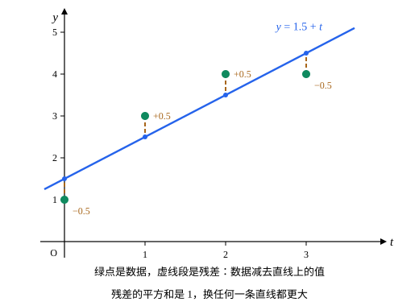

## 这一节要回答的问题

做实验测出几组数据$(t_i,y_i)$，想用一条直线$y=c_0+c_1t$描述它们。数据有误差，点一般不会正好落在一条直线上，要求每个点都在线上，关于$c_0$、$c_1$的:term[线性方程组]{id="math.linear-algebra.linear-system"}（linear system）就无解。这时该选哪条直线？[正交补与正交投影](lesson:math.linear-algebra.orthogonal-projection)说，:term[子空间]{id="math.linear-algebra.subspace"}（subspace）里离一个向量最近的点是:term[正交投影]{id="math.linear-algebra.orthogonal-projection"}（orthogonal projection），无解的方程组和投影有什么关系？

## 讲解

### 无解时找最接近的

由[两个子空间管着方程组](lesson:math.linear-algebra.column-null-space#thm-solvability)，$A\vb x=\vb b$有解，当且仅当$\vb b$在:term[列空间]{id="math.linear-algebra.column-space"}（column space）$C(A)$里。$\vb x$取遍$\R^n$时，$A\vb x$取遍$C(A)$；$\vb b$不在$C(A)$里时，退一步，找使$A\vb x$离$\vb b$最近的$\vb x$。在$\R^m$里取:term[点积]{id="math.linear-algebra.dot-product"}（dot product），距离的平方$\|A\vb x-\vb b\|^2$就是各个方程两边之差的平方和。

::anchor{id="def-least-squares"}
设$A$是$m\times n$矩阵，$\vb b\in\R^m$。使$\|A\vb x-\vb b\|$最小的$\hat{\vb x}$，叫作$A\vb x=\vb b$的:term[最小二乘解]{id="math.linear-algebra.least-squares-solution"}（least-squares solution）；$\vb r=\vb b-A\hat{\vb x}$叫作残差（residual）。

为什么这样定义：要的是误差的平方和最小，所以叫最小二乘；用平方而不用绝对值，是因为平方和正是:term[范数]{id="math.linear-algebra.norm"}（norm）的平方，可以用:term[投影]{id="math.linear-algebra.orthogonal-projection"}和勾股定理（Pythagorean theorem）来处理。$A\vb x=\vb b$有解时，最小二乘解就是通常的解，残差是$\vb 0$。边界情况：$A$的各列:term[线性相关]{id="math.linear-algebra.linearly-dependent"}（linearly dependent）时，最小二乘解不唯一，例如两列相同时，只定得下这两个未知数之和。

### 法方程

::anchor{id="thm-normal-equations"}
**:term[法方程]{id="math.linear-algebra.normal-equations"}（normal equations）**　$\hat{\vb x}$是$A\vb x=\vb b$的:term[最小二乘解]{id="math.linear-algebra.least-squares-solution"}，当且仅当$A\T A\hat{\vb x}=A\T\vb b$。这个方程组总有解。

**证明思路**：$C(A)$是$\R^m$的:term[子空间]{id="math.linear-algebra.subspace"}，由[正交投影离得最近](lesson:math.linear-algebra.orthogonal-projection#thm-best-approximation)，$\|A\vb x-\vb b\|$最小，当且仅当$A\hat{\vb x}=\operatorname{proj}_{C(A)}\vb b$，即$\vb b-A\hat{\vb x}$和$C(A)$:term[正交]{id="math.linear-algebra.orthogonal"}（orthogonal）。这又等价于残差和$A$的每一列正交；$A\T\vb r$的第$j$个元素正是$A$的第$j$列和$\vb r$的:term[点积]{id="math.linear-algebra.dot-product"}，所以条件就是$A\T(\vb b-A\hat{\vb x})=\vb 0$。:term[投影]{id="math.linear-algebra.orthogonal-projection"}总存在，又在$C(A)$里，总有$\hat{\vb x}$使$A\hat{\vb x}$等于它，所以法方程总有解。

「法」是法线的法，说的是垂直：残差垂直于:term[列空间]{id="math.linear-algebra.column-space"}。法方程把一个求最小值的问题，变成了一个$n$阶的:term[线性方程组]{id="math.linear-algebra.linear-system"}。

::anchor{id="thm-unique-least-squares"}
**什么时候唯一**　若$A$的各列:term[线性无关]{id="math.linear-algebra.linearly-independent"}（linearly independent），则$A\T A$:term[可逆]{id="math.linear-algebra.invertible"}（invertible），最小二乘解唯一，$\hat{\vb x}=(A\T A)^{-1}A\T\vb b$。

**证明思路**：$A\T A$是$n$阶:term[方阵]{id="math.linear-algebra.square-matrix"}（square matrix）。若$A\T A\vb x=\vb 0$，由[转置的运算律](lesson:math.linear-algebra.matrix-inverse#thm-transpose-laws)，$\vb x\T A\T A\vb x=(A\vb x)\cdot(A\vb x)=\|A\vb x\|^2=0$，所以$A\vb x=\vb 0$，各列线性无关，$\vb x=\vb 0$。由[可逆与方程组](lesson:math.linear-algebra.matrix-inverse#thm-invertible)，$A\T A$可逆。

实际计算时不必求逆，直接解法方程就行（例 2）。

### 拟合直线

::anchor{id="def-regression-line"}
设有数据$(t_1,y_1),\dots,(t_m,y_m)$，要求直线$y=c_0+c_1t$过每个点，就是$A\vb c=\vb y$，其中$A$的第一列全是$1$、第二列是$t_1,\dots,t_m$，$\vb c=(c_0,c_1)$，$\vb y=(y_1,\dots,y_m)$。它的:term[最小二乘解]{id="math.linear-algebra.least-squares-solution"}给出的直线，叫作这组数据的拟合直线（least-squares line），也叫回归直线（regression line）。

为什么这样定义：$\|A\vb c-\vb y\|^2=\sum\bigl(y_i-(c_0+c_1t_i)\bigr)^2$，正是各点在竖直方向上的误差的平方和。:term[法方程]{id="math.linear-algebra.normal-equations"}写出来是

$$
\begin{pmatrix}m&\sum t_i\\\sum t_i&\sum t_i^2\end{pmatrix}\begin{pmatrix}c_0\\c_1\end{pmatrix}=\begin{pmatrix}\sum y_i\\\sum t_iy_i\end{pmatrix}.
$$

$t_i$不全相同时，$A$的两列:term[线性无关]{id="math.linear-algebra.linearly-independent"}，拟合直线唯一。残差和第一列:term[正交]{id="math.linear-algebra.orthogonal"}，就是$\sum r_i=0$：直线整体不偏高也不偏低。边界情况：所有$t_i$都相同时，两列成比例，过$(t_1,\bar y)$的直线都一样好，拟合直线定不下来。

模型对系数是线性的就行，不必是直线：拟合抛物线$y=c_0+c_1t+c_2t^2$，$A$多一列$t_i^2$，做法一样。

## 几何图像

图里是例 1 的四个数据点和拟合直线$y=1.5+t$。竖直的虚线段是残差$y_i-(1.5+t_i)$，依次是$-0.5$、$0.5$、$0.5$、$-0.5$，和为$0$，平方和是$1$。换个角度看：四个$y_i$组成$\R^4$里的一个向量，所有直线给出的四个值组成二维的:term[列空间]{id="math.linear-algebra.column-space"}，拟合直线给出的四个值，正是这个向量在列空间上的:term[正交投影]{id="math.linear-algebra.orthogonal-projection"}。

## 例题

### 例 1　拟合一条直线

求数据$(0,1)$、$(1,3)$、$(2,4)$、$(3,4)$的拟合直线，并验证残差和$A$的两列都:term[正交]{id="math.linear-algebra.orthogonal"}。

**为什么想到这么做**：直接写出:term[法方程]{id="math.linear-algebra.normal-equations"}，只要算$\sum t_i$、$\sum t_i^2$、$\sum y_i$、$\sum t_iy_i$四个数。

**推导**：$m=4$，$\sum t_i=6$，$\sum t_i^2=14$，$\sum y_i=12$，$\sum t_iy_i=0+3+8+12=23$。法方程是$4c_0+6c_1=12$、$6c_0+14c_1=23$，解得$c_1=1$、$c_0=\frac32$，拟合直线是$y=1.5+t$。残差是$(-0.5,0.5,0.5,-0.5)$，和第一列$(1,1,1,1)$的:term[点积]{id="math.linear-algebra.dot-product"}是$0$，和第二列$(0,1,2,3)$的点积是$0+0.5+1-1.5=0$。

### 例 2　三个方程、两个未知数

方程组$x=1$、$y=1$、$x+y=0$无解。求它的:term[最小二乘解]{id="math.linear-algebra.least-squares-solution"}和残差。

**为什么想到这么做**：$A=\begin{pmatrix}1&0\\0&1\\1&1\end{pmatrix}$的两列:term[线性无关]{id="math.linear-algebra.linearly-independent"}，最小二乘解唯一，解:term[法方程]{id="math.linear-algebra.normal-equations"}就行。

**推导**：$\vb b=(1,1,0)$，$A\T A=\begin{pmatrix}2&1\\1&2\end{pmatrix}$，$A\T\vb b=(1,1)$。解$2x+y=1$、$x+2y=1$，得$\hat{\vb x}=\bigl(\frac13,\frac13\bigr)$。$A\hat{\vb x}=\bigl(\frac13,\frac13,\frac23\bigr)$，残差$\vb r=\bigl(\frac23,\frac23,-\frac23\bigr)$，和两列的:term[点积]{id="math.linear-algebra.dot-product"}都是$0$；三个方程的误差一样大，谁也不偏袒。

## 常见误区

- 「拟合直线让各点到直线的距离之和最小。」它让竖直方向误差的平方和最小，不是距离之和，也不是到直线的垂直距离。
- 「方程组无解，就删掉多出来的方程。」例 2 删掉第三个方程得$(1,1)$，删掉别的又得别的结果；:term[最小二乘解]{id="math.linear-algebra.least-squares-solution"}用上了全部方程，得$\bigl(\frac13,\frac13\bigr)$。
- 「:term[法方程]{id="math.linear-algebra.normal-equations"}的解满足原方程组。」只有原方程组有解时才满足；例 2 的$\hat{\vb x}$不满足$x+y=0$，残差不是$\vb 0$。
- 「$A\T A$总是:term[可逆]{id="math.linear-algebra.invertible"}的。」$A$的各列:term[线性相关]{id="math.linear-algebra.linearly-dependent"}时不可逆，例如所有数据的$t_i$都相同时，拟合直线定不下来。
