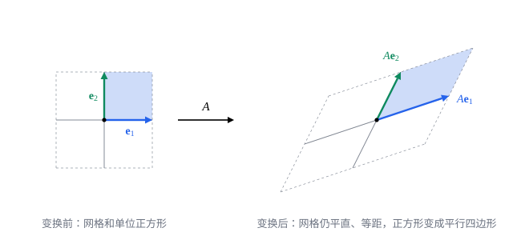

## 这一节要回答的问题

把一张图片绕中心旋转、横向拉长、斜着推一下，每个点的坐标都按同一个规则变到新的位置。哪些这样的规则能用一个矩阵表示，矩阵又该怎样写出来？先旋转、再拉长，合起来的规则对应哪个矩阵？

## 讲解

### 线性变换

[矩阵与矩阵乘法](lesson:math.linear-algebra.matrices)里，$\vb x\mapsto A\vb x$把$\R^n$中的向量变成$\R^m$中的向量，并且$A(\vb x+\vb y)=A\vb x+A\vb y$、$A(c\vb x)=cA\vb x$。把这两条性质单独拿出来，就是:term[线性变换]{id="math.linear-algebra.linear-transformation"}（linear transformation）的定义。

::anchor{id="def-linear-transformation"}
把$\R^n$中的每个向量$\vb x$变成$\R^m$中一个向量$T(\vb x)$的对应$T$，如果对任意向量$\vb u$、$\vb v$和数$c$都有$T(\vb u+\vb v)=T(\vb u)+T(\vb v)$、$T(c\vb u)=cT(\vb u)$，就叫作:term[线性变换]{id="math.linear-algebra.linear-transformation"}（linear transformation），也叫线性映射（linear map），记作$T:\R^n\to\R^m$；$T(\vb x)$叫作$\vb x$在$T$下的像（image）。

为什么这样定义：两条等式合起来，说的是$T$保持:term[线性组合]{id="math.linear-algebra.linear-combination"}（linear combination）：$T(c_1\vb v_1+\dots+c_k\vb v_k)=c_1T(\vb v_1)+\dots+c_kT(\vb v_k)$。几何上，它把网格变成平直、等距的网格，原点不动，因为$T(\vb 0)=T(0\vb 0)=0\,T(\vb 0)=\vb 0$。边界情况：平移$\vb x\mapsto\vb x+\vb b$（$\vb b\ne\vb 0$）把原点移走了，不是线性变换；$(x_1,x_2)\mapsto(x_1^2,x_2)$也不是，因为$T(2\vb e_1)=(4,0)\ne2T(\vb e_1)$。

### 标准矩阵

::anchor{id="thm-standard-matrix"}
**:term[线性变换]{id="math.linear-algebra.linear-transformation"}都是矩阵乘向量**　设$T:\R^n\to\R^m$是线性变换，$A$是以$T(\vb e_1),\dots,T(\vb e_n)$为各列的$m\times n$矩阵，则对每个$\vb x\in\R^n$都有$T(\vb x)=A\vb x$；这个$A$叫作$T$的:term[标准矩阵]{id="math.linear-algebra.standard-matrix"}（standard matrix）。

**证明思路**：$\vb x=x_1\vb e_1+\dots+x_n\vb e_n$，由线性，$T(\vb x)=x_1T(\vb e_1)+\dots+x_nT(\vb e_n)$，按矩阵乘向量的定义，这正是$A\vb x$。标准矩阵是唯一的：若$T(\vb x)=B\vb x$对每个$\vb x$成立，取$\vb x=\vb e_j$，$B$的第$j$列只能是$T(\vb e_j)$。

所以要写出一个线性变换的矩阵，只要看它把:term[标准基向量]{id="math.linear-algebra.standard-basis-vector"}（standard basis vectors）变到哪里，把这些像依次排成列。

### 平面上的几种变换

::anchor{id="def-rotation-shear"}
绕原点逆时针转过角$\theta$的变换把$\vb e_1$变成$(\cos\theta,\sin\theta)$、把$\vb e_2$变成$(-\sin\theta,\cos\theta)$，它的:term[标准矩阵]{id="math.linear-algebra.standard-matrix"}$R_\theta=\begin{pmatrix}\cos\theta&-\sin\theta\\\sin\theta&\cos\theta\end{pmatrix}$叫作:term[旋转矩阵]{id="math.linear-algebra.rotation-matrix"}（rotation matrix）；把$(x,y)$变成$(x+ky,\,y)$的变换叫作水平方向的:term[剪切]{id="math.linear-algebra.shear"}（shear），标准矩阵是$\begin{pmatrix}1&k\\0&1\end{pmatrix}$。

为什么这样定义：旋转把以$\vb u$、$\vb v$为邻边的平行四边形整个转过去，对角线还是对角线，所以旋转保持加法，也保持:term[数乘]{id="math.linear-algebra.scalar-multiplication"}（scalar multiplication），是:term[线性变换]{id="math.linear-algebra.linear-transformation"}；$\vb e_2$在$\vb e_1$逆时针转过$\frac\pi2$的位置，转过$\theta$后到了角$\theta+\frac\pi2$的方向，就是$(-\sin\theta,\cos\theta)$。剪切让每个点沿水平方向移动，移动的距离和它的纵坐标成正比，横线仍是横线，竖线变成斜线，像推一叠扑克牌的侧面。边界情况：$\theta=0$时$R_\theta=I$，$k=0$时剪切也是$I$，都是什么也不动的恒等变换（identity transformation）。

其他几种常见变换，同样看$\vb e_1$、$\vb e_2$的像：

| 变换 | $\vb e_1$的像 | $\vb e_2$的像 | 标准矩阵 |
| --- | --- | --- | --- |
| 沿两个坐标轴分别伸缩$a$倍、$b$倍 | $(a,0)$ | $(0,b)$ | $\begin{pmatrix}a&0\\0&b\end{pmatrix}$ |
| 关于$x$轴反射（reflection） | $(1,0)$ | $(0,-1)$ | $\begin{pmatrix}1&0\\0&-1\end{pmatrix}$ |
| 垂直投到$x$轴上：$(x,y)\mapsto(x,0)$ | $(1,0)$ | $(0,0)$ | $\begin{pmatrix}1&0\\0&0\end{pmatrix}$ |
| 垂直投到直线$y=x$上 | $(\frac12,\frac12)$ | $(\frac12,\frac12)$ | $\begin{pmatrix}\frac12&\frac12\\\frac12&\frac12\end{pmatrix}$ |

最后一行：从$(1,0)$向直线$y=x$作垂线，垂足是$(\frac12,\frac12)$，$(0,1)$的垂足也是它。

### 变换的复合

::anchor{id="thm-composition"}
**先后做两个:term[线性变换]{id="math.linear-algebra.linear-transformation"}**　设$T:\R^n\to\R^m$、$S:\R^m\to\R^p$是:term[线性变换]{id="math.linear-algebra.linear-transformation"}，:term[标准矩阵]{id="math.linear-algebra.standard-matrix"}分别是$A$、$B$，则先做$T$再做$S$的变换$\vb x\mapsto S(T(\vb x))$叫作它们的复合（composition），记作$S\circ T$；它也是线性变换，标准矩阵是$BA$。

**证明思路**：$S(T(\vb x))=B(A\vb x)=(BA)\vb x$，第二个等号正是:term[矩阵乘法]{id="math.linear-algebra.matrix-multiplication"}（matrix multiplication）的定义要保证的（见[矩阵与矩阵乘法](lesson:math.linear-algebra.matrices#def-matrix-product)）。$\vb x\mapsto(BA)\vb x$是矩阵乘向量，所以是线性变换。注意次序：先做的$T$的矩阵写在右边，和$S(T(\vb x))$里$T$靠近$\vb x$一样。

变换一般不能交换次序，矩阵乘法不满足交换律正是这个缘故：先转$\frac\pi2$再关于$x$轴反射，和先反射再转$\frac\pi2$，结果不同（第 3 题）。

## 几何图像

这是$A=\begin{pmatrix}1.5&0.5\\0.5&1\end{pmatrix}$。$\vb e_1$、$\vb e_2$变成$A$的两列$A\vb e_1=(1.5,0.5)$、$A\vb e_2=(0.5,1)$；整张网格跟着变，仍是平直、等距的，单位正方形变成以$A$的两列为邻边的平行四边形。知道了$\vb e_1$、$\vb e_2$去了哪里，整个平面去了哪里也就知道了。

:::anim{component="linear-map-2d"}
matrix: [[a, b], [c, d]]
range: { x: [-3.5, 3.5], y: [-3.5, 3.5] }
show: [grid, square, basis]
sliders:
  - name: a
    min: -1.5
    max: 1.5
    step: 0.25
    default: 1.5
    label: |
      $a$
  - name: b
    min: -1.5
    max: 1.5
    step: 0.25
    default: 0.5
    label: |
      $b$
  - name: c
    min: -1.5
    max: 1.5
    step: 0.25
    default: 0.5
    label: |
      $c$
  - name: d
    min: -1.5
    max: 1.5
    step: 0.25
    default: 1
    label: |
      $d$
:::

动画从:term[单位矩阵]{id="math.linear-algebra.identity-matrix"}（identity matrix）开始，一点点变到$A=\begin{pmatrix}a&b\\c&d\end{pmatrix}$，四个滑块一开始就是上图的矩阵。图例里「$\vb e_1$的像」那支箭头始终是第一列$(a,c)$，「$\vb e_2$的像」那支是第二列$(b,d)$，网格和单位正方形跟着这两支箭头走。可以试几组：$b=c=0$时沿两条坐标轴分别伸缩；$a=d=1$、$c=0$时是:term[剪切]{id="math.linear-algebra.shear"}；$a=d=0$、$b=-1$、$c=1$时是转过$90^\circ$。

两列:term[平行]{id="math.linear-algebra.parallel"}（parallel）时，例如四个数都是$1$，整个平面被压到一条直线上，单位正方形压扁成一条线段。动画的中途只是从$I$到$A$的过渡，中间的矩阵不一定是同一种变换，比较开头和结尾就行。

## 例题

### 例 1　旋转$45^\circ$

求绕原点逆时针旋转$\frac\pi4$的:term[标准矩阵]{id="math.linear-algebra.standard-matrix"}，以及点$(1,1)$转过去以后的位置。

**为什么想到这么做**：在:term[旋转矩阵]{id="math.linear-algebra.rotation-matrix"}里代入$\theta=\frac\pi4$，再乘向量。

**推导**：$\cos\frac\pi4=\sin\frac\pi4=\frac{\sqrt2}2$，所以$R_{\pi/4}=\frac{\sqrt2}2\begin{pmatrix}1&-1\\1&1\end{pmatrix}$，$R_{\pi/4}(1,1)=\frac{\sqrt2}2(1-1,\,1+1)=(0,\sqrt2)$。几何上，$(1,1)$在$45^\circ$方向、离原点$\sqrt2$，再转$45^\circ$就到了正上方，离原点仍是$\sqrt2$。

### 例 2　两次旋转与和角公式

用$R_\alpha R_\beta=R_{\alpha+\beta}$推出$\cos(\alpha+\beta)$、$\sin(\alpha+\beta)$的公式。

**为什么想到这么做**：先转$\beta$、再转$\alpha$，等于一次转$\alpha+\beta$；由复合的矩阵是乘积，$R_{\alpha+\beta}=R_\alpha R_\beta$，把右边乘出来，比较第一列。

**推导**：$R_\alpha R_\beta$的第一列是$R_\alpha(\cos\beta,\sin\beta)=(\cos\alpha\cos\beta-\sin\alpha\sin\beta,\ \sin\alpha\cos\beta+\cos\alpha\sin\beta)$，$R_{\alpha+\beta}$的第一列是$(\cos(\alpha+\beta),\sin(\alpha+\beta))$。两者相等，得到$\cos(\alpha+\beta)=\cos\alpha\cos\beta-\sin\alpha\sin\beta$、$\sin(\alpha+\beta)=\sin\alpha\cos\beta+\cos\alpha\sin\beta$。

## 常见误区

- 「平移$\vb x\mapsto\vb x+\vb b$也是:term[线性变换]{id="math.linear-algebra.linear-transformation"}。」线性变换必须把$\vb 0$变成$\vb 0$；$\vb b\ne\vb 0$时平移不是线性变换，也没有:term[标准矩阵]{id="math.linear-algebra.standard-matrix"}（第 7 题）。
- 「先做$T$再做$S$，矩阵是$AB$。」复合$S\circ T$的矩阵是$BA$：先做的写在右边。
- 「矩阵的第$j$行是$\vb e_j$的像。」$\vb e_j$的像是第$j$列；按行排就成了另一个矩阵。
- 「线性变换总把正方形变成平行四边形。」:term[投影]{id="math.linear-algebra.projection"}（projection）会把正方形压成一条线段，退化的平行四边形也要算上。例如把每个向量换成它在$x$轴方向上的投影（见[点积、长度与夹角](lesson:math.linear-algebra.dot-product#def-projection)），也就是$(x,y)\mapsto(x,0)$，单位正方形变成从原点到$(1,0)$的线段。
