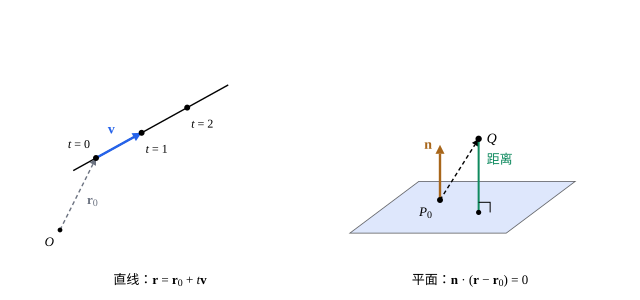

## 这一节要回答的问题

平面上一条直线可以写成$y=kx+b$，到了空间里，一条直线、一块平面该怎样用方程表示？一块木板朝哪个方向摆，用什么来描述最方便？空间里一个点离一块平面有多远，怎样不画图就算出来？

## 讲解

### 直线

一个点从$P_0$出发，以不变的速度$\vb v$运动，$t$时刻到达的位置是$P_0$的:term[位置向量]{id="math.linear-algebra.position-vector"}（position vector）加上$t\vb v$；让$t$取遍所有实数，就画出一条直线。

::anchor{id="def-line"}
设点$P_0$的位置向量是$\vb r_0$，$\vb v\ne\vb 0$，位置向量为$\vb r=\vb r_0+t\vb v$（$t\in\R$）的点组成一条直线，这个式子叫作直线的参数方程（parametric equation），$\vb v$叫作直线的:term[方向向量]{id="math.linear-algebra.direction-vector"}（direction vector）；写成:term[分量]{id="math.linear-algebra.component"}（component），就是$x=x_0+tv_1$、$y=y_0+tv_2$、$z=z_0+tv_3$。

为什么这样定义：直线由一个点和一个方向决定，$t$像是时间，每个$t$对应直线上的一个点。过两点$P$、$Q$的直线，可以取$\overrightarrow{PQ}$作方向向量。边界情况：方向向量不唯一，$\vb v$的任何非零倍数都可以，起点也可以换成直线上任何一点，所以同一条直线有许多个参数方程。

::anchor{id="def-skew"}
两条直线的方向向量:term[平行]{id="math.linear-algebra.parallel"}（parallel）时，两条直线平行或重合；空间里两条不平行的直线未必相交，既不平行、也不相交的两条直线叫作异面直线（skew lines），这在平面上是不会发生的。

### 平面

一块平板的朝向，可以用垂直于它的一个向量来描述：过一点$P_0$、垂直于给定方向的所有直线，正好铺满一个平面。

::anchor{id="def-plane"}
设点$P_0$的:term[位置向量]{id="math.linear-algebra.position-vector"}是$\vb r_0$，$\vb n\ne\vb 0$，满足$\vb n\cdot(\vb r-\vb r_0)=0$的点$\vb r$组成过$P_0$、垂直于$\vb n$的平面，这个方程叫作平面的点法式方程（point-normal equation），$\vb n$叫作平面的:term[法向量]{id="math.linear-algebra.normal-vector"}（normal vector）。

为什么这样定义：点$\vb r$在平面上，就是从$P_0$到它的向量$\vb r-\vb r_0$与$\vb n$:term[正交]{id="math.linear-algebra.orthogonal"}（orthogonal）。记$\vb n=(a,b,c)$，展开得$ax+by+cz=d$，$d=\vb n\cdot\vb r_0$；反过来，$a$、$b$、$c$不全为零时，$ax+by+cz=d$总是一个以$(a,b,c)$为法向量的平面。边界情况：法向量只差一个非零倍数，$a$、$b$、$c$相同而$d$不同的两个方程，表示两块互相平行的平面。

过不在同一直线上的三点$P$、$Q$、$R$的平面，法向量可以取$\overrightarrow{PQ}\times\overrightarrow{PR}$，因为:term[叉积]{id="math.linear-algebra.cross-product"}（cross product）同时垂直于这两个向量（例 1）。两个平面相交时，交线同时在两个平面上，方向和两个法向量都垂直，可以取$\vb n_1\times\vb n_2$（例 2）。

### 距离

::anchor{id="thm-distance-to-plane"}
**点到平面的距离**　点$Q$（:term[位置向量]{id="math.linear-algebra.position-vector"}$\vb q$）到平面$\vb n\cdot(\vb r-\vb r_0)=0$的距离是$\dfrac{|\vb n\cdot(\vb q-\vb r_0)|}{|\vb n|}$；平面写成$ax+by+cz=d$、$Q=(x_1,y_1,z_1)$时，距离是$\dfrac{|ax_1+by_1+cz_1-d|}{\sqrt{a^2+b^2+c^2}}$。

**证明思路**：从$Q$向平面作垂线，垂足是$F$，距离是$|\overrightarrow{FQ}|$。$\overrightarrow{FQ}$与$\vb n$:term[平行]{id="math.linear-algebra.parallel"}，正是$\vb q-\vb r_0$在$\vb n$上的:term[投影]{id="math.linear-algebra.projection"}（projection），它的:term[长度]{id="math.linear-algebra.length"}（length）是$\frac{|\vb n\cdot(\vb q-\vb r_0)|}{|\vb n|}$。第二个式子是把$\vb n=(a,b,c)$、$\vb n\cdot\vb r_0=d$代进去。垂足是平面上离$Q$最近的点（第 5 题）。

::anchor{id="thm-distance-to-line"}
**点到直线的距离**　点$Q$到直线$\vb r=\vb r_0+t\vb v$的距离是$\dfrac{|(\vb q-\vb r_0)\times\vb v|}{|\vb v|}$。

**证明思路**：以$\vb q-\vb r_0$和$\vb v$为邻边作平行四边形，面积是:term[叉积]{id="math.linear-algebra.cross-product"}的长度$|(\vb q-\vb r_0)\times\vb v|$；底边长$|\vb v|$，高正是$Q$到这条直线的距离，面积除以底即得。

## 几何图像

左图：直线$\vb r=\vb r_0+t\vb v$上，$t=0,1,2$的点等距地排开，相邻两点之间正好差一个:term[方向向量]{id="math.linear-algebra.direction-vector"}$\vb v$。右图：平面过$P_0$、:term[法向量]{id="math.linear-algebra.normal-vector"}是$\vb n$，点$Q$到平面的距离，是从$P_0$到$Q$的向量在$\vb n$方向上的:term[投影]{id="math.linear-algebra.projection"}的:term[长度]{id="math.linear-algebra.length"}。

## 例题

### 例 1　过三点的平面

求过$A(1,0,0)$、$B(0,2,0)$、$C(0,0,3)$的平面的方程，以及原点到它的距离。

**为什么想到这么做**：:term[法向量]{id="math.linear-algebra.normal-vector"}要同时垂直于平面里的$\overrightarrow{AB}$、$\overrightarrow{AC}$，取它们的:term[叉积]{id="math.linear-algebra.cross-product"}；[叉积](lesson:math.linear-algebra.cross-product)的例 2 已经算过，$\overrightarrow{AB}\times\overrightarrow{AC}=(6,3,2)$。

**推导**：取$\vb n=(6,3,2)$、$P_0=A$，点法式方程是$6(x-1)+3y+2z=0$，即$6x+3y+2z=6$。验算：$B$、$C$代进去都等于$6$。原点到它的距离是$\frac{|0-6|}{\sqrt{36+9+4}}=\frac67$。

### 例 2　两个平面的交线

求平面$x+y+z=1$与$x-y+2z=0$的交线的参数方程。

**为什么想到这么做**：交线的:term[方向向量]{id="math.linear-algebra.direction-vector"}和两个:term[法向量]{id="math.linear-algebra.normal-vector"}都垂直，取$\vb n_1\times\vb n_2$；再找交线上的一个点，比如令$z=0$。

**推导**：$\vb n_1\times\vb n_2=(1,1,1)\times(1,-1,2)$，三个:term[分量]{id="math.linear-algebra.component"}分别是$1\cdot2-1\cdot(-1)=3$、$1\cdot1-1\cdot2=-1$、$1\cdot(-1)-1\cdot1=-2$，所以$\vb n_1\times\vb n_2=(3,-1,-2)$。令$z=0$，$x+y=1$、$x-y=0$，得$x=y=\frac12$。所以交线是$\vb r=(\frac12,\frac12,0)+t(3,-1,-2)$；验算：代入两个方程，$t$的系数分别是$3-1-2=0$和$3+1-4=0$，常数部分分别是$1$和$0$。

## 常见误区

- 「直线的参数方程只有一个。」换一个起点、把:term[方向向量]{id="math.linear-algebra.direction-vector"}乘一个非零数，写出的式子不同，表示的却是同一条直线。
- 「$ax+by+cz=d$在空间里表示一条直线。」它是一个平面；在平面坐标系里，$ax+by=d$才表示直线。空间里的直线要两个这样的方程（两个平面的交线）来表示。
- 「空间里两条不:term[平行]{id="math.linear-algebra.parallel"}的直线一定相交。」还可能是异面直线，比如$x$轴和过$(0,0,1)$、沿$y$轴方向的直线。
- 「点到平面的距离是$|ax_1+by_1+cz_1-d|$。」还要除以:term[法向量]{id="math.linear-algebra.normal-vector"}的:term[长度]{id="math.linear-algebra.length"}$\sqrt{a^2+b^2+c^2}$；只有法向量是:term[单位向量]{id="math.linear-algebra.unit-vector"}（unit vector）时才不用除。
