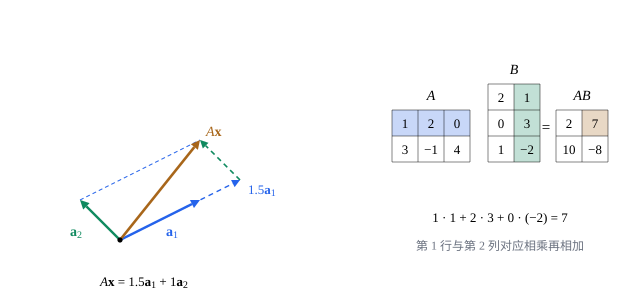

## 这一节要回答的问题

[线性方程组与高斯消元](lesson:math.linear-algebra.linear-systems)里，方程组写成了向量形式$x_1\vb a_1+\dots+x_n\vb a_n=\vb b$，$\vb a_j$是:term[系数矩阵]{id="math.linear-algebra.coefficient-matrix"}（coefficient matrix）的第$j$列，写起来还是很长。能不能把系数矩阵$A$和未知数排成的向量$\vb x$「乘」起来，简写成$A\vb x=\vb b$？两个矩阵又该怎样相乘，这种乘法和数的乘法有什么不同？

## 讲解

### 矩阵的加法与数乘

::anchor{id="def-matrix-operations"}
两个$m\times n$矩阵相加，是把对应位置上的数相加；数$c$乘矩阵$A$，是把$A$的每个数都乘以$c$；所有数都是$0$的矩阵叫作:term[零矩阵]{id="math.linear-algebra.zero-matrix"}（zero matrix），记作$O$；行数等于列数的矩阵叫作:term[方阵]{id="math.linear-algebra.square-matrix"}（square matrix），$n\times n$的方阵也叫$n$阶方阵。

为什么这样定义：把矩阵看成按两个下标排起来的一组数，加法和:term[数乘]{id="math.linear-algebra.scalar-multiplication"}（scalar multiplication）都照搬向量的做法，逐个位置进行，[向量与线性运算](lesson:math.linear-algebra.vectors)里的八条运算律照样成立。只有一列的矩阵就是向量，$\R^m$中的向量正是$m\times1$矩阵。边界情况：大小不同的矩阵不能相加，$2\times3$矩阵和$3\times2$矩阵的和没有意义。

### 矩阵乘向量

::anchor{id="def-matrix-vector"}
设$A$是$m\times n$矩阵，各列依次是$\vb a_1,\dots,\vb a_n$，$\vb x=(x_1,\dots,x_n)$，规定$A\vb x=x_1\vb a_1+x_2\vb a_2+\dots+x_n\vb a_n$，它是$\R^m$中的向量，叫作矩阵$A$与向量$\vb x$的乘积。

为什么这样定义：有了它，:term[线性方程组]{id="math.linear-algebra.linear-system"}（system of linear equations）$x_1\vb a_1+\dots+x_n\vb a_n=\vb b$就简写成$A\vb x=\vb b$，$A$是:term[系数矩阵]{id="math.linear-algebra.coefficient-matrix"}；$A\vb x$是$A$的各列以$\vb x$的:term[分量]{id="math.linear-algebra.component"}（component）为系数的:term[线性组合]{id="math.linear-algebra.linear-combination"}（linear combination）。方程组有没有解，就是$\vb b$是不是$A$的各列的线性组合。边界情况：$\vb x$的分量个数必须等于$A$的列数；$A\vb e_j=\vb a_j$，乘:term[标准基向量]{id="math.linear-algebra.standard-basis-vector"}（standard basis vector）$\vb e_j$就取出第$j$列。

::anchor{id="thm-row-rule"}
**按行计算**　$A\vb x$的第$i$个分量，是$A$的第$i$行与$\vb x$的分量对应相乘再相加：$(A\vb x)_i=a_{i1}x_1+a_{i2}x_2+\dots+a_{in}x_n$；并且$A(\vb x+\vb y)=A\vb x+A\vb y$，$A(c\vb x)=c(A\vb x)$。

**证明思路**：$x_1\vb a_1+\dots+x_n\vb a_n$的第$i$个分量是$x_1a_{i1}+\dots+x_na_{in}$，正是第$i$行与$\vb x$对应相乘再相加。后两个等式逐行由数的运算律得到。所以第$i$个方程的左边，正是$A\vb x$的第$i$个分量。

按列看，$A\vb x$是各列的组合，适合想它是什么；按行看，每个分量是一行与$\vb x$对应相乘再相加，适合动手算。学过[点积、长度与夹角](lesson:math.linear-algebra.dot-product)的话，这正是第$i$行与$\vb x$的:term[点积]{id="math.linear-algebra.dot-product"}（dot product）。

### 矩阵乘法

::anchor{id="def-matrix-product"}
设$A$是$m\times n$矩阵，$B$是$n\times p$矩阵，各列是$\vb b_1,\dots,\vb b_p$，规定$AB$是以$A\vb b_1,\dots,A\vb b_p$为各列的$m\times p$矩阵，这种运算叫作:term[矩阵乘法]{id="math.linear-algebra.matrix-multiplication"}（matrix multiplication）；按行计算，$AB$第$i$行第$j$列的数是$A$的第$i$行与$B$的第$j$列对应相乘再相加，即$\sum_{k=1}^na_{ik}b_{kj}$。

为什么这样定义：要让先用$B$、再用$A$作用的结果，等于用一个矩阵一次作用，即$(AB)\vb x=A(B\vb x)$对每个$\vb x$成立。$B\vb x=x_1\vb b_1+\dots+x_p\vb b_p$，再乘$A$，由上面的线性得$x_1A\vb b_1+\dots+x_pA\vb b_p$，这正是以$A\vb b_j$为列的矩阵乘$\vb x$。边界情况：$A$的列数等于$B$的行数，$AB$才有定义；$1\times n$矩阵乘$n\times1$矩阵得到$1\times1$矩阵，就是两个向量对应:term[分量]{id="math.linear-algebra.component"}的乘积之和。

::anchor{id="thm-product-laws"}
**矩阵乘法的运算律**　在乘积有定义时：(1) $(AB)C=A(BC)$；(2) $A(B+C)=AB+AC$，$(A+B)C=AC+BC$；(3) $c(AB)=(cA)B=A(cB)$。

**证明思路**：(1) 比较第$j$列：左边是$(AB)\vb c_j$，右边是$A(B\vb c_j)$，由$AB$的定义两者相等。(2)、(3) 用按行计算的公式，逐个位置都是数的运算律。乘法一般不能交换次序：$AB$和$BA$可能一个有定义、一个没有，都有定义时也常常不相等（例 2）。

### 对角矩阵与单位矩阵

::anchor{id="def-identity"}
:term[方阵]{id="math.linear-algebra.square-matrix"}中$a_{11},a_{22},\dots,a_{nn}$所在的斜线叫作主对角线（main diagonal），主对角线以外的数都是$0$的方阵叫作:term[对角矩阵]{id="math.linear-algebra.diagonal-matrix"}（diagonal matrix），记作$\operatorname{diag}(d_1,\dots,d_n)$；主对角线上都是$1$的对角矩阵叫作:term[单位矩阵]{id="math.linear-algebra.identity-matrix"}（identity matrix），记作$I$，要写明阶数时记作$I_n$。

为什么这样定义：$\operatorname{diag}(d_1,\dots,d_n)\vb x=(d_1x_1,\dots,d_nx_n)$，对角矩阵只是把各个:term[分量]{id="math.linear-algebra.component"}分别放大，是最简单的方阵；$I$的各列是$\vb e_1,\dots,\vb e_n$，所以$I\vb x=x_1\vb e_1+\dots+x_n\vb e_n=\vb x$。于是对$m\times n$矩阵$A$，$I_mA=A=AI_n$，单位矩阵在:term[矩阵乘法]{id="math.linear-algebra.matrix-multiplication"}里的作用就像数$1$。边界情况：方阵$A$可以和自己相乘，$A^2=AA$、$A^3=AAA$，由结合律，怎样加括号都一样。

## 几何图像

左图是$A=\begin{pmatrix}2&-1\\1&1\end{pmatrix}$、$\vb x=(1.5,1)$：$A\vb x$是两列$\vb a_1=(2,1)$、$\vb a_2=(-1,1)$的:term[线性组合]{id="math.linear-algebra.linear-combination"}$1.5\vb a_1+\vb a_2=(2,2.5)$。右图是按行计算的:term[矩阵乘法]{id="math.linear-algebra.matrix-multiplication"}：$AB$第$1$行第$2$列的数，是$A$的第$1$行与$B$的第$2$列对应相乘再相加。

## 例题

### 例 1　按列和按行算$A\vb x$

设$A=\begin{pmatrix}1&2\\3&4\\5&6\end{pmatrix}$，$\vb x=(1,-1)$，求$A\vb x$。

**为什么想到这么做**：$A$是$3\times2$矩阵，$\vb x$有$2$个:term[分量]{id="math.linear-algebra.component"}，乘积有定义，是$\R^3$中的向量；按列算看清它是什么，按行算做个验算。

**推导**：按列，$A\vb x=1\cdot(1,3,5)+(-1)\cdot(2,4,6)=(-1,-1,-1)$。按行，三个分量依次是$1\cdot1+2\cdot(-1)=-1$、$3-4=-1$、$5-6=-1$，结果相同。

### 例 2　$AB$与$BA$

设$A=\begin{pmatrix}1&1\\0&1\end{pmatrix}$，$B=\begin{pmatrix}1&0\\1&1\end{pmatrix}$，求$AB$和$BA$。

**为什么想到这么做**：两个都是$2\times2$:term[方阵]{id="math.linear-algebra.square-matrix"}，两种次序的乘积都有定义，按行计算的公式逐个位置算出来比较。

**推导**：$AB=\begin{pmatrix}1\cdot1+1\cdot1&1\cdot0+1\cdot1\\0\cdot1+1\cdot1&0\cdot0+1\cdot1\end{pmatrix}=\begin{pmatrix}2&1\\1&1\end{pmatrix}$，$BA=\begin{pmatrix}1\cdot1+0\cdot0&1\cdot1+0\cdot1\\1\cdot1+1\cdot0&1\cdot1+1\cdot1\end{pmatrix}=\begin{pmatrix}1&1\\1&2\end{pmatrix}$。两者不相等，:term[矩阵乘法]{id="math.linear-algebra.matrix-multiplication"}不满足交换律。

## 常见误区

- 「:term[矩阵乘法]{id="math.linear-algebra.matrix-multiplication"}就是对应位置相乘。」那是另一种运算；矩阵乘法是行与列对应相乘再相加，这样才有$(AB)\vb x=A(B\vb x)$（第 7 题）。
- 「$AB=O$，就有$A=O$或$B=O$。」$A=\begin{pmatrix}0&1\\0&0\end{pmatrix}$不是:term[零矩阵]{id="math.linear-algebra.zero-matrix"}，可$A^2=O$。
- 「$(A+B)^2=A^2+2AB+B^2$。」展开是$A^2+AB+BA+B^2$，只有$AB=BA$时才能合并成$2AB$。
- 「$AB$有定义，$BA$也有定义。」$2\times3$矩阵乘$3\times4$矩阵有定义，反过来$3\times4$乘$2\times3$就没有。
