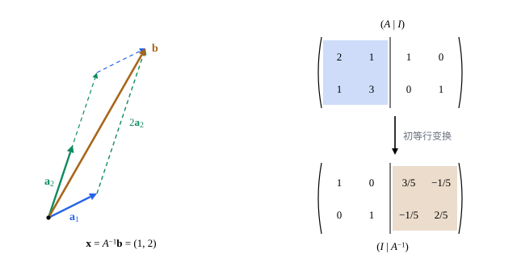

## 这一节要回答的问题

数$a\ne0$时，方程$ax=b$的解是$x=a^{-1}b$。:term[方阵]{id="math.linear-algebra.square-matrix"}（square matrix）$A$乘向量这件事能不能撤销：有没有一个矩阵，乘在$A\vb x$上又得到$\vb x$？有的话怎样求，它和方程组$A\vb x=\vb b$的解有什么关系？

## 讲解

### 逆矩阵

::anchor{id="def-inverse"}
设$A$是$n$阶:term[方阵]{id="math.linear-algebra.square-matrix"}，如果有$n$阶方阵$B$使$AB=BA=I$，就说$A$:term[可逆]{id="math.linear-algebra.invertible"}（invertible），$B$叫作$A$的:term[逆矩阵]{id="math.linear-algebra.inverse-matrix"}（inverse matrix），记作$A^{-1}$；不可逆的方阵也叫奇异矩阵（singular matrix）。

为什么这样定义：$A^{-1}(A\vb x)=(A^{-1}A)\vb x=I\vb x=\vb x$，先乘$A$、再乘$A^{-1}$，又回到$\vb x$，正像一个数先乘$a$、再乘$a^{-1}$会回到原来的数。逆矩阵若存在就只有一个：若$B$、$C$都满足条件，则$B=BI=B(AC)=(BA)C=IC=C$。边界情况：$A=\begin{pmatrix}1&0\\0&0\end{pmatrix}$不可逆，因为$A\vb e_2=\vb 0$，若有$B$，就得$\vb e_2=B(A\vb e_2)=B\vb 0=\vb 0$，矛盾。

::anchor{id="thm-invertible"}
**可逆与方程组**　对$n$阶方阵$A$，下面几条等价：(1) $A$可逆；(2) 对每个$\vb b\in\R^n$，$A\vb x=\vb b$都有唯一解；(3) $A\vb x=\vb 0$只有零解（trivial solution）；(4) $A$的:term[简化行阶梯形]{id="math.linear-algebra.reduced-row-echelon-form"}（reduced row echelon form）是$I$。$A$可逆时，$A\vb x=\vb b$的唯一解是$\vb x=A^{-1}\vb b$。

**证明思路**：(1) 推 (2)：$A(A^{-1}\vb b)=\vb b$，所以$A^{-1}\vb b$是解；任何解$\vb x$都满足$\vb x=A^{-1}(A\vb x)=A^{-1}\vb b$，所以唯一。(2)、(3)、(4) 等价，就是[线性方程组与高斯消元](lesson:math.linear-algebra.linear-systems#thm-square)里「方程个数等于未知数个数」那个定理：都说的是$A$的$n$列都有:term[主元]{id="math.linear-algebra.pivot"}（pivot）。(4) 推 (1) 由下面求逆的方法给出。

::anchor{id="thm-one-sided"}
**一边成立就够**　设$A$、$B$都是$n$阶方阵，$AB=I$，那么$BA=I$，即$B=A^{-1}$。

**证明思路**：若$B\vb x=\vb 0$，则$\vb x=(AB)\vb x=A(B\vb x)=\vb 0$，所以$B\vb x=\vb 0$只有零解，$B$满足 (3)。于是对每个$j$，$B\vb c_j=\vb e_j$都有唯一解，以$\vb c_j$为各列的矩阵$C$满足$BC=I$。由此$A=A(BC)=(AB)C=C$，所以$BA=BC=I$。检验一个矩阵是不是$A$的逆，只要乘一边。

### 用初等行变换求逆

::anchor{id="thm-gauss-jordan"}
**求:term[逆矩阵]{id="math.linear-algebra.inverse-matrix"}**　对$n\times2n$矩阵$(A\mid I)$做:term[初等行变换]{id="math.linear-algebra.elementary-row-operation"}（elementary row operations）：如果左半边能化成$I$，右半边就化成了$A^{-1}$；如果左半边的:term[简化行阶梯形]{id="math.linear-algebra.reduced-row-echelon-form"}不是$I$，$A$不:term[可逆]{id="math.linear-algebra.invertible"}。

**证明思路**：求$A^{-1}$的第$j$列，就是解方程组$A\vb x=\vb e_j$；$n$个方程组系数相同，消元的步骤也相同，可以把$n$个常数项列并排放在右边一起算。左半边化成$I$时，右边第$j$列就是$A\vb x=\vb e_j$的解，右半边$X$满足$AX=I$，由上面的定理$X=A^{-1}$。左半边化不成$I$时，有一列没有:term[主元]{id="math.linear-algebra.pivot"}，$A\vb x=\vb 0$有非零解，$A$不可逆。

二阶矩阵可以直接写出逆矩阵。

::anchor{id="thm-two-by-two"}
**二阶矩阵的逆**　设$A=\begin{pmatrix}a&b\\c&d\end{pmatrix}$。$ad-bc\ne0$时$A$可逆，$A^{-1}=\frac1{ad-bc}\begin{pmatrix}d&-b\\-c&a\end{pmatrix}$；$ad-bc=0$时$A$不可逆。

**证明思路**：直接相乘，$\begin{pmatrix}a&b\\c&d\end{pmatrix}\begin{pmatrix}d&-b\\-c&a\end{pmatrix}=(ad-bc)I$，$ad-bc\ne0$时两边除以它即得，乘一边就够。$ad-bc=0$时，这个乘积是$O$；若$A$可逆，左乘$A^{-1}$得$\begin{pmatrix}d&-b\\-c&a\end{pmatrix}=O$，于是$A=O$，可$O$不可逆，矛盾。以后[行列式：有向面积与体积](lesson:math.linear-algebra.determinant)里讲的:term[行列式]{id="math.linear-algebra.determinant"}（determinant），对二阶矩阵正是这个$ad-bc$。

::anchor{id="thm-inverse-laws"}
**逆矩阵的运算律**　设$A$、$B$是同阶的可逆矩阵，$c\ne0$：(1) $(A^{-1})^{-1}=A$；(2) $AB$可逆，$(AB)^{-1}=B^{-1}A^{-1}$；(3) $(cA)^{-1}=c^{-1}A^{-1}$。

**证明思路**：每一条都只要乘一边验证，例如$(AB)(B^{-1}A^{-1})=A(BB^{-1})A^{-1}=AA^{-1}=I$。次序要倒过来：先穿袜子再穿鞋，脱的时候先脱鞋再脱袜子。

### 转置

::anchor{id="def-transpose"}
把$m\times n$矩阵$A$的各行依次写成各列，得到的$n\times m$矩阵叫作$A$的:term[转置]{id="math.linear-algebra.transpose"}（transpose），记作$A\T$，即$(A\T)_{ij}=a_{ji}$；满足$A\T=A$的:term[方阵]{id="math.linear-algebra.square-matrix"}叫作:term[对称矩阵]{id="math.linear-algebra.symmetric-matrix"}（symmetric matrix）。

为什么这样定义：向量写成一列是$n\times1$矩阵，转置以后是一行$\vb x\T$，于是$\vb x\T\vb y=x_1y_1+\dots+x_ny_n$，这正是[点积、长度与夹角](lesson:math.linear-algebra.dot-product)里的:term[点积]{id="math.linear-algebra.dot-product"}（dot product）。对称矩阵关于主对角线（main diagonal）对称，$a_{ij}=a_{ji}$，以后在[二次型与正定矩阵](lesson:math.linear-algebra.quadratic-forms)、[实对称矩阵的谱定理](lesson:math.linear-algebra.spectral-theorem)里常常遇到。边界情况：$(A\T)\T=A$；方阵的转置是沿主对角线把矩阵翻过来，主对角线上的数不动。

::anchor{id="thm-transpose-laws"}
**转置的运算律**　(1) $(A+B)\T=A\T+B\T$，$(cA)\T=cA\T$；(2) $(AB)\T=B\T A\T$；(3) $A$:term[可逆]{id="math.linear-algebra.invertible"}时$A\T$也可逆，$(A\T)^{-1}=(A^{-1})\T$。

**证明思路**：(1) 逐个位置看。(2) $(AB)\T$第$i$行第$j$列是$(AB)_{ji}=\sum_ka_{jk}b_{ki}$，而$B\T A\T$第$i$行第$j$列是$\sum_k(B\T)_{ik}(A\T)_{kj}=\sum_kb_{ki}a_{jk}$，两者相等，次序同样要倒过来。(3) 由 (2)，$A\T(A^{-1})\T=(A^{-1}A)\T=I\T=I$，再用「一边成立就够」。

## 几何图像

左图：$A=\begin{pmatrix}2&1\\1&3\end{pmatrix}$的两列是$\vb a_1$、$\vb a_2$，解$A\vb x=\vb b$就是把$\vb b=(4,7)$写成$x_1\vb a_1+x_2\vb a_2$；$\vb x=A^{-1}\vb b=(1,2)$，$\vb b$是$\vb a_1$和$2\vb a_2$围成的平行四边形的对角线。右图：把$(A\mid I)$的左半边化成$I$，右半边就成了:term[逆矩阵]{id="math.linear-algebra.inverse-matrix"}$A^{-1}=\frac15\begin{pmatrix}3&-1\\-1&2\end{pmatrix}$。

:::anim{component="linear-map-2d"}
steps:
  - matrix: [[2, 1], [1, 3]]
    label: |
      先作用$A$
  - matrix: [["3/5", "-1/5"], ["-1/5", "2/5"]]
    label: |
      再作用$A^{-1}$
range: { x: [-2.5, 6.5], y: [-1, 8] }
show: [grid, square, basis]
vectors:
  - x: 1
    y: 2
    label: |
      $\vb x=(1,2)$
:::

动画分两步：先作用$A$，网格、单位正方形和$\vb x=(1,2)$一起变成左图的样子，$\vb x$的像正是$\vb b=(4,7)$；再作用$A^{-1}$，一切回到原样，$\vb b$回到$\vb x$。两步合起来是$A^{-1}A=I$，等于什么都没做；把进度条拖回第一步的终点，可以再看一眼$A$把单位正方形拉成的平行四边形。

## 例题

### 例 1　二阶矩阵求逆

用:term[初等行变换]{id="math.linear-algebra.elementary-row-operation"}求$A=\begin{pmatrix}1&2\\3&5\end{pmatrix}$的:term[逆矩阵]{id="math.linear-algebra.inverse-matrix"}，并用二阶矩阵的公式验算。

**为什么想到这么做**：把$(A\mid I)$的左半边化成$I$，右半边就是$A^{-1}$。

**推导**：做$R_2-3R_1$，再做$-R_2$，最后做$R_1-2R_2$：

$$
\left(\begin{array}{cc|cc}1&2&1&0\\3&5&0&1\end{array}\right)\to\left(\begin{array}{cc|cc}1&2&1&0\\0&-1&-3&1\end{array}\right)\to\left(\begin{array}{cc|cc}1&2&1&0\\0&1&3&-1\end{array}\right)\to\left(\begin{array}{cc|cc}1&0&-5&2\\0&1&3&-1\end{array}\right).
$$

所以$A^{-1}=\begin{pmatrix}-5&2\\3&-1\end{pmatrix}$。用公式：$ad-bc=5-6=-1$，$A^{-1}=\frac{1}{-1}\begin{pmatrix}5&-2\\-3&1\end{pmatrix}$，结果相同。

### 例 2　不可逆的方阵

判断$A=\begin{pmatrix}1&2&3\\2&3&4\\3&4&5\end{pmatrix}$是否:term[可逆]{id="math.linear-algebra.invertible"}；不可逆的话，找一个使$A\vb x=\vb 0$的非零向量。

**为什么想到这么做**：$A$可逆当且仅当它的:term[简化行阶梯形]{id="math.linear-algebra.reduced-row-echelon-form"}是$I$；消元时出现全零行，就不可逆，没有:term[主元]{id="math.linear-algebra.pivot"}的那一列给出非零解。

**推导**：做$R_2-2R_1$、$R_3-3R_1$，得第二、三行$(0,-1,-2)$、$(0,-2,-4)$；再做$R_3-2R_2$，第三行全是零，$A$不可逆。第三列没有主元，令$x_3=1$，由$-x_2-2x_3=0$得$x_2=-2$，由$x_1+2x_2+3x_3=0$得$x_1=1$，$\vb x=(1,-2,1)$。验算：$A\vb x$的三个:term[分量]{id="math.linear-algebra.component"}（component）是$1-4+3$、$2-6+4$、$3-8+5$，都是$0$。

## 常见误区

- 「$(AB)^{-1}=A^{-1}B^{-1}$。」次序要倒过来：$(AB)^{-1}=B^{-1}A^{-1}$；:term[转置]{id="math.linear-algebra.transpose"}也一样，$(AB)\T=B\T A\T$。
- 「不是:term[零矩阵]{id="math.linear-algebra.zero-matrix"}（zero matrix）的:term[方阵]{id="math.linear-algebra.square-matrix"}都:term[可逆]{id="math.linear-algebra.invertible"}。」$\begin{pmatrix}1&0\\0&0\end{pmatrix}$不是零矩阵，却不可逆。
- 「$A\vb x=\vb b$的解是$\frac{\vb b}{A}$。」矩阵没有除法；解是$A^{-1}\vb b$，$A^{-1}$要乘在左边，写成$\vb bA^{-1}$连乘法都没有定义。
- 「检验$B$是$A$的逆，要验证$AB=I$和$BA=I$两个等式。」方阵只要验证一个，另一个自动成立（一边成立就够）；不是方阵时才要小心（第 6 题）。
