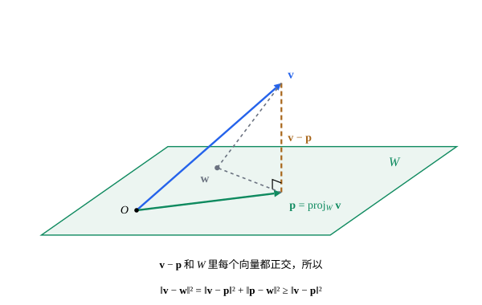

## 这一节要回答的问题

[点积、长度与夹角](lesson:math.linear-algebra.dot-product)里，一个向量在一个非零向量上的:term[投影]{id="math.linear-algebra.projection"}（projection），把它分成:term[平行]{id="math.linear-algebra.parallel"}（parallel）、垂直两部分。换成一个平面，或者一般的:term[子空间]{id="math.linear-algebra.subspace"}（subspace），向量还能这样分吗？子空间里哪一点离给定的向量最近？在函数组成的:term[内积空间]{id="math.linear-algebra.inner-product-space"}（inner product space）里，用一次函数去逼近$x^2$，最好的那个怎样找？

## 讲解

### 正交补

在$\R^3$里，和一个过原点的平面垂直的向量，组成一条过原点的直线；和一条过原点的直线垂直的向量，组成一个平面。一般地，和一个:term[子空间]{id="math.linear-algebra.subspace"}里每个向量都垂直的向量组成什么？

::anchor{id="def-orthogonal-complement"}
设$W$是:term[内积空间]{id="math.linear-algebra.inner-product-space"}$V$的子空间。$V$中和$W$里每个向量都:term[正交]{id="math.linear-algebra.orthogonal"}（orthogonal）的向量全体，叫作$W$的:term[正交补]{id="math.linear-algebra.orthogonal-complement"}（orthogonal complement），记作$W^\perp$。

为什么这样定义：要把向量分成「在$W$里」和「和$W$垂直」两部分，后一部分就落在$W^\perp$里。$W^\perp$也是子空间，因为「和每个$\vb w\in W$的:term[内积]{id="math.linear-algebra.inner-product"}（inner product）为$0$」这个条件，对加法和:term[数乘]{id="math.linear-algebra.scalar-multiplication"}（scalar multiplication）都保持。若$W$由$\vb w_1,\dots,\vb w_k$:term[生成]{id="math.linear-algebra.span"}（span），只要和这$k$个向量都正交，就和$W$里每个向量都正交，因为内积对:term[线性组合]{id="math.linear-algebra.linear-combination"}（linear combination）是线性的。边界情况：$\{\vb 0\}^\perp=V$，$V^\perp=\{\vb 0\}$，因为和自己正交的向量只有$\vb 0$；同理$W\cap W^\perp=\{\vb 0\}$。

### 正交投影

::anchor{id="def-orthogonal-projection"}
设$W$是:term[内积空间]{id="math.linear-algebra.inner-product-space"}$V$的:term[子空间]{id="math.linear-algebra.subspace"}，$\vb v\in V$。如果$\vb p\in W$，并且$\vb v-\vb p\in W^\perp$，就说$\vb p$是$\vb v$在$W$上的:term[正交投影]{id="math.linear-algebra.orthogonal-projection"}（orthogonal projection），记作$\operatorname{proj}_W\vb v$。

为什么这样定义：这正是把$\vb v$分成$\vb p+(\vb v-\vb p)$，前一部分在$W$里，后一部分和$W$垂直；$W$是一条直线$\Span\{\vb u\}$时，它就是向量在$\vb u$上的:term[投影]{id="math.linear-algebra.projection"}。这样的$\vb p$最多一个：若$\vb p$、$\vb p'$都满足条件，$\vb p-\vb p'$既在$W$里，又是两个$W^\perp$中向量之差，只能是$\vb 0$。边界情况：$\vb v\in W$时$\operatorname{proj}_W\vb v=\vb v$，$\vb v\in W^\perp$时$\operatorname{proj}_W\vb v=\vb 0$。

::anchor{id="thm-projection-exists"}
**投影的存在和求法**　设$W$是:term[有限维]{id="math.linear-algebra.finite-dimensional"}（finite-dimensional）的子空间，$\vb w_1,\dots,\vb w_k$是它的一组:term[基]{id="math.linear-algebra.basis"}（basis）。则$\operatorname{proj}_W\vb v=c_1\vb w_1+\dots+c_k\vb w_k$存在，系数由方程组$\sum_{j=1}^kc_j\langle\vb w_j,\vb w_i\rangle=\langle\vb v,\vb w_i\rangle$（$i=1,\dots,k$）唯一确定；若这组基两两:term[正交]{id="math.linear-algebra.orthogonal"}，$c_i=\frac{\langle\vb v,\vb w_i\rangle}{\langle\vb w_i,\vb w_i\rangle}$。

**证明思路**：$\vb v-\sum c_j\vb w_j$和每个$\vb w_i$正交，展开正是这个方程组，有$k$个方程、$k$个未知数。它对应的:term[齐次线性方程组]{id="math.linear-algebra.homogeneous-system"}（homogeneous linear system）只有零解（trivial solution）：若$\sum_jc_j\langle\vb w_j,\vb w_i\rangle=0$对每个$i$成立，令$\vb u=\sum c_j\vb w_j$，则$\langle\vb u,\vb u\rangle=\sum_ic_i\langle\vb u,\vb w_i\rangle=0$，$\vb u=\vb 0$，由:term[线性无关]{id="math.linear-algebra.linearly-independent"}（linearly independent）各$c_j=0$。所以化成:term[行阶梯形]{id="math.linear-algebra.row-echelon-form"}（row echelon form）后每一列都有:term[主元]{id="math.linear-algebra.pivot"}（pivot），原方程组恰有一个解；基两两正交时，第$i$个方程只剩$c_i\langle\vb w_i,\vb w_i\rangle=\langle\vb v,\vb w_i\rangle$。

两两正交的基最方便：投影就是分别投到每个基向量上，再加起来（例 1 的基不正交，就要解方程组）。这个定理只要求$W$有限维，$V$可以是无限维（infinite-dimensional）的，例如$C[a,b]$：向一个有限维的函数子空间投影，照样存在。

### 最近的点

::anchor{id="thm-best-approximation"}
**:term[正交投影]{id="math.linear-algebra.orthogonal-projection"}离得最近**　设$\vb p=\operatorname{proj}_W\vb v$。对$W$中每个$\vb w$，都有$\|\vb v-\vb w\|\ge\|\vb v-\vb p\|$，等号只在$\vb w=\vb p$时成立。

**证明思路**：$\vb v-\vb w=(\vb v-\vb p)+(\vb p-\vb w)$，后一项在$W$里，和前一项:term[正交]{id="math.linear-algebra.orthogonal"}。由[勾股定理](lesson:math.linear-algebra.inner-product-spaces#thm-pythagorean)，$\|\vb v-\vb w\|^2=\|\vb v-\vb p\|^2+\|\vb p-\vb w\|^2\ge\|\vb v-\vb p\|^2$，等号只在$\vb p-\vb w=\vb 0$时成立。

所以$\|\vb v-\operatorname{proj}_W\vb v\|$就是$\vb v$到$W$的距离。在$C[a,b]$里，:term[范数]{id="math.linear-algebra.norm"}（norm）的平方是$\int_a^b(f-g)^2\dd x$，正交投影是在$W$里找平方误差的积分最小的函数（例 2）。[贝塞尔不等式与帕塞瓦尔等式](lesson:math.analysis.parseval)里，:term[傅里叶级数]{id="math.analysis.fourier-series"}（Fourier series）的部分和是平方平均意义下最好的三角多项式（trigonometric polynomial），用的正是这个定理。

### 直和

::anchor{id="def-direct-sum"}
设$W_1$、$W_2$是:term[向量空间]{id="math.linear-algebra.vector-space"}（vector space）$V$的:term[子空间]{id="math.linear-algebra.subspace"}。如果$V$的每个向量都能唯一地写成$W_1$中一个向量与$W_2$中一个向量之和，就说$V$是$W_1$与$W_2$的:term[直和]{id="math.linear-algebra.direct-sum"}（direct sum），记作$V=W_1\oplus W_2$。

为什么这样定义：$\R^3$是$xy$平面和$z$轴的直和，每个向量都唯一地分成水平、竖直两部分。「唯一」等价于$W_1\cap W_2=\{\vb 0\}$：若$\vb x+\vb y=\vb x'+\vb y'$，则$\vb x-\vb x'=\vb y'-\vb y$同时在两个子空间里。边界情况：$xy$平面和$xz$平面加起来也得到整个$\R^3$，但交集（intersection）是$x$轴，分法不唯一，不是直和。

::anchor{id="thm-orthogonal-decomposition"}
**:term[正交分解]{id="math.linear-algebra.orthogonal-decomposition"}（orthogonal decomposition）**　$W$是:term[内积空间]{id="math.linear-algebra.inner-product-space"}$V$的:term[有限维]{id="math.linear-algebra.finite-dimensional"}子空间时，$V=W\oplus W^\perp$。$V$也有限维时，$\dim W+\dim W^\perp=\dim V$，并且$(W^\perp)^\perp=W$。

**证明思路**：每个$\vb v$都能写成$\operatorname{proj}_W\vb v+(\vb v-\operatorname{proj}_W\vb v)$，而$W\cap W^\perp=\{\vb 0\}$，所以分法唯一。把$W$的一组:term[基]{id="math.linear-algebra.basis"}和$W^\perp$的一组基合起来，就是$V$的一组基，:term[维数]{id="math.linear-algebra.dimension"}（dimension）相加（第 5 题）；$(W^\perp)^\perp$的证明也在第 5 题。

## 几何图像

平行四边形代表二维的:term[子空间]{id="math.linear-algebra.subspace"}$W$。从$\vb v$的终点向$W$作垂线，垂足就是$\vb p=\operatorname{proj}_W\vb v$，$\vb v-\vb p$和$W$里每个向量都:term[正交]{id="math.linear-algebra.orthogonal"}。$W$里任取另一点$\vb w$，$\vb v$、$\vb p$、$\vb w$三点组成一个直角三角形，$\|\vb v-\vb w\|$是斜边，比直角边$\|\vb v-\vb p\|$长：这就是最近的点的定理。

## 例题

### 例 1　向平面投影

在$\R^3$里取:term[点积]{id="math.linear-algebra.dot-product"}（dot product），$W=\Span\{\vb w_1,\vb w_2\}$，$\vb w_1=(1,1,0)$，$\vb w_2=(1,0,1)$。求$\vb v=(1,2,3)$在$W$上的:term[正交投影]{id="math.linear-algebra.orthogonal-projection"}，以及$\vb v$到$W$的距离。

**为什么想到这么做**：$\vb w_1\cdot\vb w_2=1\ne0$，这组:term[基]{id="math.linear-algebra.basis"}不:term[正交]{id="math.linear-algebra.orthogonal"}，不能分别:term[投影]{id="math.linear-algebra.projection"}再相加，要解定理里的方程组。

**推导**：$\vb w_1\cdot\vb w_1=2$，$\vb w_1\cdot\vb w_2=1$，$\vb w_2\cdot\vb w_2=2$，$\vb v\cdot\vb w_1=3$，$\vb v\cdot\vb w_2=4$，方程组是$2c_1+c_2=3$、$c_1+2c_2=4$，解得$c_1=\frac23$、$c_2=\frac53$。$\vb p=\frac23(1,1,0)+\frac53(1,0,1)=\bigl(\frac73,\frac23,\frac53\bigr)$，$\vb v-\vb p=\frac43(-1,1,1)$，和$\vb w_1$、$\vb w_2$的点积都是$0$。距离是$\|\vb v-\vb p\|=\frac43\sqrt3=\frac4{\sqrt3}$。验算：$W^\perp$由$\vb n=(-1,1,1)$:term[生成]{id="math.linear-algebra.span"}，$\vb v$在$\vb n$上的投影是$\frac{\vb v\cdot\vb n}{\vb n\cdot\vb n}\vb n=\frac43\vb n$，正是$\vb v-\vb p$。

### 例 2　用一次函数逼近$x^2$

在$C[0,1]$里取:term[积分内积]{id="math.linear-algebra.inner-product"}，$W$是一次函数组成的:term[子空间]{id="math.linear-algebra.subspace"}，由$1$、$x$:term[生成]{id="math.linear-algebra.span"}。求$x^2$在$W$上的:term[正交投影]{id="math.linear-algebra.orthogonal-projection"}，并和过两个端点的直线$y=x$比较误差。

**为什么想到这么做**：最好的一次函数，就是让$\int_0^1(x^2-c_0-c_1x)^2\dd x$最小，由[正交投影离得最近](lesson:math.linear-algebra.orthogonal-projection#thm-best-approximation)，正是正交投影；$1$和$x$不:term[正交]{id="math.linear-algebra.orthogonal"}，要解方程组。

**推导**：$\langle1,1\rangle=1$，$\langle1,x\rangle=\frac12$，$\langle x,x\rangle=\frac13$，$\langle x^2,1\rangle=\frac13$，$\langle x^2,x\rangle=\frac14$，方程组是$c_0+\frac12c_1=\frac13$、$\frac12c_0+\frac13c_1=\frac14$，解得$c_1=1$、$c_0=-\frac16$，投影是$x-\frac16$。误差的平方是$\int_0^1\bigl(x^2-x+\frac16\bigr)^2\dd x=\frac1{180}$；过端点的直线$y=x$误差的平方是$\int_0^1(x^2-x)^2\dd x=\frac1{30}$，是前者的$6$倍。把直线整体往下移$\frac16$，两头误差变大，中间变小，平方积分反而小了。

## 常见误区

- 「:term[正交投影]{id="math.linear-algebra.orthogonal-projection"}就是分别投到每个基向量上，再加起来。」只有:term[基]{id="math.linear-algebra.basis"}两两:term[正交]{id="math.linear-algebra.orthogonal"}时才对。例 1 里分别:term[投影]{id="math.linear-algebra.projection"}再相加得$\frac32(1,1,0)+2(1,0,1)=\bigl(\frac72,\frac32,2\bigr)$，减去它以后和$\vb w_1$的:term[点积]{id="math.linear-algebra.dot-product"}不是$0$。
- 「$V$由$W$和$W^\perp$里的向量组成。」$V=W\oplus W^\perp$说的是每个向量能唯一地写成两部分之和；大多数向量既不在$W$里，也不在$W^\perp$里。
- 「逼近一个函数，最好的直线是过两个端点的那条。」例 2 里过端点的直线，平方误差的积分是正交投影的$6$倍。
- 「:term[子空间]{id="math.linear-algebra.subspace"}里离$\vb v$最近的点，要在子空间里一点一点地找。」不用搜索：解一个方程组就得到投影，最近的点的定理保证它就是最小值。
