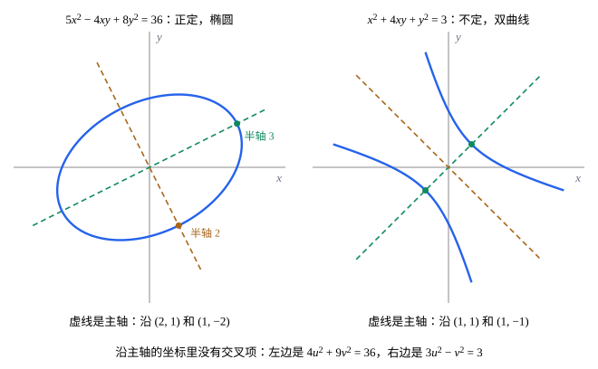

## 这一节要回答的问题

方程$5x^2-4xy+8y^2=36$画出来是什么曲线？交叉项$-4xy$让人一下子看不出来，换一组坐标轴，能不能把它消掉？[逆矩阵与转置](lesson:math.linear-algebra.matrix-inverse)说:term[对称矩阵]{id="math.linear-algebra.symmetric-matrix"}（symmetric matrix）常和这样的二次式一起出现；怎样判断一个二次式对所有非零的变量值都取正值？换一种坐标，式子里正项、负项的个数会不会变？

## 讲解

### 二次型和它的矩阵

::anchor{id="def-quadratic-form"}
$n$个变量的二次齐次多项式$Q(\vb x)=\sum_{i,j}a_{ij}x_ix_j$叫作:term[二次型]{id="math.linear-algebra.quadratic-form"}（quadratic form）。把$x_ix_j$（$i\ne j$）的系数平分给$a_{ij}$和$a_{ji}$，就能写成$Q(\vb x)=\vb x\T A\vb x$，$A$是:term[对称矩阵]{id="math.linear-algebra.symmetric-matrix"}，叫作这个二次型的矩阵。

为什么这样定义：$5x^2-4xy+8y^2$的矩阵是$\begin{pmatrix}5&-2\\-2&8\end{pmatrix}$，交叉项$-4xy$平分成两个$-2$。要求对称，是为了让二次型和矩阵一一对应：$\begin{pmatrix}5&-4\\0&8\end{pmatrix}$给出同一个二次式，平分以后只剩一种写法。边界情况：二次型的矩阵是:term[对角矩阵]{id="math.linear-algebra.diagonal-matrix"}（diagonal matrix），二次型就没有交叉项，$\vb x\T D\vb x=d_1x_1^2+\dots+d_nx_n^2$。

::anchor{id="thm-polarization"}
**极化恒等式（polarization identity）**　对称矩阵$A$满足$\vb x\T A\vb y=\frac14\bigl[(\vb x+\vb y)\T A(\vb x+\vb y)-(\vb x-\vb y)\T A(\vb x-\vb y)\bigr]$。所以对称矩阵由它的二次型完全决定：两个对称矩阵的二次型处处相等，它们就相等。

**证明思路**：展开两项，$\vb x\T A\vb x$、$\vb y\T A\vb y$相消，剩下$2\vb x\T A\vb y+2\vb y\T A\vb x$；$A$对称时$\vb y\T A\vb x=(\vb y\T A\vb x)\T=\vb x\T A\vb y$，所以是$4\vb x\T A\vb y$。二次型处处相等，由这个等式$\vb x\T A\vb y$也处处相等，取$\vb x=\vb e_i$、$\vb y=\vb e_j$就得到每个元素相等。[内积空间](lesson:math.linear-algebra.inner-product-spaces)第 5 题是同一个等式。

### 主轴变换

::anchor{id="thm-principal-axes"}
**主轴定理（principal axis theorem）**　设$A$是:term[实对称矩阵]{id="math.linear-algebra.symmetric-matrix"}，由:term[谱定理]{id="math.linear-algebra.spectral-theorem"}（spectral theorem），$A=QDQ\T$，$Q$是:term[正交矩阵]{id="math.linear-algebra.orthogonal-matrix"}（orthogonal matrix），$D$的对角元（diagonal entries）是:term[特征值]{id="math.linear-algebra.eigenvalue"}（eigenvalue）$\lambda_1,\dots,\lambda_n$。令$\vb x=Q\vb y$，则$\vb x\T A\vb x=\lambda_1y_1^2+\dots+\lambda_ny_n^2$。$Q$的各列叫作这个:term[二次型]{id="math.linear-algebra.quadratic-form"}的主轴（principal axes）。

**证明思路**：$\vb x\T A\vb x=\vb y\T Q\T AQ\vb y=\vb y\T D\vb y$，$D$是:term[对角矩阵]{id="math.linear-algebra.diagonal-matrix"}，没有交叉项。

主轴是互相垂直的:term[单位特征向量]{id="math.linear-algebra.eigenvector"}（eigenvector），$y_1,\dots,y_n$是沿主轴的坐标。$\vb x=Q\vb y$是:term[正交变换]{id="math.linear-algebra.orthogonal-transformation"}（orthogonal transformation），不改变:term[长度]{id="math.linear-algebra.length"}（length）和:term[夹角]{id="math.linear-algebra.angle"}（angle），所以$Q(\vb x)=1$这样的曲线、曲面只是转了个方向，形状不变：两个变量时，两个特征值同正是椭圆，一正一负是双曲线（几何图像）。

### 正定

::anchor{id="def-positive-definite"}
若对所有$\vb x\ne\vb 0$都有$\vb x\T A\vb x>0$，就说:term[二次型]{id="math.linear-algebra.quadratic-form"}和:term[对称矩阵]{id="math.linear-algebra.symmetric-matrix"}$A$是:term[正定]{id="math.linear-algebra.positive-definite"}（positive definite）的；对所有$\vb x$都有$\vb x\T A\vb x\ge0$，叫作半正定（positive semidefinite）的；既能取正值又能取负值，叫作不定（indefinite）的。

为什么这样定义：正定的二次型好比距离的平方，只在原点为零、别处都是正的；[内积空间](lesson:math.linear-algebra.inner-product-spaces)里的:term[内积]{id="math.linear-algebra.inner-product"}（inner product），正是要求$\langle\vb v,\vb v\rangle$正定。:term[多元函数]{id="math.vector-calculus.multivariable-function"}（function of several variables）在:term[驻点]{id="math.vector-calculus.stationary-point"}（stationary point）附近的二阶近似就是一个二次型，它正定时那里是极小值点，力学里平衡就是稳定的（见[小振动与简正坐标](lesson:physics.analytical-mechanics.small-oscillations)）。边界情况：$x^2$作为两个变量$x$、$y$的二次型只是半正定，$(0,1)$处为零；正定的二次型限制到任何:term[子空间]{id="math.linear-algebra.subspace"}（subspace）上仍然正定。

::anchor{id="thm-positive-definite-eigen"}
**用:term[特征值]{id="math.linear-algebra.eigenvalue"}判断**　对称矩阵$A$正定，当且仅当它的特征值都是正数。

**证明思路**：由主轴定理，$\vb x\T A\vb x=\lambda_1y_1^2+\dots+\lambda_ny_n^2$，$\vb x\ne\vb 0$当且仅当$\vb y=Q\T\vb x\ne\vb 0$。各$\lambda_i>0$时它对$\vb y\ne\vb 0$为正；若某个$\lambda_i\le0$，取$\vb y=\vb e_i$，值为$\lambda_i\le0$。

二阶时不用求特征值：$\begin{pmatrix}a&b\\b&c\end{pmatrix}$的两个特征值之和是$a+c$、积是$ac-b^2$，都为正当且仅当$a>0$、$ac-b^2>0$（第 6 题）。$n$阶时也有类似的判别法：左上角$1$阶、$2$阶、……、$n$阶子矩阵的:term[行列式]{id="math.linear-algebra.determinant"}（determinant）都为正，这里不证。

### 惯性定理

用主轴变换化成平方和，系数是:term[特征值]{id="math.linear-algebra.eigenvalue"}；用别的:term[可逆]{id="math.linear-algebra.invertible"}（invertible）换元，比如配方，也能化成平方和，系数却不一样（例 2）。系数变了，什么没变？

::anchor{id="thm-inertia"}
**:term[惯性定理]{id="math.linear-algebra.law-of-inertia"}（Sylvester's law of inertia）**　设$A$是:term[实对称矩阵]{id="math.linear-algebra.symmetric-matrix"}。无论用怎样的可逆线性换元$\vb x=P\vb y$把$\vb x\T A\vb x$化成$d_1y_1^2+\dots+d_ny_n^2$，正系数的个数$p$、负系数的个数$q$都不变，分别等于$A$的正特征值、负特征值的个数（按:term[代数重数]{id="math.linear-algebra.algebraic-multiplicity"}（algebraic multiplicity）算）。$p$、$q$叫作:term[二次型]{id="math.linear-algebra.quadratic-form"}的正惯性指数（positive index of inertia）、负惯性指数（negative index of inertia），$p-q$叫作符号差（signature）。

**证明思路**：设两种化法的正系数个数$p>p'$。取第一种化法里系数为正的$p$个方向，它们:term[生成]{id="math.linear-algebra.span"}（span）的:term[子空间]{id="math.linear-algebra.subspace"}$U$里，非零向量的值都为正；取第二种化法里系数不为正的$n-p'$个方向，生成的子空间$W$里，值都不为正。$U$、$W$的:term[基]{id="math.linear-algebra.basis"}（basis）合起来有$p+n-p'>n$个向量，必:term[线性相关]{id="math.linear-algebra.linearly-dependent"}（linearly dependent），把相关关系两边整理，就得到一个同时在$U$、$W$里的非零向量，它的值既为正又不为正，矛盾；$q$同理。

物理里说的号差（signature），常指符号的排列本身，和数学里的符号差不是一回事，例如[四维矢量与闵可夫斯基度规](lesson:physics.special-relativity.four-vectors)里的$(+,-,-,-)$。惯性定理保证，无论怎样线性换元，:term[时空间隔]{id="physics.special-relativity.spacetime-interval"}（spacetime interval）里正项、负项的个数都是一个、三个。

## 几何图像

左图的:term[二次型]{id="math.linear-algebra.quadratic-form"}$5x^2-4xy+8y^2$，矩阵的:term[特征值]{id="math.linear-algebra.eigenvalue"}是$4$、$9$，都为正，:term[正定]{id="math.linear-algebra.positive-definite"}，$Q(\vb x)=36$是椭圆；沿主轴的坐标里是$4u^2+9v^2=36$，半轴是$3$、$2$（例 1）。右图的$x^2+4xy+y^2$，矩阵$\begin{pmatrix}1&2\\2&1\end{pmatrix}$的特征值是$3$、$-1$，不定，$Q(\vb x)=3$是双曲线，沿主轴是$3u^2-v^2=3$。两幅图里交叉项都让曲线斜着，换到虚线方向的坐标，交叉项就没有了。

## 例题

### 例 1　化简一个二元二次型

用主轴变换化简$5x^2-4xy+8y^2$，说明$5x^2-4xy+8y^2=36$是什么曲线。

**为什么想到这么做**：:term[二次型]{id="math.linear-algebra.quadratic-form"}的矩阵对称，由:term[谱定理]{id="math.linear-algebra.spectral-theorem"}能用:term[正交矩阵]{id="math.linear-algebra.orthogonal-matrix"}:term[对角化]{id="math.linear-algebra.diagonalization"}（diagonalization）；:term[特征向量]{id="math.linear-algebra.eigenvector"}就是主轴。

**推导**：矩阵$A=\begin{pmatrix}5&-2\\-2&8\end{pmatrix}$，$\tr A=13$，$\det A=36$，:term[特征值]{id="math.linear-algebra.eigenvalue"}是$4$、$9$。$A-4I=\begin{pmatrix}1&-2\\-2&4\end{pmatrix}$，特征向量取$(2,1)$；$A-9I=\begin{pmatrix}-4&-2\\-2&-1\end{pmatrix}$，特征向量取$(1,-2)$。令$Q=\frac1{\sqrt5}\begin{pmatrix}2&1\\1&-2\end{pmatrix}$，$\vb x=Q\vb y$，$y_1=u$、$y_2=v$，二次型变成$4u^2+9v^2$。方程$4u^2+9v^2=36$即$\frac{u^2}9+\frac{v^2}4=1$，是半轴为$3$、$2$的椭圆，长轴沿$(2,1)$。

### 例 2　两种化法，同样的正负个数

把$Q(\vb x)=2x_1x_2+2x_2x_3+2x_1x_3$分别用配方和主轴变换化成平方和，比较系数。

**为什么想到这么做**：没有平方项，不能直接配方；先令$x_1=y_1+y_2$、$x_2=y_1-y_2$造出平方项。

**推导**：配方：代入得$2y_1^2-2y_2^2+4y_1x_3=2(y_1+x_3)^2-2y_2^2-2x_3^2$，系数是$2$、$-2$、$-2$。主轴变换：矩阵是全$1$矩阵减去$I$，全$1$矩阵的:term[特征值]{id="math.linear-algebra.eigenvalue"}是$3$、$0$、$0$，所以这里的特征值是$2$、$-1$、$-1$。两种化法的系数不同，正的都是一个、负的都是两个：正惯性指数是$1$，负惯性指数是$2$，这个:term[二次型]{id="math.linear-algebra.quadratic-form"}不定。

## 常见误区

- 「:term[二次型]{id="math.linear-algebra.quadratic-form"}的矩阵，把系数照抄进去就行。」交叉项的系数要平分：$5x^2-4xy+8y^2$的矩阵是$\begin{pmatrix}5&-2\\-2&8\end{pmatrix}$，不是$\begin{pmatrix}5&-4\\0&8\end{pmatrix}$。
- 「主对角元都是正数，二次型就:term[正定]{id="math.linear-algebra.positive-definite"}。」$x^2+4xy+y^2$的主对角元都是$1$，$(1,-1)$处的值却是$-2$。
- 「正定矩阵的元素都是正数。」$\begin{pmatrix}2&-1\\-1&2\end{pmatrix}$的:term[特征值]{id="math.linear-algebra.eigenvalue"}是$1$、$3$，正定，却有负元素。
- 「:term[惯性定理]{id="math.linear-algebra.law-of-inertia"}说，化成平方和以后的系数总是特征值。」系数随换元而变，例 2 里配方得$2$、$-2$、$-2$，特征值是$2$、$-1$、$-1$；不变的只是正、负系数的个数。
