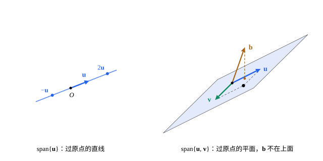

## 这一节要回答的问题

在[向量与线性运算](lesson:math.linear-algebra.vectors)里，平面上两个不:term[平行]{id="math.linear-algebra.parallel"}（parallel）的向量，用它们的:term[线性组合]{id="math.linear-algebra.linear-combination"}（linear combination）能到达平面上的每一点。一般地，一组向量的全部线性组合组成一个什么样的集合？给定一个向量，怎样判断它在不在里面？[解集的结构](lesson:math.linear-algebra.solution-sets)里，:term[齐次方程组]{id="math.linear-algebra.homogeneous-system"}（homogeneous linear system）的解相加、:term[数乘]{id="math.linear-algebra.scalar-multiplication"}（scalar multiplication）仍是解，具有这种性质的集合还有哪些？

## 讲解

### 生成

::anchor{id="def-span"}
设$\vb v_1,\dots,\vb v_k$是$\R^n$里的向量。它们的全部:term[线性组合]{id="math.linear-algebra.linear-combination"}$c_1\vb v_1+\dots+c_k\vb v_k$（$c_1,\dots,c_k$取遍全体实数）组成的集合，叫作$\vb v_1,\dots,\vb v_k$:term[生成]{id="math.linear-algebra.span"}（span）的集合，记作$\Span\{\vb v_1,\dots,\vb v_k\}$，也说它们张成这个集合。

为什么这样定义：一组向量用加法和:term[数乘]{id="math.linear-algebra.scalar-multiplication"}能到达的地方，就是它们生成的集合。$\R^3$里一个非零向量生成过原点的一条直线，两个不:term[平行]{id="math.linear-algebra.parallel"}的向量生成过原点的一个平面；:term[标准基向量]{id="math.linear-algebra.standard-basis-vector"}（standard basis vector）$\vb e_1,\dots,\vb e_n$生成整个$\R^n$，因为$\vb v=v_1\vb e_1+\dots+v_n\vb e_n$。边界情况：:term[零向量]{id="math.linear-algebra.zero-vector"}（zero vector）生成的只有零向量自己；约定一个向量也不取时，生成的是$\{\vb 0\}$。

::anchor{id="thm-span-system"}
**判断在不在生成的集合里**　$\vb b\in\Span\{\vb v_1,\dots,\vb v_k\}$，当且仅当以$\vb v_1,\dots,\vb v_k$为各列系数、$\vb b$为常数项的:term[线性方程组]{id="math.linear-algebra.linear-system"}（system of linear equations）$x_1\vb v_1+\dots+x_k\vb v_k=\vb b$有解；它的每一个解$(x_1,\dots,x_k)$都给出$\vb b$的一种写法。

**证明思路**：$\vb b$在里面，就是有数$x_1,\dots,x_k$使$x_1\vb v_1+\dots+x_k\vb v_k=\vb b$。按:term[分量]{id="math.linear-algebra.component"}（component）写开，第$i$个分量是一个方程，$n$个分量正好组成$n$个方程、$k$个未知数的方程组，它的:term[增广矩阵]{id="math.linear-algebra.augmented-matrix"}（augmented matrix）的各列依次是$\vb v_1,\dots,\vb v_k,\vb b$。

::anchor{id="thm-span-rn"}
**生成整个$\R^n$**　$\vb v_1,\dots,\vb v_k$生成$\R^n$，当且仅当以它们为各列的系数部分化成:term[行阶梯形]{id="math.linear-algebra.row-echelon-form"}（row echelon form）后，每一行都有:term[主元]{id="math.linear-algebra.pivot"}（pivot）。特别地，少于$n$个向量生成不了$\R^n$。

**证明思路**：每一行都有主元时，不论常数项是什么，化成行阶梯形后都不会出现$(0\ \cdots\ 0\mid c)$、$c\ne0$这样的行，由[解的三种情况](lesson:math.linear-algebra.linear-systems#thm-three-cases)，方程组总有解。反过来，若最后一行没有主元，系数部分的最后一行全是零：让常数项这一行是$1$，再把做过的:term[初等行变换]{id="math.linear-algebra.elementary-row-operation"}（elementary row operations）倒着做回去，得到的$\vb b$使方程组无解。主元个数不超过列数$k$，$k<n$时总有一行没有主元。

### 子空间

::anchor{id="def-subspace"}
$\R^n$的子集$V$如果满足：(1) $\vb 0\in V$；(2) $\vb u,\vb v\in V$时$\vb u+\vb v\in V$；(3) $\vb u\in V$、$c$是数时$c\vb u\in V$，就叫作$\R^n$的:term[子空间]{id="math.linear-algebra.subspace"}（subspace）。

为什么这样定义：后两条说的是，在$V$里做加法、:term[数乘]{id="math.linear-algebra.scalar-multiplication"}，跑不出$V$；于是$V$里向量的任何:term[线性组合]{id="math.linear-algebra.linear-combination"}仍在$V$里，$V$自己就像一个小的$\R^n$。有了 (3)，只要$V$里有向量，取$c=0$就得到$\vb 0$，所以 (1) 只是说$V$不是空集。边界情况：$\{\vb 0\}$和$\R^n$本身都是子空间；不过原点的直线、平面都不是子空间，因为不含$\vb 0$。

只满足其中一条的集合很多。$\R^2$里，第一象限$\{(x,y):x\ge0,\ y\ge0\}$对加法封闭，乘以$-1$却跑了出去；两条坐标轴合在一起，对数乘封闭，可$(1,0)+(0,1)=(1,1)$不在上面。

::anchor{id="thm-span-subspace"}
**:term[生成]{id="math.linear-algebra.span"}的集合是子空间**　$\Span\{\vb v_1,\dots,\vb v_k\}$是$\R^n$的:term[子空间]{id="math.linear-algebra.subspace"}，它含有每个$\vb v_i$；任何含有$\vb v_1,\dots,\vb v_k$的子空间都包含它，所以它是含有这些向量的最小的子空间。

**证明思路**：系数全取$0$得到$\vb 0$；两个线性组合相加、乘以数，系数对应相加、相乘，仍是线性组合。若子空间$W$含有每个$\vb v_i$，由 (2)、(3) 反复用，$W$含有它们的每个线性组合。子空间$V$等于$\Span\{\vb v_1,\dots,\vb v_k\}$时，也说$\vb v_1,\dots,\vb v_k$生成$V$。

::anchor{id="thm-homogeneous-subspace"}
**齐次解组成子空间**　$n$个未知数的:term[齐次线性方程组]{id="math.linear-algebra.homogeneous-system"}的:term[解集]{id="math.linear-algebra.solution-set"}（solution set）是$\R^n$的子空间；常数项不全为零的方程组，解集不是子空间。

**证明思路**：由[齐次解相加、数乘仍是解](lesson:math.linear-algebra.solution-sets#thm-homogeneous-combinations)，后两条成立，零解又在里面。常数项不全为零时，把$\vb 0$代进去，左边全是$0$，等不到那个不为零的常数项，所以$\vb 0$不是解。

所以子空间有两种常见的给法：用一组向量生成，或者用一个齐次方程组的解集刻画（例 2）。在[列空间与零空间](lesson:math.linear-algebra.column-null-space)里，这两种给法分别成为矩阵的:term[列空间]{id="math.linear-algebra.column-space"}（column space）和:term[零空间]{id="math.linear-algebra.null-space"}（null space）。

## 几何图像

左图：一个非零向量$\vb u$:term[生成]{id="math.linear-algebra.span"}的是过原点的直线，$-\vb u$、$2\vb u$都在上面。右图：$\vb u$、$\vb v$不:term[平行]{id="math.linear-algebra.parallel"}，它们生成的是过原点的平面，虚线补出的平行四边形的第四个顶点$\vb u+\vb v$也在平面上；$\vb b$不在这个平面上，由上面判断在不在生成的集合里的定理，方程组$x_1\vb u+x_2\vb v=\vb b$无解。

## 例题

### 例 1　判断向量在不在生成的集合里

设$\vb v_1=(1,2,1)$、$\vb v_2=(-1,1,0)$。判断$\vb b=(1,5,2)$和$\vb c=(1,5,3)$是否在$\Span\{\vb v_1,\vb v_2\}$里；在的话，写出用$\vb v_1$、$\vb v_2$表示的式子。

**为什么想到这么做**：在不在里面，就看方程组$x_1\vb v_1+x_2\vb v_2=\vb b$有没有解；把:term[增广矩阵]{id="math.linear-algebra.augmented-matrix"}化成:term[行阶梯形]{id="math.linear-algebra.row-echelon-form"}，看有没有$(0\ \ 0\mid c)$、$c\ne0$这样的行。

**推导**：对$\vb b$，增广矩阵的三行是$(1,-1\mid1)$、$(2,1\mid5)$、$(1,0\mid2)$。做$R_2-2R_1$、$R_3-R_1$，得$(0,3\mid3)$、$(0,1\mid1)$；再做$R_3-\frac13R_2$，第三行全是零。于是$x_2=1$、$x_1=2$，$\vb b=2\vb v_1+\vb v_2$，验算：$2(1,2,1)+(-1,1,0)=(1,5,2)$。对$\vb c$，同样的变换把第三行化成$(0,0\mid1)$，方程组无解，$\vb c$不在里面。

### 例 2　哪些子集是子空间

判断$\R^3$的两个子集$V=\{(x,y,z):x+2y-z=0\}$、$W=\{(x,y,z):x+2y-z=1\}$是不是:term[子空间]{id="math.linear-algebra.subspace"}；是的话，找几个向量:term[生成]{id="math.linear-algebra.span"}它。

**为什么想到这么做**：$V$是一个齐次方程的:term[解集]{id="math.linear-algebra.solution-set"}，$W$的常数项不是零，直接用上面的定理；生成$V$的向量从:term[通解]{id="math.linear-algebra.general-solution"}（general solution）里读出来。

**推导**：$V$是齐次方程的解集，是子空间。$y$、$z$是:term[自由变量]{id="math.linear-algebra.free-variable"}（free variable），令$y=s$、$z=t$，得$x=-2s+t$，通解是$s(-2,1,0)+t(1,0,1)$，所以$V=\Span\{(-2,1,0),(1,0,1)\}$。$W$不含$\vb 0$，不是子空间；它是$V$平移到经过$(1,0,0)$的位置得到的平面。

## 常见误区

- 「过原点的集合都是:term[子空间]{id="math.linear-algebra.subspace"}。」两条坐标轴合在一起也过原点，可$(1,0)+(0,1)$不在上面；子空间要对加法和:term[数乘]{id="math.linear-algebra.scalar-multiplication"}都封闭。
- 「两个向量:term[生成]{id="math.linear-algebra.span"}一个平面。」两个向量:term[平行]{id="math.linear-algebra.parallel"}时，生成的只是一条直线；两个都是:term[零向量]{id="math.linear-algebra.zero-vector"}时，只有原点。
- 「$\R^2$是$\R^3$的子空间。」$\R^2$里的向量只有两个:term[分量]{id="math.linear-algebra.component"}，不是$\R^3$的子集；$\R^3$里和它对应的是平面$z=0$，即$\Span\{\vb e_1,\vb e_2\}$，那才是子空间。
- 「$\vb b$在$\Span\{\vb v_1,\dots,\vb v_k\}$里，写法就只有一种。」方程组可以有无穷多个解，例如$\vb v_3=\vb v_1+\vb v_2$时同一个$\vb b$有许多写法；什么时候唯一，是[线性无关](lesson:math.linear-algebra.linear-independence)要回答的。
