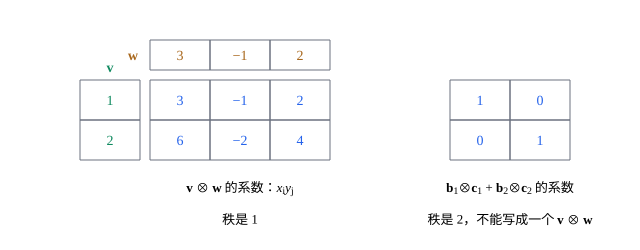

## 这一节要回答的问题

$f(\vb u,\vb v)=u_1v_2-u_2v_1$对$\vb u$是线性的，对$\vb v$也是线性的；可把$(\vb u,\vb v)$看成一个整体，它不是:term[线性映射]{id="math.linear-algebra.linear-map"}（linear map），因为$f(2\vb u,2\vb v)=4f(\vb u,\vb v)$。这种「对每个变量分别线性」的映射，在线性代数和物理里到处都是。能不能造一个更大的:term[向量空间]{id="math.linear-algebra.vector-space"}（vector space），让它们变成那上面真正的线性映射？换:term[基]{id="math.linear-algebra.basis"}（basis）时，这个空间里元素的:term[分量]{id="math.linear-algebra.component"}（component）又怎样变？

## 讲解

### 双线性映射

::anchor{id="def-bilinear"}
设$V$、$W$、$U$是:term[向量空间]{id="math.linear-algebra.vector-space"}，$V\times W$是所有有序对$(\vb v,\vb w)$组成的集合。映射$f:V\times W\to U$如果固定$\vb w$时对$\vb v$是:term[线性映射]{id="math.linear-algebra.linear-map"}、固定$\vb v$时对$\vb w$也是线性映射，就叫作:term[双线性映射]{id="math.linear-algebra.bilinear-map"}（bilinear map）。

为什么这样定义：两个变量各自保持加法和:term[数乘]{id="math.linear-algebra.scalar-multiplication"}（scalar multiplication），就能和乘法一样展开：取$V$的:term[基]{id="math.linear-algebra.basis"}$\vb b_1,\dots,\vb b_m$、$W$的基$\vb c_1,\dots,\vb c_n$，$\vb v=\sum x_i\vb b_i$、$\vb w=\sum y_j\vb c_j$时，$f(\vb v,\vb w)=\sum_{i,j}x_iy_jf(\vb b_i,\vb c_j)$，$f$由$mn$个值$f(\vb b_i,\vb c_j)$决定。它对整个$(\vb v,\vb w)$一般不是线性的，两个变量同时乘$2$，值乘的是$4$。三个、更多个变量时同样定义，对每个变量都线性的映射也说是:term[多重线性]{id="math.linear-algebra.multilinear"}（multilinear）的，[行列式](lesson:math.linear-algebra.determinant#def-determinant)对它的各列就是这样。

### 张量积

双线性的$f$由$mn$个值决定，这和一个$mn$维空间上的:term[线性映射]{id="math.linear-algebra.linear-map"}由:term[基]{id="math.linear-algebra.basis"}的:term[像]{id="math.linear-algebra.image"}（image）决定一模一样：只要有一个空间，它的基正好对应$mn$个有序对$(\vb b_i,\vb c_j)$。

::anchor{id="def-tensor-product"}
取$V$的基$\vb b_1,\dots,\vb b_m$和$W$的基$\vb c_1,\dots,\vb c_n$。以$mn$个记号$\vb b_i\otimes\vb c_j$为基的:term[向量空间]{id="math.linear-algebra.vector-space"}，叫作$V$和$W$的:term[张量积]{id="math.linear-algebra.tensor-product"}（tensor product），记作$V\otimes W$，它的元素叫作张量（tensor）。对$\vb v=\sum x_i\vb b_i$、$\vb w=\sum y_j\vb c_j$，规定$\vb v\otimes\vb w=\sum_{i,j}x_iy_j\,\vb b_i\otimes\vb c_j$。

为什么这样定义：这样规定的$\otimes$和乘法一样展开，$(\vb v+\vb v')\otimes\vb w=\vb v\otimes\vb w+\vb v'\otimes\vb w$，$(c\vb v)\otimes\vb w=c(\vb v\otimes\vb w)=\vb v\otimes(c\vb w)$，对第二个因子也一样，所以$(\vb v,\vb w)\mapsto\vb v\otimes\vb w$本身是:term[双线性映射]{id="math.linear-algebra.bilinear-map"}。$\dim(V\otimes W)=mn$，是:term[维数]{id="math.linear-algebra.dimension"}（dimension）之积，不是之和。边界情况：并不是每个元素都形如$\vb v\otimes\vb w$，例如$\vb b_1\otimes\vb c_1+\vb b_2\otimes\vb c_2$（几何图像）。

把$T=\sum t_{ij}\,\vb b_i\otimes\vb c_j$的系数排成$m\times n$矩阵$(t_{ij})$，张量就和矩阵一一对应；$\vb v\otimes\vb w$的系数矩阵是$\vb v$的坐标这一列乘$\vb w$的坐标这一行，元素是$x_iy_j$。换另一组基做出来的空间和原来的:term[同构]{id="math.linear-algebra.isomorphism"}（isomorphism），下面的换基公式把$\vb v\otimes\vb w$对应到$\vb v\otimes\vb w$，所以张量积和基的选法无关。

### 双线性映射变成线性映射

::anchor{id="thm-universal"}
**:term[张量积]{id="math.linear-algebra.tensor-product"}把双线性变成线性**　对每个:term[双线性映射]{id="math.linear-algebra.bilinear-map"}$f:V\times W\to U$，恰有一个:term[线性映射]{id="math.linear-algebra.linear-map"}$F:V\otimes W\to U$，使对所有$\vb v$、$\vb w$都有$F(\vb v\otimes\vb w)=f(\vb v,\vb w)$。

**证明思路**：线性映射由:term[基]{id="math.linear-algebra.basis"}的:term[像]{id="math.linear-algebra.image"}决定，令$F(\vb b_i\otimes\vb c_j)=f(\vb b_i,\vb c_j)$。则$F(\vb v\otimes\vb w)=\sum x_iy_jf(\vb b_i,\vb c_j)=f(\vb v,\vb w)$，后一个等号用的是$f$双线性。基向量$\vb b_i\otimes\vb c_j$本身就形如$\vb v\otimes\vb w$，$F$在它们上的值已被定死，所以只有这一个。

所以$V\times W$上的双线性函数（bilinear form），和$V\otimes W$上的:term[线性函数]{id="math.linear-algebra.linear-functional"}（linear functional）一一对应，它们组成$mn$维的:term[对偶空间]{id="math.linear-algebra.dual-space"}（dual space）$(V\otimes W)^*$。三个以上的因子也一样：$V_1\otimes\dots\otimes V_k$以$\vb b_{i_1}\otimes\dots\otimes\vb b_{i_k}$为基，上面的线性映射就是$V_1\times\dots\times V_k$上对每个变量都线性的映射。

### 换基时分量怎样变

::anchor{id="thm-tensor-change"}
**每个指标各变一次**　设$V$、$W$换:term[基]{id="math.linear-algebra.basis"}时，向量的坐标分别按$[\vb v]'=Q[\vb v]$、$[\vb w]'=R[\vb w]$变，$Q$、$R$是两个空间的:term[基变换矩阵]{id="math.linear-algebra.change-of-basis-matrix"}（change-of-basis matrix）。那么$V\otimes W$中的张量在新基$\vb b_k'\otimes\vb c_l'$下的系数是$t'_{kl}=\sum_{i,j}q_{ki}r_{lj}t_{ij}$，写成矩阵是$T'=QTR\T$：两个指标各按自己空间的坐标变换变一次。

**证明思路**：$\vb b_i$都能用$\vb b_k'$展开，$\vb c_j$都能用$\vb c_l'$展开，由双线性，每个$\vb b_i\otimes\vb c_j$都是$\vb b_k'\otimes\vb c_l'$的组合；这$mn$个向量:term[生成]{id="math.linear-algebra.span"}（span）$mn$维的空间，所以也是一组基。对$\vb v\otimes\vb w$，用新坐标展开得系数矩阵$(Q\vb x)(R\vb y)\T=Q(\vb x\vb y\T)R\T$。每个张量都是若干个这样的项之和，两边都是线性的，所以对一般的张量也成立。

$V=W$时，系数按$T'=QTQ\T$变，这正是[能量-动量张量](lesson:physics.special-relativity.stress-energy-tensor)里「两个指标各变换一次」的意思，那里的$Q$是:term[洛伦兹变换]{id="physics.special-relativity.lorentz-transformation"}（Lorentz transformation）的矩阵。第二个因子换成$V^*$时，由[余向量的坐标跟着基变](lesson:math.linear-algebra.dual-space#thm-dual-change)，那个指标反着变，系数按$T'=QTQ^{-1}$变，这正是[线性算子的矩阵与相似](lesson:math.linear-algebra.similarity)里矩阵换基的样子。

## 几何图像

左边是$\vb v=(1,2)$、$\vb w=(3,-1,2)$时$\vb v\otimes\vb w$的系数：一列乘一行，每一行都是$\vb w$的坐标的倍数，所以这个$2\times3$矩阵的:term[秩]{id="math.linear-algebra.rank"}（rank）是$1$。每个$\vb v\otimes\vb w$的系数矩阵的秩都不超过$1$；右边$\vb b_1\otimes\vb c_1+\vb b_2\otimes\vb c_2$的系数矩阵秩是$2$，所以它不能写成一个$\vb v\otimes\vb w$，只能写成两个这样的项之和（第 6 题）。

## 例题

### 例 1　把双线性函数写成张量积上的线性函数

$f(\vb u,\vb v)=u_1v_2-u_2v_1$是$\R^2\times\R^2$上的双线性函数。求$\R^2\otimes\R^2$上的:term[线性函数]{id="math.linear-algebra.linear-functional"}$F$，使$F(\vb u\otimes\vb v)=f(\vb u,\vb v)$，用系数$t_{ij}$写出$F(T)$。

**为什么想到这么做**：由定理，$F$由它在:term[基]{id="math.linear-algebra.basis"}$\vb e_i\otimes\vb e_j$上的值决定，这些值就是$f(\vb e_i,\vb e_j)$。

**推导**：$f(\vb e_1,\vb e_1)=0$，$f(\vb e_1,\vb e_2)=1$，$f(\vb e_2,\vb e_1)=-1$，$f(\vb e_2,\vb e_2)=0$，所以$F(T)=t_{12}-t_{21}$。验算：$\vb u\otimes\vb v$的$t_{12}=u_1v_2$、$t_{21}=u_2v_1$，$F(\vb u\otimes\vb v)=u_1v_2-u_2v_1$。$F$还能作用在不形如$\vb u\otimes\vb v$的张量上，例如$F(\vb e_1\otimes\vb e_2-\vb e_2\otimes\vb e_1)=2$。

### 例 2　换一组基，同一个张量的系数变了

$T=\vb e_1\otimes\vb e_1+\vb e_2\otimes\vb e_2\in\R^2\otimes\R^2$。两个因子都换成:term[基]{id="math.linear-algebra.basis"}$\vb b_1'=(1,0)$、$\vb b_2'=(1,1)$，求$T$的新系数。

**为什么想到这么做**：用换基公式$T'=QTQ\T$，$Q$是把标准坐标换成新坐标的矩阵；最后展开验算。

**推导**：新基的矩阵是$\begin{pmatrix}1&1\\0&1\end{pmatrix}$，$Q$是它的逆$\begin{pmatrix}1&-1\\0&1\end{pmatrix}$。$T$的系数矩阵是$I$，$T'=QQ\T=\begin{pmatrix}2&-1\\-1&1\end{pmatrix}$，即$T=2\vb b_1'\otimes\vb b_1'-\vb b_1'\otimes\vb b_2'-\vb b_2'\otimes\vb b_1'+\vb b_2'\otimes\vb b_2'$。验算：把$\vb b_1'=\vb e_1$、$\vb b_2'=\vb e_1+\vb e_2$代进去展开，$\vb e_1\otimes\vb e_1$的系数是$2-1-1+1=1$，$\vb e_1\otimes\vb e_2$、$\vb e_2\otimes\vb e_1$的系数都是$0$，$\vb e_2\otimes\vb e_2$的是$1$。

## 常见误区

- 「$\dim(V\otimes W)=\dim V+\dim W$。」那是有序对的集合$V\times W$按:term[分量]{id="math.linear-algebra.component"}运算时的:term[维数]{id="math.linear-algebra.dimension"}；:term[张量积]{id="math.linear-algebra.tensor-product"}的维数是乘积，$\R^2\otimes\R^3$是$6$维的。
- 「$V\otimes W$的元素都形如$\vb v\otimes\vb w$。」形如$\vb v\otimes\vb w$的，系数矩阵的:term[秩]{id="math.linear-algebra.rank"}不超过$1$；秩为$2$的就不是。
- 「$\vb v\otimes\vb w=\vb w\otimes\vb v$。」在$\R^2\otimes\R^2$里，$\vb e_1\otimes\vb e_2$和$\vb e_2\otimes\vb e_1$是两个不同的基向量。
- 「$(2\vb v)\otimes(2\vb w)=2(\vb v\otimes\vb w)$。」两个因子各提出一个$2$，结果是$4(\vb v\otimes\vb w)$。
