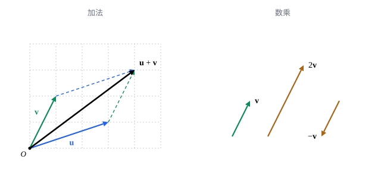

## 这一节要回答的问题

从家出发先向东走$3$千米、再向北走$4$千米，和沿东偏北的某个方向直走$5$千米，到的是同一个地方。位移、速度、力这些量既有大小又有方向，怎样把它们加起来，怎样放大、缩小、反向？把它们拆成「向东多少、向北多少」以后，这些运算能不能变成数的加法和乘法？

## 讲解

### 向量

走路的结果只看从哪里到了哪里：在操场上先东$3$千米再北$4$千米，换一个地方出发，也一样是「东$3$北$4$」。这种只关心大小和方向、不关心从哪里出发的量，就是下面要定义的向量。

::anchor{id="def-vector"}
既有大小又有方向的量叫作向量（vector），画成一个箭头，箭头的:term[长度]{id="math.linear-algebra.length"}（length）表示大小，指向表示方向；长度和方向都相同的两个箭头表示同一个向量，不管起点在哪里；只有大小、没有方向的量叫作数量，也叫标量（scalar）。向量印成粗体字母$\vb u$、$\vb v$，手写时常写成$\vec v$；大小为零的向量叫作:term[零向量]{id="math.linear-algebra.zero-vector"}（zero vector），记作$\vb 0$。

为什么这样定义：位移、速度、力关心的都是大小和方向，把箭头平移到别处，表示的还是同一个位移；温度、质量只有大小，是标量。物理书里的「矢量」（vector）就是向量。边界情况：零向量的大小是零，指向无从谈起，它是唯一没有确定方向的向量。

### 加法与数乘

::anchor{id="def-addition"}
把$\vb v$的起点接到$\vb u$的终点，从$\vb u$的起点指向$\vb v$的终点的向量叫作$\vb u$与$\vb v$的和，记作$\vb u+\vb v$；把两个向量画成从同一点出发的两条边，和就是以它们为邻边的平行四边形的对角线，这叫作平行四边形法则（parallelogram rule）。

为什么这样定义：先走$\vb u$、再走$\vb v$，总的位移就是$\vb u+\vb v$；从同一点出发先走$\vb v$、再走$\vb u$，沿平行四边形的另外两条边，到的是同一个顶点，所以$\vb u+\vb v=\vb v+\vb u$。边界情况：$\vb v+\vb 0=\vb v$，加上:term[零向量]{id="math.linear-algebra.zero-vector"}等于原地不动。

::anchor{id="def-scalar-multiplication"}
数$c$与向量$\vb v$的乘积$c\vb v$是这样一个向量：:term[长度]{id="math.linear-algebra.length"}是$\vb v$的$|c|$倍，$c>0$时与$\vb v$同向，$c<0$时与$\vb v$反向，$c=0$或$\vb v=\vb 0$时是$\vb 0$；这种运算叫作:term[数乘]{id="math.linear-algebra.scalar-multiplication"}（scalar multiplication），加法和数乘合称线性运算（linear operations）。$(-1)\vb v$记作$-\vb v$，减法规定为$\vb u-\vb v=\vb u+(-\vb v)$。

为什么这样定义：$2\vb v$是同一方向走两倍远，$-\vb v$是原路走回来，正对应「放大」和「反向」；按减法的规定，$\vb v-\vb v=\vb v+(-\vb v)=\vb 0$。边界情况：$\vb u-\vb v$是从$\vb v$的终点指向$\vb u$的终点的向量（两者从同一点出发时），在平行四边形里是另一条对角线。

::anchor{id="def-parallel"}
如果$\vb u=c\vb v$或$\vb v=c\vb u$对某个数$c$成立，就说$\vb u$与$\vb v$:term[平行]{id="math.linear-algebra.parallel"}（parallel），也就是两者方向相同或相反；零向量和任何向量平行。

为什么这样定义：一个向量的所有倍数都在同一条直线的方向上，平行就是「能互相数乘得到」。写成「其中一个是另一个的倍数」而不只写$\vb u=c\vb v$，是因为$\vb u\ne\vb 0$、$\vb v=\vb 0$时$\vb u$不是$\vb v$的倍数，可$\vb v=0\vb u$。边界情况：$(1,2)$和$(-2,-4)$平行（后者是前者的$-2$倍），$(1,2)$和$(2,1)$不平行。

### 坐标

在平面上取直角坐标系，把向量的起点放在原点，终点落在某一点$(v_1,v_2)$上，向量就由这一对数完全确定了。

::anchor{id="def-components"}
把向量$\vb v$的起点放在原点$O$时，终点的坐标$v_1$、$v_2$（空间里是$v_1$、$v_2$、$v_3$）叫作$\vb v$的:term[分量]{id="math.linear-algebra.component"}（component），写成一列$\vb v=\begin{pmatrix}v_1\\v_2\end{pmatrix}$，行文里为了省地方也写成$\vb v=(v_1,v_2)$，两种写法表示同一个向量；从原点指向点$P$的向量叫作$P$的:term[位置向量]{id="math.linear-algebra.position-vector"}（position vector），它的分量就是$P$的坐标。

为什么这样定义：起点放在哪里都表示同一个向量，统一放在原点，向量和它的终点就一一对应，于是向量可以用数来算。分量写成一列，是为了以后和矩阵相乘时对得上（见[矩阵与矩阵乘法](lesson:math.linear-algebra.matrices)）。边界情况：:term[零向量]{id="math.linear-algebra.zero-vector"}的分量全是$0$；从点$A(a_1,a_2)$到点$B(b_1,b_2)$的向量$\overrightarrow{AB}$，分量是$(b_1-a_1,\,b_2-a_2)$，终点坐标减起点坐标。

::anchor{id="thm-componentwise"}
**按分量运算**　设$\vb u=(u_1,u_2)$、$\vb v=(v_1,v_2)$，$c$是数，则$\vb u+\vb v=(u_1+v_1,\,u_2+v_2)$，$c\vb v=(cv_1,\,cv_2)$；空间里多一个分量，同样逐个分量相加、相乘。

**证明思路**：从原点先走$\vb u$到点$(u_1,u_2)$，再走$\vb v$，横坐标增加$v_1$、纵坐标增加$v_2$，终点是$(u_1+v_1,u_2+v_2)$。:term[数乘]{id="math.linear-algebra.scalar-multiplication"}把箭头按同一比例拉长或反向，由相似三角形，两个分量都乘以$c$。

### 更多分量的向量

::anchor{id="def-rn"}
由$n$个实数$v_1,\dots,v_n$排成的一列$\vb v=(v_1,\dots,v_n)$也叫作向量，$v_i$是它的第$i$个:term[分量]{id="math.linear-algebra.component"}；这样的向量的全体记作$\R^n$，其中的加法和:term[数乘]{id="math.linear-algebra.scalar-multiplication"}规定为按分量进行。

为什么这样定义：$n\ge4$时画不出箭头，可按分量相加、数乘照样有意义，例如一家商店$n$种商品的库存量，两天的进货相加就是按分量相加。$\R^2$、$\R^3$就是平面和空间里的向量，$\R^1$就是数本身。边界情况：分量个数不同的向量不能相加，$(1,2)+(1,2,3)$没有意义。

::anchor{id="thm-laws"}
**运算律**　对$\R^n$中的向量$\vb u$、$\vb v$、$\vb w$和数$c$、$d$：$\vb u+\vb v=\vb v+\vb u$，$(\vb u+\vb v)+\vb w=\vb u+(\vb v+\vb w)$，$\vb v+\vb 0=\vb v$，$\vb v+(-\vb v)=\vb 0$，$c(\vb u+\vb v)=c\vb u+c\vb v$，$(c+d)\vb v=c\vb v+d\vb v$，$(cd)\vb v=c(d\vb v)$，$1\vb v=\vb v$。

**证明思路**：每一条按分量写开，都是数的运算律；例如第$i$个分量上，$c(u_i+v_i)=cu_i+cv_i$。以后在[抽象向量空间](lesson:math.linear-algebra.vector-spaces)里，这八条会成为向量空间的定义。

### 线性组合

只用加法和:term[数乘]{id="math.linear-algebra.scalar-multiplication"}，能从几个给定的向量造出哪些向量？

::anchor{id="def-linear-combination"}
给定$\R^n$中的向量$\vb v_1,\dots,\vb v_k$和数$c_1,\dots,c_k$，向量$c_1\vb v_1+c_2\vb v_2+\dots+c_k\vb v_k$叫作$\vb v_1,\dots,\vb v_k$的:term[线性组合]{id="math.linear-algebra.linear-combination"}（linear combination），$c_1,\dots,c_k$叫作组合的系数（coefficient）。

为什么这样定义：加法和数乘是向量最基本的两种运算，线性组合就是只用这两种运算能得到的全部向量。判断一个向量是不是给定向量的线性组合，要解关于系数的方程（例 2），这正是以后[线性方程组与高斯消元](lesson:math.linear-algebra.linear-systems)要讲的。边界情况：一个非零向量$\vb v$的线性组合就是它的全部倍数，落在一条过原点的直线上；系数全取$0$，任何一组向量的线性组合里都有$\vb 0$。

::anchor{id="def-standard-basis"}
$\R^n$中第$i$个:term[分量]{id="math.linear-algebra.component"}是$1$、其余分量是$0$的向量记作$\vb e_i$，$\vb e_1,\dots,\vb e_n$叫作:term[标准基向量]{id="math.linear-algebra.standard-basis-vector"}（standard basis vectors）；每个向量都能写成它们的线性组合$\vb v=v_1\vb e_1+\dots+v_n\vb e_n$，系数正是$\vb v$的分量。

为什么这样定义：$\R^3$里的$\vb e_1$、$\vb e_2$、$\vb e_3$是沿三条坐标轴正方向、:term[长度]{id="math.linear-algebra.length"}为$1$的向量，把$\vb v$写成它们的线性组合，就是把它拆成沿各条坐标轴的部分。物理里常写作$\uv x$、$\uv y$、$\uv z$，也有书写作$\vb i$、$\vb j$、$\vb k$；「基」的一般含义以后在[基与维数](lesson:math.linear-algebra.basis-dimension)里讲。边界情况：系数是唯一的，因为$v_1\vb e_1+\dots+v_n\vb e_n$的第$i$个分量就是$v_i$，两组不同的系数给出不同的向量。

## 几何图像

左图是平行四边形法则：$\vb u=(3,1)$、$\vb v=(1,2)$，虚线把它们平移，接成平行四边形，对角线$\vb u+\vb v=(4,3)$，正好是:term[分量]{id="math.linear-algebra.component"}相加。右图是:term[数乘]{id="math.linear-algebra.scalar-multiplication"}：$2\vb v$与$\vb v$同向、:term[长度]{id="math.linear-algebra.length"}加倍，$-\vb v$与$\vb v$反向。

:::anim{component="function-plot"}
range: { x: [-8, 8], y: [-4.8, 4.8] }
functions:
  - expr: "x/3"
    label: |
      $\vb u$方向的直线
  - expr: "2*x"
    label: |
      $\vb v$方向的直线
  - expr: "(a + 2*b) + (x - (3*a + b))/3"
    label: |
      过$a\vb u+b\vb v$、平行于$\vb u$
  - expr: "(a + 2*b) + 2*(x - (3*a + b))"
    label: |
      过$a\vb u+b\vb v$、平行于$\vb v$
points:
  - { x: "3*a", y: "a" }
  - { x: "b", y: "2*b" }
  - { x: "3*a + b", y: "a + 2*b" }
sliders:
  - name: a
    min: -1.5
    max: 1.5
    step: 0.5
    default: 1
    label: |
      系数$a$
  - name: b
    min: -1.5
    max: 1.5
    step: 0.5
    default: 0.5
    label: |
      系数$b$
:::

这是同样的$\vb u=(3,1)$、$\vb v=(1,2)$的:term[线性组合]{id="math.linear-algebra.linear-combination"}$a\vb u+b\vb v$，横轴、纵轴就是平面上的两个坐标。三个点依次是$a\vb u$、$b\vb v$和$a\vb u+b\vb v$：前两个落在$\vb u$、$\vb v$方向的直线上，过第三个点的两条直线分别:term[平行]{id="math.linear-algebra.parallel"}于$\vb u$、$\vb v$，四条直线围成平行四边形。拖动$a$、$b$，$a\vb u+b\vb v$在平面上移动；$a$、$b$取遍所有的数时，它能到达平面上的任何一点（第 6 题）。

## 例题

### 例 1　按分量计算

设$\vb u=(1,-2,3)$、$\vb v=(2,0,-1)$，求$2\vb u-3\vb v$，并把它写成$\vb e_1$、$\vb e_2$、$\vb e_3$的:term[线性组合]{id="math.linear-algebra.linear-combination"}。

**为什么想到这么做**：$\R^3$里的加法和:term[数乘]{id="math.linear-algebra.scalar-multiplication"}都按:term[分量]{id="math.linear-algebra.component"}进行，先各自数乘，再逐个分量相减；写成:term[标准基向量]{id="math.linear-algebra.standard-basis-vector"}的线性组合，系数就是分量。

**推导**：$2\vb u=(2,-4,6)$，$3\vb v=(6,0,-3)$，所以$2\vb u-3\vb v=(2-6,\,-4-0,\,6-(-3))=(-4,-4,9)$，即$-4\vb e_1-4\vb e_2+9\vb e_3$。

### 例 2　写成线性组合

把$\vb w=(5,5)$写成$\vb u=(1,2)$与$\vb v=(3,1)$的:term[线性组合]{id="math.linear-algebra.linear-combination"}。

**为什么想到这么做**：设$\vb w=c_1\vb u+c_2\vb v$，两边的:term[分量]{id="math.linear-algebra.component"}分别相等，得到关于$c_1$、$c_2$的两个方程。

**推导**：$c_1(1,2)+c_2(3,1)=(c_1+3c_2,\,2c_1+c_2)$，要等于$(5,5)$，即$c_1+3c_2=5$、$2c_1+c_2=5$。由第二个方程，$c_2=5-2c_1$，代入第一个得$c_1+15-6c_1=5$，$c_1=2$，于是$c_2=1$。所以$\vb w=2\vb u+\vb v$；验算：$(2,4)+(3,1)=(5,5)$。

## 常见误区

- 「向量就是一个点。」点是位置，向量是位移；只有起点放在原点时，向量才和它的终点一一对应。两个点的坐标相加，换一个原点结果就变了，两个点相减得到的却是从一个点到另一个点的向量（第 7 题）。
- 「两个向量相加，:term[长度]{id="math.linear-algebra.length"}也相加。」$(3,0)+(0,4)=(3,4)$，长度是$5$而不是$7$；只有方向相同时长度才相加。
- 「$(1,2)$和$(2,1)$是同一个向量。」:term[分量]{id="math.linear-algebra.component"}有顺序，前者陡、后者平，它们不相等，也不:term[平行]{id="math.linear-algebra.parallel"}。
- 「$\vb 0$和$0$是一回事。」$\vb 0$是分量全为零的向量，$0$是数；$0\vb v=\vb 0$，等号左边是数$0$，右边是:term[零向量]{id="math.linear-algebra.zero-vector"}。
