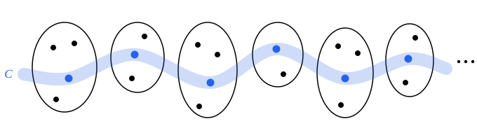
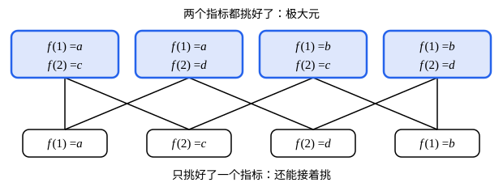

## 这一节要回答的问题

有无穷多双鞋，要从每双里各挑一只，说「都挑左脚的」就行；换成无穷多双袜子，两只一模一样，说不出挑哪一只，凭什么说能从每双里各挑一只？数学书里还常说「取一个极大的……」，这样的对象凭什么存在？

## 讲解

### 选择公理

从正整数集的每个非空:term[子集]{id="math.logic-sets.subset"}（subset）里各挑一个数，可以挑最小的，靠的是:term[良序原理]{id="math.logic-sets.well-ordering-principle"}（well-ordering principle，见[数学归纳法](lesson:math.logic-sets.induction#def-well-ordering)）；从每个开区间$(a,b)$里各挑一个，可以挑中点$\frac{a+b}2$。换成$\R$的全体非空子集，就写不出一条能证明对每个都管用的规则（集合论的公理不矛盾时，这是定理）。

::anchor{id="def-choice-function"}
设$\{A_i\}_{i\in I}$是:term[集族]{id="math.logic-sets.family-of-sets"}（family of sets）。满足「对每个$i\in I$，$f(i)\in A_i$」的:term[映射]{id="math.logic-sets.map"}（map）$f:I\to\bigcup_{i\in I}A_i$，叫作这个集族的选择函数（choice function）。

为什么这样定义：「从每个$A_i$里各挑一个」，说清楚了就是一个映射，把$i$送到挑中的元素；映射的对应法则（rule）只要求每个$i$恰好对应一个元素，不要求写得出来。边界情况：只要有一个$A_i$是:term[空集]{id="math.logic-sets.empty-set"}（empty set），就没有选择函数。

::anchor{id="def-axiom-of-choice"}
:term[选择公理]{id="math.logic-sets.axiom-of-choice"}（axiom of choice）说：由非空集合组成的集族都有选择函数。

为什么要一条公理：集合有无穷多个、又写不出规则时，一个一个取永远取不完；集合论其余的公理，只要本身不矛盾，就既推不出它，也推不出它不成立。它只断言选择函数存在，不给出怎样挑。边界情况：只从一个非空集合里取一个元素，或者写得出规则，或者:term[指标集]{id="math.logic-sets.index-set"}（index set）有限（见下面的定理），都用不着它。

::anchor{id="thm-finite-choice"}
**定理**　设$n$是正整数，$A_1,A_2,\dots,A_n$都是非空集合，则$\{A_i\}_{i\in\{1,2,\dots,n\}}$有选择函数，证明不用选择公理。

**证明**：对$n$归纳。$n=1$时，$A_1$非空，有$a\in A_1$，令$f(1)=a$。设$n$时成立，给了$n+1$个：由:term[归纳假设]{id="math.logic-sets.induction-hypothesis"}（induction hypothesis），前$n$个有选择函数$f$；$A_{n+1}$非空，有$a\in A_{n+1}$，补上$f(n+1)=a$。

策梅洛（Ernst Zermelo）把选择公理说成：一些:term[两两不相交]{id="math.logic-sets.pairwise-disjoint"}（pairwise disjoint）的非空集合，总有一个集合$C$，和其中每一个恰有一个公共元素。因为两两不相交，选择函数的:term[像集]{id="math.logic-sets.range"}（range）就是这样的$C$；反过来见第 5 题（1）。从无穷多个:term[等价类]{id="math.logic-sets.equivalence-class"}（equivalence class）里各挑一个:term[代表元]{id="math.logic-sets.representative"}（representative）、又写不出规则时，用的就是它。[复合映射与逆映射](lesson:math.logic-sets.composition-inverse)说的「每个:term[满射]{id="math.logic-sets.surjective"}（surjective）都有:term[右逆]{id="math.logic-sets.right-inverse"}（right inverse）」是另一种说法。

[函数极限的严格定义](lesson:math.analysis.function-limits#thm-heine)一节证:term[海涅定理]{id="math.analysis.heine-theorem"}（Heine's theorem）的后一半，对每个正整数$n$从一个非空的实数集里任取一个$x_n$，严格说靠指标集为正整数集的选择公理（axiom of countable choice）。[子列与致密性定理](lesson:math.analysis.subsequences#thm-bolzano-weierstrass)里取下标$n_k$，是从正整数里取，规定每次取最小的，就成了:term[递归定义]{id="math.logic-sets.recursive-definition"}（recursive definition），用不着它。

### 佐恩引理

非空的有限:term[偏序集]{id="math.logic-sets.poset"}（partially ordered set，poset）一定有:term[极大元]{id="math.logic-sets.maximal-element"}（maximal element），[证过了](lesson:math.logic-sets.maximal-elements#thm-finite-maximal)；无限的要加一个条件。

::anchor{id="thm-zorn"}
**:term[佐恩引理]{id="math.logic-sets.zorn-lemma"}（Zorn's lemma）**　设${(P,\preceq)}$是非空的偏序集。若$P$的每条非空的:term[链]{id="math.logic-sets.chain"}（chain）在$P$里都有:term[上界]{id="math.logic-sets.upper-bound"}（upper bound），则$P$有极大元。

条件为什么要：${(\N,\le)}$自己就是一条没有上界的链，它没有极大元；空的偏序集里什么也没有。结论只说有极大元，不一定是:term[最大元]{id="math.logic-sets.greatest-element"}（greatest element），也不说是哪一个。这条引理和:term[选择公理]{id="math.logic-sets.axiom-of-choice"}互相推出，见下面两条定理。

用法分三步：把「做到一半」的对象组成非空的偏序集，多半按包含或「接着往下做」来排；验证每条非空的链有上界，多半是把链里的都并起来；取一个极大元，说明它就是要找的，不然还能做得更大。

::anchor{id="thm-zorn-choice"}
**定理**　由佐恩引理可以推出选择公理。

**证明**：设$\{A_i\}_{i\in I}$由非空集合组成，$I$不是:term[空集]{id="math.logic-sets.empty-set"}（否则不用挑）。$P$由所有的$(J,f)$组成，其中$J$是$I$的非空:term[子集]{id="math.logic-sets.subset"}，$f$是$\{A_i\}_{i\in J}$的选择函数；$J\subseteq K$并且$f$、$g$在$J$上处处相同时，规定$(J,f)\preceq(K,g)$，即$g$接着$f$往下挑。这是:term[偏序]{id="math.logic-sets.partial-order"}（partial order）。取$i\in I$和$a\in A_i$，只在$\{i\}$上挑$a$，就是$P$的元素，所以$P$不空。

设$C$是$P$的非空的链，$K$是$C$中各个$J$的:term[并]{id="math.logic-sets.family-union"}（union of a family）。对$i\in K$，$C$中满足$i\in J$的$(J,f)$至少有一个，任意两个:term[可比]{id="math.logic-sets.comparable"}（comparable），所以在$i$处的值相同；令$g(i)$为这个值。于是$g(i)\in A_i$，$(K,g)\in P$，它是$C$的上界。

由佐恩引理，$P$有极大元$(J,f)$。若$J\ne I$，取$i\in I\setminus J$和$a\in A_i$，补上$f(i)=a$，得到更大的元素，和极大矛盾。所以$J=I$，$f$就是要找的选择函数。

::anchor{id="thm-choice-zorn"}
**定理**　由选择公理可以推出佐恩引理。

**证明思路**：用选择公理，给每条还能再长的链挑好一个要添的元素；从空链出发一直添，直到得出一条不能再长的链。它的上界就是极大元，否则还能再长。「一直添」怎样说严格，证明见第 6 题。

::anchor{id="def-well-ordering-theorem"}
每个集合上都有一个:term[全序]{id="math.logic-sets.total-order"}（total order），使得按这个序，每个非空子集都有:term[最小元]{id="math.logic-sets.least-element"}（least element），这叫作良序定理（well-ordering theorem）。

为什么提它：它和选择公理也能互相推出，一个方向见第 5 题（2），另一个本站不证。边界情况：它不是:term[良序原理]{id="math.logic-sets.well-ordering-principle"}，后者说正整数按$\le$就有这个性质；$\R$按$\le$没有；$\R$上这样的序存在，却写不出一个能证明管用的。

## 几何图像

每个椭圆是一个非空集合，它们:term[两两不相交]{id="math.logic-sets.pairwise-disjoint"}。强调色的圆点组成$C$，带子只是把它们圈在一起：$C$和每个集合恰有一个公共元素。画得出的只有有限个，有限个时一个一个挑就行；有无穷多个时，:term[选择公理]{id="math.logic-sets.axiom-of-choice"}断言这样的$C$存在，图上并没有画出怎样挑。

设$A_1=\{a,b\}$，$A_2=\{c,d\}$。这是证「由:term[佐恩引理]{id="math.logic-sets.zorn-lemma"}可以推出选择公理」时那个:term[偏序集]{id="math.logic-sets.poset"}$P$的:term[哈斯图]{id="math.logic-sets.hasse-diagram"}（Hasse diagram）：下排只给一个指标挑好了，沿着线往上走，就是接着给另一个指标挑。上排的四个，两个指标都挑好了，不能再接着挑，都是:term[极大元]{id="math.logic-sets.maximal-element"}，正是全部选择函数；极大元不止一个，所以没有:term[最大元]{id="math.logic-sets.greatest-element"}。

## 例题

### 例 1　差总是无理数的极大集合

证明：有$\R$的:term[子集]{id="math.logic-sets.subset"}$M$，其中任意两个不同的数之差都是无理数，并且每个实数都和$M$中某个数相差一个有理数。

**为什么想到这么做**：让满足前一条的集合大得不能再大；再添一个数就破坏前一条，正说明后一条成立。照:term[佐恩引理]{id="math.logic-sets.zorn-lemma"}的三步做。

**推导**：$P$由满足前一条的所有子集组成，按$\subseteq$排，$\{0\}\in P$。设$C$是$P$的非空的:term[链]{id="math.logic-sets.chain"}，$U$是$C$中各集合的:term[并]{id="math.logic-sets.family-union"}；$U$中任意两个不同的数各在$C$的某个集合里，两个集合一个包含另一个，所以它们同在大的那个里，差是无理数。于是$U\in P$，是$C$的:term[上界]{id="math.logic-sets.upper-bound"}。

由佐恩引理，$P$有:term[极大元]{id="math.logic-sets.maximal-element"}$M$。任取实数$x$：$x\in M$时$x-x=0$是有理数；$x\notin M$时$M\cup\{x\}$不在$P$里，而$M$中不同的数之差都是无理数，所以有$m\in M$使$x-m$是有理数。概率论的[维塔利集](lesson:math.probability.vitali-set)（Vitali set）就是$[0,1)$里这样的集合。

## 常见误区

- 「从一个非空集合里取一个元素，也要用:term[选择公理]{id="math.logic-sets.axiom-of-choice"}。」不对：取一次、取有限次，都用不着。从无穷多个集合里各取一个，写得出规则的，如从每双鞋里挑左脚的，也用不着。
- 「选择公理给出了挑的办法。」不对：它只断言选择函数存在。给$\R$的全体非空:term[子集]{id="math.logic-sets.subset"}各挑一个数，选择函数存在，却写不出一条能证明管用的规则。
- 「:term[佐恩引理]{id="math.logic-sets.zorn-lemma"}说，满足条件的:term[偏序集]{id="math.logic-sets.poset"}有:term[最大元]{id="math.logic-sets.greatest-element"}。」不对：只说有:term[极大元]{id="math.logic-sets.maximal-element"}，可以有很多个。例 1 里$M$的每个数都加$1$，得到另一个极大元，所以那里的$P$没有最大元。
- 「每条:term[链]{id="math.logic-sets.chain"}都有:term[上界]{id="math.logic-sets.upper-bound"}，整个偏序集就有上界。」不对：例 1 的$P$里每条非空的链都有上界，可整个$P$没有：$P$的上界要包含$\{0\}$和$\{1\}$，其中的$0$和$1$之差却是有理数。
