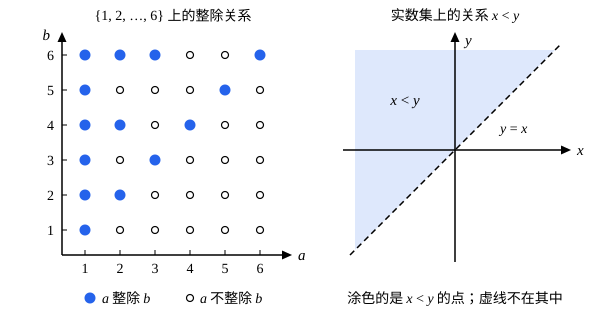

## 这一节要回答的问题

平面上的点$(2,3)$和$(3,2)$不是同一个点，集合$\{2,3\}$和$\{3,2\}$却是同一个集合：集合不管先后，要记下谁在前、谁在后，得另想办法。「$x<y$」「$a$整除$b$」「$A\subseteq B$」说的都是两个对象之间有没有某种:term[关系]{id="math.logic-sets.binary-relation"}（binary relation），能不能把一个关系本身也看成一个集合？看成集合以后，又怎样判断一个关系是不是每个对象都和自己有这个关系，能不能像由$a<b$、$b<c$推出$a<c$那样一步步接下去？

## 讲解

### 有序对

「第 2 排第 3 号」和「第 3 排第 2 号」是两个座位，只记下集合$\{2,3\}$就分不出是哪一个：集合只看有哪些元素，记不下先后。

::anchor{id="def-ordered-pair"}
两个对象$a$、$b$按先后排成的一对，记作$(a,b)$，叫作:term[有序对]{id="math.logic-sets.ordered-pair"}（ordered pair），$a$、$b$分别叫作它的第一个分量、第二个分量；规定$(a,b)=(c,d)$当且仅当$a=c$且$b=d$。同样，$n$个对象按先后排成的$(a_1,a_2,\dots,a_n)$叫作:term[$n$元组]{id="math.logic-sets.tuple"}（$n$-tuple），两个$n$元组相等当且仅当对应的分量都相等。

为什么拿相等的规定当定义：用到有序对时，要紧的只是分得清先后，这条规定正说出了这一点；用集合也能造出满足它的对象，见第 5 题。

边界情况：两个分量可以相同，$(1,1)$是有序对，集合$\{1,1\}=\{1\}$却只有一个元素。有序对和开区间都写成圆括号，两者挨着出现时写明「有序对$(1,2)$」「开区间$(1,2)$」。

### 笛卡儿积

掷一红一蓝两颗骰子，把红骰子的点数写在前，每种结果就是一个:term[有序对]{id="math.logic-sets.ordered-pair"}，$(1,6)$和$(6,1)$是不同的结果；红、蓝各有$6$种点数，一共有$6\times6=36$种结果。

::anchor{id="def-cartesian-product"}
设$A$、$B$是集合，所有有序对$(a,b)$（$a\in A$，$b\in B$）组成的集合，叫作$A$与$B$的:term[笛卡儿积]{id="math.logic-sets.cartesian-product"}（Cartesian product），记作$A\times B$，即$A\times B=\{(a,b):a\in A,\ b\in B\}$。同样，所有:term[$n$元组]{id="math.logic-sets.tuple"}$(a_1,\dots,a_n)$（每个$a_i\in A_i$）组成的集合记作$A_1\times A_2\times\cdots\times A_n$；$n$个$A$的笛卡儿积记作$A^n$，如$A\times A=A^2$。

为什么这样定义：两边各取一个的所有搭配打包成了一个集合，上面的$36$种结果就是$\{1,2,\dots,6\}^2$。平面上的点用实数的有序对表示，整个平面就是$\R\times\R=\R^2$。

边界情况：$A\times B$和$B\times A$一般不相等，$\{1\}\times\{2\}=\{(1,2)\}$，$\{2\}\times\{1\}=\{(2,1)\}$。$A$、$B$中有一个是:term[空集]{id="math.logic-sets.empty-set"}（empty set）时，取不出有序对，$A\times B=\varnothing$。

$A$有$m$个元素、$B$有$n$个元素时，不同的取法给出不同的有序对，由乘法原理（multiplication principle），$A\times B$有$mn$个元素。

别处常见的写法由此有了出处：$[a,b]\times[c,d]$是矩形，$[0,1]^2$是单位正方形，$[0,1]^3$是单位立方体，$\R^n=\R\times\cdots\times\R$就是线性代数里的$\R^n$，写成$\{(x,y):\cdots\}$的平面点集都是$\R^2$的:term[子集]{id="math.logic-sets.subset"}（subset）。$\R^2$的元素是有序对，$\R^3$的元素是三元组（triple），所以$\R^2$不是$\R^3$的子集。记号$\times$还表示向量的:term[叉积]{id="math.linear-algebra.cross-product"}（cross product）$\vb u\times\vb v$、矩阵的尺寸$m\times n$和乘号，看两边是什么就分得清。

### 二元关系

「$x<y$」挑出了$\R^2$里的一部分:term[有序对]{id="math.logic-sets.ordered-pair"}：$(1,2)$在内，$(2,1)$不在，挑出的是$\R^2$的:term[子集]{id="math.logic-sets.subset"}$\{(x,y)\in\R^2:x<y\}$，即直线$y=x$上方的半平面。正整数之间的整除也一样，$(2,6)$满足，$(6,2)$不满足。

::anchor{id="def-binary-relation"}
设$A$、$B$是集合，$A\times B$的子集$R$叫作从$A$到$B$的:term[二元关系]{id="math.logic-sets.binary-relation"}（binary relation），简称关系；$A=B$时，也说$R$是$A$上的关系。$(a,b)\in R$时，记作$a\mathrel{R}b$，说$a$与$b$有关系$R$。

为什么定义成集合：说清了哪些有序对有这个关系，关系也就定下来了，不必再问它「是什么」；两种说法挑出的有序对相同，就是同一个关系，例如$\R$上的「$x<y$」和「$y-x$是正数」。

边界情况：$\varnothing$和整个$A\times B$也都是从$A$到$B$的关系，前者谁和谁都没有这个关系，后者谁和谁都有。

记号：关系用斜体字母$R$，第二个用$S$，和实数集$\R$不同。常用的关系有自己的符号：$\R$上的$\le$（大小关系），$\Pow(A)$上的$\subseteq$（包含关系），相等$=$；对整数$a$、$b$，有整数$k$使$b=ak$时说$a$整除$b$，记作$a\mid b$，按这个说法$0\mid0$也成立。这里的竖线和:term[增广矩阵]{id="math.linear-algebra.augmented-matrix"}（augmented matrix）里的竖线样子相同、意思不同。

### 自反性与传递性

上面这些:term[关系]{id="math.logic-sets.binary-relation"}里，$=$、$\le$、$\subseteq$、整除都有一个特点：每个对象都和自己有这个关系，如$a\le a$、$a\mid a$；$<$却不是，$1<1$不成立。

::anchor{id="def-reflexive"}
设$R$是集合$A$上的关系。如果对每个$a\in A$都有$a\mathrel{R}a$，就说$R$具有:term[自反性]{id="math.logic-sets.reflexive"}（reflexivity），也说$R$是自反的（reflexive）。

为什么单独起名：$\le$、$\subseteq$算上了「和自己比」的情形，$<$、$\subsetneq$不算，这条性质正把它们分开。

边界情况：自反性要求$A$的每个元素都满足，所以它和$A$有关。$\{(1,1),(1,2),(2,2)\}$作为$\{1,2\}$上的关系是自反的，它就是$\{1,2\}$上的$\le$；作为$\{1,2,3\}$上的关系却不是，少了$(3,3)$。

$\le$、$<$、$\subseteq$、整除还能一步步接下去，例如由$a\le b$、$b\le c$得$a\le c$。

::anchor{id="def-transitive"}
设$R$是集合$A$上的关系。如果对所有$a,b,c\in A$，只要$a\mathrel{R}b$且$b\mathrel{R}c$，就有$a\mathrel{R}c$，就说$R$具有:term[传递性]{id="math.logic-sets.transitive"}（transitivity），也说$R$是传递的（transitive）。

为什么单独起名：把关系一步步接起来推理，靠的就是它。写成符号是$\forall a,b,c\in A,\quad(a\mathrel{R}b\land b\mathrel{R}c)\Rightarrow a\mathrel{R}c$；照[多重量词](lesson:math.logic-sets.nested-quantifiers)里的办法否定，$R$不是传递的，就是有$a$、$b$、$c$使$a\mathrel{R}b$、$b\mathrel{R}c$成立而$a\mathrel{R}c$不成立。「属于」能不能这样接下去，见[集合与子集](lesson:math.logic-sets.sets)第 8 题。

边界情况：定义里的$a$、$b$、$c$不必互不相同，$\R$上的$\ne$就不是传递的：$1\ne2$，$2\ne1$，可$1\ne1$不成立。另一方面，$\{1,2\}$上的关系$R=\{(1,2)\}$是传递的：没有$a$、$b$、$c$使$a\mathrel{R}b$、$b\mathrel{R}c$同时成立，条件永远不成立，按定义为真。

::anchor{id="thm-divisibility"}
**定理**　整除关系是自反的、传递的：对任何整数$a$，$a\mid a$；对任何整数$a$、$b$、$c$，若$a\mid b$且$b\mid c$，则$a\mid c$。

**证明**：$a=a\cdot1$，所以$a\mid a$。设$a\mid b$，$b\mid c$，则有整数$k$、$l$使$b=ak$，$c=bl$。于是$c=(ak)l=a(kl)$，$kl$是整数，所以$a\mid c$。

关系的:term[对称性]{id="math.logic-sets.symmetric"}（symmetry）、反对称性（antisymmetry）见[等价关系与商集](lesson:math.logic-sets.equivalence-relations)、[偏序与全序](lesson:math.logic-sets.partial-orders)，那两节也都要用自反性和传递性。

## 几何图像

左图是$\{1,2,\dots,6\}^2$的$36$个点，横坐标为$a$、纵坐标为$b$的点表示:term[有序对]{id="math.logic-sets.ordered-pair"}$(a,b)$。:term[整除关系]{id="math.logic-sets.binary-relation"}挑出的点画成实心的：$(2,6)$是实心的，$(6,2)$是空心的，先后不能颠倒。左下到右上那条对角线上的$6$个点$(a,a)$都是实心的，这说明$\{1,2,\dots,6\}$上的整除关系是:term[自反的]{id="math.logic-sets.reflexive"}。

右图是$x<y$挑出的有序对，它们组成直线$y=x$上方的半平面，图上只画了其中一块。直线本身画成虚线，表示不在其中：对角线上的点$(x,x)$一个也不在里面，所以$<$不是自反的。一般地，$A$上的关系$R$是自反的，就是说对角线$\{(a,a):a\in A\}$整个包含在$R$里。

## 例题

### 例 1　把整除关系写成子集

设$A=\{1,2,\dots,6\}$。$A$上的:term[整除关系]{id="math.logic-sets.binary-relation"}作为$A\times A$的:term[子集]{id="math.logic-sets.subset"}，含有几个:term[有序对]{id="math.logic-sets.ordered-pair"}？它是:term[自反的]{id="math.logic-sets.reflexive"}吗？是:term[传递的]{id="math.logic-sets.transitive"}吗？

**为什么想到这么做**：关系就是有序对的集合，按第一个分量$a$分开数，每个$a$数出它在$A$里的倍数；自反、传递用讲解里的定理判断。

**推导**：$a=1$时$b$可以是$1$到$6$，有$6$个；$a=2$时$b=2,4,6$，有$3$个；$a=3$时$b=3,6$，有$2$个；$a=4,5,6$时$b$只能是$a$自己，各$1$个。一共$6+3+2+1+1+1=14$个有序对，就是几何图像左图里的实心点。$A$的元素都是整数，由讲解里的定理，这个关系既是自反的，又是传递的。

### 例 2　自反却不传递

$\Z$上的:term[关系]{id="math.logic-sets.binary-relation"}$R$规定为：$x\mathrel{R}y$当且仅当$x\le y+1$。$R$是:term[自反的]{id="math.logic-sets.reflexive"}吗？是:term[传递的]{id="math.logic-sets.transitive"}吗？

**为什么想到这么做**：自反一眼看得出。传递是「接力」：$x\le y+1$、$y\le z+1$接起来只得到$x\le z+2$，多出$1$，往这里找反例（counterexample）。

**推导**：对每个整数$x$，$x\le x+1$，即$x\mathrel{R}x$，所以$R$是自反的。取$x=2$、$y=1$、$z=0$：$2\le1+1$，$1\le0+1$，即$2\mathrel{R}1$、$1\mathrel{R}0$都成立；可$2\le0+1$不成立，$2\mathrel{R}0$不成立。有这样一组$x$、$y$、$z$，$R$就不是传递的。

## 常见误区

- 「:term[有序对]{id="math.logic-sets.ordered-pair"}$(a,b)$就是集合$\{a,b\}$。」不对：集合不管先后和重复，$\{1,2\}=\{2,1\}$，$\{1,1\}=\{1\}$；有序对却讲先后，$(1,2)\ne(2,1)$，$(1,1)$的两个分量也都要算。
- 「$R$不是:term[自反的]{id="math.logic-sets.reflexive"}，就是没有一个元素和自己有:term[关系]{id="math.logic-sets.binary-relation"}$R$。」不对：自反性说的是每个$a\in A$都有$a\mathrel{R}a$，它的:term[否定]{id="math.logic-sets.negation"}（negation）是至少有一个$a\in A$使$a\mathrel{R}a$不成立。$\{1,2,3\}$上的关系$\{(1,1),(1,2),(2,2)\}$不是自反的，可$1$、$2$都和自己有这个关系。
- 「找到一组满足$a\mathrel{R}b$、$b\mathrel{R}c$、$a\mathrel{R}c$的$a$、$b$、$c$，就说明$R$是:term[传递的]{id="math.logic-sets.transitive"}。」不对：传递性要对所有$a$、$b$、$c$都成立，一组例子说明不了。例 2 的关系里，$1\mathrel{R}2$、$2\mathrel{R}3$、$1\mathrel{R}3$都成立，可它不是传递的。
