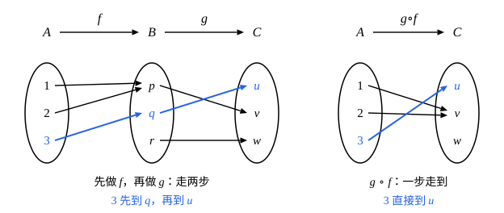
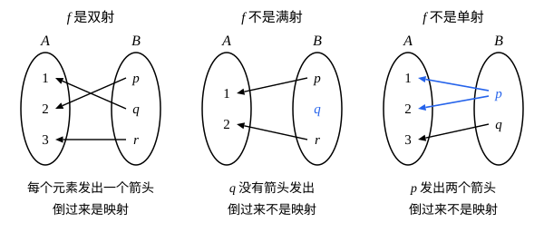

## 这一节要回答的问题

先把$x$加$1$再平方，和先平方再加$1$，结果一般不一样；「先做$f$再做$g$」该怎样写，有什么讲究？反过来，$f$把$x$送到$y$，什么时候有一个:term[映射]{id="math.logic-sets.map"}（map）能把每个$y$都送回去？中学求:term[反函数]{id="math.logic-sets.inverse-map"}（inverse function），为什么有时要先截出一段:term[定义域]{id="math.logic-sets.domain"}（domain）？

## 讲解

### 复合映射

设$f(x)=x+1$，$g(x)=x^2$，都是$\R\to\R$的:term[映射]{id="math.logic-sets.map"}。先做$f$再做$g$，$x$被送到$(x+1)^2$；先做$g$再做$f$，$x$被送到$x^2+1$。

::anchor{id="def-composite"}
设$f:A\to B$，$g:B\to C$。先做$f$、再做$g$，得到映射$A\to C$，$x\mapsto g(f(x))$，叫作$f$与$g$的:term[复合映射]{id="math.logic-sets.composite-map"}（composite map），简称复合（composition），记作$g\circ f$；先做的$f$写在右边。数集之间的复合映射，就是中学说的复合函数（composite function）。

为什么这样定义：两步并成一步，得到的仍是映射。记号照着$(g\circ f)(x)=g(f(x))$，先做的$f$挨着$x$；[线性代数](lesson:math.linear-algebra.linear-maps#thm-composition)也这样写。以后抽象代数的[置换群](lesson:math.abstract-algebra.symmetric-groups)里，两个置换（permutation）的乘积$\sigma\tau$指$\sigma\circ\tau$，有的书次序相反。

边界情况：$f$的:term[陪域]{id="math.logic-sets.codomain"}（codomain）要正是$g$的:term[定义域]{id="math.logic-sets.domain"}，$\sqrt{x-1}$要写成复合，得先把$x\mapsto x-1$看成$[1,+\infty)\to[0,+\infty)$的映射。$f\circ g$要$C=A$才有意义；有意义也未必等于$g\circ f$，上面的$(x+1)^2$和$x^2+1$在$x=1$处就不同，复合一般不能交换次序。

::anchor{id="thm-composition-laws"}
**定理**　设$f:A\to B$，$g:B\to C$，$h:C\to D$。(1) 结合律（associative law）：$h\circ(g\circ f)=(h\circ g)\circ f$；(2) 和:term[恒等映射]{id="math.logic-sets.identity-map"}（identity map）复合，映射不变：$f\circ\mathrm{id}_A=f=\mathrm{id}_B\circ f$。

**证明**：(1) 两边都是$A\to D$的映射，都把$x$送到$h(g(f(x)))$；定义域、陪域相同，又逐点相等，所以[相等](lesson:math.logic-sets.functions#def-map-equality)。(2) 三个都是$A\to B$的映射，都把$x$送到$f(x)$。

所以几个映射连着复合不用写括号，恒等映射在复合里就像乘法里的$1$。数列$a:\N^+\to\R$的:term[子列]{id="math.analysis.subsequence"}（subsequence），就是先用严格递增（strictly increasing）的$k\mapsto n_k$挑下标、再做$a$，也是复合。

::anchor{id="thm-composition-injective"}
设$f:A\to B$，$g:B\to C$。$f$、$g$都是:term[单射]{id="math.logic-sets.injective"}（injective）时，$g\circ f$是单射；都是:term[满射]{id="math.logic-sets.surjective"}（surjective）时，$g\circ f$是满射。证明见第 5 题。

### 逆映射

$\R\to\R$的$f(x)=2x+1$和$g(y)=\frac{y-1}2$，不论先做哪个，再做另一个都回到原处。

::anchor{id="def-inverse"}
设$f:A\to B$。若$g:B\to A$满足$g\circ f=\mathrm{id}_A$和$f\circ g=\mathrm{id}_B$，就说$g$是$f$的:term[逆映射]{id="math.logic-sets.inverse-map"}（inverse map），记作$f^{-1}$。数集之间的逆映射，就是中学说的反函数。

为什么两个等式都要：前一个说从$A$出发回得来，后一个说从$B$出发回得来，只有一个不够。$\N\to\N$的$f(n)=n+1$，令$g(0)=0$，$n\ge1$时$g(n)=n-1$，则$g\circ f=\mathrm{id}_{\N}$，可$f(g(0))=1$。边界情况：$\R\to[0,+\infty)$的$f(x)=x^2$没有逆映射，$g\circ f=\mathrm{id}_{\R}$要求$g(4)$既等于$2$，又等于$-2$。

::anchor{id="def-one-sided-inverse"}
设$f:A\to B$，$g$和$h$都是$B\to A$的:term[映射]{id="math.logic-sets.map"}。$g\circ f=\mathrm{id}_A$时，说$g$是$f$的左逆（left inverse）；$f\circ h=\mathrm{id}_B$时，说$h$是$f$的:term[右逆]{id="math.logic-sets.right-inverse"}（right inverse）。

为什么分开起名：只有一边成立的很常见。多项式先求从$0$起的:term[变上限积分]{id="math.calculus.variable-upper-limit-integral"}（integral with variable upper limit）、再求导，回到原处；先求导、再这样积分，$x^2+1$却变成了$x^2$。边界情况：上面$\N\to\N$的$g$只是左逆；$g(0)$换成别的自然数也行，左逆不止一个。

::anchor{id="thm-inverse-unique"}
**定理**　$f:A\to B$的逆映射至多有一个。

**证明**：设$g_1$、$g_2$都是$f$的逆映射，由结合律和:term[恒等映射]{id="math.logic-sets.identity-map"}的性质，

$$
g_1=g_1\circ\mathrm{id}_B=g_1\circ(f\circ g_2)=(g_1\circ f)\circ g_2=\mathrm{id}_A\circ g_2=g_2 .
$$

所以$f^{-1}$指得清是哪个映射。证明只用到$g_1$是左逆、$g_2$是右逆：两样都有时，它们相等，就是逆映射。

::anchor{id="thm-inverse-bijective"}
**定理**　$f:A\to B$有逆映射，当且仅当$f$是:term[双射]{id="math.logic-sets.bijective"}（bijective）。

**证明**：设$f$有逆映射$g$。若$f(x_1)=f(x_2)$，两边用$g$送回去，得$x_1=x_2$，$f$是:term[单射]{id="math.logic-sets.injective"}；任取$y\in B$，$y=f(g(y))$是$g(y)$的像（image），$f$是:term[满射]{id="math.logic-sets.surjective"}。

反过来，设$f$是双射，则每个$y\in B$[恰有一个](lesson:math.logic-sets.nested-quantifiers#def-exactly-one)$x\in A$使$f(x)=y$，令$g(y)$为这个$x$，就得到映射$g:B\to A$。按取法，$f(g(y))=y$；任取$x\in A$，$g(f(x))$是被$f$送到$f(x)$的那个元素，就是$x$。所以$g$是$f$的逆映射。

满射让每个$y$都送得回去，单射让它只有一处可回；$f^{-1}(y)$就是方程$f(x)=y$的唯一解。反过来，写出$g$、验证两个等式，就证了$f$是双射。

::anchor{id="thm-inverse-composite"}
**定理**　设$f:A\to B$，$g:B\to C$都是双射，则$g\circ f$是双射，$(g\circ f)^{-1}=f^{-1}\circ g^{-1}$；$f^{-1}$也是双射，$(f^{-1})^{-1}=f$。

**证明**：由结合律和恒等映射的性质，

$$
\begin{aligned}
(f^{-1}\circ g^{-1})\circ(g\circ f)&=f^{-1}\circ(g^{-1}\circ g)\circ f=f^{-1}\circ f=\mathrm{id}_A ,\\
(g\circ f)\circ(f^{-1}\circ g^{-1})&=g\circ(f\circ f^{-1})\circ g^{-1}=g\circ g^{-1}=\mathrm{id}_C ,
\end{aligned}
$$

所以$f^{-1}\circ g^{-1}$是$g\circ f$的逆映射，$g\circ f$是双射。$f^{-1}\circ f=\mathrm{id}_A$、$f\circ f^{-1}=\mathrm{id}_B$也说明$f$是$f^{-1}$的逆映射，所以$f^{-1}$是双射。

次序倒过来，就像先穿袜子后穿鞋，脱时先脱鞋。

### 和中学、别处的说法对上

函数$f$的曲线上的点$(x,f(x))$对应:term[反函数]{id="math.logic-sets.inverse-map"}的曲线上的点$(f(x),x)$，两条曲线关于直线$y=x$对称。中学不提:term[陪域]{id="math.logic-sets.codomain"}，求反函数时默认把陪域换成:term[值域]{id="math.logic-sets.range"}（range）：$e^x$看成$\R\to(0,+\infty)$的:term[映射]{id="math.logic-sets.map"}，反函数是$\ln x$。$\R\to\R$的$x\mapsto x^2$只换陪域，还是没有反函数；取它在$[0,+\infty)$上的限制（restriction），陪域也换成$[0,+\infty)$，就有反函数$y\mapsto\sqrt y$。换陪域、截出一段，都是换了一个映射。

$\sin$也这样：取它在$\bigl[-\frac\pi2,\frac\pi2\bigr]$上的限制，陪域换成$[-1,1]$，反函数就是:term[反正弦函数]{id="math.calculus.arcsine"}（arcsine）$\arcsin$。$\sin(\arcsin x)=x$总成立，$\arcsin(\sin x)=x$却只在截出的那一段上成立；把$\arcsin$的陪域换成$\R$，对整个$\sin:\R\to[-1,1]$来说，它只是:term[右逆]{id="math.logic-sets.right-inverse"}。

[像与原像](lesson:math.logic-sets.image-preimage#def-preimage)里的$f^{-1}(S)$（$S\subseteq B$），对任何$f:A\to B$都有意义，指$S$的:term[原像]{id="math.logic-sets.preimage"}（preimage）；$f$是:term[双射]{id="math.logic-sets.bijective"}时，它也是把$S$的元素用$f^{-1}$逐个送回去得到的集合，两种读法一致。

$A$不空时，:term[单射]{id="math.logic-sets.injective"}都有左逆（第 6 题）。每个:term[满射]{id="math.logic-sets.surjective"}都有右逆，却一般要用:term[选择公理]{id="math.logic-sets.axiom-of-choice"}（axiom of choice）：要给每个$y$从被送到$y$的元素里挑一个，见[选择公理与佐恩引理](lesson:math.logic-sets.axiom-of-choice)。

## 几何图像

左图先沿$f$的箭头、再沿$g$的箭头，走两步；右图的:term[复合映射]{id="math.logic-sets.composite-map"}$g\circ f$一步走到同一个地方。强调色画的是从$3$出发的一路，先到$q$，再到$u$：先走的是$f$，写在右边。$r$没有箭头指来，$g$把它送到哪里，都不影响$g\circ f$。

这三幅图把$f$的箭头全部倒过来，从$B$指向$A$。左图的$f$是:term[双射]{id="math.logic-sets.bijective"}，$B$的每个元素恰好发出一个箭头，倒过来还是:term[映射]{id="math.logic-sets.map"}，就是:term[逆映射]{id="math.logic-sets.inverse-map"}。中图的$f$不是:term[满射]{id="math.logic-sets.surjective"}，$q$没有箭头发出；右图的$f$不是:term[单射]{id="math.logic-sets.injective"}，$p$发出两个箭头；倒过来都不是映射。

:::anim{component="function-plot"}
range: { x: [-3, 3], y: [-1.8, 1.8] }
functions:
  - expr: "sin(x) + 0*sqrt(pi/2 - abs(x))"
    label: |
      $y=\sin x$，$-\frac\pi2\le x\le\frac\pi2$
  - expr: "asin(max(-1, min(1, x))) + 0*sqrt(1.01 - abs(x))"
    label: |
      $y=\arcsin x$
  - expr: "x"
    label: |
      $y=x$
  - expr: "asin(sin(x))"
    label: |
      $y=\arcsin(\sin x)$
points:
  - { x: "a", y: "sin(a)" }
  - { x: "sin(a)", y: "a" }
sliders:
  - name: a
    min: -1.5
    max: 1.5
    step: 0.1
    default: 1.2
    label: |
      $a$
:::

蓝色是截出来的$\sin$，橙色是它的反函数$\arcsin$，两条曲线关于绿色的直线$y=x$对称：拖动$a$，圆点$(a,\sin a)$在蓝线上，圆点$(\sin a,a)$在橙线上，总是对称的一对。紫色的$y=\arcsin(\sin x)$只在截出的那一段上和$y=x$重合，盖住了绿线，出了这一段就折回来。图上横轴写作 x；纵轴的范围取成横轴的$0.6$倍，$y=x$才画成$45^\circ$。

## 例题

### 例 1　自己是自己的逆

证明$f:\R\setminus\{1\}\to\R\setminus\{1\}$，$f(x)=\frac{x+1}{x-1}$是:term[双射]{id="math.logic-sets.bijective"}，并求$f^{-1}$。

**为什么想到这么做**：由$y=\frac{x+1}{x-1}$解出$x$，得到$x=\frac{y+1}{y-1}$，还是同一个式子，这提示$f$是自己的:term[逆映射]{id="math.logic-sets.inverse-map"}。验证$f\circ f$是:term[恒等映射]{id="math.logic-sets.identity-map"}，就不用分两半证双射了。

**推导**：$f(x)=1+\frac2{x-1}\ne1$，$f$确实映到$\R\setminus\{1\}$里。由$f(x)-1=\frac2{x-1}$，$f(f(x))=1+\frac2{f(x)-1}=1+(x-1)$，就是$x$，即$f\circ f$是$\R\setminus\{1\}$上的恒等映射。取$g=f$，两个等式都成立，所以$f$是双射，$f^{-1}=f$。

### 例 2　截一段，求反函数

求$f:(0,+\infty)\to\R$，$f(x)=x-\frac1x$的:term[反函数]{id="math.logic-sets.inverse-map"}。

**为什么想到这么做**：由$y=x-\frac1x$得$x^2-yx-1=0$，$x=\frac{y\pm\sqrt{y^2+4}}2$，两个根的积是$-1$，正的才在:term[定义域]{id="math.logic-sets.domain"}里。解出来的只是候选，要验证两个:term[复合]{id="math.logic-sets.composite-map"}都是:term[恒等映射]{id="math.logic-sets.identity-map"}。

**推导**：令$g(y)=\frac{y+\sqrt{y^2+4}}2$。$\sqrt{y^2+4}>|y|$，所以$g(y)>0$，$g$是$\R\to(0,+\infty)$的:term[映射]{id="math.logic-sets.map"}。又

$$
\frac1{g(y)}=\frac2{y+\sqrt{y^2+4}}=\frac{\sqrt{y^2+4}-y}2 ,
$$

所以$f(g(y))=g(y)-\frac1{g(y)}=y$。

反过来，$f(x)^2+4=\bigl(x+\frac1x\bigr)^2$，$x>0$时$\sqrt{f(x)^2+4}=x+\frac1x$，所以$g(f(x))=\frac12\bigl(x-\frac1x+x+\frac1x\bigr)=x$。于是$f^{-1}=g$。定义域换成$\R\setminus\{0\}$，$f(2)=f\bigl(-\frac12\bigr)$，$f$就没有反函数了。

## 常见误区

- 「$g\circ f$先做$g$。」不对：照$g(f(x))$读，先做的是右边的$f$。$f(x)=x+1$，$g(x)=x^2$时，$(g\circ f)(1)=g(2)=4$；先做$g$算出的$f(g(1))=2$，是另一个:term[复合映射]{id="math.logic-sets.composite-map"}$f\circ g$的值。
- 「$f^{-1}(x)=\frac1{f(x)}$。」不对：$f^{-1}$是:term[逆映射]{id="math.logic-sets.inverse-map"}，不是倒数。$f(x)=2x+1$时，$f(1)=3$，所以$f^{-1}(3)=1$，而$\frac1{f(3)}=\frac17$。
- 「$g\circ f$是:term[恒等映射]{id="math.logic-sets.identity-map"}，$g$就是$f$的逆映射。」不对：还要$f\circ g$是恒等映射。$\N\to\N$的$f(n)=n+1$有左逆，却没有逆映射：$0$不是像，$f$不是:term[双射]{id="math.logic-sets.bijective"}。
- 「$f$、$g$都是双射时，$(g\circ f)^{-1}=g^{-1}\circ f^{-1}$。」不对：次序要倒过来，$A$、$C$不同时，右边连意义都没有。$f(x)=x+1$、$g(x)=2x$都是$\R\to\R$的双射，$(g\circ f)^{-1}(0)=-1$，$g^{-1}(f^{-1}(0))=-\frac12$。
