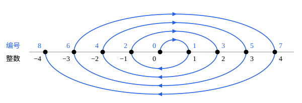
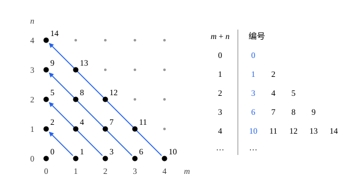
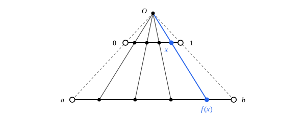

## 这一节要回答的问题

两堆东西是不是一样多，不用数，一个配一个，看有没有多出来的。无穷多个东西数不完，配对却照样能做：非负偶数只是自然数的一部分，会不会和自然数「一样多」？坐标都是自然数的点布满了四分之一个平面，又能不能不重复、不遗漏地排成一列？

## 讲解

### 等势

一人坐一把椅子，没人站着，也没有空椅子，人和椅子就一样多。$n\mapsto2n$也这样把自然数和非负偶数配成了对。

::anchor{id="def-equinumerous"}
设$A$、$B$是集合。如果有从$A$到$B$的:term[双射]{id="math.logic-sets.bijective"}（bijective），就说$A$与$B$:term[等势]{id="math.logic-sets.equinumerous"}（equinumerous），记作$|A|=|B|$。

为什么这样定义：有限个可以数，无穷多个只能配对，配得上就当作一样多。竖线中间是集合，不是绝对值，整个式子读作「$A$与$B$等势」，也读作「基数相同」（same cardinality）；有的书把等势叫「对等」，写作$\operatorname{card}A=\operatorname{card}B$或$\#A=\#B$。

边界情况：一个集合可以和自己的:term[真子集]{id="math.logic-sets.proper-subset"}（proper subset）等势，如$\N$和全体非负偶数；$n\mapsto n+1$是$\N\to\N^+$的双射，$\N$多出来的$0$并不碍事。

::anchor{id="thm-equinumerous"}
**定理**　设$A$、$B$、$C$是集合。(1) ${|A|=|A|}$；(2) 若${|A|=|B|}$，则${|B|=|A|}$；(3) 若${|A|=|B|}$且${|B|=|C|}$，则${|A|=|C|}$。

**证明**：(1) :term[恒等映射]{id="math.logic-sets.identity-map"}（identity map）$\mathrm{id}_A$是双射。(2)、(3) 设$f:A\to B$、$g:B\to C$是双射，由[复合映射与逆映射](lesson:math.logic-sets.composition-inverse#thm-inverse-composite)，:term[逆映射]{id="math.logic-sets.inverse-map"}（inverse map）$f^{-1}:B\to A$和$g\circ f:A\to C$也是双射。

由 (2)，说等势不必分先后；由 (3)，可以借$B$来过渡。

### 有限集与无限集

数三个苹果，就是把它们和$1$、$2$、$3$一个配一个，从哪个苹果数起，都数到$3$。

::anchor{id="def-finite-set"}
:term[空集]{id="math.logic-sets.empty-set"}（empty set），或者和某个$\{1,2,\dots,n\}$（$n\in\N^+$）:term[等势]{id="math.logic-sets.equinumerous"}的集合$A$，叫作:term[有限集]{id="math.logic-sets.finite-set"}（finite set），$n$叫作它的元素个数，记作$|A|=n$，空集的元素个数是$0$；不是有限集的集合叫作:term[无限集]{id="math.logic-sets.infinite-set"}（infinite set），也叫无穷集。

为什么这样定义：「数得完」就是能和$1$到某个$n$配上对；[多重量词](lesson:math.logic-sets.nested-quantifiers)第 5 题说的「有无穷多个」，就是组成无限集。边界情况：同一个集合要是又和$\{1,2\}$、又和$\{1,2,3\}$等势，元素个数就说不清了；由下面的 (1)，不会这样。

::anchor{id="thm-finite-counting"}
关于元素个数，要用到三条事实：(1) $m$、$n$是正整数时，有从$\{1,2,\dots,m\}$到$\{1,2,\dots,n\}$的:term[单射]{id="math.logic-sets.injective"}（injective），就有$m\le n$，所以两者等势只在$m=n$时成立，空集和它们也都不等势，有限集的元素个数因此是确定的；(2) 有限集添上一个不在里面的元素，还是有限集，元素个数加$1$；(3) 有限集的:term[子集]{id="math.logic-sets.subset"}（subset）也是有限集，元素个数不超过原来的。证明见第 5 题。

由 (1)，有限集等势就是元素个数相同；多重量词那道题里，都不超过$N$的$n$至多$N$个，靠 (3)。

::anchor{id="thm-naturals-infinite"}
**定理**　有限集不会和它的:term[真子集]{id="math.logic-sets.proper-subset"}等势；$\N$是无限集。

**证明**：设$B$是有限集$A$的真子集，取$a\in A$，$a\notin B$。由 (3)、(2)，$B$有限，$B\cup\{a\}$的元素个数比$B$的多$1$，又不超过$A$的；所以$B$的元素个数比$A$的小，由 (1)，两者不等势。$\N$却和真子集$\N^+$等势，所以不是有限集。

由等势的定理，和$\N$等势的也都是无限集。$\N$的非空子集是无限集，当且仅当它没有最大的数，见[可数集的子集与有理数集](lesson:math.logic-sets.countable-subsets)。

### 可数集

非负偶数排成$0,2,4,6,\dots$，每一个排在第几位都说得清。

::anchor{id="def-countable"}
和$\N$:term[等势]{id="math.logic-sets.equinumerous"}的集合叫作:term[可数集]{id="math.logic-sets.countable-set"}（countable set），也叫可列集；:term[有限集]{id="math.logic-sets.finite-set"}和可数集统称:term[至多可数集]{id="math.logic-sets.at-most-countable"}（at most countable set）。

为什么这样定义：$n\mapsto n+1$是$\N\to\N^+$的:term[双射]{id="math.logic-sets.bijective"}，所以$A$可数，就是有从$\N^+$到$A$的双射，即$A$的元素能不重复、不遗漏地排成一列$a_1,a_2,a_3,\dots$。「排成一列」只管编号，不管谁大谁小、谁快谁慢（[无穷小的比较](lesson:math.calculus.infinitesimal-orders)第 7 题说的是按快慢排）。有限集和可数集常要合起来说，如可数集的:term[子集]{id="math.logic-sets.subset"}不是有限集就是可数集（见[可数集的子集与有理数集](lesson:math.logic-sets.countable-subsets)），所以另起「至多可数」这个名。

边界情况：把自然数里的偶数都排在前面、奇数都排在后面，不算排成一列，说不出$1$是第几个。$\{1,2,3\}$是至多可数集，不是可数集；英文的 countable 在有的书里也包括有限集，本领域不包括。

整数两头都没有尽头，就从$0$往两边轮流取。

::anchor{id="thm-integers-countable"}
**定理**　$\Z$是可数集。

**证明**：照$0,1,-1,2,-2,\dots$来排：令$f:\N\to\Z$，$n$是奇数时$f(n)=\frac{n+1}2$，$n$是偶数时$f(n)=-\frac n2$。再令$g:\Z\to\N$，$k>0$时$g(k)=2k-1$，$k\le0$时$g(k)=-2k$。$n$是奇数时$f(n)>0$，$g(f(n))=2f(n)-1=n$；$n$是偶数时$f(n)\le0$，$g(f(n))=-2f(n)=n$；分$k>0$、$k\le0$，同样算得$f(g(k))=k$。所以$g$是$f$的:term[逆映射]{id="math.logic-sets.inverse-map"}，$f$是双射。

两个自然数也能合成一个：$40=2^3(2\cdot2+1)$，由$40$就认得出$3$和$2$。

::anchor{id="thm-pairs-countable"}
**定理**　(1) $\N\times\N$是可数集。(2) $A$、$B$是可数集时，:term[笛卡儿积]{id="math.logic-sets.cartesian-product"}（Cartesian product）$A\times B$也是可数集。

**证明**：(1) 证$(m,n)\mapsto2^m(2n+1)-1$是$\N\times\N\to\N$的双射，也就是每个正整数恰有一种写法$2^m(2n+1)$。至少一种，用:term[强归纳法]{id="math.logic-sets.strong-induction"}（strong induction）：$1=2^0\cdot1$；$a\ge2$时，设比$a$小的正整数都写得出，若$a$是奇数$2n+1$，取$m=0$，若$a$是偶数$2j$，由:term[归纳假设]{id="math.logic-sets.induction-hypothesis"}（induction hypothesis）$j=2^m(2n+1)$，$a=2^{m+1}(2n+1)$。至多一种：设$2^m(2n+1)=2^k(2l+1)$，若$m<k$，约去$2^m$，左边是奇数，右边是偶数，矛盾；$m>k$同理。所以$m=k$，$n=l$。

(2) 取双射$p:\N\to A$、$q:\N\to B$，则$(m,n)\mapsto(p(m),q(n))$是$\N\times\N\to A\times B$的双射，逆映射是$(a,b)\mapsto(p^{-1}(a),q^{-1}(b))$。所以$A\times B$与$\N\times\N$等势，由 (1)，也与$\N$等势。

$\N\times\N$也可以照几何图像那样沿斜线排，$(m,n)$的编号是$\frac{(m+n)(m+n+1)}2+n$（证明见第 6 题）；数学分析[级数的重排](lesson:math.analysis.rearrangement#thm-cauchy-product)算:term[柯西乘积]{id="math.analysis.cauchy-product"}（Cauchy product）时按「对角线」排，就是这样。$\Q$也是可数集，证明见[可数集的子集与有理数集](lesson:math.logic-sets.countable-subsets)。

## 几何图像

弧线从$0$出发，往右跨、往左跨轮流来，依次经过$0,1,-1,2,-2,\dots$，每个整数恰好经过一次（只画到$-4$）。点的下方是整数，上方是编号$n$，从$0$编起；正整数的编号是奇数，$0$和负整数的编号是偶数，就是讲解里的$f$。

点$(m,n)$表示一个:term[有序对]{id="math.logic-sets.ordered-pair"}（ordered pair），旁边是它的编号，也从$0$编起。$m+n$相同的点在同一条斜线上，沿箭头走完一条，再走下一条，每个点都在有限步内排到，不重复、不遗漏，这就是$\N\times\N$和$\N$之间的:term[双射]{id="math.logic-sets.bijective"}。右边每行开头的数$0,1,3,6,10$是这条斜线以前的点数，$m+n=s$那一条以前有$1+2+\dots+s=\frac{s(s+1)}2$个点，$(m,n)$的编号还要再加$n$。

上面的开区间$(0,1)$和下面的开区间$(a,b)$平行，长短不同。从$O$发出的射线，只要穿过上面的一个点，就恰好穿过下面的一个点，反过来也一样，两边的点就一个配一个地配好了：两个开区间:term[等势]{id="math.logic-sets.equinumerous"}，例 1 把它写成式子。

## 例题

### 例 1　长短不同的开区间等势

设$a<b$。证明开区间$(0,1)$与$(a,b)$:term[等势]{id="math.logic-sets.equinumerous"}，由此说明任意两个形如$(a,b)$的开区间等势。

**为什么想到这么做**：把$(0,1)$伸缩到原来的$b-a$倍，再把左端移到$a$，是一次函数；写出:term[逆映射]{id="math.logic-sets.inverse-map"}，就不用分两半证:term[双射]{id="math.logic-sets.bijective"}了。

**推导**：令$f(x)=a+(b-a)x$，$0<x<1$时$a<f(x)<b$，所以$f:(0,1)\to(a,b)$。令$g(y)=\frac{y-a}{b-a}$，$a<y<b$时$0<g(y)<1$，所以$g:(a,b)\to(0,1)$。$g(f(x))=x$，$f(g(y))=y$，所以$g$是$f$的逆映射，$f$是双射。任意两个这样的开区间都和$(0,1)$等势，所以互相等势：长短不同，点却一样多。

### 例 2　可数集添一个元素

设$A$是:term[可数集]{id="math.logic-sets.countable-set"}，$b\notin A$。证明$A\cup\{b\}$是可数集。

**为什么想到这么做**：把$A$排成一列，每个元素往后挪一位，空出来的第一位给$b$。

**推导**：取:term[双射]{id="math.logic-sets.bijective"}$p:\N\to A$，令$h(0)=b$，$h(n+1)=p(n)$，得到$h:\N\to A\cup\{b\}$。$b$和$A$的每个元素都是像（image），$h$是:term[满射]{id="math.logic-sets.surjective"}（surjective）；$h(n+1)\in A$，不等于$b$，$n\ne k$时$p(n)\ne p(k)$，$h$是:term[单射]{id="math.logic-sets.injective"}。所以$h$是双射，$A\cup\{b\}$可数；由归纳，添有限个元素也可数。

## 常见误区

- 「:term[真子集]{id="math.logic-sets.proper-subset"}的元素总比原来的集合少。」不对：对:term[有限集]{id="math.logic-sets.finite-set"}成立，对:term[无限集]{id="math.logic-sets.infinite-set"}却不一定，$\N^+$是$\N$的真子集，两者:term[等势]{id="math.logic-sets.equinumerous"}。
- 「从$A$到$B$有一个:term[单射]{id="math.logic-sets.injective"}不是:term[满射]{id="math.logic-sets.surjective"}，$A$与$B$就不等势。」不对：$A$是有限集时成立，是无限集时却不一定；不等势是说一个:term[双射]{id="math.logic-sets.bijective"}也没有。$\N\to\Z$的$n\mapsto n$是单射，不是满射，可$\N$与$\Z$等势。
- 「:term[可数]{id="math.logic-sets.countable-set"}就是数得完。」不对：可数集都是无限集，数不完；「可数」说的是能一个接一个地编号，每个元素都有确定的编号。
- 「$\N\times\N$光第一行就排不完，所以排不成一列。」不对：不必一行一行地排。沿斜线排，每个$(m,n)$的前面只有有限个点，都有编号。
- 「把$\N\times\N$按对角线排，就是:term[对角线论证]{id="math.logic-sets.diagonal-argument"}（diagonal argument）。」不对：按对角线排是把元素排成一列，说明排得成；对角线论证是造一个不在列里的对象，说明排不全，见[不可数集与对角线论证](lesson:math.logic-sets.uncountable-sets)。
