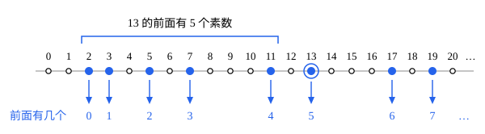
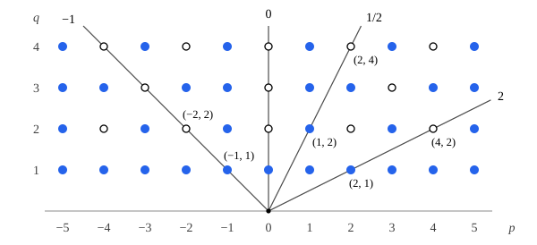

## 这一节要回答的问题

素数从小到大排成$2,3,5,7,\dots$，第几个是谁，都说得清；$\N$的任何一个无限:term[子集]{id="math.logic-sets.subset"}（subset），都能这样排吗？有理数在数轴上密密麻麻，任意两个之间还有无穷多个，哪一个都没有「下一个」，它们也能不重复、不遗漏地排成一列吗？

## 讲解

### $\N$的无限子集

素数$2,3,5,7,11,\dots$的前面，依次有$0,1,2,3,4,\dots$个素数。数一数前面有几个，就给每个素数编上了号，不重复，也不跳过。

:term[良序原理]{id="math.logic-sets.well-ordering-principle"}（well-ordering principle，见[数学归纳法](lesson:math.logic-sets.induction#def-well-ordering)）说的是正整数；自然数组成的非空集合，每个数加$1$就化成正整数的情形，所以其中也有最小的数。

::anchor{id="thm-infinite-no-maximum"}
**定理**　设$A$是$\N$的非空:term[子集]{id="math.logic-sets.subset"}，则$A$是:term[无限集]{id="math.logic-sets.infinite-set"}（infinite set），当且仅当$A$里没有最大的数。

**证明**：即证$A$里有最大的数，当且仅当$A$是:term[有限集]{id="math.logic-sets.finite-set"}（finite set）。有最大的数$M$时，$A\subseteq\{0,1,\dots,M\}$，由[等势与可数集](lesson:math.logic-sets.countable-sets#thm-finite-counting)关于元素个数的事实 (3)，$A$是有限集。反过来，$A$有限时对元素个数归纳：只有一个数时就是它；设$n$个数时成立，$n+1$个数时拿出一个，它和剩下$n$个里最大的，较大的就是$A$里最大的。

「非空」不能省：:term[空集]{id="math.logic-sets.empty-set"}（empty set）里没有最大的数，却是有限集。[多重量词](lesson:math.logic-sets.nested-quantifiers)第 5 题「有的话取$N$为其中最大的，一个也没有就取$N=1$」，依据就在这里。

::anchor{id="thm-infinite-subset"}
**定理**　$\N$的无限子集都和$\N$:term[等势]{id="math.logic-sets.equinumerous"}（equinumerous）。

**证明**：设$A$是$\N$的无限子集，它不空（空集是有限集）。对$a\in A$，由事实 (3)，$A$中比$a$小的数至多有$a$个，令$\varphi(a)$为它们的个数，$\varphi$是$A\to\N$的:term[映射]{id="math.logic-sets.map"}（map）。

$\varphi$是:term[单射]{id="math.logic-sets.injective"}（injective）：设$a,a'\in A$，$a<a'$。$A$中比$a$小的数也比$a'$小，$a$自己也比$a'$小，由事实 (2)、(3)，$\varphi(a')\ge\varphi(a)+1$，两个像（image）不同。

$\varphi$是:term[满射]{id="math.logic-sets.surjective"}（surjective）：对$n$归纳，证明$n$是$A$中某个数的像。$A$中最小的数，像是$0$。设$\varphi(a)=n$；由上面的定理，$A$里没有最大的数，所以$A$中有比$a$大的，取其中最小的$a'$。$A$中比$a'$小的，恰是比$a$小的那$n$个和$a$自己，由事实 (2)，$\varphi(a')=n+1$。

所以$A$是:term[可数集]{id="math.logic-sets.countable-set"}（countable set，也叫可列集），能从小到大排成$s_1<s_2<s_3<\cdots$，前面恰有$n$个数的是$s_{n+1}$。数学分析[子列与致密性定理](lesson:math.analysis.subsequences)例 2 把下标「从小到大排成$m_1<m_2<\cdots$」，靠的就是它。也可以说「每次取剩下的数里最小的」，那是:term[递归定义]{id="math.logic-sets.recursive-definition"}（recursive definition），见[皮亚诺公理与递归定义](lesson:math.logic-sets.peano-axioms#def-recursive-definition)。

### 至多可数的判断

由上面的定理，证:term[无限集]{id="math.logic-sets.infinite-set"}是:term[可数集]{id="math.logic-sets.countable-set"}，不必写出:term[双射]{id="math.logic-sets.bijective"}（bijective），一半就够。

::anchor{id="thm-injection-countable"}
**定理**　(1) 有从$B$到$\N$的:term[单射]{id="math.logic-sets.injective"}时，$B$是:term[至多可数集]{id="math.logic-sets.at-most-countable"}（at most countable set）；所以可数集的:term[子集]{id="math.logic-sets.subset"}都至多可数。(2) 有从$\N$到$B$的:term[满射]{id="math.logic-sets.surjective"}时，$B$是至多可数集。

**证明**：(1) 设$f:B\to\N$是单射，:term[像集]{id="math.logic-sets.range"}（range）记作$S$。:term[陪域]{id="math.logic-sets.codomain"}（codomain）换成$S$，$f$就是双射，$B$与$S$:term[等势]{id="math.logic-sets.equinumerous"}。$S\subseteq\N$，若是:term[有限集]{id="math.logic-sets.finite-set"}，$B$也是；若是无限集，就与$\N$等势，$B$也与$\N$等势。$B$是可数集$A$的子集时，双射$q:A\to\N$在$B$上的限制（restriction）就是单射。

(2) 设$f:\N\to B$是满射。对$b\in B$，满足$f(n)=b$的$n$至少有一个，令$g(b)$为其中最小的。由$g(b)=g(b')$得$b=f(g(b))=f(g(b'))=b'$，所以$g:B\to\N$是单射，用 (1)。

(2) 说，排成一列时有重复也不要紧：取最小的$n$，就是把后面重复的跳过。数学分析[闭区间套定理](lesson:math.analysis.nested-intervals)第 7 题排$[0,1]$里的有理数，「约分后重复的跳过」，就是这样。边界情况：两条都只得到至多可数，$n$除以$2$的余数就给出$\N\to\{0,1\}$的满射；要说可数，还得说明$B$是无限集。

### 有理数集

$\frac12$由$1$和$2$写出来，每个有理数都由两个整数写出来。

::anchor{id="thm-rationals-countable"}
**定理**　$\Q$是:term[可数集]{id="math.logic-sets.countable-set"}。

**证明**：有理数$r$写成$\frac pq$（$p$是整数，$q$是正整数），写法不止一种，取$q$最小的，也就是约到最简的（$0$写成$\frac01$）。由$(p,q)$认得出$r$，所以$r\mapsto(p,q)$是$\Q\to\Z\times\N^+$的:term[单射]{id="math.logic-sets.injective"}。$\Z$、$\N^+$可数，由[等势与可数集](lesson:math.logic-sets.countable-sets#thm-pairs-countable)，:term[笛卡儿积]{id="math.logic-sets.cartesian-product"}（Cartesian product）$\Z\times\N^+$可数，取:term[双射]{id="math.logic-sets.bijective"}$\Z\times\N^+\to\N$，两者:term[复合]{id="math.logic-sets.composite-map"}（composition）起来是$\Q\to\N$的单射，$\Q$:term[至多可数]{id="math.logic-sets.at-most-countable"}。它有无限的:term[子集]{id="math.logic-sets.subset"}$\N$，不是:term[有限集]{id="math.logic-sets.finite-set"}，所以可数。

密密麻麻和排成一列并不矛盾：「任意两个之间还有」是按大小说的，排成一列却不必照大小。$\Q$的无限子集，如$[0,1)$里的有理数，也都能不重复、不遗漏地排成一列。

::anchor{id="thm-union-countable"}
**定理**　两个可数集的:term[并集]{id="math.logic-sets.union"}（union）是可数集。

**证明**：把两个集合排成$a_1,a_2,a_3,\dots$和$b_1,b_2,b_3,\dots$，轮流取：令$f(2k)=a_{k+1}$，$f(2k+1)=b_{k+1}$（$k\in\N$）。$f$是从$\N$到并集的:term[满射]{id="math.logic-sets.surjective"}，并集至多可数，又不是有限集，所以可数。

可数个可数集$A_1,A_2,A_3,\dots$呢？每一个都给好了排法$a_{k1},a_{k2},\dots$时，$(k,n)\mapsto a_{kn}$是从$\N^+\times\N^+$到它们的:term[可数并]{id="math.logic-sets.family-union"}（countable union，见[集族的并与交](lesson:math.logic-sets.indexed-families#def-family-union-intersection)）的满射，所以这个并可数；:term[指标集]{id="math.logic-sets.index-set"}（index set）换成别的可数集，先把指标排成一列。只知道每个$A_k$可数、没有给好排法时，要给每一个挑一种，一般要用:term[选择公理]{id="math.logic-sets.axiom-of-choice"}（axiom of choice，见[选择公理与佐恩引理](lesson:math.logic-sets.axiom-of-choice#def-axiom-of-choice)）。

## 几何图像

$A$取全体素数（只画到$20$），强调色的圆点是它的元素，箭头指着的数是前面有几个素数，就是$\varphi$的值，如$\varphi(13)=5$。往右走到下一个强调色的圆点，值恰好加$1$，所以每个自然数都取到，也只取到一次，$\varphi$是:term[双射]{id="math.logic-sets.bijective"}。

点$(p,q)$表示分数$\frac pq$，横的方向是分子，纵的方向是分母，只画了一部分。从原点出发的一条射线上，各点表示同一个有理数，如$\frac12=\frac24$；其中只有离原点最近的一点用强调色，它的分母最小。证$\Q$:term[可数]{id="math.logic-sets.countable-set"}用的:term[单射]{id="math.logic-sets.injective"}，就是把每个有理数送到自己射线上的强调色圆点。

:::anim{component="function-plot"}
range: { x: [0, 122], y: [-0.06, 1.06] }
functions:
  - expr: "(k - floor((1 + sqrt(8*k - 7))/2)*(floor((1 + sqrt(8*k - 7))/2) - 1)/2 - 1)/floor((1 + sqrt(8*k - 7))/2)"
    label: |
      $y=x_k$
sequences:
  - expr: "(n - floor((1 + sqrt(8*n - 7))/2)*(floor((1 + sqrt(8*n - 7))/2) - 1)/2 - 1)/floor((1 + sqrt(8*n - 7))/2)"
    n: [1, 120]
    label: |
      $x_n$
points:
  - { x: "k", y: "(k - floor((1 + sqrt(8*k - 7))/2)*(floor((1 + sqrt(8*k - 7))/2) - 1)/2 - 1)/floor((1 + sqrt(8*k - 7))/2)" }
sliders:
  - name: k
    min: 1
    max: 45
    step: 1
    default: 9
    label: |
      $k$
:::

把$[0,1)$里的有理数允许重复地排成一列$x_1,x_2,x_3,\dots$：先排分母是$1$的$\frac01$，再排分母是$2$的$\frac02$、$\frac12$，再排分母是$3$的$\frac03$、$\frac13$、$\frac23$，依此类推。图上横轴是位置$n$（写作 x），橙色的点是$x_n$，画到第$120$个；每换一个分母，点就从$0$往上走一趟。拖动$k$，大圆点是第$k$个，蓝色的水平线是$y=x_k$，线上的点都是同一个有理数。$k=9$时大圆点是$\frac24$，线上最左边的是$n=3$处的$\frac12$：讲解证「有从$\N$到$B$的:term[满射]{id="math.logic-sets.surjective"}」那一条时取最小的$n$，取到的就是最左边那一点。

## 例题

### 例 1　有限长的 0、1 串

证明：由$0$、$1$组成的有限长的串（长度至少是$1$，如$0$、$01$、$0010$）全体是:term[可数集]{id="math.logic-sets.countable-set"}。

**为什么想到这么做**：找一个到$\N$的:term[单射]{id="math.logic-sets.injective"}。当作二进制数来读，开头的$0$会丢，$1$和$01$分不开；先在最前面添一个$1$再读，就不会丢。

**推导**：把串$d_1d_2\cdots d_k$送到二进制写作$1d_1d_2\cdots d_k$的数，如$01$送到$5$，$001$送到$9$。由这个数认得出串：除以$2$，[余数](lesson:math.logic-sets.direct-proof#thm-remainder-unique)是最后一位，对商再这样做，到商是$1$为止。所以这是单射，这些串:term[至多可数]{id="math.logic-sets.at-most-countable"}；$0$、$00$、$000$、……各不相同，所以可数。换成$m$种符号，编成$1$到$m$，当作$m+1$进制的数来读，也一样。

### 例 2　形如$m+n\sqrt2$的数

证明$\{m+n\sqrt2:m,n\in\Z\}$是:term[可数集]{id="math.logic-sets.countable-set"}。

**为什么想到这么做**：这样的数由一对整数给出；允许重复，有:term[满射]{id="math.logic-sets.surjective"}就够，不必证写法只有一种。

**推导**：$(m,n)\mapsto m+n\sqrt2$是从$\Z\times\Z$到它的满射。$\Z\times\Z$可数，取:term[双射]{id="math.logic-sets.bijective"}$\N\to\Z\times\Z$，:term[复合]{id="math.logic-sets.composite-map"}起来就是$\N$到它的满射，所以它:term[至多可数]{id="math.logic-sets.at-most-countable"}。它含有全部整数，不是:term[有限集]{id="math.logic-sets.finite-set"}，所以可数。

## 常见误区

- 「有理数密密麻麻，所以比自然数多。」不对：密密麻麻是按大小说的；能不能和自然数一个配一个，是另一回事，$\Q$配得上。
- 「要证$\Q$:term[可数]{id="math.logic-sets.countable-set"}，得写出每个有理数排在第几。」不必：$\Q$是:term[无限集]{id="math.logic-sets.infinite-set"}，又有到$\N$的:term[单射]{id="math.logic-sets.injective"}，就可数，具体的编号用不着。
- 「$\N$的无限:term[子集]{id="math.logic-sets.subset"}能从小到大排成一列，$\Q$的也能。」不对：$\Q$的无限子集能排成一列，却不一定能从小到大排。$[0,1)$里的正有理数没有最小的，$x$在其中，更小的$\frac x2$也在其中。
- 「任意多个可数集并起来，还是:term[至多可数]{id="math.logic-sets.at-most-countable"}。」不对：个数要至多可数，有无穷多个时还要给好排法，或者用:term[选择公理]{id="math.logic-sets.axiom-of-choice"}。对每个实数$x$，$\{x+n:n\in\N\}$都可数，全部并起来是$\R$，可$\R$排不成一列，见[闭区间套定理](lesson:math.analysis.nested-intervals)例 2。
