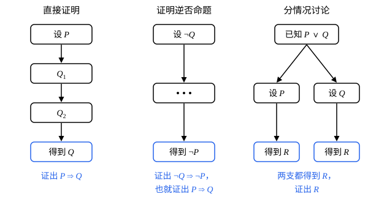

## 这一节要回答的问题

「两个奇数的积是奇数」「若$n^2$是偶数，则$n$是偶数」都是中学就知道的事，可怎样写出一个挑不出毛病的证明？要说一个命题对每个整数都成立，验算再多的例子也不够；要说它不成立，一个例子就够了。从条件出发推不动的时候，还能换一条什么路？

## 讲解

### 从条件出发

先证明两个奇数的积是奇数，这里的奇数指能写成$2k+1$（$k$是整数）的整数。设$m$、$n$是奇数，则有整数$k$、$l$使$m=2k+1$，$n=2l+1$。于是$mn=4kl+2k+2l+1=2(2kl+k+l)+1$，而$2kl+k+l$是整数，所以$mn$是奇数。

::anchor{id="def-direct-proof"}
从条件出发，每一步都由条件、已经推出的结论或已知的定义、定理得到，一步一步推出结论，这样的证明叫作:term[直接证明]{id="math.logic-sets.direct-proof"}（direct proof）。

为什么这样定义：每一步「由$Q_1$得到$Q_2$」都是一个成立的$Q_1\Rightarrow Q_2$，由[蕴含与充要条件](lesson:math.logic-sets.implication#thm-chain)里的定理，一步步接起来，就是「若条件成立，则结论成立」。条件不成立时，按:term[蕴含]{id="math.logic-sets.implication"}（implication）的定义它本来就为真，不用讨论。

边界情况：从结论往回推出一个成立的式子，不能说明结论成立。从「$-1=1$」两边平方，得到成立的「$1=1$」，可$-1=1$是错的：这只证了「若$-1=1$，则$1=1$」，方向反了。往回推的草稿怎样改写成证明，见第 8 题。

### 任取一个与造出一个

开头证的其实是一个:term[全称量词命题]{id="math.logic-sets.universal-statement"}（universal statement）：对所有奇数$m$、$n$，$mn$都是奇数。证明里的$m$、$n$是任取的，只用了「是奇数」这一条，所以推理对每一对奇数都适用。证$\forall x\in A,\ P(x)$就这样做：任取$x\in A$，关于它只用「$x\in A$」，推出$P(x)$。

证:term[存在量词命题]{id="math.logic-sets.existential-statement"}（existential statement）$\exists x\in A,\ P(x)$，只要造出$A$中的一个元素，验证它使$P(x)$成立。例如证「存在正整数$n$，使$n^2>50n+100$」，取$n=100$就行：$100^2=10000$，比$50\times100+100=5100$大。最小的这样的$n$其实是$52$，可证明用不着它：造出的只要够用，不必最小。

### 反例

看命题「对每个素数$p$，$2^p-1$都是素数」。$p=2,3,5,7$时，$2^p-1$依次是$3$、$7$、$31$、$127$，都是素数；可$p=11$时，$2^{11}-1=2047=23\times89$，不是素数。有这一个$p$，命题就是假的。

::anchor{id="def-counterexample"}
对:term[全称量词命题]{id="math.logic-sets.universal-statement"}$\forall x\in A,\ P(x)$，$A$中使$P(x)$不成立的元素，叫作它的反例（counterexample）。

为什么这样定义：由[全称量词与存在量词](lesson:math.logic-sets.quantifiers#thm-quantifier-negation)里的定理，$\neg\bigl(\forall x\in A,\ P(x)\bigr)$和$\exists x\in A,\ \neg P(x)$:term[逻辑等价]{id="math.logic-sets.logical-equivalence"}（logical equivalence），所以全称量词命题为假就是有反例，举出一个就推翻了它。反过来，验证再多的元素也证明不了它，除非$A$只有有限个元素、个个都验证过。

边界情况：反例要在取值范围里。对「每个正整数$n$都满足$\frac1n\le1$」，$n=\frac12$使$\frac1n\le1$不成立，可$\frac12$不是正整数，不算反例，这个命题是真的。命题说成「若……则……」时，反例是满足条件、不满足结论的元素，如「若$p$是素数，则$2^p-1$是素数」的$p=11$。

### 改证逆否命题

看命题「若实数$a$、$b$满足$a+b\ge2$，则$a\ge1$或$b\ge1$」。从$a+b\ge2$往下推，不知道该推向$a$还是$b$。它的:term[逆否命题]{id="math.logic-sets.contrapositive"}（contrapositive）是「若$a<1$且$b<1$，则$a+b<2$」：由:term[德摩根律]{id="math.logic-sets.de-morgan-laws"}（De Morgan's laws），「$a\ge1$或$b\ge1$」的:term[否定]{id="math.logic-sets.negation"}（negation）是「$a<1$且$b<1$」。这一句一行就证完：两个不等式相加，得$a+b<2$。

由[蕴含与充要条件](lesson:math.logic-sets.implication#thm-contrapositive)里的定理，原命题和逆否命题同真同假，所以原命题也证完了。数学书里说「改证逆否命题」「用逆否形式证明」（proof by contraposition），本节标题说「逆否证明」，都是指这样做：要证$P\Rightarrow Q$，设$\neg Q$，推出$\neg P$。它仍是:term[直接证明]{id="math.logic-sets.direct-proof"}，只是证的是$\neg Q\Rightarrow\neg P$；从条件推不动、结论的否定却好算时，就可以这样证。

证「$P$当且仅当$Q$」，由:term[充要条件]{id="math.logic-sets.necessary-sufficient-condition"}（necessary and sufficient condition）的定义，要证$P\Rightarrow Q$和$Q\Rightarrow P$两个方向，可以各用各的办法，见例 1。

### 证「或」与用「或」

看命题「若实数$a$、$b$满足$ab=0$，则$a=0$或$b=0$」。设$a\ne0$，则$b=\frac{ab}a=0$；$a=0$时，结论本来就成立。所以证「$a=0$或$b=0$」，只需设前一半不成立，推出后一半。

::anchor{id="thm-or-proof"}
**定理**　$P\lor Q\iff(\neg P\Rightarrow Q)$。

**证明**：由[蕴含与充要条件](lesson:math.logic-sets.implication#thm-implication-or)里的定理，$\neg P\Rightarrow Q$和$\neg\neg P\lor Q$:term[逻辑等价]{id="math.logic-sets.logical-equivalence"}；$\neg\neg P$和$P$逻辑等价，所以$\neg P\Rightarrow Q$和$P\lor Q$逻辑等价。

$P\lor Q$和$Q\lor P$逻辑等价，所以也可以设$Q$不成立、推出$P$，哪个顺手设哪个。

再看手里有「$P$或$Q$」时怎样用。例如对实数$a$、$b$，要证$\max\{a,b\}+\min\{a,b\}=a+b$：$a\ge b$和$a<b$总有一个成立；$a\ge b$时左边是$a+b$，$a<b$时左边是$b+a$，两种情形都等于右边。

::anchor{id="thm-cases"}
**定理（:term[分情况讨论]{id="math.logic-sets.proof-by-cases"}，proof by cases）**　若$P\lor Q$、$P\Rightarrow R$、$Q\Rightarrow R$都成立，则$R$成立。

**证明**：$P\lor Q$成立，所以$P$、$Q$至少有一个为真。$P$为真时，$R$不能为假，否则$P\Rightarrow R$条件真、结论假，不成立；$Q$为真时同理。所以$R$为真。

情形多于两种也一样，只要各种情形合起来不漏。

上面的等式交换$a$、$b$后，条件和结论都不变，$a<b$的情形对调字母就成了$a\ge b$的情形，所以可以「不妨设$a\ge b$」（without loss of generality），只证这一种。换元也行：证「实数$x\ne0$时$x^2>0$」，把$x$换成$-x$，条件和结论都不变，可以不妨设$x>0$。要写清另一种怎样化过来；对调或换元以后条件或结论变了，就化不过来。

### 唯一性

要求余数在$0$到$4$之间时，$17$除以$5$只能写成$17=3\times5+2$，不能写成$17=2\times5+7$。

::anchor{id="thm-remainder-unique"}
**定理（:term[余数的唯一性]{id="math.logic-sets.remainder-uniqueness"}，uniqueness of remainder）**　设$n$是正整数，$a$是整数。把$a$写成$a=qn+r$，其中$q$、$r$是整数，$0\le r<n$，这样的写法只有一种。

能这样写是中学学过的带余除法（division with remainder），这里只证唯一。

**证明**：设$a=qn+r=q'n+r'$，两种写法都满足条件。则$r'-r=n(q-q')$，记$k=q-q'$，它是整数。由$0\le r<n$和$0\le r'<n$得$-n<r'-r<n$，即$-n<nk<n$，两边除以正数$n$得$-1<k<1$，所以$k=0$。于是$q'=q$，$r'=r$。

所以说「$a$除以$n$的余数」，指的就是这个唯一的$r$。

证「满足条件的至多有一个」，常像上面这样，设有两个都满足条件的，推出它们相等；也可以设有两个不同的，推出矛盾，这是:term[反证法]{id="math.logic-sets.proof-by-contradiction"}（proof by contradiction）。证[恰有一个](lesson:math.logic-sets.nested-quantifiers#def-exactly-one)，就是造出一个，再证至多一个。

## 几何图像

每个方框是论证里的一句话，箭头是有依据的推理；右图上面的分叉不是推理，表示分成两种情形。左图是:term[直接证明]{id="math.logic-sets.direct-proof"}，从条件一步步走到结论，证出$P\Rightarrow Q$。中图走的是另一条路：起点是结论的:term[否定]{id="math.logic-sets.negation"}，终点是条件的否定，证出的是:term[逆否命题]{id="math.logic-sets.contrapositive"}$\neg Q\Rightarrow\neg P$，靠它和$P\Rightarrow Q$同真同假，才算证完了原命题。

右图的两支各是一个完整的论证，两支都要走到$R$，少一支就漏了一种情形。证「$P$或$Q$」也是一条从否定出发的路：起点是「设$\neg P$」，终点是$Q$。

## 例题

### 例 1　$n$是偶数当且仅当$n^2$是偶数

设$n$是整数。证明：$n$是偶数，当且仅当$n^2$是偶数。

**为什么想到这么做**：「当且仅当」要两个方向分开证。反方向由$n^2=2j$看不出$n$的样子，推不动；改证:term[逆否命题]{id="math.logic-sets.contrapositive"}，条件「$n$不是偶数」给出能算的$n=2k+1$，要证的正是开头的「两个奇数的积是奇数」。

**推导**：先证「若$n$是偶数，则$n^2$是偶数」。设$n=2k$，$k$是整数，则$n^2=4k^2=2(2k^2)$，而$2k^2$是整数，所以$n^2$是偶数。

再证「若$n^2$是偶数，则$n$是偶数」，改证它的逆否命题：设$n$不是偶数，要证$n^2$不是偶数。整数不是偶数就是奇数，所以$n$是奇数；开头证过两个奇数的积是奇数，两个都取成$n$，得$n^2$是奇数。由:term[余数的唯一性]{id="math.logic-sets.remainder-uniqueness"}，$n^2$除以$2$不能既余$1$又余$0$，所以$n^2$不是偶数，两个方向都证完了。

## 常见误区

- 「证明『两个奇数的积是奇数』，可以设这两个奇数是$2k+1$和$2k+1$。」不对：这样设，两个奇数就相等了，证出的只是「奇数的平方是奇数」。两个任取的奇数要各用一个字母，写成$2k+1$、$2l+1$；任取的对象之间，除了条件给的，不能再添别的关系。
- 「要证『若$n^2$是偶数，则$n$是偶数』，证『若$n^2$不是偶数，则$n$不是偶数』也行。」不对：后者只把条件、结论各自换成:term[否定]{id="math.logic-sets.negation"}，没有交换位置，它和原命题的:term[逆命题]{id="math.logic-sets.converse"}（converse）同真同假，和原命题却不一定。要改证的:term[逆否命题]{id="math.logic-sets.contrapositive"}是「若$n$不是偶数，则$n^2$不是偶数」，既要换成否定，又要交换位置。
- 「:term[分情况讨论]{id="math.logic-sets.proof-by-cases"}时，各种情形不能有重叠。」不对：分情况讨论的定理只要求$P\lor Q$成立，也就是各种情形合起来不漏；有重叠不要紧，例如分成$a\ge b$、$a\le b$两种，$a=b$在两种里都算，证明照样成立。要紧的是不漏：只讨论$a>b$和$a<b$，就漏了$a=b$。
- 「交换字母只是换个名字，所以总可以『不妨设$a\ge b$』。」不对：交换以后条件或结论变了，就不能这样省。「对所有实数$a$、$b$，$\max\{a,b\}=a$」是错的（$a=1$、$b=2$），可写「不妨设$a\ge b$」就把它「证」出来了。错在交换$a$、$b$以后，等式变成$\max\{a,b\}=b$，和原来的不是同一句话，$a<b$的情形化不过来。
