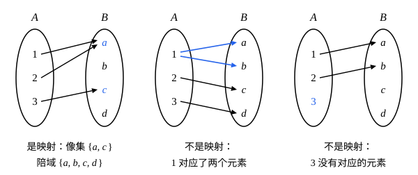

## 这一节要回答的问题

「$f(x)=x^2$」说了怎样由$x$算出$f(x)$，却没说$x$在哪里取值、$f(x)$落在哪个集合里。把每个正整数$n$对应到$\frac1n$，把两个整数组成的:term[有序对]{id="math.logic-sets.ordered-pair"}（ordered pair）对应到它们的和，也都是「每个对象对应一个结果」。怎样把这样的:term[映射]{id="math.logic-sets.map"}（map）说清楚，什么时候两个映射是同一个？

## 讲解

### 映射

数列$\frac1n$把每个正整数$n$对应到一个实数。:term[有限集]{id="math.logic-sets.finite-set"}（finite set）之间的对应可以逐个列出：$A=\{1,2,3\}$，$B=\{a,b,c,d\}$（$a$、$b$、$c$、$d$互不相同），让$1$、$2$都对应$a$，$3$对应$c$。也有不合格的：把正数$x$对应到满足$y^2=x$的实数$y$，每个$x$对应了两个数；在$\R$上让$x$对应$\frac1x$，$0$没有对应的数。

::anchor{id="def-map"}
设$A$、$B$是集合。如果按某个对应法则（rule）$f$，$A$的每个元素$x$都恰好对应$B$的一个元素，这个元素记作$f(x)$，就说$f$是从$A$到$B$的:term[映射]{id="math.logic-sets.map"}（map，也叫 mapping），记作$f:A\to B$；$A$叫作$f$的:term[定义域]{id="math.logic-sets.domain"}（domain），$B$叫作$f$的:term[陪域]{id="math.logic-sets.codomain"}（codomain）。

为什么要求恰好一个：这样$f(x)$才指得出是哪个元素。「恰好一个」就是[多重量词](lesson:math.logic-sets.nested-quantifiers#def-exactly-one)里的「至少一个」加「至多一个」：$\frac1x$那个对应在$0$处缺了前一半，$y^2=x$那个缺了后一半。$B$的元素有没有被对应到、被对应几次，定义不管。

边界情况：定义域换成$\R\setminus\{0\}$，「$x$对应$\frac1x$」就是映射。现行课本把对应法则叫「对应关系」，本站不这样叫，免得和:term[二元关系]{id="math.logic-sets.binary-relation"}（binary relation）混淆。

记号：$f:A\to B$读作「$f$是从$A$到$B$的映射」，这里的$\to$连接两个集合，不是「趋于」。$x\mapsto f(x)$读作「把$x$送到$f(x)$」，$\mapsto$连接两个元素，例如$x\mapsto x^2$是$\R\to\R$的映射。

::anchor{id="def-function"}
定义域和陪域都是$\R$的:term[子集]{id="math.logic-sets.subset"}（subset）的映射，叫作函数（function）。

为什么这样定义：中学的函数是「一个数对应一个数」，这样它就是映射的特例。只写式子、不写定义域时，默认定义域是使式子有意义的全体实数，陪域取$\R$；数列$\{a_n\}$是$\N^+\to\R$的映射，$a_n$是$n$对应的数。

边界情况：自变量是点的映射、取值是向量或复数的映射，习惯上也叫函数，如:term[多元函数]{id="math.vector-calculus.multivariable-function"}（function of several variables）、:term[向量值函数]{id="math.vector-calculus.vector-valued-function"}（vector-valued function）、:term[复变函数]{id="math.complex-analysis.complex-function"}（function of a complex variable），「函数」和「映射」常常混用，也有叫变换（transformation）、算子（operator）的。

### 像与像集

前面$\{1,2,3\}$到$\{a,b,c,d\}$的:term[映射]{id="math.logic-sets.map"}把$1$、$2$都送到$a$，把$3$送到$c$，没有元素送到$b$、$d$。

::anchor{id="def-image"}
设$f:A\to B$，$x\in A$，$f(x)$叫作$x$在$f$下的像（image）。

为什么起名：「$x$被送到的那个元素」常常要说。边界情况：不同的$x$可以有同一个像，如上面的$1$、$2$。

::anchor{id="def-range"}
$A$中所有元素的像组成的集合$\{f(x):x\in A\}$，叫作$f$的:term[像集]{id="math.logic-sets.range"}（range），记作$f(A)$；数集之间的映射的像集，就是中学说的值域。

为什么这样定义：:term[陪域]{id="math.logic-sets.codomain"}只是事先说好值落在哪个集合里，像集是实际取到的值，是陪域的:term[子集]{id="math.logic-sets.subset"}，未必相等。$x\mapsto x^2$作为$\R\to\R$的映射，像集是$[0,+\infty)$：$x^2\ge0$，每个$y\ge0$又等于$(\sqrt y)^2$；作为$\R\to[0,+\infty)$的映射，陪域就等于像集。

边界情况：英文的 range 有的书指陪域，本站指像集。线性代数把:term[线性映射]{id="math.linear-algebra.linear-map"}（linear map）$T$的像集记作$\operatorname{im}T$，叫作$T$的:term[像]{id="math.linear-algebra.image"}，那里说的「目标空间」（target space）就是陪域。

::anchor{id="def-map-equality"}
设$f:A\to B$，$g:C\to D$。如果$A=C$，$B=D$，并且每个$x\in A$都有$f(x)=g(x)$，就说$f$与$g$相等，记作$f=g$。

为什么陪域也要相同：以后讲:term[满射]{id="math.logic-sets.surjective"}（surjection）时要问$f$是否取遍了陪域，答案和陪域取哪个有关，见[单射、满射与双射](lesson:math.logic-sets.injective-surjective)。所以$\R\to\R$和$\R\to[0,+\infty)$的$x\mapsto x^2$是两个映射。

边界情况：只看这三样，不看式子。$\frac{x^2-1}{x-1}$的默认:term[定义域]{id="math.logic-sets.domain"}是$\R\setminus\{1\}$，和$x+1$的不同，两者不相等；定义域都取成$\R\setminus\{1\}$、陪域都取$\R$，它们就相等了。

### 映射的图像

函数$y=x^2$的图像是所有点$(x,x^2)$组成的抛物线。

::anchor{id="def-graph"}
:term[映射]{id="math.logic-sets.map"}$f:A\to B$的图像（graph）是:term[笛卡儿积]{id="math.logic-sets.cartesian-product"}（Cartesian product）$A\times B$的:term[子集]{id="math.logic-sets.subset"}$\{(x,f(x)):x\in A\}$。

为什么这样定义：$A$、$B$都是数集时，它就是平面上函数的图像。反过来，$A\times B$的子集$G$是某个$f:A\to B$的图像，当且仅当每个$x\in A$都恰有一个$y\in B$使$(x,y)\in G$（证明见第 5 题）；数集之间，就是每条竖直线$x=x_0$（$x_0\in A$）和$G$恰有一个交点。所以映射也可以看成一种特殊的:term[关系]{id="math.logic-sets.binary-relation"}。

边界情况：单位圆$\{(x,y):x^2+y^2=1\}$不是任何$[-1,1]\to\R$的映射的图像，$x=0$时有$y=1$、$y=-1$两个。

### 几种常见的映射

把每个元素留在原处，也是一个:term[映射]{id="math.logic-sets.map"}。

::anchor{id="def-identity-map"}
把集合$A$的每个元素映成它自己的映射$A\to A$，$x\mapsto x$，叫作$A$上的:term[恒等映射]{id="math.logic-sets.identity-map"}（identity map），记作$\mathrm{id}_A$。

为什么单独起名：以后做:term[复合]{id="math.logic-sets.composite-map"}（composition）$g\circ f$时，它就像乘法里的$1$，见[复合映射与逆映射](lesson:math.logic-sets.composition-inverse)。边界情况：$A\ne B$时，$\mathrm{id}_A$和$\mathrm{id}_B$的:term[定义域]{id="math.logic-sets.domain"}不同，是两个映射。

::anchor{id="def-constant-inclusion"}
设$b\in B$，把$A$的每个元素都映成$b$的映射$A\to B$叫作:term[常值映射]{id="math.logic-sets.constant-map"}（constant map）；$A\subseteq B$时，$A\to B$的$x\mapsto x$叫作:term[包含映射]{id="math.logic-sets.inclusion-map"}（inclusion map）。

为什么起名：两者都常用，前者让所有元素共用一个像，后者把$A$的元素当作$B$的元素。边界情况：包含映射和$\mathrm{id}_A$的对应法则一样，$A\ne B$时:term[陪域]{id="math.logic-sets.codomain"}不同，是两个映射。

把偶数映成$1$、奇数映成$0$的映射$\N\to\{0,1\}$，记下了哪些自然数是偶数。

::anchor{id="def-indicator-function"}
设$S\subseteq A$。在$S$的元素处取$1$、在$A$的其余元素处取$0$的映射$A\to\{0,1\}$，叫作$S$的:term[指示函数]{id="math.logic-sets.indicator-function"}（indicator function，也叫示性函数），记作$\mathbf 1_S$。

为什么起名：「属不属于$S$」就这样成了一个映射，由它又认得出$S$，见例 2。边界情况：$S=\varnothing$、$S=A$时它都是常值映射，一个总取$0$，一个总取$1$。

定义域也可以是:term[笛卡儿积]{id="math.logic-sets.cartesian-product"}：加法是$\Z\times\Z\to\Z$的映射$(a,b)\mapsto a+b$，这时$f((a,b))$简写成$f(a,b)$。定义域是:term[有限集]{id="math.logic-sets.finite-set"}时，映射就是一张对照表，可以画成箭头图（arrow diagram）。

## 几何图像

三幅箭头图的左边都是$A=\{1,2,3\}$，右边都是$B=\{a,b,c,d\}$（$a$、$b$、$c$、$d$互不相同），箭头从$x$指向和它对应的元素。左图每个元素恰好发出一个箭头，是:term[映射]{id="math.logic-sets.map"}；:term[像集]{id="math.logic-sets.range"}$\{a,c\}$的元素用强调色画，$b$、$d$不是任何元素的像，:term[陪域]{id="math.logic-sets.codomain"}却仍是整个$B$。中图$1$发出两个箭头，右图$3$没有箭头，都不是映射。

:::anim{component="function-plot"}
range: { x: [-2.3, 2.3], y: [-0.6, 5.4] }
functions:
  - expr: "x^2 + 0*sqrt(x - a) + 0*sqrt(2 - x)"
    label: |
      $y=x^2$，$a\le x\le2$
  - expr: "4"
    label: |
      像集的上端
  - expr: "max(a, 0)^2"
    label: |
      像集的下端
points:
  - { x: "a", y: "a^2" }
  - { x: "2", y: "4" }
sliders:
  - name: a
    min: -2
    max: 1.5
    step: 0.1
    default: -1
    label: |
      $a$
:::

曲线是$f(x)=x^2$在$[a,2]$上的部分（蓝），两端画成圆点；两条横线（橙、绿）之间的纵坐标（含两端）就是像集，$a\le0$时是$[0,4]$，$a>0$时是$[a^2,4]$。这里$f$的:term[定义域]{id="math.logic-sets.domain"}取$[a,2]$、陪域取$\R$：拖动$a$，定义域和像集跟着变，陪域始终是整条纵轴。图上横轴写作 x、纵轴写作 y，就是$x$和$f(x)$。

## 例题

### 例 1　求像集

设$f:[0,3]\to\R$，$f(x)=x^2-2x$。求$f$的:term[像集]{id="math.logic-sets.range"}$f([0,3])$。

**为什么想到这么做**：配方得$f(x)=(x-1)^2-1$，值从$f(1)=-1$到$f(3)=3$，猜像集是$[-1,3]$。证两个集合相等就证互相包含：值都在$[-1,3]$里，$[-1,3]$里的每个数也都取得到，见[集合与子集](lesson:math.logic-sets.sets#thm-set-equality)。

**推导**：$x\in[0,3]$时$-1\le x-1\le2$，所以$0\le(x-1)^2\le4$，$-1\le f(x)\le3$，即$f([0,3])\subseteq[-1,3]$。反过来，任取$y\in[-1,3]$，令$x=1+\sqrt{y+1}$，则$1\le x\le3$，并且$f(x)=(\sqrt{y+1})^2-1=y$，所以$[-1,3]\subseteq f([0,3])$。于是$f([0,3])=[-1,3]$，比:term[陪域]{id="math.logic-sets.codomain"}$\R$小；陪域改成$[-1,3]$，就是另一个:term[映射]{id="math.logic-sets.map"}，它的像集等于陪域。

### 例 2　到$\{0,1\}$的映射

$A=\{1,2,3\}$到$\{0,1\}$的:term[映射]{id="math.logic-sets.map"}有几个？它们和$A$的:term[子集]{id="math.logic-sets.subset"}有什么关系？

**为什么想到这么做**：给出映射，就是给每个元素挑一个像，每个元素两种挑法，用乘法原理（multiplication principle）。$f$由「哪些元素的像是$1$」完全确定，这正是挑一个子集。

**推导**：$1$、$2$、$3$的像各有$0$、$1$两种取法，由乘法原理，映射有$2\times2\times2=8$个。每个映射$f$给出子集$\{x\in A:f(x)=1\}$；反过来，子集$S$给出它的:term[指示函数]{id="math.logic-sets.indicator-function"}$\mathbf 1_S$。两种做法互相还原，所以映射和子集一样多，和[集合与子集](lesson:math.logic-sets.sets#thm-subset-count)里的$2^3$对上。

## 常见误区

- 「:term[陪域]{id="math.logic-sets.codomain"}就是:term[值域]{id="math.logic-sets.range"}。」不对：值域是像集，是实际取到的值；陪域只要求装得下这些值。例 1 的$f$陪域是$\R$，值域是$[-1,3]$。
- 「两个:term[映射]{id="math.logic-sets.map"}的式子一样，它们就相等。」不对：:term[定义域]{id="math.logic-sets.domain"}、陪域也要一样。$\Z\to\Z$和$\Z\to\R$的$n\mapsto2n$式子相同，陪域不同，是两个映射。
- 「映射要求$B$的每个元素都是某个元素的像。」不对：定义只要求$A$的每个元素恰有一个像，$B$的元素可以不是任何元素的像，例如$\R\to\R$的$x\mapsto x^2$，负数都不是像。每个元素都是像，是:term[满射]{id="math.logic-sets.surjective"}的要求，见[单射、满射与双射](lesson:math.logic-sets.injective-surjective)。
- 「$f$和$f(x)$是一回事。」不对：$f$是映射，$f(x)$是$x$的像，是陪域里的一个元素。常说的「函数$f(x)=x^2$」是简便说法，指的是映射$x\mapsto x^2$。
