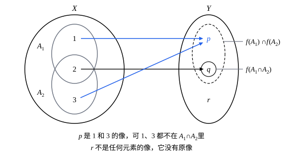

## 这一节要回答的问题

:term[映射]{id="math.logic-sets.map"}（map）把元素逐个送过去，也就把一整个集合送了过去；反过来也可以问，哪些元素会被送进给定的集合。拓扑里问开集（open set）的:term[原像]{id="math.logic-sets.preimage"}（preimage）是不是开集，概率论里问「哪些结果的取值不超过$x$」，都是后一种问题。先取并再送过去，和先送过去再取并，结果一样吗？换成交和补，换成倒过来找，又怎样？

## 讲解

### 子集的像与原像

本节的:term[映射]{id="math.logic-sets.map"}写成$f:X\to Y$（[映射](lesson:math.logic-sets.functions)一节写的是$f:A\to B$），$A$、$B$留给:term[子集]{id="math.logic-sets.subset"}（subset）。取$f:\R\to\R$，$f(x)=x^2$：把$[1,2]$里的数送过去，得到$[1,4]$；被送进$[1,4]$的，却还有$[-2,-1]$里的数。

::anchor{id="def-image-of-subset"}
设$f:X\to Y$，$A\subseteq X$。把$A$的元素逐个送过去，得到的集合$f(A)=\{f(x):x\in A\}$，叫作$A$在$f$下的像（image）。

为什么这样定义：常要问$X$的一部分被送到哪里，如函数在一段区间上取哪些值；$A=X$时，它就是:term[像集]{id="math.logic-sets.range"}（range）$f(X)$，见[映射](lesson:math.logic-sets.functions#def-range)，别的子集的像不叫像集。边界情况：$f(\{x\})=\{f(x)\}$，$f(\varnothing)=\varnothing$；$f(x)$是$Y$的元素，$f(A)$是$Y$的子集，同一个$f$，两种用法。

::anchor{id="def-preimage"}
设$f:X\to Y$，$B\subseteq Y$。被$f$送进$B$的元素组成的集合$f^{-1}(B)=\{x\in X:f(x)\in B\}$，叫作$B$在$f$下的:term[原像]{id="math.logic-sets.preimage"}（preimage），也叫逆像（inverse image）；$f^{-1}(\{y\})$的元素，也叫作$y$的原像。

为什么这样定义：$x\in f^{-1}(B)$就是$f(x)\in B$，求原像就是解这个条件；解方程$f(x)=y$，求的就是$\{y\}$的原像$f^{-1}(\{y\})$。掷两颗骰子，$f$把结果$(i,j)$送到点数之和$i+j$，「和不超过$3$」就是$f^{-1}(\{2,3\})=\{(1,1),(1,2),(2,1)\}$，概率论就这样把一句话变成一个集合。

$f^{-1}(B)$是一个整体的记号，任何映射都能取，不要求$f$有:term[逆映射]{id="math.logic-sets.inverse-map"}（inverse map，也记作$f^{-1}$，见[复合映射与逆映射](lesson:math.logic-sets.composition-inverse)），和$\frac1f$也无关。边界情况：$f^{-1}(\varnothing)=\varnothing$，$f^{-1}(Y)=X$；$f(x)=x^2$时，$f^{-1}(\{4\})=\{-2,2\}$，$f^{-1}(\{0\})=\{0\}$，$f^{-1}(\{-1\})=\varnothing$，$\{y\}$的原像不一定恰有一个元素。

### 原像保持并、交、补

$x$在不在$f^{-1}(B)$里，只看$f(x)$这一个元素在不在$B$里，所以「或」「且」「非」都能原样搬过来。「保持并」指先取并再取:term[原像]{id="math.logic-sets.preimage"}，和先取原像再取并，结果一样；交、补同样。

::anchor{id="thm-preimage-operations"}
**定理**　设$f:X\to Y$，$\{B_i\}_{i\in I}$是$Y$的:term[子集]{id="math.logic-sets.subset"}组成的:term[集族]{id="math.logic-sets.family-of-sets"}（family of sets），$B\subseteq Y$。(1) $f^{-1}\bigl(\bigcup_{i\in I}B_i\bigr)=\bigcup_{i\in I}f^{-1}(B_i)$；(2) $I$不是:term[空集]{id="math.logic-sets.empty-set"}（empty set）时，$f^{-1}\bigl(\bigcap_{i\in I}B_i\bigr)=\bigcap_{i\in I}f^{-1}(B_i)$；(3) $f^{-1}(Y\setminus B)=X\setminus f^{-1}(B)$。

**证明**：每条的两边都是$X$的子集，任取$x\in X$。(1) $x$属于左边，就是$f(x)\in\bigcup_{i\in I}B_i$，即有$i\in I$使$f(x)\in B_i$；这就是有$i\in I$使$x\in f^{-1}(B_i)$，即$x$属于右边。(2) 一样，只把「有$i\in I$」换成「对每个$i\in I$」。(3) $f(x)$总在$Y$里，$x$属于左边就是$f(x)\notin B$，即$x\notin f^{-1}(B)$，$x$属于右边。

原像也保持包含：$B\subseteq B'\subseteq Y$时，$f(x)\in B$推出$f(x)\in B'$，所以$f^{-1}(B)\subseteq f^{-1}(B')$。

(1)、(2) 里的:term[集族的并]{id="math.logic-sets.family-union"}（union of a family）、:term[集族的交]{id="math.logic-sets.family-intersection"}（intersection of a family）见[集族的并与交](lesson:math.logic-sets.indexed-families#def-family-union-intersection)；$I=\{1,2\}$时就是两个集合的并、交。:term[补集]{id="math.logic-sets.complement"}（complement）写成$Y\setminus B$、$X\setminus f^{-1}(B)$，不写$B^{\mathrm c}$，因为两边的:term[全集]{id="math.logic-sets.universal-set"}（universal set）不同。有了 (1)、(3)，由:term[德摩根律]{id="math.logic-sets.de-morgan-laws"}（De Morgan's laws，见[集族形式](lesson:math.logic-sets.indexed-families#thm-de-morgan-families)）也能推出 (2)。

拓扑里用「开集的原像是开集」定义连续映射（continuous map，见[连续函数的严格定义](lesson:math.analysis.continuity)第 8 题），把原像和并、交、补换次序都靠这三条。

### 像保持并，不一定保持交

$y$在不在$f(A)$里，问的却是有没有$x\in A$被送到$y$。取$f(x)=x^2$，$A_1=[-1,0]$，$A_2=[0,1]$：公共元素只有$0$，$f(A_1\cap A_2)=\{0\}$，可$f(A_1)\cap f(A_2)=[0,1]$。

::anchor{id="thm-image-operations"}
**定理**　设$f:X\to Y$，$A\subseteq A'\subseteq X$，$\{A_i\}_{i\in I}$是$X$的:term[子集]{id="math.logic-sets.subset"}组成的:term[集族]{id="math.logic-sets.family-of-sets"}。(1) $f(A)\subseteq f(A')$；(2) $f\bigl(\bigcup_{i\in I}A_i\bigr)=\bigcup_{i\in I}f(A_i)$；(3) $I$不是:term[空集]{id="math.logic-sets.empty-set"}时，$f\bigl(\bigcap_{i\in I}A_i\bigr)\subseteq\bigcap_{i\in I}f(A_i)$，两边可以不相等。

**证明**：(1) $y\in f(A)$时，有$x\in A$使$f(x)=y$；$x$也属于$A'$，所以$y\in f(A')$。(2) $y$属于左边，就是有$i\in I$和$x\in A_i$使$f(x)=y$；这就是有$i\in I$使$y\in f(A_i)$，即$y$属于右边。(3) $\bigcap_{i\in I}A_i$包含于每个$A_i$，由 (1)，左边包含于每个$f(A_i)$，也就包含于右边；上面的例子里两边不相等。

为什么差一步：$y\in f(A_1)\cap f(A_2)$只说有$x_1\in A_1$、$x_2\in A_2$都被送到$y$，它们未必是同一个。「有一个$x$」和「且」一般不能换次序，和「或」却可以，所以像保持并。:term[常值映射]{id="math.logic-sets.constant-map"}（constant map）更极端：$A_1$、$A_2$非空而:term[不相交]{id="math.logic-sets.disjoint"}（disjoint）时，$f(A_1\cap A_2)=\varnothing$，$f(A_1)\cap f(A_2)$却有一个元素。复分析里，$z^2$把张角$\frac{3\pi}2$的扇形映过去，上半平面都盖了两层（见[共形映射](lesson:math.complex-analysis.conformal-maps#thm-sector-strip)），也是两个点撞到了一处。

补也一样，:term[原像]{id="math.logic-sets.preimage"}保持，像不一定：设$X=\{1,2\}$，$Y=\{a,b\}$（$a\ne b$），$f$把$1$、$2$都送到$a$，取$A=\{1\}$，则$f(X\setminus A)=\{a\}$，$Y\setminus f(A)=\{b\}$，谁也不包含谁。合起来：

| 关系、运算 | 取原像 | 取像 |
| --- | --- | --- |
| 包含 | 保持 | 保持 |
| 并（任意多个） | 保持 | 保持 |
| 交（任意多个） | 保持 | 只保证「包含于」 |
| 补 | 保持 | 可以谁也不包含谁 |

### 送过去再找回来

开头的$[1,2]$送过去再找回来，多出了$[-2,-1]$。

::anchor{id="thm-image-preimage"}
**定理**　设$f:X\to Y$，$A\subseteq X$，$B\subseteq Y$，则$A\subseteq f^{-1}(f(A))$，$f(f^{-1}(B))\subseteq B$。

**证明**：$f(A)\subseteq B$和$A\subseteq f^{-1}(B)$说的是同一件事：$A$的元素都被送进$B$。取$B=f(A)$，前一句成立，后一句就是$A\subseteq f^{-1}(f(A))$；取$A=f^{-1}(B)$，后一句成立，前一句就是$f(f^{-1}(B))\subseteq B$。

两处的左边都可以是右边的:term[真子集]{id="math.logic-sets.proper-subset"}（proper subset）。送过去再找回来，会把$A$外面、和$A$的元素撞到一处的元素也带回来；找回来再送过去，会丢掉$B$中不是像的元素，$f(x)=x^2$，$B=[-1,4]$时，$f^{-1}(B)=[-2,2]$，$f(f^{-1}(B))=[0,4]$。等号什么时候成立，见第 5、6 题。拓扑里证「紧致集（compact set）的连续像是紧致的」，要用这两条，还有像、:term[原像]{id="math.logic-sets.preimage"}都保持并。

## 几何图像

:::anim{component="function-plot"}
range: { x: [-3, 3], y: [-1.5, 5] }
functions:
  - expr: "x^2"
    label: |
      $y=x^2$
  - expr: "c"
    label: |
      $y=c$
points:
  - { x: "sqrt(c)", y: "c" }
  - { x: "-sqrt(c)", y: "c" }
sliders:
  - name: c
    min: -1
    max: 4
    step: 0.5
    default: 2
    label: |
      $c$
:::

这里$f:\R\to\R$，$f(x)=x^2$。曲线（蓝）和横线$y=c$（橙）的交点画成圆点，圆点的横坐标就是$f^{-1}(\{c\})$的元素。拖动$c$：$c>0$时有两个，$c=0$时两个圆点并成一个，$c<0$时没有交点，$\{c\}$的:term[原像]{id="math.logic-sets.preimage"}是:term[空集]{id="math.logic-sets.empty-set"}。图上横轴写作 x。

$X=\{1,2,3\}$，$Y=\{p,q,r\}$（$p$、$q$、$r$互不相同），$A_1=\{1,2\}$，$A_2=\{2,3\}$。$A_1$和$A_2$的像都是$\{p,q\}$，所以$f(A_1)\cap f(A_2)=\{p,q\}$；公共元素只有$2$，$f(A_1\cap A_2)=\{q\}$。多出来的$p$有两条来路，一条从$A_1$来，一条从$A_2$来，却没有一条从公共部分来。

## 例题

### 例 1　求像与原像

设$f:\R\to\R$，$f(x)=|x|-1$。求$f([-2,1))$、$f^{-1}([0,2])$和$f^{-1}((-\infty,-1))$。

**为什么想到这么做**：求像，先估出值的范围，再证互相包含；求:term[原像]{id="math.logic-sets.preimage"}，就把条件$f(x)\in B$一步步化简，每一步都要两头推得通。

**推导**：$x\in[-2,1)$时$0\le|x|\le2$，所以$-1\le f(x)\le1$，$f([-2,1))\subseteq[-1,1]$。反过来，任取$y\in[-1,1]$，令$x=-(y+1)$，则$-2\le x\le0$，$x\in[-2,1)$，并且$f(x)=(y+1)-1=y$。所以$f([-2,1))=[-1,1]$；只看$f(-2)=1$、$f(1)=0$，会漏掉中间取到的负值。

$0\le f(x)\le2$当且仅当$1\le|x|\le3$，所以$f^{-1}([0,2])=[-3,-1]\cup[1,3]$。$f(x)<-1$当且仅当$|x|<0$，没有这样的$x$，所以$f^{-1}((-\infty,-1))=\varnothing$。

### 例 2　一个总成立的等式

设$f:X\to Y$，$A\subseteq X$，$B\subseteq Y$。证明$f(A\cap f^{-1}(B))=f(A)\cap B$。

**为什么想到这么做**：像不一定保持交，可这里第二个集合是一整个:term[原像]{id="math.logic-sets.preimage"}：右边的$y$来自$A$中的某个$x$，$y\in B$就说明$x\in f^{-1}(B)$，正好补上差的那一步。

**推导**：$A\cap f^{-1}(B)$既包含于$A$，又包含于$f^{-1}(B)$，所以左边既包含于$f(A)$，又包含于$f(f^{-1}(B))\subseteq B$，即包含于$f(A)\cap B$。反过来，设$y\in f(A)\cap B$，有$x\in A$使$f(x)=y$；$f(x)\in B$，所以$x\in f^{-1}(B)$。于是$x\in A\cap f^{-1}(B)$，$y=f(x)$属于左边。

## 常见误区

- 「$f$有:term[逆映射]{id="math.logic-sets.inverse-map"}，$f^{-1}(B)$才有意义。」不对：$f^{-1}(B)$是一个整体的记号，指被送进$B$的那些元素组成的集合，任何:term[映射]{id="math.logic-sets.map"}都能取。
- 「$f(A_1\cap A_2)=f(A_1)\cap f(A_2)$。」不对：上面的箭头图（arrow diagram）里，$p$属于两边的像，却不是公共元素$2$的像；只保证左边包含于右边。
- 「$f(f^{-1}(B))=B$，找回来再送过去总能还原。」不对：$B$里不是像的元素找不回来。箭头图里取$B=\{q,r\}$，$f^{-1}(B)=\{2\}$，送过去只剩$\{q\}$。
- 「$x\notin A$，就有$f(x)\notin f(A)$。」不对：$f(x)=x^2$，$A=[0,1]$，$-1\notin A$，可$f(-1)=1\in f(A)$。像不一定保持补，一半毛病出在这里，另一半是$Y$里可以有不是像的元素，如讲解例子里的$b$。
