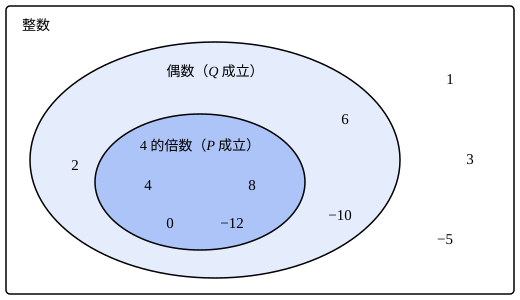

## 这一节要回答的问题

「若$n$是$4$的倍数，则$n$是偶数」是对的；反过来说「若$n$是偶数，则$n$是$4$的倍数」，却不对，$n=2$就不行。原来那句话还能怎样改写，改写以后仍然对？「若……则……」不成立，又是什么意思？「只有$P$才$Q$」和「只要$P$就$Q$」，说的是同一个方向吗？

## 讲解

### 若$P$则$Q$

开头那句话里$n$是整数，取定$n$以后，条件和结论都是命题：$n=8$时都真；$n=6$、$n=3$时条件不成立，这句话对它们什么也没说。要说它错，得找出是$4$的倍数却不是偶数的$n$，这样的$n$没有。说它对，是说它对每个整数$n$都对（怎样写成式子见[多重量词](lesson:math.logic-sets.nested-quantifiers)），这一节只看取定$n$以后的句子。

::anchor{id="def-implication"}
对命题$P$、$Q$，「若$P$则$Q$」也是一个:term[复合命题]{id="math.logic-sets.compound-proposition"}（compound proposition），叫作:term[蕴含]{id="math.logic-sets.implication"}（implication），记作$P\Rightarrow Q$，读作「$P$推出$Q$」或「$P$蕴含$Q$」；$P$叫作条件，$Q$叫作结论。它只在$P$真、$Q$假时为假，其余三种情形都为真。

列成:term[真值表]{id="math.logic-sets.truth-table"}（truth table）：

| $P$ | $Q$ | $P\Rightarrow Q$ |
| --- | --- | --- |
| 真 | 真 | 真 |
| 真 | 假 | 假 |
| 假 | 真 | 真 |
| 假 | 假 | 真 |

为什么条件不成立时算真：「若$P$则$Q$」只对$P$成立的情形作了担保，$P$不成立时它什么也没说，也就推翻不了。边界情况：「若$1>2$，则$1=3$」条件不成立，是真命题；「若$2>1$，则$1=3$」条件真、结论假，是假命题。

定理里写$P\Rightarrow Q$，是断言它为真。$\Rightarrow$和$\land$、$\lor$或别的$\Rightarrow$混写时加括号，如$(P\land Q)\Rightarrow R$；$\neg$照旧只管紧跟的字母或括号；$\iff$两边各算一个整体。

::anchor{id="thm-implication-or"}
**定理**　$P\Rightarrow Q\iff\neg P\lor Q$。

**证明**：$P\Rightarrow Q$只在$P$真、$Q$假时为假；$\neg P\lor Q$为假要$\neg P$、$Q$都假，也只在这一行。两边每一行真假都相同，由:term[逻辑等价]{id="math.logic-sets.logical-equivalence"}（logical equivalence）的定义，定理成立。

用中文说，「若$P$则$Q$」就是「$P$不成立，或者$Q$成立」。

### 逆命题、否命题与逆否命题

开头那句话交换条件和结论就不对（$n=2$）；条件、结论都换成反面也不对（还是$n=2$）；既交换、又都换成反面，「若$n$不是偶数，则$n$不是$4$的倍数」却是对的。

::anchor{id="def-converse-contrapositive"}
对$P\Rightarrow Q$，交换条件和结论得到的$Q\Rightarrow P$叫作它的:term[逆命题]{id="math.logic-sets.converse"}（converse），$\neg P\Rightarrow\neg Q$叫作否命题（inverse），$\neg Q\Rightarrow\neg P$叫作:term[逆否命题]{id="math.logic-sets.contrapositive"}（contrapositive），$P\Rightarrow Q$本身叫作原命题。

为什么要分清：书上说定理「反过来不成立」，说的就是逆命题，它对不对要另外证明，或举反例（counterexample）推翻。边界情况：逆命题的逆命题是原命题；逆否命题的逆否命题是$\neg\neg P\Rightarrow\neg\neg Q$，去掉两个「非」也是原命题。

::anchor{id="thm-contrapositive"}
**定理**　原命题和逆否命题:term[逻辑等价]{id="math.logic-sets.logical-equivalence"}：$P\Rightarrow Q\iff\neg Q\Rightarrow\neg P$；逆命题和否命题也逻辑等价：$Q\Rightarrow P\iff\neg P\Rightarrow\neg Q$。原命题和逆命题却不一定同真同假。

**证明**：照:term[蕴含]{id="math.logic-sets.implication"}的定义列表，只有条件真、结论假的格为假：

| $P$ | $Q$ | $P\Rightarrow Q$ | $Q\Rightarrow P$ | $\neg P\Rightarrow\neg Q$ | $\neg Q\Rightarrow\neg P$ |
| --- | --- | --- | --- | --- | --- |
| 真 | 真 | 真 | 真 | 真 | 真 |
| 真 | 假 | 假 | 真 | 真 | 假 |
| 假 | 真 | 真 | 假 | 假 | 真 |
| 假 | 假 | 真 | 真 | 真 | 真 |

第三、六列逐行相同，第四、五列也逐行相同，所以前两条成立；第三、四列在第二、三行不同。

所以开头那句话的逆否命题也对每个$n$都对。原命题不好证时，可以改证逆否命题，见[直接证明与逆否证明](lesson:math.logic-sets.direct-proof)。

### 「若$P$则$Q$」的否定

::anchor{id="thm-implication-negation"}
**定理**　$\neg(P\Rightarrow Q)\iff P\land\neg Q$。

**证明**：$\neg(P\Rightarrow Q)$为真，就是$P\Rightarrow Q$为假，由:term[蕴含]{id="math.logic-sets.implication"}的定义即$P$真、$Q$假，也就是$P\land\neg Q$为真。两边每一行真假都相同，所以:term[逻辑等价]{id="math.logic-sets.logical-equivalence"}。

用中文说，「若$P$则$Q$」的:term[否定]{id="math.logic-sets.negation"}（negation）是「$P$成立，而$Q$不成立」：条件留着，结论取反。要推翻开头那类话，就要找满足条件、不满足结论的$n$，也就是反例。

否命题不是原命题的否定：前面那张表的第一行，原命题、否命题都真，可一个命题和它的否定总是一真一假。

### 充分条件与必要条件

「$n$是$4$的倍数」足以保证「$n$是偶数」；「$n$是偶数」则是做$4$的倍数少不了的。

::anchor{id="def-sufficient-necessary"}
$P\Rightarrow Q$成立时，说$P$是$Q$的:term[充分条件]{id="math.logic-sets.sufficient-condition"}（sufficient condition），$Q$是$P$的:term[必要条件]{id="math.logic-sets.necessary-condition"}（necessary condition）。

为什么这样叫：$P$成立就足以保证$Q$成立；由:term[逆否命题]{id="math.logic-sets.contrapositive"}，$Q$不成立时$P$一定不成立，$Q$对$P$必不可少。

边界情况：「$n$是偶数」只是「$n$是$4$的倍数」的必要条件，不是充分条件（$n=2$），即必要不充分；反过来，「$n$是$4$的倍数」是「$n$是偶数」的充分不必要条件。既不充分也不必要的见例 2。

日常说法：「只要$P$，就$Q$」说的是$P\Rightarrow Q$，$P$是充分条件；「只有$P$，才$Q$」说$P$不成立则$Q$不成立，即$Q\Rightarrow P$，$P$是必要条件。

### 充要条件

三角形三边相等，则三个角相等；反过来也对。两个方向都成立，「三边相等」和「三角相等」就是一回事。

::anchor{id="def-iff"}
如果$P\Rightarrow Q$和$Q\Rightarrow P$都成立，就说$P$是$Q$的充分必要条件，简称:term[充要条件]{id="math.logic-sets.necessary-sufficient-condition"}（necessary and sufficient condition），记作$P\iff Q$，读作「$P$当且仅当$Q$」（if and only if）。作为:term[复合命题]{id="math.logic-sets.compound-proposition"}，$P\iff Q$就是$(P\Rightarrow Q)\land(Q\Rightarrow P)$，$P$、$Q$同真同假时为真。

为什么这样定义：两个方向都成立，$P$、$Q$就总是同真同假；两个复合命题:term[逻辑等价]{id="math.logic-sets.logical-equivalence"}，就是用$\iff$连起来后每一行都真，所以$\iff$读「等价于」和读「当且仅当」是一回事。边界情况：只证了一个方向，只能说充分或必要；$P$、$Q$都假时$P\iff Q$为真，如「$1>2$当且仅当$2>3$」。

::anchor{id="def-necessity-sufficiency"}
「$P$当且仅当$Q$」拆成两半：「$P$，当$Q$」（$P$ if $Q$）说的是$Q\Rightarrow P$，「$P$仅当$Q$」（$P$ only if $Q$）说的是$P\Rightarrow Q$。说「$P$的充要条件是$Q$」时，证$P\Rightarrow Q$叫作证必要性（necessity），证$Q\Rightarrow P$叫作证充分性（sufficiency）。

为什么这样叫：$P\Rightarrow Q$说$Q$对$P$必要，$Q\Rightarrow P$说$Q$对$P$充分，标签都站在$Q$的角度，例 1 就这样写。边界情况：按「$Q$的充要条件是$P$」的说法，必要性要证的就是$Q\Rightarrow P$。

::anchor{id="thm-chain"}
**定理**　若$P\Rightarrow Q$和$Q\Rightarrow R$都成立，则$P\Rightarrow R$也成立。

**证明**：$P$真时，$Q$不能假，否则$P\Rightarrow Q$为假；同样$R$也不能假，所以$P\Rightarrow R$为真。$P$假时，$P\Rightarrow R$本来就为真。

书上说「下面几条等价」，是说任两条都能互推；由这条定理，按$(1)\Rightarrow(2)\Rightarrow\cdots\Rightarrow(1)$绕一圈证完就够了，连写的$\Rightarrow$表示一步接一步。$P\Rightarrow Q$成立时也说$P$比$Q$强、$Q$比$P$弱。

## 几何图像

大矩形里是全体整数，大椭圆里是偶数，小椭圆里是$4$的倍数。取$P$为「$n$是$4$的倍数」，$Q$为「$n$是偶数」：使$P$成立的数都落在使$Q$成立的范围里面，这就是说，对每个整数$n$，$P\Rightarrow Q$都成立。

大椭圆外面的数一定也在小椭圆外面，这是它的:term[逆否命题]{id="math.logic-sets.contrapositive"}$\neg Q\Rightarrow\neg P$；大椭圆里面的数却不一定在小椭圆里面，比如$2$，所以:term[逆命题]{id="math.logic-sets.converse"}$Q\Rightarrow P$不成立。照这幅图，:term[充分条件]{id="math.logic-sets.sufficient-condition"}是小的范围，:term[必要条件]{id="math.logic-sets.necessary-condition"}是把它套住的大的范围。

「一个范围套在另一个里面」只是帮助记忆的图像，推理不靠它。范围之间这样的「套」，以后叫作:term[子集]{id="math.logic-sets.subset"}（subset），见[集合与子集](lesson:math.logic-sets.sets)。

## 例题

### 例 1　按必要性、充分性证明充要条件

证明：实数$x$满足$x^2=x$的:term[充要条件]{id="math.logic-sets.necessary-sufficient-condition"}是「$x=0$或$x=1$」。

**为什么想到这么做**：充要条件要两个方向都证。这是「$P$的充要条件是$Q$」的说法，$P$为「$x^2=x$」，$Q$为「$x=0$或$x=1$」，所以必要性证$P\Rightarrow Q$，充分性证$Q\Rightarrow P$。

**推导**：先证必要性。设$x^2=x$，则$x(x-1)=0$；两个实数的积为$0$，其中至少有一个为$0$，所以$x=0$或$x=1$。

再证充分性。$x=0$时$x^2=0=x$，$x=1$时$x^2=1=x$，两种情形都有$x^2=x$。

### 例 2　判断是什么条件

设$a$、$b$是实数。「$a>b$」是「$a^2>b^2$」的什么条件？「$a>b>0$」呢？

**为什么想到这么做**：看两个方向各成不成立：不成立举一个反例，成立要证明。

**推导**：$a=1$、$b=-2$满足$a>b$，却有$a^2<b^2$；$a=-2$、$b=1$满足$a^2>b^2$，却有$a<b$。所以「$a>b$」既不充分也不必要。

$a>b>0$时$a-b>0$、$a+b>0$，$a^2-b^2=(a-b)(a+b)>0$，所以「$a>b>0$」是:term[充分条件]{id="math.logic-sets.sufficient-condition"}。$a=-3$、$b=1$满足$a^2>b^2$，却不满足$a>b>0$，所以它是充分不必要条件。

## 常见误区

- 「『若$P$则$Q$』的:term[否定]{id="math.logic-sets.negation"}是『若非$P$则非$Q$』。」不对：「若非$P$则非$Q$」是否命题。「若$P$则$Q$」的否定是「$P$而非$Q$」：条件留着，结论取反。
- 「原命题对，它的:term[逆命题]{id="math.logic-sets.converse"}也就对。」不对：「若$n$是$4$的倍数，则$n$是偶数」对，它的逆命题「若$n$是偶数，则$n$是$4$的倍数」却不对。逆命题要另外证明，:term[逆否命题]{id="math.logic-sets.contrapositive"}则和原命题一定同真同假。
- 「『只有$P$才$Q$』和『只要$P$就$Q$』说的是一回事。」不对：前者说的是$Q\Rightarrow P$，后者说的是$P\Rightarrow Q$。「只有$n$是偶数，$n$才是$4$的倍数」对，「只要$n$是偶数，$n$就是$4$的倍数」却不对。
- 「对实数$a$、$b$，只有$a$、$b$都是正数，$ab$才是正数。」不对，话说过头了：它说的是「若$ab>0$，则$a>0$且$b>0$」，$a=b=-1$就推翻了它；该说「只要$a$、$b$都是正数，$ab$就是正数」。写「只有」「才」之前，先查一遍别的情形是不是也行。
