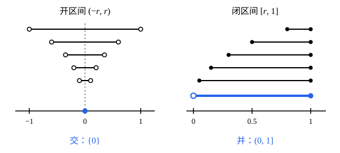

## 这一节要回答的问题

两个、三个集合的:term[并集]{id="math.logic-sets.union"}（union）、:term[交集]{id="math.logic-sets.intersection"}（intersection）好写，可数学里常要一下子并起或交起无穷多个集合：一串越来越窄的区间有没有公共点，无穷多个区间合在一起是什么。「任意多个」集合的并与交该怎样定义？:term[德摩根律]{id="math.logic-sets.de-morgan-laws"}（De Morgan's laws）还成立吗？

## 讲解

### 一族集合

对每个$n\in\N$，令$A_n=\{k\in\N:k\ge n\}$，就得到一串集合：$A_0=\N$，$A_1=\N^+$，$A_2=\{2,3,4,\dots\}$，……也可以对每个正数$r$取开区间$(-r,r)$，这时每个正实数都对应一个集合。

::anchor{id="def-family"}
设$I$是一个集合，对$I$的每个元素$i$都给定一个集合$A_i$，这样的一组集合叫作:term[集族]{id="math.logic-sets.family-of-sets"}（family of sets），记作$\{A_i\}_{i\in I}$；$I$叫作它的:term[指标集]{id="math.logic-sets.index-set"}（index set），$i$叫作指标（index）。

为什么这样定义：要说「第$i$个」「每一个」，就得给集合编上号；编号用什么都行，指标集可以是$\{1,2,\dots,n\}$、$\N$、全体正实数，甚至是一些集合组成的集合。

边界情况：不同的指标可以给出同一个集合，比如$A_1=A_2$。所以$\{A_i\}_{i\in I}$带着编号、允许重复，和数列$\{a_n\}$是同一种写法，不是集合$\{A_i:i\in I\}$，后者只看有哪些集合。严格地说，集族就是把每个$i$送到$A_i$的:term[映射]{id="math.logic-sets.map"}（map），见[映射](lesson:math.logic-sets.functions)。

### 集族的并与交

两个集合时，$x\in A_1\cup A_2$就是$x$属于其中某一个，$x\in A_1\cap A_2$就是属于其中每一个；集合有无穷多个时，「或」「且」写不完，这两句却照样说得出。

::anchor{id="def-family-union-intersection"}
对:term[集族]{id="math.logic-sets.family-of-sets"}$\{A_i\}_{i\in I}$，属于某一个$A_i$的元素组成的集合，叫作这个:term[集族的并]{id="math.logic-sets.family-union"}（union），记作$\bigcup_{i\in I}A_i$；$I$不是:term[空集]{id="math.logic-sets.empty-set"}（empty set）时，属于每一个$A_i$的元素组成的集合，叫作这个:term[集族的交]{id="math.logic-sets.family-intersection"}（intersection），记作$\bigcap_{i\in I}A_i$。也就是说，$x\in\bigcup_{i\in I}A_i$即$\exists i\in I,\ x\in A_i$，$x\in\bigcap_{i\in I}A_i$即$\forall i\in I,\ x\in A_i$。指标是$1,2,3,\dots$时写成$\bigcup_{n=1}^{\infty}A_n$、$\bigcap_{n=1}^{\infty}A_n$，叫作可数并（countable union）、可数交（countable intersection）；指标只有有限个时叫有限并（finite union）、有限交（finite intersection），不限定:term[指标集]{id="math.logic-sets.index-set"}时也说任意并（arbitrary union）、任意交（arbitrary intersection）。

为什么这样定义：$I=\{1,2\}$时，$\exists i\in I,\ x\in A_i$就是$x\in A_1\lor x\in A_2$，$\forall i\in I,\ x\in A_i$就是$x\in A_1\land x\in A_2$，正是原来的:term[并集]{id="math.logic-sets.union"}和:term[交集]{id="math.logic-sets.intersection"}；「存在」「对每个」不管集合有多少都说得完。交要求$I$不是空集，原因见第 7 题。

下标也可以写条件，$\bigcup_{r>0}$的指标集是全体正实数，和$\forall\varepsilon>0$一样。逐个看$x$属于「某一个」还是「每一个」：

- $\bigcap_{r>0}(-r,r)=\{0\}$：$0$属于每一个$(-r,r)$；$x\ne0$时，$x$不属于$\bigl(-|x|,|x|\bigr)$，不在交里。
- $\bigcup_{r>0}[r,1]=(0,1]$：这里$[r,1]$指$\{x\in\R:r\le x\le1\}$，$r>1$时是空集。$0<x\le1$时$x\in[x,1]$，在并里；$x\le0$或$x>1$时，$x$不属于任何一个$[r,1]$。

数学分析里一串区间$\{[a_n,b_n]\}$的「公共点」「公共部分」，就是这个集族的交$\bigcap_{n=1}^{\infty}[a_n,b_n]$。

边界情况：每个$A_i$都有无穷多个元素，交也可能是空集。开头的$A_n=\{k\in\N:k\ge n\}$一个比一个小，可任取$k\in\N$，都有$k\notin A_{k+1}$，所以$\bigcap_{n\in\N}A_n=\varnothing$。

一些集合组成的集合$S$，也可以拿它自己当指标集，写成$\bigcup_{X\in S}X$，$S$不是空集时还有$\bigcap_{X\in S}X$。数学分析用:term[戴德金分割]{id="math.analysis.dedekind-cut"}（Dedekind cut）造实数时，就这样把一族分割并成$\bigcup_{\alpha\in A}\alpha$。

### 德摩根律

[集合的运算](lesson:math.logic-sets.set-operations#thm-de-morgan-sets)一节证过，取:term[补集]{id="math.logic-sets.complement"}（complement）会把两个集合的:term[并集]{id="math.logic-sets.union"}、:term[交集]{id="math.logic-sets.intersection"}互换。:term[集族的并]{id="math.logic-sets.family-union"}、:term[集族的交]{id="math.logic-sets.family-intersection"}用「存在」「对每个」定义，换用否定量词命题的定理，就能推广过来。

::anchor{id="thm-de-morgan-families"}
**:term[德摩根律]{id="math.logic-sets.de-morgan-laws"}（:term[集族]{id="math.logic-sets.family-of-sets"}形式）**　设$\{A_i\}_{i\in I}$是集族，$I$不是:term[空集]{id="math.logic-sets.empty-set"}，每个$A_i$都是:term[全集]{id="math.logic-sets.universal-set"}（universal set）$U$的:term[子集]{id="math.logic-sets.subset"}（subset），则$\bigl(\bigcup_{i\in I}A_i\bigr)^{\mathrm c}=\bigcap_{i\in I}A_i^{\mathrm c}$，$\bigl(\bigcap_{i\in I}A_i\bigr)^{\mathrm c}=\bigcup_{i\in I}A_i^{\mathrm c}$。

**证明**：两边都是$U$的子集（$I$不是空集，交才有定义），只需看$U$中的$x$。$x\in\bigl(\bigcup_{i\in I}A_i\bigr)^{\mathrm c}$就是$\neg\bigl(\exists i\in I,\ x\in A_i\bigr)$，由[全称量词与存在量词](lesson:math.logic-sets.quantifiers#thm-quantifier-negation)里否定量词命题的定理，它和$\forall i\in I,\ x\notin A_i$同真同假。对$U$中的$x$，$x\notin A_i$就是$x\in A_i^{\mathrm c}$，所以这正是$x\in\bigcap_{i\in I}A_i^{\mathrm c}$；两边的元素完全相同，第一条成立。

第二条同样：$x\in\bigl(\bigcap_{i\in I}A_i\bigr)^{\mathrm c}$就是$\neg\bigl(\forall i\in I,\ x\in A_i\bigr)$，由同一个定理，它和$\exists i\in I,\ x\notin A_i$同真同假，也就是$x\in\bigcup_{i\in I}A_i^{\mathrm c}$。

用中文说：一个$A_i$也不属于，就是属于每一个$A_i^{\mathrm c}$；并非属于每一个$A_i$，就是至少不属于其中一个，即属于某一个$A_i^{\mathrm c}$。分配律也能推广到集族，见第 5 题。

### 两两不相交

全体正数、全体负数和$\{0\}$，任意两个都没有公共元素，合起来是$\R$。

::anchor{id="def-pairwise-disjoint"}
若:term[集族]{id="math.logic-sets.family-of-sets"}$\{A_i\}_{i\in I}$中任意两个指标不同的集合都:term[不相交]{id="math.logic-sets.disjoint"}（disjoint），即对$I$中任意两个不同的$i$、$j$，都有$A_i\cap A_j=\varnothing$，就说这个集族:term[两两不相交]{id="math.logic-sets.pairwise-disjoint"}（pairwise disjoint）。

为什么这样定义：两两不相交，就是每个元素$x$至多对一个指标$i$满足$x\in A_i$；把一个集合分成互不重叠的几块，要的正是这一条。一些集合组成的集合$S$拿自己当:term[指标集]{id="math.logic-sets.index-set"}时，两两不相交就是$S$中任意两个不同的集合都不相交。[等价关系与商集](lesson:math.logic-sets.equivalence-relations)里的:term[划分]{id="math.logic-sets.partition"}（partition），就是这样一组非空、并起来是整个集合的块。

边界情况：两两不相交和「所有$A_i$的交是:term[空集]{id="math.logic-sets.empty-set"}」不同。$\{1,2\}$、$\{2,3\}$、$\{3,1\}$三个一起的交是空集，可其中任意两个都有公共元素，不是两两不相交的。

## 几何图像

左图叠画了开区间$(-r,r)$中的五个，$r$越小，区间越短，$0$处的竖虚线穿过每一个。$r$取遍所有正数时，每个$x\ne0$迟早被挤出去，交只剩下$0$。

右图叠画了$[r,1]$中的五个，$r$越小，区间越长；每个$0<x\le1$都在$r=x$的那一个里，$0$却不在任何一个里，所以并是$(0,1]$，左端画成空心圆。图上只画得出有限个区间，结论要靠讲解里逐个元素的论证。

## 例题

### 例 1　倍数的并与交

对每个整数$n\ge2$，令$A_n$是$\N$中$n$的倍数组成的集合，这里$k$是$n$的倍数，指有整数$m$使$k=mn$。求$\bigcup_{n=2}^{\infty}A_n$和$\bigcap_{n=2}^{\infty}A_n$。

**为什么想到这么做**：按定义，对每个自然数$k$问：它属于某一个$A_n$吗？属于每一个吗？先试小的数：$0=0\cdot n$是每个$n$的倍数，$1$却不像是任何$n\ge2$的倍数。

**推导**：先求并。$k\ge2$时$k=1\cdot k$，$k\in A_k$；$0$也属于每个$A_n$。$1=mn$要求$m=\frac1n$，它不是整数，所以$1$不属于任何一个$A_n$。于是$\bigcup_{n=2}^{\infty}A_n=\N\setminus\{1\}$。

再求交。$0$属于每一个$A_n$。$k\ge1$时，$k+1$在$\N$中的倍数是$0$、$k+1$、$2(k+1)$、……，$k$夹在$0$和$k+1$之间，不是其中之一，所以$k\notin A_{k+1}$，不在交里。于是$\bigcap_{n=2}^{\infty}A_n=\{0\}$。

### 例 2　改成两两不相交

设$B_1,B_2,B_3,\dots$是一串集合。令$C_1=B_1$，$n\ge2$时$C_n=B_n\setminus(B_1\cup\cdots\cup B_{n-1})$。证明$\{C_n\}_{n\in\N^+}$:term[两两不相交]{id="math.logic-sets.pairwise-disjoint"}，并且$\bigcup_{n=1}^{\infty}C_n=\bigcup_{n=1}^{\infty}B_n$。

**为什么想到这么做**：让每个元素只留在它第一次出现的那个$B_n$里，重叠就去掉了，元素却一个也不少；$C_n$正是$B_n$里前面没出现过的元素。

**推导**：先证两两不相交。任取两个不同的指标，记小的为$m$、大的为$n$。$C_n$的元素不属于$B_1\cup\cdots\cup B_{n-1}$，当然不属于$B_m$；而$C_m\subseteq B_m$，所以$C_m\cap C_n=\varnothing$。

再证两边互相包含。每个$C_n\subseteq B_n$，属于某个$C_n$的元素也属于$B_n$，所以左边是右边的:term[子集]{id="math.logic-sets.subset"}。反过来，设$x$属于右边，即有$m$使$x\in B_m$；$1,2,\dots,m$中使$x\in B_n$的$n$至少有一个，在这有限个里取最小的$n$，则$x\in B_n$，而$x$不属于$B_1,\dots,B_{n-1}$，所以$x\in C_n$，$x$属于左边。

## 常见误区

- 「一族集合的交是:term[空集]{id="math.logic-sets.empty-set"}，它们就:term[两两不相交]{id="math.logic-sets.pairwise-disjoint"}。」不对：讲解里的$A_n=\{k\in\N:k\ge n\}$交是空集，可$m<n$时$A_m\cap A_n=A_n$，任意两个都相交。
- 「取:term[补集]{id="math.logic-sets.complement"}时，把每个$A_i$换成$A_i^{\mathrm c}$就行，并还是并。」不对：由:term[德摩根律]{id="math.logic-sets.de-morgan-laws"}，并的补集是补集的交。:term[全集]{id="math.logic-sets.universal-set"}取$\N$，还用上面的$A_n$，$\bigl(\bigcup_{n\in\N}A_n\bigr)^{\mathrm c}=\N^{\mathrm c}=\varnothing$，而$A_n^{\mathrm c}=\{k\in\N:k<n\}$，$\bigcup_{n\in\N}A_n^{\mathrm c}=\N$。
