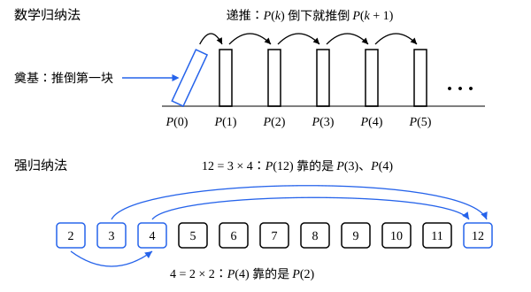

## 这一节要回答的问题

把前几个奇数加起来：$1=1^2$，$1+3=2^2$，$1+3+5=3^2$，$1+3+5+7=4^2$，看样子前$n$个奇数的和总是$n^2$。要说它对每个正整数$n$都成立，就得验证无穷多个等式，一个一个算永远算不完；算了很多个都对，下一个照样可能不对。怎样用有限的几步论证，管住所有的$n$？

## 讲解

### 归纳原理

推倒第一块骨牌，又保证每一块倒下都推倒下一块，所有的骨牌就都会倒。奇数的和也能这样证：$n=1$时$1=1^2$成立；设对某个正整数$k$成立，即前$k$个奇数的和是$k^2$，两边加上第$k+1$个奇数$2k+1$，右边成了$k^2+2k+1=(k+1)^2$，对$k+1$也成立。于是对$1$成立就对$2$成立，对$2$成立就对$3$成立……一步步走遍所有正整数。本站的$\N$含$0$，下面的原理从$0$说起。

::anchor{id="thm-induction-principle"}
**归纳原理（principle of mathematical induction）**　设$P(n)$是含有变量$n$的语句，$n$在$\N$里取值。若$P(0)$成立，并且对每个$k\in\N$，由$P(k)$成立能推出$P(k+1)$成立，则$P(n)$对所有$n\in\N$都成立。

这条原理不是由逻辑规则推出来的，是当作自然数的基本性质承认的：自然数正是从$0$起一次加$1$得到的，原理说的就是这件事，拿它刻画自然数见[皮亚诺公理与递归定义](lesson:math.logic-sets.peano-axioms)。各书的$\N$含不含$0$不一样；从别的整数起，是同一个原理，见下面的定理。

::anchor{id="thm-induction-start"}
**定理**　设$n_0$是整数，$P(n)$是含有变量$n$的语句，$n$取不小于$n_0$的整数。若$P(n_0)$成立，并且对每个整数$k\ge n_0$，由$P(k)$能推出$P(k+1)$，则$P(n)$对所有整数$n\ge n_0$都成立。

**证明**：对$m\in\N$，记$Q(m)$为「$P(n_0+m)$成立」。$Q(0)$就是$P(n_0)$，成立；对每个$m\in\N$，取$k=n_0+m\ge n_0$，由条件，$Q(m)$能推出$Q(m+1)$。由归纳原理，$Q(m)$对所有$m\in\N$成立，即$P(n)$对所有整数$n\ge n_0$成立。

::anchor{id="def-induction"}
用归纳原理和上面的定理证明「$P(n)$对所有整数$n\ge n_0$成立」，这种方法叫作:term[数学归纳法]{id="math.logic-sets.mathematical-induction"}（mathematical induction）。它分两步：证明$P(n_0)$成立，叫作归纳奠基（base case）；对每个整数$k\ge n_0$，证明由$P(k)$能推出$P(k+1)$，叫作归纳递推（inductive step），其中假设成立的$P(k)$叫作归纳假设（induction hypothesis）。

为什么要这两步：奠基推倒第一块，递推保证每一块都推倒下一块，少一步都不行。只有递推不行：$P(n)$取「$n>n+1$」，由$k>k+1$得$k+1>k+2$，递推成立，$P(n)$却对哪个$n$都不成立。只有奠基、再多验证几个也不行：[全称量词与存在量词](lesson:math.logic-sets.quantifiers)的常见误区里，$n^2+n+41$在$n=0,1,\dots,39$时都是素数，$n=40$时却不是。

书上常把两步缩成一句：「$n=1$时成立；设$n$时成立……」「第一项满足；若第$n$项满足，则第$n+1$项也满足」都是简写，「设$n$时成立」就是归纳假设；「由归纳法」「归纳可知」只写结论，「对$n$归纳」点明对哪个变量归纳。读到这样的话，要能自己补出奠基和递推。

数列常常只给出第一项和由前一项算后一项的规则，如$a_0=1$，$a_{n+1}=2a_n$；由归纳原理，每一项都有定义，严格的讲法见[皮亚诺公理与递归定义](lesson:math.logic-sets.peano-axioms)。

### 强归纳法

再看「每个大于$1$的整数都能写成素数的乘积」，一个素数本身也算。递推时手里只有「$k$能写成素数的乘积」，可$12=3\times4$要用的是$3$和$4$，和$11$不相干：递推时要能用上前面所有的数。

::anchor{id="thm-strong-induction"}
**定理（:term[强归纳法]{id="math.logic-sets.strong-induction"}，strong induction）**　设$n_0$是整数，$P(n)$是含有变量$n$的语句，$n$取不小于$n_0$的整数。若$P(n_0)$成立，并且对每个整数$k\ge n_0$，由「$n_0\le m\le k$时$P(m)$都成立」能推出$P(k+1)$，则$P(n)$对所有整数$n\ge n_0$都成立。用这个定理证明的方法叫作强归纳法，也叫第二数学归纳法，它的归纳假设是$P(n_0)$、$P(n_0+1)$、…、$P(k)$都成立。

**证明**：对整数$n\ge n_0$，记$Q(n)$为「$n_0\le m\le n$时$P(m)$都成立」。$Q(n_0)$就是$P(n_0)$，成立。若$Q(k)$成立，由条件，$P(k+1)$成立，连同$Q(k)$就是$Q(k+1)$。由:term[数学归纳法]{id="math.logic-sets.mathematical-induction"}，$Q(n)$对所有整数$n\ge n_0$成立，其中就有$P(n)$。

归纳假设多了，递推更好证，所以叫「强」；可它是用普通的数学归纳法证出来的，能证的命题并不更多。边界情况：$k=n_0$时归纳假设只有$P(n_0)$，而$P(n_0)$本身前面没有数可用，只能单独证明，所以强归纳法也少不了奠基。

::anchor{id="thm-prime-product"}
**定理**　每个大于$1$的整数都能写成素数的乘积。

**证明**：用强归纳法，$n_0=2$。$2$是素数，本身就是一个乘积。设$2\le m\le k$时$m$都能写成素数的乘积，看$k+1$：它是素数时已经是；不是素数时，它有正因数$a$满足$1<a<k+1$，记$b=\frac{k+1}a$，则$b$也是整数且$1<b<k+1$。这样$a$、$b$都在$2$和$k$之间，由归纳假设，它们都能写成素数的乘积，乘起来就是$k+1=ab$的写法。

### 良序原理

[反证法与证明方法的选择](lesson:math.logic-sets.proof-methods#thm-prime-divisor)里取最小的因数，靠的是「有限个整数（至少一个）里有最小的」。对无穷多个正整数，也是这样。

::anchor{id="def-well-ordering"}
正整数组成的非空集合里一定有最小的数，这叫作良序原理（well-ordering principle）。

为什么：它和归纳原理可以互相推出，证明见第 5 题，拿哪一条当自然数的基本性质都行。用它证明时常「取最小的反例（counterexample）」：设有不成立的正整数，取最小的一个，推出矛盾。同样，非空的整数集合里的数都不超过某个整数$M$时，其中有最大的数，把每个数$s$换成$M+1-s$就化成上面的情形。边界情况：对正实数不成立，$x>0$时$\frac x2$更小，正实数里没有最小的数。

## 几何图像

上排是:term[数学归纳法]{id="math.logic-sets.mathematical-induction"}：奠基推倒$P(0)$那一块，递推让每一块倒下时推倒紧挨着的下一块，于是一块接一块全倒。下排是:term[强归纳法]{id="math.logic-sets.strong-induction"}：证$P(12)$时用的是$P(3)$和$P(4)$，证$P(4)$时用的是$P(2)$，每一块可以靠前面任意几块，不必是紧挨着的那一块。

## 例题

### 例 1　先猜后证

求$2^0+2^1+\dots+2^n$，这里$n\in\N$。

**为什么想到这么做**：先算几项、猜出通式，再用:term[数学归纳法]{id="math.logic-sets.mathematical-induction"}证明，是常用的做法。$n=0,1,2,3,4$时，和依次是$1,3,7,15,31$，都比$2$的幂少$1$，猜和是$2^{n+1}-1$；它只对这几个$n$验证过，还要证明。$n$从$0$起，奠基验证的就是$n=0$。

**推导**：记$P(n)$为「$2^0+2^1+\dots+2^n=2^{n+1}-1$」。奠基：$n=0$时左边是$2^0=1$，右边是$2^1-1=1$，成立。递推：设$P(k)$成立，即$2^0+\dots+2^k=2^{k+1}-1$，两边加上$2^{k+1}$，右边成了$2\cdot2^{k+1}-1=2^{k+2}-1$，这正是$P(k+1)$。由数学归纳法，对每个$n\in\N$，和都是$2^{n+1}-1$。

### 例 2　用强归纳法

证明：每个正整数都能写成若干个互不相同的$2$的幂之和，这里$2^0=1$也算$2$的幂，例如$13=8+4+1$。

**为什么想到这么做**：$k+1$是偶数$2j$时，把$j$的写法里每个幂乘$2$，就得到它的写法；要用的是只有它一半大的$j$，不是$k$，所以用:term[强归纳法]{id="math.logic-sets.strong-induction"}。

**推导**：用强归纳法，$n_0=1$。$1=2^0$。设$1\le m\le k$时$m$都能这样写，看$k+1\ge2$：若$k+1=2j$，则$1\le j\le k$，把$j$的写法里每个$2^i$换成$2^{i+1}$，仍然互不相同，和是$2j$。

若$k+1=2j+1$，则$k+1\ge3$，$1\le j\le k$；照上面写出$2j$，用到的幂都不小于$2^1$，再加上$2^0$，仍然互不相同，和是$2j+1$。所以$k+1$也能这样写。

## 常见误区

- 「每一步看起来都对，归纳证明就没问题。」记$P(n)$为「任意$n$匹马颜色都相同」，有人这样「证明」它对所有正整数$n$成立：$P(1)$显然；设$P(k)$成立，任取$k+1$匹马，去掉第一匹、去掉最后一匹，各剩$k$匹，都同色，两组有公共的马，所以全都同色。错在递推并没有对每个$k\ge1$都成立：$k=1$时两组各只有$1$匹，没有公共的马，由$P(1)$推不出$P(2)$。
- 「验证了$P(1)$、$P(2)$、$P(3)$，再写『依此类推』，就是用了:term[数学归纳法]{id="math.logic-sets.mathematical-induction"}。」不对：「依此类推」只是相信规律会一直保持下去，并没有证明递推。递推要对每个$k\ge n_0$证明由$P(k)$能推出$P(k+1)$，验证再多个$n$也代替不了它。
- 「:term[强归纳法]{id="math.logic-sets.strong-induction"}的归纳假设多，能证明普通的数学归纳法证不了的命题。」不对：讲解里正是用普通的数学归纳法证明了强归纳法。强归纳法只是让递推好写：要用的不是紧挨着的前一个时，不必自己去造那个命题$Q(n)$。
