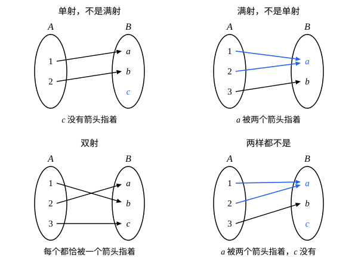

## 这一节要回答的问题

方程$f(x)=y$对哪些$y$有解，解是不是只有一个？:term[映射]{id="math.logic-sets.map"}（map）只要求每个$x$恰有一个像（image）；反过来，每个$y$是不是也恰是一个$x$的像？中学说实数和数轴上的点:term[一一对应]{id="math.logic-sets.bijective"}（one-to-one correspondence），说的是什么，又怎样证明？

## 讲解

### 单射

$\Z\to\Z$的:term[映射]{id="math.logic-sets.map"}$n\mapsto2n$把不同的整数送到不同的整数；$\R\to\R$的$x\mapsto x^2$却把$1$和$-1$送到了一处。

::anchor{id="def-injective"}
设$f:A\to B$。如果$A$中不同的元素总有不同的像，即对所有$x_1,x_2\in A$，只要$x_1\ne x_2$，就有$f(x_1)\ne f(x_2)$，就说$f$是:term[单射]{id="math.logic-sets.injective"}（injective，名词写 injection）。

为什么这样定义：这样由像就认得出原来的元素。用方程说，是对每个$y\in B$，$f(x)=y$至多有一个解：两个不同的解，就是两个不同的元素有同一个像。

「只要$x_1\ne x_2$，就有$f(x_1)\ne f(x_2)$」的:term[逆否命题]{id="math.logic-sets.contrapositive"}（contrapositive）是「只要$f(x_1)=f(x_2)$，就有$x_1=x_2$」；由[蕴含与充要条件](lesson:math.logic-sets.implication#thm-contrapositive)，两种写法说的是一回事。证单射多用后一种：设$f(x_1)=f(x_2)$，推出$x_1=x_2$，和[直接证明与逆否证明](lesson:math.logic-sets.direct-proof)证「至多一个」是同一个办法。要说不是单射，找出两个不同的元素、像相同就够了。

边界情况：:term[包含映射]{id="math.logic-sets.inclusion-map"}（inclusion map）都是单射；:term[常值映射]{id="math.logic-sets.constant-map"}（constant map）在$A$至少有两个元素时不是单射。$A$只有一个元素，或者是:term[空集]{id="math.logic-sets.empty-set"}（empty set）时，取不出不同的$x_1$、$x_2$，$f$自动是单射。

::anchor{id="thm-monotone-injective"}
**定理**　设$D,E\subseteq\R$，$f:D\to E$严格递增（strictly increasing，即$x_1<x_2$时$f(x_1)<f(x_2)$）或严格递减（strictly decreasing，即$x_1<x_2$时$f(x_1)>f(x_2)$），则$f$是单射。

**证明**：任取$D$中的$x_1\ne x_2$。对调两者，条件和要证的$f(x_1)\ne f(x_2)$都不变，所以不妨设$x_1<x_2$。严格递增时$f(x_1)<f(x_2)$，严格递减时$f(x_1)>f(x_2)$，总有$f(x_1)\ne f(x_2)$。

证函数是单射，常用这个办法，中学的指数函数、对数函数和$x^3$都归它管。反过来，单射未必严格递增或严格递减，反例（counterexample）见常见误区。

### 满射

$\R\to\R$的$x\mapsto x^2$取不到负数；$\R\to[0,+\infty)$的$x\mapsto x^2$，每个$y\ge0$都等于$(\sqrt y)^2$，全取到了。

::anchor{id="def-surjective"}
设$f:A\to B$。如果$B$的每个元素都是$A$中某个元素的像，即:term[像集]{id="math.logic-sets.range"}（range）$f(A)=B$，就说$f$是:term[满射]{id="math.logic-sets.surjective"}（surjective，名词写 surjection）。

为什么这样定义：:term[陪域]{id="math.logic-sets.codomain"}（codomain）只是[事先说好](lesson:math.logic-sets.functions#def-range)值落在哪个集合里，满射是说真的取遍了它。用方程说，是对每个$y\in B$，$f(x)=y$至少有一个解。证满射就任取$y\in B$，找出一个$x$，再验证$x\in A$、$f(x)=y$；要说不是满射，找出$B$中一个不是像的元素就够了。

满不满和陪域取哪个有关：只把陪域换大，:term[单射]{id="math.logic-sets.injective"}还是单射，满射就不满了。所以两个:term[映射]{id="math.logic-sets.map"}要:term[定义域]{id="math.logic-sets.domain"}（domain）相同、陪域相同，并且逐点相等，[才算相等](lesson:math.logic-sets.functions#def-map-equality)。

边界情况：把陪域换成像集，任何映射都成了满射；$A\subsetneq B$时，:term[包含映射]{id="math.logic-sets.inclusion-map"}$A\to B$不是满射。单射和满射谁也推不出谁，四种情形都有，见几何图像。

### 双射

$\R\to\R$的$x\mapsto2x+1$，每个$y$都恰由$x=\frac{y-1}2$这一个数得来。

::anchor{id="def-bijective"}
既是:term[单射]{id="math.logic-sets.injective"}又是:term[满射]{id="math.logic-sets.surjective"}的:term[映射]{id="math.logic-sets.map"}，叫作:term[双射]{id="math.logic-sets.bijective"}（bijective，名词写 bijection），也就是中学说的一一对应。

为什么这样定义：$f:A\to B$是双射，就是每个$y\in B$[恰有一个](lesson:math.logic-sets.nested-quantifiers#def-exactly-one)$x\in A$使$f(x)=y$，两边的元素一个配一个，不重不漏；所以双射能倒过来用，把$y$送回这个$x$，见[复合映射与逆映射](lesson:math.logic-sets.composition-inverse)。证明也照这样分两半，「至多一个」证单射，「至少一个」证满射，各用各的办法。例如数学分析证[对每个$y>0$恰好有一个$x$使$e^x=y$](lesson:math.analysis.exp-log-construction#thm-exp-onto)，就是证$e^x$是$\R\to(0,+\infty)$的双射：至多一个靠严格递增，至少一个靠:term[介值定理]{id="math.analysis.intermediate-value-theorem"}（intermediate value theorem）。

边界情况：:term[恒等映射]{id="math.logic-sets.identity-map"}（identity map）都是双射；$x\mapsto x^2$作为$\R\to\R$的映射两半都不成立，作为$[0,+\infty)\to[0,+\infty)$的映射两半都成立。$\{1,2,\dots,n\}$到自己的双射，就是$1,2,\dots,n$的一个排列（permutation）。数学分析的:term[重排]{id="math.analysis.rearrangement"}（rearrangement），用的是$\N^+$到自己的双射$\sigma$；$\sigma(n)=2n-1$是单射，却不是满射，丢了偶数，所以不算重排。

别处的说法：[分式线性变换](lesson:math.complex-analysis.mobius#def-mobius)一节说$T$「是一一的」（one-to-one），指单射；[共形映射](lesson:math.complex-analysis.conformal-maps#thm-sector-strip)一节说「一一地映成」，指双射，那里也分两半证。「一一」的意思要看上下文，本领域改说单射、双射。线性代数[线性映射的核与像](lesson:math.linear-algebra.kernel-image#def-injective-surjective)一节的单射、满射，就是这两个词用在:term[线性映射]{id="math.linear-algebra.linear-map"}（linear map）上。

## 几何图像

四幅箭头图（arrow diagram）的左边，每个元素都恰好发出一个箭头，所以都是:term[映射]{id="math.logic-sets.map"}。再看右边的每个元素：至多被一个箭头指着，是:term[单射]{id="math.logic-sets.injective"}；至少被一个箭头指着，是:term[满射]{id="math.logic-sets.surjective"}；恰被一个箭头指着，是:term[双射]{id="math.logic-sets.bijective"}。强调色标出不满足的地方：$c$没有箭头指着，就不是满射；$a$被两个箭头指着，就不是单射。

:::anim{component="function-plot"}
range: { x: [-2.6, 2.6], y: [-3, 3] }
functions:
  - expr: "x^3 - a*x"
    label: |
      $y=x^3-ax$
  - expr: "exp(x)"
    label: |
      $y=e^x$
  - expr: "c"
    label: |
      $y=c$
points:
  - { x: "cbrt(c/2 + sqrt(c^2/4 - a^3/27)) + cbrt(c/2 - sqrt(c^2/4 - a^3/27))", y: "c" }
  - { x: "2*sqrt(a/3)*cos(acos(3*c/(2*a)*sqrt(3/a))/3)", y: "c" }
  - { x: "2*sqrt(a/3)*cos(acos(3*c/(2*a)*sqrt(3/a))/3 - 2*pi/3)", y: "c" }
  - { x: "2*sqrt(a/3)*cos(acos(3*c/(2*a)*sqrt(3/a))/3 + 2*pi/3)", y: "c" }
  - { x: "ln(c)", y: "c" }
sliders:
  - name: c
    min: -2.5
    max: 2.5
    step: 0.5
    default: 0.5
    label: |
      $c$
  - name: a
    min: -1
    max: 3
    step: 0.5
    default: 2
    label: |
      $a$
:::

:term[定义域]{id="math.logic-sets.domain"}、:term[陪域]{id="math.logic-sets.codomain"}都取$\R$时，也可以看曲线：方程$f(x)=c$的解，就是曲线$y=f(x)$和水平线$y=c$（绿）的交点的横坐标，交点画成圆点（图上横轴写作 x）。每条水平线至多交一次，是单射；至少交一次，是满射。拖动$c$看橙色的$y=e^x$：至多交一次，$c\le0$时却一次也不交，所以是单射，不是满射。蓝色的$y=x^3-ax$和每条水平线都相交，是满射；$a>0$时它和$y=0$交三次，不是单射，$a\le0$时和每条水平线恰好交一次，是双射。

## 例题

### 例 1　分两半证双射

证明$f:\R\setminus\{1\}\to\R\setminus\{2\}$，$f(x)=\frac{2x+1}{x-1}$是:term[双射]{id="math.logic-sets.bijective"}。

**为什么想到这么做**：先化成$f(x)=2+\frac3{x-1}$，$x$只出现一次，两半都好算。还要看清值确实落在$\R\setminus\{2\}$里，$f$才是这样一个:term[映射]{id="math.logic-sets.map"}。

**推导**：$\frac3{x-1}\ne0$，所以$f(x)\ne2$，$f$确实映到$\R\setminus\{2\}$里。设$f(x_1)=f(x_2)$，则$\frac3{x_1-1}=\frac3{x_2-1}$，所以$x_1=x_2$，$f$是:term[单射]{id="math.logic-sets.injective"}。

任取$y\ne2$，由$y=2+\frac3{x-1}$往回找到$x=1+\frac3{y-2}$。它不等于$1$，在:term[定义域]{id="math.logic-sets.domain"}里；代回去，$f(x)=2+(y-2)=y$，所以$f$是:term[满射]{id="math.logic-sets.surjective"}。:term[陪域]{id="math.logic-sets.codomain"}要是写成$\R$，$2$不是像，$f$就只是单射了。

### 例 2　取补集

设$X$是集合，$f:\Pow(X)\to\Pow(X)$，$f(S)=X\setminus S$。证明$f$是:term[双射]{id="math.logic-sets.bijective"}。

**为什么想到这么做**：:term[幂集]{id="math.logic-sets.power-set"}（power set）$\Pow(X)$的元素是$X$的:term[子集]{id="math.logic-sets.subset"}（subset），照样按定义查。取两次:term[补集]{id="math.logic-sets.complement"}（complement）就回到原来的子集，两半都靠这一条。

**推导**：$X\setminus S\subseteq X$，$f$确实映到$\Pow(X)$里。$X$的元素不属于$X\setminus S$，就是属于$S$，所以$X\setminus(X\setminus S)=S$。设$f(S_1)=f(S_2)$，两边再取一次补集，得$S_1=S_2$，$f$是:term[单射]{id="math.logic-sets.injective"}。任取$T\in\Pow(X)$，令$S=X\setminus T$，则$S\in\Pow(X)$，$f(S)=X\setminus(X\setminus T)=T$，$f$是:term[满射]{id="math.logic-sets.surjective"}。

## 常见误区

- 「每个$x$恰有一个像，所以:term[映射]{id="math.logic-sets.map"}都是:term[单射]{id="math.logic-sets.injective"}。」不对：每个$x$恰有一个像，保证的是$x_1=x_2$时$f(x_1)=f(x_2)$；单射要求的是它的:term[逆命题]{id="math.logic-sets.converse"}（converse），$f(x_1)=f(x_2)$时$x_1=x_2$。$\R\to\R$的$x\mapsto x^2$是映射，不是单射。
- 「$f:A\to B$是:term[满射]{id="math.logic-sets.surjective"}，就是$B$的每个元素恰是一个元素的像。」不对：满射只要求至少一个，恰好一个是:term[双射]{id="math.logic-sets.bijective"}。
- 「函数是单射，就一定严格递增或严格递减。」不对：严格递增、严格递减能推出单射，反过来不一定。$\R\setminus\{0\}\to\R$的$x\mapsto\frac1x$是单射，因为$\frac1{x_1}=\frac1{x_2}$推出$x_1=x_2$；可它在$-1$、$1$、$2$处的值依次是$-1$、$1$、$\frac12$，先增后减。
- 「从$y=f(x)$解出了$x$，就证了满射。」不够：$[0,+\infty)\to\R$的$x\mapsto\sqrt x$，由$y=\sqrt x$解出$x=y^2$，每个$y$都算得出一个$x$，可$y=-1$时$x=1$，$\sqrt1\ne-1$。解方程推出的是「若$f(x)=y$，则$x=y^2$」，只说明至多有一个解；证满射要把找到的$x$代回去验证。
