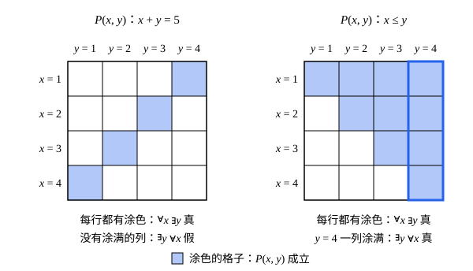

## 这一节要回答的问题

「每个人都有一位母亲」是真的；把两个量词（quantifier）的先后换一换，说成「有一位母亲是每个人的母亲」，就不对了。数学里也常常一连用上几个量词，以后在数学分析里会读到这样一句话，这里$a_n$是一列数的第$n$项，$L$是一个实数：

$$
\forall\varepsilon>0,\ \exists N\in\N^+,\ \forall n>N,\quad |a_n-L|<\varepsilon .
$$

三个量词为什么必须按这个顺序排？「$\varepsilon>0$」「$n>N$」这样的条件写在量词后面，是什么意思？这样含有多重量词（nested quantifiers）的话，它的:term[否定]{id="math.logic-sets.negation"}（negation）又该怎样写？

## 讲解

### 量词的顺序

含有两个变量的语句记作$P(x,y)$，例如「$x+y=0$」；「$\exists y\in\Z,\ x+y=0$」只含变量$x$，前面再加一个关于$x$的量词，就成了命题。让$x$、$y$都在整数里取值。$\forall x\in\Z,\ \exists y\in\Z,\quad x+y=0$为真：给了$x$，取$y=-x$就行。交换两个量词，$\exists y\in\Z,\ \forall x\in\Z,\quad x+y=0$为假：不管$y$取哪个整数，$x=1-y$都使$x+y=1$。

从左往右读，写在后面的量词可以依赖写在前面的变量：$\forall x\,\exists y$里$y$可以随$x$变；$\exists y\,\forall x$里$y$先定下来，对所有的$x$都得管用。中文靠语序表达:term[全称量词]{id="math.logic-sets.universal-quantifier"}（universal quantifier）和:term[存在量词]{id="math.logic-sets.existential-quantifier"}（existential quantifier）的先后：开头那两句话，一句先说「每个」，是$\forall\exists$；一句先说「有」，是$\exists\forall$。

::anchor{id="thm-quantifier-order"}
**定理**　设$A$、$B$是两个取值范围，$P(x,y)$是含有变量$x$、$y$的语句。若$\exists y\in B,\ \forall x\in A,\quad P(x,y)$为真，则$\forall x\in A,\ \exists y\in B,\quad P(x,y)$也为真；反过来不一定。

**证明**：取$y_0\in B$，使每个$x\in A$都满足$P(x,y_0)$。任给$x\in A$，$y=y_0$就使$P(x,y)$成立，所以$\forall x\in A,\ \exists y\in B,\quad P(x,y)$为真。反过来不一定：上面$x+y=0$的例子里，$\forall x\,\exists y$为真，$\exists y\,\forall x$为假。

$\forall x\in A,\ \forall y\in B$和$\forall y\in B,\ \forall x\in A$说的都是每一对$x$、$y$都满足$P(x,y)$，两个$\exists$也一样；会改变意思的，是全称和存在的先后。

中学说「函数$f$在数集$D$上有最大值」，写出来是$\exists x_0\in D,\ \forall x\in D,\quad f(x)\le f(x_0)$。交换两个量词，取$x_0=x$就满足，什么函数都满足，这句话等于什么也没说。

### 把条件写进量词

「每个大于$2$的素数都是奇数」里的:term[全称量词]{id="math.logic-sets.universal-quantifier"}只管大于$2$的素数。让$x$在整数里取值，记$C(x)$为「$x$是大于$2$的素数」，$P(x)$为「$x$是奇数」，这句话就是$\forall x\in\Z,\ \bigl(C(x)\Rightarrow P(x)\bigr)$。

::anchor{id="def-restricted-quantifier"}
设$C(x)$、$P(x)$是含有变量$x$的语句，$x$的取值范围已经说好、不再写出。「对所有满足$C(x)$的$x$，都有$P(x)$」指的是$\forall x\,\bigl(C(x)\Rightarrow P(x)\bigr)$，「存在满足$C(x)$的$x$，使$P(x)$」指的是$\exists x\,\bigl(C(x)\land P(x)\bigr)$。

为什么全称配「推出」、存在配「且」：不满足$C(x)$的$x$使「若$C(x)$，则$P(x)$」自动为真，所以$\forall x\,\bigl(C(x)\Rightarrow P(x)\bigr)$只对满足$C(x)$的$x$提要求；写成$\forall x\,\bigl(C(x)\land P(x)\bigr)$，就成了要求每个整数都是大于$2$的素数。存在要是配「推出」，「存在整数$x$，若$x$是大于$2$的素数，则$x$是偶数」取$x=1$就为真，可大于$2$的偶素数一个也没有。

边界情况：没有$x$满足$C(x)$时，$\forall x\,\bigl(C(x)\Rightarrow P(x)\bigr)$为真，$\exists x\,\bigl(C(x)\land P(x)\bigr)$为假，和取值范围一个元素也没有时一样。

常见的写法都是把条件写进量词：$\forall x\in A,\ P(x)$就是$\forall x\,\bigl(x\in A\Rightarrow P(x)\bigr)$，$\exists x\in A,\ P(x)$就是$\exists x\,\bigl(x\in A\land P(x)\bigr)$；$\forall\varepsilon>0$是「对所有满足$\varepsilon>0$的$\varepsilon$」；$n$在正整数里取值时，$\forall n>N$是「对所有大于$N$的正整数$n$」。

同类的量词挨着时常合写，$\forall m,n>N$就是$\forall m>N,\ \forall n>N$，$m$、$n$可以相等。条件也可以写在括号里：$x$在实数里取值时，$\forall x\ \bigl(x>2\bigr),\quad x^2>4$就是$\forall x\,\bigl(x>2\Rightarrow x^2>4\bigr)$。

::anchor{id="thm-restricted-negation"}
**定理**　设$C(x)$、$P(x)$是含有变量$x$的语句，则$\neg\bigl(\forall x\,(C(x)\Rightarrow P(x))\bigr)\iff\exists x\,\bigl(C(x)\land\neg P(x)\bigr)$，$\neg\bigl(\exists x\,(C(x)\land P(x))\bigr)\iff\forall x\,\bigl(C(x)\Rightarrow\neg P(x)\bigr)$。

**证明**：由[否定量词命题的定理](lesson:math.logic-sets.quantifiers#thm-quantifier-negation)，第一条的左边和$\exists x\,\neg\bigl(C(x)\Rightarrow P(x)\bigr)$:term[逻辑等价]{id="math.logic-sets.logical-equivalence"}（logical equivalence）。对每个取定的$x$，由[$\neg(P\Rightarrow Q)\iff P\land\neg Q$](lesson:math.logic-sets.implication#thm-implication-negation)，$\neg\bigl(C(x)\Rightarrow P(x)\bigr)$和$C(x)\land\neg P(x)$同真同假，所以「有$x$使前者为真」和「有$x$使后者为真」同真同假，第一条成立。

第二条同样：左边和$\forall x\,\neg\bigl(C(x)\land P(x)\bigr)$逻辑等价；对每个取定的$x$，由:term[德摩根律]{id="math.logic-sets.de-morgan-laws"}（De Morgan's laws）和[$P\Rightarrow Q\iff\neg P\lor Q$](lesson:math.logic-sets.implication#thm-implication-or)，$\neg\bigl(C(x)\land P(x)\bigr)$、$\neg C(x)\lor\neg P(x)$、$C(x)\Rightarrow\neg P(x)$同真同假，所以第二条也成立。

所以否定时条件照抄，只否定$P(x)$：「每个大于$2$的素数都是奇数」的:term[否定]{id="math.logic-sets.negation"}是「有大于$2$的素数不是奇数」，$\forall\varepsilon>0$否定以后是$\exists\varepsilon>0$。

### 多重量词的否定

::anchor{id="thm-nested-negation"}
**定理**　否定一个几个量词连用的命题（量词依次写在前面，后面接一个语句）时，把量词逐个否定：任意变存在，存在变任意，取值范围和条件照抄，最后的语句取反。得到的命题和原命题的:term[否定]{id="math.logic-sets.negation"}:term[逻辑等价]{id="math.logic-sets.logical-equivalence"}，叫作原命题的否定形式（negated form）。

**证明**：$\forall x,\ \exists y,\ \forall z,\quad P(x,y,z)$是在只含变量$x$的语句$\exists y,\ \forall z,\quad P(x,y,z)$前面加上$\forall x$，一层套一层（证明里略去取值范围）。从最外层起，每一步用一次否定量词命题的定理（带条件时用上面的定理），把否定号往里移过一个量词，这个量词换成另一种，取值范围和条件照抄。外层的变量取定以后，每一步换前换后同真同假，整句也就同真同假。三个量词时是这样，连写的$\iff$表示一步接一步：

$$
\begin{aligned}
\neg\bigl(\forall x,\ \exists y,\ \forall z,\quad P(x,y,z)\bigr)
&\iff\exists x,\ \neg\bigl(\exists y,\ \forall z,\quad P(x,y,z)\bigr)\\
&\iff\exists x,\ \forall y,\ \neg\bigl(\forall z,\quad P(x,y,z)\bigr)\\
&\iff\exists x,\ \forall y,\ \exists z,\quad \neg P(x,y,z) .
\end{aligned}
$$

例如$\forall x\in\Z,\ \exists n\in\Z,\quad n>x$为真，取$n=x+1$就行；它的否定形式$\exists x\in\Z,\ \forall n\in\Z,\quad n\le x$说「有整数$x$，使所有整数$n$都满足$n\le x$」，即有最大的整数，为假。

$n$在正整数里取值时，「从某一项起都有$P(n)$」是$\exists N\in\N^+,\ \forall n>N,\quad P(n)$，否定形式$\forall N\in\N^+,\ \exists n>N,\quad\neg P(n)$读作「无论从多靠后的地方看起，后面总还有使$P(n)$不成立的$n$」，也就是这样的$n$有无穷多个，证明见第 5 题。例如「从某一项起$n$都不是$3$的倍数」是假的：对每个正整数$N$，$n=3N$大于$N$，又是$3$的倍数。

### 恰有一个

偶素数只有$2$一个，$x^2=4$的实数解有两个，$x^2=-1$没有实数解。「只有一个」说了两件事：至少有一个，并且不会有两个不同的。

::anchor{id="def-exactly-one"}
设$P(x)$是含有变量$x$的语句。「满足$P(x)$的$x$至多有一个」（at most one）是说$\forall x,\ \forall y,\quad\bigl(P(x)\land P(y)\bigr)\Rightarrow x=y$，即任取两个满足条件的，它们一定相等；「满足$P(x)$的$x$恰有一个」（exactly one）是说$\exists x,\ P(x)$和上面这句都成立。

为什么拆成两半：两半证法不同，「至少一个」常要找出一个，「至多一个」要说明不会有两个不同的，证法见[直接证明与逆否证明](lesson:math.logic-sets.direct-proof)。

边界情况：每一对实数$x$、$y$都使「$x^2=-1$且$y^2=-1$」为假，「若……则……」自动为真，所以$x^2=-1$的实数解至多有一个；可它一个也没有，「至多一个」不保证有。

## 几何图像

两张方格里，$x$、$y$都在$1,2,3,4$里取值，行是$x$，列是$y$，涂色的格子是使$P(x,y)$成立的$(x,y)$。$\forall x\,\exists y$说的是每一行都有涂色的格子；$\exists y\,\forall x$说的是有一整列都涂满了。

左图的$P(x,y)$是「$x+y=5$」：每一行恰有一格涂色，四行涂在四个不同的列，没有涂满的列，所以$\forall x\,\exists y$为真，$\exists y\,\forall x$为假。右图的$P(x,y)$是「$x\le y$」：$y=4$那一列涂满了，两句都为真。有一整列涂满，每一行在这一列里就都有涂色的格子，这正是$\exists y\,\forall x$推出$\forall x\,\exists y$的道理；反过来，每一行都有涂色的格子，未必凑得成一整列。

## 例题

### 例 1　三层量词

写出「对每个正整数$M$，都存在正整数$N$，使所有大于$N$的正整数$n$都满足$n^2>M$」的符号式和否定形式，并判断哪一个为真。

**为什么想到这么做**：照语序从左往右排量词，条件写进各自的量词；否定时照定理把量词逐个否定。判断真假看哪一句好证：$N$写在$M$后面，可以随$M$取。

**推导**：符号式是

$$
\forall M\in\N^+,\ \exists N\in\N^+,\ \forall n>N,\quad n^2>M ,
$$

这里$n$也在正整数里取值。否定形式是

$$
\exists M\in\N^+,\ \forall N\in\N^+,\ \exists n>N,\quad n^2\le M ,
$$

即「有正整数$M$，使无论正整数$N$取多大，都有大于$N$的正整数$n$满足$n^2\le M$」。

原命题为真、否定形式为假：任给正整数$M$，取$N=M$，则$n>N$时$n^2\ge n>M$。

### 例 2　没有最大值

证明：$f(x)=x$在开区间$(0,1)$上没有最大值。

**为什么想到这么做**：要说明「有最大值」不成立，就证它的否定形式$\forall x_0\,\exists x$：任给$x_0$，找一个函数值更大的$x$，$x$可以随$x_0$变。

**推导**：「$f$在$(0,1)$上有最大值」的否定形式是

$$
\forall x_0\in(0,1),\ \exists x\in(0,1),\quad f(x)>f(x_0) .
$$

任给$x_0\in(0,1)$，取$x=\frac{x_0+1}2$，则$0<x_0<x<1$，所以$x\in(0,1)$，且$f(x)>f(x_0)$。否定形式为真，$f$在$(0,1)$上没有最大值。

## 常见误区

- 「$\forall x\,\exists y$和$\exists y\,\forall x$只是写法不同。」不对：后者的$y$要对所有$x$都管用，前者的$y$可以随$x$变。$\forall x\in\Z,\ \exists y\in\Z,\quad x+y=0$为真，交换两个量词以后却为假；后者能推出前者，前者不一定能推出后者。
- 「否定『对所有满足$C(x)$的$x$，都有$P(x)$』，要连条件一起否定。」不对：条件照抄，只否定$P(x)$。「每个大于$2$的素数都是奇数」是真命题，连条件一起否定会得到「有整数不是大于$2$的素数，也不是奇数」，可它也是真的，例如$4$；一个命题和它的:term[否定]{id="math.logic-sets.negation"}却总是一真一假。
- 「『有无穷多个$n$使$P(n)$』就是『从某一项起都有$P(n)$』。」不对：前者比后者弱，这里$n$取正整数。偶数有无穷多个，可并不是从某一项起都是偶数；「从某一项起都有$P(n)$」能推出「有无穷多个$n$使$P(n)$」，反过来不一定。
