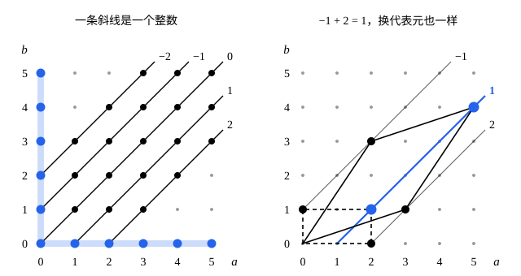

## 这一节要回答的问题

自然数里$3-5$没有意义。收入$3$、支出$5$，和收入$0$、支出$2$，净值都是欠$2$；能不能只用自然数的:term[有序对]{id="math.logic-sets.ordered-pair"}（ordered pair）造出整数，让「$-2$」就是这些净值相同的对合在一起？合起来以后，加法、乘法只好从每个整数里挑一个对来算，换一个对，结果会不会变？

## 讲解

### 净值相同的有序对

用:term[有序对]{id="math.logic-sets.ordered-pair"}$(a,b)$表示收入$a$、支出$b$，$(3,5)$和$(0,2)$净值相同。还没有减法，「$3-5=0-2$」要改写成$3+2=5+0$。

::anchor{id="def-integer-relation"}
在$\N\times\N$上规定:term[关系]{id="math.logic-sets.binary-relation"}（binary relation）$\sim$：$(a,b)\sim(c,d)$当且仅当$a+d=b+c$。本节的$\sim$都指这一个。

为什么这样规定：它说的就是$a-b=c-d$，却只用到自然数的加法。边界情况：$(a,b)\sim(0,0)$就是$a=b$，收支相抵；收入、支出各添$k$，净值不变，$(a,b)\sim(a+k,b+k)$。

::anchor{id="thm-integer-relation"}
**定理**　$\sim$是$\N\times\N$上的:term[等价关系]{id="math.logic-sets.equivalence-relation"}（equivalence relation）。

**证明**：由加法的交换律（commutative law），$a+b=b+a$，所以$\sim$:term[自反]{id="math.logic-sets.reflexive"}（reflexive）；$a+d=b+c$可以改写成$c+b=d+a$，所以它:term[对称]{id="math.logic-sets.symmetric"}（symmetric）。再看:term[传递]{id="math.logic-sets.transitive"}（transitive）：设$a+d=b+c$，$c+f=d+e$，两式相加，由结合律（associative law）、交换律重排成

$$
(a+f)+(c+d)=(b+e)+(c+d) .
$$

由[自然数的加法与乘法](lesson:math.logic-sets.natural-arithmetic#thm-cancellation)的:term[消去律]{id="math.logic-sets.cancellation-law"}（cancellation law），$a+f=b+e$，即$(a,b)\sim(e,f)$。少了消去律会怎样，见第 8 题。

::anchor{id="def-integers"}
:term[商集]{id="math.logic-sets.quotient-set"}（quotient set）$\Z=(\N\times\N)/{\sim}$的元素叫作整数（integer），$(a,b)$所在的:term[等价类]{id="math.logic-sets.equivalence-class"}（equivalence class）记作$[(a,b)]$。

为什么这样定义：把净值相同的对粘成一个，「$-2$」就是$(0,2),(1,3),(2,4),(3,5),\dots$组成的类；由[等价关系与商集](lesson:math.logic-sets.equivalence-relations#thm-class-lemma)，$[(a,b)]=[(c,d)]$当且仅当$a+d=b+c$。边界情况：一个整数有无穷多个:term[代表元]{id="math.logic-sets.representative"}（representative），如$[(3,5)]=[(0,2)]$；方括号里是有序对，不是闭区间。

### 良定义

想规定整数$[(a,b)]$的「收入」是$a$，行不行？$[(3,5)]=[(0,2)]$，同一个整数的收入又是$3$又是$0$，给不出$\Z\to\N$的:term[映射]{id="math.logic-sets.map"}（map）。

::anchor{id="def-well-defined"}
借:term[代表元]{id="math.logic-sets.representative"}规定:term[商集]{id="math.logic-sets.quotient-set"}上的映射或运算时，如果换成同一个:term[等价类]{id="math.logic-sets.equivalence-class"}里别的代表元，结果都不变，就说这个规定是:term[良定义]{id="math.logic-sets.well-defined"}的（well-defined）。

为什么这样定义：映射要求每个元素[恰有一个](lesson:math.logic-sets.nested-quantifiers#def-exactly-one)像（image）。类不空，只要每个代表元都算得出一个:term[陪域]{id="math.logic-sets.codomain"}（codomain）里的结果，「至少一个」就有了；一个类往往有好几种写法，各种写法算出的结果都一样，才是「至多一个」。

怎样验证：规定$F([x])=g(x)$，先看清各个$g(x)$都在陪域里，再证$x$与$x'$等价时$g(x)=g(x')$；结果也是类时，证算出的两个代表元等价。边界情况：「收入」不是良定义的。[等价关系与商集](lesson:math.logic-sets.equivalence-relations)第 6 题验证过，模$n$的加法、乘法是良定义的，$\N$上模$3$的$[a]^{[b]}=[a^b]$不是。

::anchor{id="thm-integer-addition"}
**定理**　规定$[(a,b)]+[(c,d)]=[(a+c,\ b+d)]$是良定义的，它给出$\Z\times\Z\to\Z$的映射，叫作整数的加法。

**证明**：设$(a,b)\sim(a',b')$，$(c,d)\sim(c',d')$，即$a+b'=b+a'$，$c+d'=d+c'$。两式相加，重排成

$$
(a+c)+(b'+d')=(b+d)+(a'+c') ,
$$

这正是$(a+c,\ b+d)\sim(a'+c',\ b'+d')$。

定理里，左边的加号是刚规定的整数加法，右边圆括号里的加号是自然数的加法：收入、支出分别相加。有了这个定理，才说得上「两个整数的和」。边界情况：加$[(0,0)]$，整数不变。

乘法照着$(a-b)(c-d)=(ac+bd)-(ad+bc)$来规定，收入是$ac+bd$，支出是$ad+bc$。

::anchor{id="thm-integer-multiplication"}
**定理**　规定$[(a,b)]\cdot[(c,d)]=[(ac+bd,\ ad+bc)]$是良定义的，它给出$\Z\times\Z\to\Z$的映射，叫作整数的乘法。

**证明**：先只换第一个代表元。设$a+b'=b+a'$，由分配律（distributive law），两边乘$c$，得$ac+b'c=bc+a'c$；两边对调再乘$d$，得$bd+a'd=ad+b'd$。相加、重排，

$$
(ac+bd)+(a'd+b'c)=(ad+bc)+(a'c+b'd) ,
$$

即$(ac+bd,\ ad+bc)\sim(a'c+b'd,\ a'd+b'c)$。

再只换第二个代表元。设$c+d'=d+c'$，两边乘$a'$，对调再乘$b'$，同样得到$(a'c+b'd,\ a'd+b'c)\sim(a'c'+b'd',\ a'd'+b'c')$。由:term[传递性]{id="math.logic-sets.transitive"}，两个都换，结果也不变。

边界情况：乘$[(0,0)]$，总得$[(0,0)]$。

### 自然数放进整数

$[(3,0)]$是收入$3$、没有支出，应当就是自然数$3$。

::anchor{id="thm-naturals-in-integers"}
**定理**　$n\mapsto[(n,0)]$把不同的自然数送到不同的整数，并且$[(m,0)]+[(n,0)]=[(m+n,0)]$，$[(m,0)]\cdot[(n,0)]=[(mn,0)]$。每个整数都等于某个$[(n,0)]$或$[(0,n)]$。

**证明**：$[(m,0)]=[(n,0)]$就是$m+0=0+n$，即$m=n$；两个等式照规定算出来就是。对$(a,b)$，[总有自然数$k$](lesson:math.logic-sets.natural-arithmetic#def-natural-order)使$a=b+k$或$b=a+k$：前者$[(a,b)]=[(b+k,b)]=[(k,0)]$，后者$[(a,b)]=[(a,a+k)]=[(0,k)]$。

所以可以把$n$和$[(n,0)]$看成一个，在$\N$里算，和放进$\Z$以后再算，结果一样，$\N$就放进了$\Z$。

$[(0,2)]$的收入、支出对调，得$[(2,0)]$，欠$2$变成了有$2$。

::anchor{id="def-opposite"}
整数$[(b,a)]$叫作$[(a,b)]$的相反数（opposite），记作$-[(a,b)]$；整数$x$、$y$的差$x-y$规定为$x+(-y)$。

为什么这样定义：对调以后正好相抵，$[(a,b)]+[(b,a)]=[(a+b,\ b+a)]$，就是$[(0,0)]$，即$0$。相反数也是借:term[代表元]{id="math.logic-sets.representative"}规定的，$a+b'=b+a'$就是$b+a'=a+b'$，所以:term[良定义]{id="math.logic-sets.well-defined"}。边界情况：$0$的相反数是$0$。

于是$[(0,n)]=-n$，$\Z=\{\dots,-2,-1,0,1,2,\dots\}$。减法总做得成：$[(a,b)]=[(a,0)]+[(0,b)]=a-b$，开头没有意义的$3-5$，就是$[(3,5)]=-2$。

::anchor{id="thm-integer-laws"}
对整数$x$、$y$、$z$，加法和乘法都满足交换律、结合律，乘法对加法满足分配律，$x+0=x$，$x+(-x)=0$，$x\cdot1=x$，$x\cdot0=0$，$(-1)x=-x$；非零整数的积不是$0$，所以乘法也满足:term[消去律]{id="math.logic-sets.cancellation-law"}：${z\ne0}$时，由$xz=yz$得$x=y$。证明见第 5、6 题。

它们都化成自然数的性质。例如加法的结合律，设$x=[(a,b)]$，$y=[(c,d)]$，$z=[(e,f)]$，则$(x+y)+z=[((a+c)+e,\ (b+d)+f)]$，$x+(y+z)=[(a+(c+e),\ b+(d+f))]$，由自然数加法的结合律，两个:term[有序对]{id="math.logic-sets.ordered-pair"}相同。

这套步骤以后还要用：规定哪些看成一样，借代表元规定运算，再验证良定义。[用等价类构造有理数](lesson:math.logic-sets.rational-construction)、数学分析里用有理数的:term[柯西列]{id="math.analysis.cauchy-sequence"}（Cauchy sequence）造实数的办法（见[柯西收敛准则](lesson:math.analysis.cauchy-sequences)第 8 题）、抽象代数的[剩余类](lesson:math.abstract-algebra.modular-arithmetic)（residue class），走的都是它。

## 几何图像

左图的每个点是一个:term[有序对]{id="math.logic-sets.ordered-pair"}$(a,b)$，只画到$5$；一条斜线上的点$a-b$相同，合起来就是右上端标着的整数，图上画了五条。把$(a,b)$送到它的:term[等价类]{id="math.logic-sets.equivalence-class"}，得到$\N\times\N\to\Z$的:term[映射]{id="math.logic-sets.map"}：同一条斜线上的点送到同一个整数，不同斜线上的点送到不同的整数。每条斜线在最左一列或最下一行恰有一个点（强调色），就是$(0,n)$或$(n,0)$。沿最左一列走下来，再沿最下一行往右，依次经过$\dots,-2,-1,0,1,2,\dots$，是一条折过来的数轴。

右图看加法为什么:term[良定义]{id="math.logic-sets.well-defined"}：$-1$和$2$各取两个:term[代表元]{id="math.logic-sets.representative"}，$(0,1)$、$(2,0)$按分量相加得$(2,1)$（虚线），$(2,3)$、$(3,1)$得$(5,4)$（实线），两个点不同，却都在标着$1$的斜线上。换代表元，就是让点沿着它的斜线挪，两个分量添得一样多，或者减得一样多；加出来的点也只沿斜线挪，还是同一个整数。

## 例题

### 例 1　负负得正

用整数乘法的规定，算$[(0,1)]\cdot[(0,1)]$。

**为什么想到这么做**：$[(0,1)]$就是$-1$。中学里「负负得正」像是一条规定，现在乘法已经规定好了，它应当算得出来。

**推导**：照规定，$[(0,1)]\cdot[(0,1)]=[(0\cdot0+1\cdot1,\ 0\cdot1+1\cdot0)]$，就是$[(1,0)]$，即$(-1)(-1)=1$。同样算得$[(0,m)]\cdot[(0,n)]=[(mn,0)]$，$[(0,m)]\cdot[(n,0)]=[(0,mn)]$，即$(-m)(-n)=mn$，$(-m)n=-(mn)$。

### 例 2　是不是良定义

下面两条规定，哪一条给出$\Z\to\Z$的:term[映射]{id="math.logic-sets.map"}？(1) $F([(a,b)])=[(a^2,b^2)]$；(2) $G([(a,b)])=[(a+1,b)]$。

**为什么想到这么做**：不是:term[良定义]{id="math.logic-sets.well-defined"}的，举出一个类的两个:term[代表元]{id="math.logic-sets.representative"}、结果不同就够；是良定义的，要对任意两个代表元证。

**推导**：(1) $[(1,0)]=[(2,1)]$，可$(1,0)$和$(4,1)$不等价，因为$1+1\ne0+4$，所以$F$不是良定义的。(2) 设$a+b'=b+a'$，则$(a+1)+b'=b+(a'+1)$，即$(a+1,b)\sim(a'+1,b')$，所以$G$是良定义的，它就是$x\mapsto x+1$。

## 常见误区

- 「$[(a,b)]$里的$a$、$b$由这个整数定下来。」不对：$[(3,5)]=[(0,2)]$，一个整数有无穷多个:term[代表元]{id="math.logic-sets.representative"}，收入、支出都定不下来，定得下来的是净值。
- 「$\sim$是:term[等价关系]{id="math.logic-sets.equivalence-relation"}，借代表元的规定就自动:term[良定义]{id="math.logic-sets.well-defined"}。」不对：「收入」就不是。等价关系管的是类分得清，规定落不落得到类上，要另外验证。
- 「验证良定义，换几个代表元算一算就行。」不对：算几个只能发现毛病，没发现不等于没有；要对同一类的任意两个代表元证。
- 「可以直接用$a-b=c-d$规定$\sim$。」不行：自然数里$3-5$没有意义，要改写成只用加法的$a+d=b+c$。
- 「自然数$3$和整数$[(3,0)]$本来就是同一个东西。」不对：照字面，后者是:term[有序对]{id="math.logic-sets.ordered-pair"}组成的集合。能看成一个，是因为不同的自然数送到了不同的整数，加法、乘法又都对得上；写$\N\subseteq\Z$，说的就是这样看成一个。
