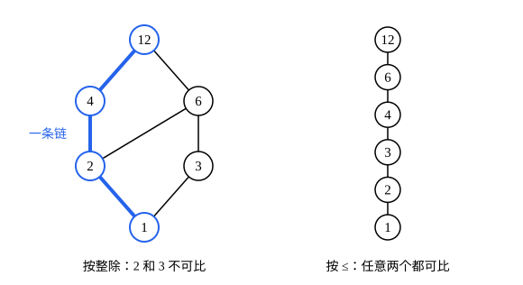

## 这一节要回答的问题

实数能从小到大排在一条线上；集合可以按「谁包含谁」来排，可$\{1\}$和$\{2\}$谁也不包含谁；正整数可以按「谁整除谁」来排，$2$和$3$又谁也不整除谁。这些「排大小」的:term[关系]{id="math.logic-sets.binary-relation"}（binary relation）有什么共同的性质？什么时候任意两个都能比，只能比一部分的时候，又怎样画出来看清楚？

## 讲解

### 反对称性

$\R$上由$a\le b$、$b\le a$得$a=b$；两个集合互相包含，就[相等](lesson:math.logic-sets.sets#thm-set-equality)。正整数的整除也这样：$a\mid b$、$b\mid a$时，有正整数$k$、$l$使$b=ak$、$a=bl$，于是$a=akl$，$kl=1$，$k=l=1$，$a=b$。这三个:term[关系]{id="math.logic-sets.binary-relation"}有一个共同点：两个不同的对象，不会互相有这个关系。

::anchor{id="def-antisymmetric"}
设$R$是集合$A$上的关系。如果对所有$a,b\in A$，只要$a\mathrel{R}b$且$b\mathrel{R}a$，就有$a=b$，就说$R$具有:term[反对称性]{id="math.logic-sets.antisymmetric"}（antisymmetry），也说$R$是反对称的（antisymmetric）。

为什么单独起名：排大小的关系靠它分出先后；证两个集合相等时证互相包含，用的正是$\subseteq$的反对称性。

边界情况：$\Z$上的整除不反对称，$2\mid-2$，$-2\mid2$，可$2\ne-2$。相等关系$=$是反对称的，条件$a=b$且$b=a$本身就给出了$a=b$；$<$也是，条件$a<b$且$b<a$永远不成立。

### 偏序

$\R$上的$\le$、:term[幂集]{id="math.logic-sets.power-set"}（power set）$\Pow(X)$上的$\subseteq$、$\N^+$上的整除还有两个共同点：每个对象和自己有这个:term[关系]{id="math.logic-sets.binary-relation"}，又能一步步接下去；整除的这两条，见[笛卡儿积与关系](lesson:math.logic-sets.cartesian-product#thm-divisibility)。

::anchor{id="def-partial-order"}
集合$P$上:term[自反]{id="math.logic-sets.reflexive"}（reflexive）、:term[反对称]{id="math.logic-sets.antisymmetric"}、:term[传递]{id="math.logic-sets.transitive"}（transitive）的关系，叫作$P$上的:term[偏序]{id="math.logic-sets.partial-order"}（partial order），也叫偏序关系，常记作$\preceq$，$a\preceq b$读作「$a$不超过$b$」；$P$连同它上面的一个偏序$\preceq$，叫作:term[偏序集]{id="math.logic-sets.poset"}（partially ordered set，poset），记作${(P,\preceq)}$。$a\preceq b$且$a\ne b$时，记作$a\prec b$，说$a$比$b$小、$b$比$a$大。

为什么要这三条：自己不超过自己，互相不超过就是同一个，又能一步步接下去，这样才像比大小。「偏」是说可以只给一部分对象排先后，有的书叫「半序」。

边界情况：$\Z$上的整除自反、传递，不反对称，不是偏序；$\R$上的$<$不自反，也不是偏序，它是由$\le$得到的$\prec$；只缺传递的，见常见误区。同一个集合上可以有不同的偏序，${(\N^+,\le)}$和${(\N^+,\mid)}$是两个偏序集，所以要写明是哪个序。

三条都是对所有元素的要求，所以偏序集的:term[子集]{id="math.logic-sets.subset"}（subset）按同一个关系仍是偏序集，如$12$的正因数按整除。

### 全序与链

$\R$里任意两个数都能比大小；按整除，$2$和$3$谁也排不到谁的前面，$1$、$2$、$6$却能排在一条线上。

::anchor{id="def-total-order"}
设${(P,\preceq)}$是:term[偏序集]{id="math.logic-sets.poset"}。$a\preceq b$或$b\preceq a$成立时，说$a$与$b$:term[可比]{id="math.logic-sets.comparable"}（comparable），都不成立时说它们不可比（incomparable）；任意两个元素都可比的:term[偏序]{id="math.logic-sets.partial-order"}，叫作:term[全序]{id="math.logic-sets.total-order"}（total order），也叫线性序（linear order），这时${(P,\preceq)}$叫作全序集（totally ordered set）。

为什么这样定义：全序就是能把所有元素排在一条线上的序；偏序不要求这一条，才装得下包含、整除。边界情况：每个元素和自己可比；$X$有两个不同的元素$x$、$y$时，$\{x\}$和$\{y\}$不可比，${(\Pow(X),\subseteq)}$不是全序集，$X$至多有一个元素时却是，它的:term[子集]{id="math.logic-sets.subset"}只有$\varnothing$和$X$。

::anchor{id="def-chain"}
偏序集$P$的子集$C$中任意两个元素都可比时，$C$叫作$P$的一条:term[链]{id="math.logic-sets.chain"}（chain）。

为什么这样定义：不是全序的偏序集里，也有能排在一条线上的部分；以后的:term[佐恩引理]{id="math.logic-sets.zorn-lemma"}（Zorn's lemma，见[选择公理与佐恩引理](lesson:math.logic-sets.axiom-of-choice)）就用链来说。边界情况：$\{1,2,6\}$是${(\N^+,\mid)}$里的链，$\{2,3\}$不是；:term[空集]{id="math.logic-sets.empty-set"}（empty set）和只含一个元素的集合都是链，全序集的每个子集都是链。

数学分析把实数定义成:term[戴德金分割]{id="math.analysis.dedekind-cut"}（Dedekind cut），按$\subseteq$比大小：一般的集合按包含只排得成偏序，两个分割却[总是可比的](lesson:math.analysis.real-construction#thm-cut-total-order)。

### 哈斯图

$12$的正因数里，$1\mid12$，可中间夹着$2$、$6$；画图时只连紧挨着的，才看得清楚。

::anchor{id="def-hasse-diagram"}
把有限的:term[偏序集]{id="math.logic-sets.poset"}的每个元素画成一点；$a\prec b$并且没有$c$使$a\prec c\prec b$时，把$b$画在$a$的上方并连一条线。这样画出的图叫作:term[哈斯图]{id="math.logic-sets.hasse-diagram"}（Hasse diagram）。

为什么只连紧挨着的：由:term[自反性]{id="math.logic-sets.reflexive"}、:term[传递性]{id="math.logic-sets.transitive"}推得出来的都不画，线就少了；顺着线往上走，走到的都比起点大，反过来，比起点大的也都走得到，证明见第 6 题。[集合与子集](lesson:math.logic-sets.sets)几何图像的右图，就是${(\Pow(\{a,b,c\}),\subseteq)}$的哈斯图。边界情况：画得高不一定大，不:term[可比]{id="math.logic-sets.comparable"}的两个元素谁画得高都行。

## 几何图像

两幅:term[哈斯图]{id="math.logic-sets.hasse-diagram"}画的是同一个集合$\{1,2,3,4,6,12\}$，即$12$的正因数。左图按整除：$2$和$3$不:term[可比]{id="math.logic-sets.comparable"}；$4$画得比$3$高，可没有从$3$一路往上到$4$的线，$3$不整除$4$，这两个数也不可比。加粗的三条线经过$1$、$2$、$4$、$12$，它们两两可比，是一条:term[链]{id="math.logic-sets.chain"}。

右图按$\le$：任意两个数都可比，是:term[全序]{id="math.logic-sets.total-order"}，六个数排成一条竖线。同一个集合，换一个序就换一张图，所以说到:term[偏序集]{id="math.logic-sets.poset"}，要写明是哪个序。

## 例题

### 例 1　平面上的两种比法

在$\R^2$上规定：(1) $(a,b)\preceq_1(c,d)$当且仅当$a\le c$且$b\le d$；(2) $(a,b)\preceq_2(c,d)$当且仅当$a<c$，或者$a=c$且$b\le d$。它们是:term[偏序]{id="math.logic-sets.partial-order"}吗？是:term[全序]{id="math.logic-sets.total-order"}吗？

**为什么想到这么做**：三条性质逐条查；不是全序，找一对不:term[可比]{id="math.logic-sets.comparable"}的就够，是全序，要证任意两个都可比。(2) 像查字典，先比第一个分量，相同时再比第二个。

**推导**：(1) $a\le a$、$b\le b$，:term[自反]{id="math.logic-sets.reflexive"}；设$(a,b)\preceq_1(c,d)$、$(c,d)\preceq_1(a,b)$，则$a\le c\le a$、$b\le d\le b$，得$a=c$、$b=d$，:term[反对称]{id="math.logic-sets.antisymmetric"}；设$(a,b)\preceq_1(c,d)$、$(c,d)\preceq_1(e,f)$，则$a\le c\le e$、$b\le d\le f$，:term[传递]{id="math.logic-sets.transitive"}。所以是偏序；$(0,1)$和$(1,0)$不可比，不是全序。

(2) 自反：$a=a$且$b\le b$。反对称：$(a,b)\preceq_2(c,d)$、$(c,d)\preceq_2(a,b)$都成立时$a\le c$且$c\le a$，所以$a=c$，于是$b\le d$且$d\le b$，$b=d$。传递：设$(a,b)\preceq_2(c,d)$，$(c,d)\preceq_2(e,f)$，则$a\le c\le e$；$a<e$时成立，$a=e$时$a=c=e$，$b\le d\le f$，也成立。$a<c$、$a>c$、$a=c$总有一个成立，$a=c$时再比$b$、$d$，所以任意两个都可比，是全序。

把$(a,b)$写成复数$a+bi$，照 (2)，复数也两两可比。[复数与复平面](lesson:math.complex-analysis.complex-numbers#def-complex-number)说「复数不比大小」，是要求大小和乘法相容；照 (2)，$i$排在$0$后面，$i\cdot i=-1$却排在$0$前面。

### 例 2　画哈斯图

画出$\{2,3,4,5,6,12\}$按整除的:term[哈斯图]{id="math.logic-sets.hasse-diagram"}。

**为什么想到这么做**：先找出有:term[整除关系]{id="math.logic-sets.binary-relation"}的每一对，再去掉中间夹着别的数的，剩下的才连线。

**推导**：$2$整除$4,6,12$，$3$整除$6,12$，$4$、$6$都整除$12$。$2\mid4\mid12$，$2$和$12$之间不连；$3\mid6\mid12$，$3$和$12$也不连。剩下的五条线是$2$连$4$、$2$连$6$、$3$连$6$、$4$连$12$、$6$连$12$；$5$和别的数都不:term[可比]{id="math.logic-sets.comparable"}，是单独的一点。图就是几何图像左图去掉$1$和它的两条线，再添上$5$。

## 常见误区

- 「:term[反对称]{id="math.logic-sets.antisymmetric"}就是$a\mathrel{R}b$和$b\mathrel{R}a$不会同时成立。」不对：$a=b$时可以同时成立，:term[自反的]{id="math.logic-sets.reflexive"}:term[关系]{id="math.logic-sets.binary-relation"}里每个元素都这样；反对称说的只是，两个不同的元素不会互相有这个关系。
- 「$a\preceq b$不成立，就有$b\prec a$。」不对：$a$与$b$还可能不:term[可比]{id="math.logic-sets.comparable"}，$\{1\}\subseteq\{2\}$、$\{2\}\subseteq\{1\}$都不成立。两者可比时才推得出来，在:term[全序集]{id="math.logic-sets.total-order"}里总是这样。
- 「:term[哈斯图]{id="math.logic-sets.hasse-diagram"}里画得高的元素就大。」不对：几何图像的左图里，$4$画得比$3$高，$3$却不整除$4$。看图比大小，要看从低的能不能沿着线一路往上走到高的。
- 「任意两样都分得出先后，就能排在一条线上。」不对：石头、剪刀、布两两分得出输赢，规定每样不超过自己、输的不超过赢的，任意两样总有一样不超过另一样，这个关系也自反、反对称。可布输给剪刀，剪刀输给石头，布却赢了石头：它不:term[传递]{id="math.logic-sets.transitive"}，连:term[偏序]{id="math.logic-sets.partial-order"}都不是，更谈不上全序。
