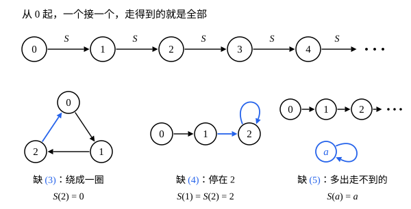
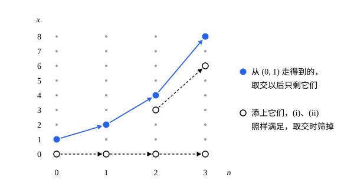

## 这一节要回答的问题

「自然数」人人会用，可怎样才算说清了它是什么？[数学归纳法](lesson:math.logic-sets.induction)一节把:term[归纳原理]{id="math.logic-sets.induction-principle"}（principle of mathematical induction）当作自然数的基本性质承认下来，还要承认哪几条？有了它们，「$a_0=1$，$a_{n+1}=2a_n$」好像一项一项就把整个数列定了下来，可一项一项地定，永远定不完，凭什么说有这样一个数列，而且只有一个？

## 讲解

### 五条公理

数数时从$0$起，$0$后面紧跟着$1$，$1$后面紧跟着$2$，每个数后面都紧跟着一个：用到的只有「从哪里起」和「下一个是谁」。

::anchor{id="def-peano-axioms"}
设$\N$是集合，$0$是一个对象，$S$给$\N$的每个元素$n$规定一个对象$S(n)$，叫作$n$的:term[后继]{id="math.logic-sets.successor"}（successor）。下面五条叫作:term[皮亚诺公理]{id="math.logic-sets.peano-axioms"}（Peano axioms，人名也译作佩亚诺）：(1) $0\in\N$；(2) 对每个$n\in\N$，$S(n)\in\N$，即$S$是$\N\to\N$的:term[映射]{id="math.logic-sets.map"}（map）；(3) 对每个$n\in\N$，$S(n)\ne0$；(4) 对所有$m,n\in\N$，若$S(m)=S(n)$，则$m=n$；(5) $\N$的:term[子集]{id="math.logic-sets.subset"}（subset）$A$若满足$0\in A$，并且对每个$n\in A$都有$S(n)\in A$，则$A=\N$。第 (5) 条叫作归纳公理（axiom of induction）。

为什么要这五条：(1)、(2) 说有起点，而且每一步都走得下去；(3) 说不会绕回起点，(4) 说两条路不会并成一条；(5) 说从起点一步步走得到的就是全部。后三条缺一不可，各有一个只差这一条的反例（counterexample）：

- 缺 (3)：$\{0,1,2\}$，$S(0)=1$，$S(1)=2$，$S(2)=0$，绕成了一圈。
- 缺 (4)：$\{0,1,2\}$，$S(0)=1$，$S(1)=S(2)=2$，走到$2$就原地不动。
- 缺 (5)：在$\N$外面添一个$a$，令$S(a)=a$。从$0$走不到$a$，原来的$\N$满足 (5) 的条件，却不是全部。

边界情况：公理不管这些对象是什么，只管它们怎样一个接一个。$\{1,2,4,8,\dots\}$以$1$当作$0$，令$S(n)=2n$，也满足五条；有的书从$1$起，只是换了起点的名字。任意两个满足五条的系统，都能让起点对着起点、后继对着后继，把元素一个对一个地配起来（证明见第 6 题），所以它们只差名字，五条公理把自然数刻画清楚了。

(5) 正是:term[归纳原理]{id="math.logic-sets.induction-principle"}（见[数学归纳法](lesson:math.logic-sets.induction#thm-induction-principle)）：把那里的$k+1$读作$S(k)$，取$A=\{n\in\N:P(n)\}$，由 (5) 就得到归纳原理；反过来，取$P(n)$为「$n\in A$」，由归纳原理就得到 (5)。所以下面说「对$n$归纳」，用的就是 (5)。

### 递归定理

「$a_0=1$，$a_{n+1}=2a_n$」要的是一个:term[映射]{id="math.logic-sets.map"}$h:\N\to\N$，使$h(0)=1$，并且对每个$n\in\N$，$h(S(n))=2h(n)$。后一项总由前一项按同一条规则$g$得到，这里$g(x)=2x$；本节的乘法都先当作已知，递推式里的$n+1$就读作$S(n)$。

::anchor{id="thm-recursion"}
**:term[递归定理]{id="math.logic-sets.recursion-theorem"}（recursion theorem）**　设$X$是集合，$c\in X$，$g:X\to X$。则恰有一个映射$h:\N\to X$，使$h(0)=c$，并且对每个$n\in\N$，$h(S(n))=g(h(n))$。

**证明**：先证至少有一个。看:term[笛卡儿积]{id="math.logic-sets.cartesian-product"}（Cartesian product）$\N\times X$的满足下面两条的:term[子集]{id="math.logic-sets.subset"}$R$：(i) $(0,c)\in R$；(ii) 对每个$(n,x)\in R$，都有$(S(n),g(x))\in R$。$\N\times X$本身就是一个。

用$\mathcal R$记所有这样的$R$组成的集合，它不空，照[集族的并与交](lesson:math.logic-sets.indexed-families#def-family-union-intersection)拿它自己当:term[指标集]{id="math.logic-sets.index-set"}（index set），取:term[集族的交]{id="math.logic-sets.family-intersection"}（intersection of a family）$T=\bigcap_{R\in\mathcal R}R$。(i)、(ii) 对每个$R$都成立，所以$T$也满足 (i)、(ii)；它包含在每个$R$里，是其中最小的。

下面对$n$归纳证明：恰有一个$x$使$(n,x)\in T$。$n=0$时，$(0,c)\in T$。若还有$d\ne c$使$(0,d)\in T$，就从$T$里去掉$(0,d)$：(i) 还成立；由公理 (3)，$(S(m),g(z))$总不是$(0,d)$，(ii) 也成立。剩下的属于$\mathcal R$，却比$T$小，矛盾。

设对$n$成立，$x$是那一个，则$(S(n),g(x))\in T$。若还有$y\ne g(x)$使$(S(n),y)\in T$，就从$T$里去掉$(S(n),y)$。由公理 (3)，去掉的不是$(0,c)$，(i) 还成立。若某个$(m,z)\in T$的$(S(m),g(z))$正是去掉的那个，即$S(m)=S(n)$，$g(z)=y$，则由公理 (4)，$m=n$，由:term[归纳假设]{id="math.logic-sets.induction-hypothesis"}（induction hypothesis），$z=x$，于是$y=g(x)$，矛盾；所以 (ii) 也成立，同样和$T$最小矛盾。

于是令$h(n)$为使$(n,x)\in T$的那个$x$，就得到映射$h:\N\to X$。由 (i)，$h(0)=c$；由 (ii)，$(S(n),g(h(n)))\in T$，即$h(S(n))=g(h(n))$。

再证至多有一个。设$h$、$h'$都满足条件，令$A=\{n\in\N:h(n)=h'(n)\}$。$h(0)=c=h'(0)$，$0\in A$；$n\in A$时，$h(S(n))=g(h(n))=g(h'(n))=h'(S(n))$，$S(n)\in A$。由公理 (5)，$A=\N$，所以$h=h'$。

为什么想到取交：要的是从$(0,c)$出发、一步步走得到的那些:term[有序对]{id="math.logic-sets.ordered-pair"}（ordered pair），别的一概不要。拿$X=\N$、$c=1$、$g(x)=2x$来看，走得到的是$(0,1),(1,2),(2,4),\dots$；再添上所有的$(n,0)$，(i)、(ii) 也都满足，可$0$对应了$1$和$0$两个数，不是映射。走得到的那些自己就满足 (i)、(ii)，所以取交正好筛掉走不到的，剩下的每个$n$恰配一个$x$。

::anchor{id="def-recursive-definition"}
给出$h(0)\in X$，再给出由$h(n)$得到$h(S(n))$的规则$g:X\to X$，由递归定理确定映射$h:\N\to X$，这样的办法叫作:term[递归定义]{id="math.logic-sets.recursive-definition"}（recursive definition）。

为什么起名：数列常常这样给出，[数学归纳法](lesson:math.logic-sets.induction)一节说「由:term[归纳原理]{id="math.logic-sets.induction-principle"}，每一项都有定义」，严格的意思就是递归定理：这样的数列有，而且只有一个。用的时候写出$X$、$c$、$g$三样，看清$g$确实是$X\to X$的映射。数学分析[单调有界数列](lesson:math.analysis.bounded-monotone#def-recursive-sequence)里由$a_{n+1}=f(a_n)$一项一项定义的数列从第$1$项起：取一个含$a_1$的$X$，使$x\mapsto f(x)$是$X\to X$的映射（如那里例 1 的$\sqrt{2+x}$取$X=[0,+\infty)$），再令$h(n)=a_{n+1}$，就归到这里。

边界情况：规则要对$X$的每个元素都有意义，$a_0=1$、$a_{n+1}=\frac1{a_n-1}$第一步就断了，$\frac1{x-1}$不是$\R\to\R$的映射。规则要看前两项，或者要用到$n$本身时，先打包，见例 1、例 2。

## 几何图像

圆圈里写的是元素，箭头从$n$指向它的:term[后继]{id="math.logic-sets.successor"}$S(n)$。上排满足五条:term[皮亚诺公理]{id="math.logic-sets.peano-axioms"}；下排是讲解里的三个反例，各只违反写出的那一条，另外四条都满足。

每个点是一个:term[有序对]{id="math.logic-sets.ordered-pair"}$(n,x)$，取的是$X=\N$、$c=1$、$g(x)=2x$，箭头从$(n,x)$指向$(S(n),g(x))$，只画到$n=3$。满足 (i)、(ii) 的:term[子集]{id="math.logic-sets.subset"}都要有强调色的圆点，而这些圆点（一直走下去）自己就满足 (i)、(ii)，空心圆和别的点可有可无，所以交里只剩强调色的圆点：每个$n$的上方恰有一个，它的高度就是$h(n)$。

## 例题

### 例 1　斐波那契数列

斐波那契数列（Fibonacci sequence）由$F_0=0$，$F_1=1$，$F_{n+2}=F_{n+1}+F_n$（$n\in\N$）给出。证明：这样的自然数数列恰有一个。

**为什么想到这么做**：:term[递归定理]{id="math.logic-sets.recursion-theorem"}里后一项只看前一项，这里要看前两项；把相邻两项打包成:term[有序对]{id="math.logic-sets.ordered-pair"}，后一对就由前一对完全定出。

**推导**：取$X=\N\times\N$，$c=(0,1)$，$g(a,b)=(b,a+b)$，这里的加法先当作已知，见[自然数的加法与乘法](lesson:math.logic-sets.natural-arithmetic)。由递归定理有$h:\N\to X$，记$h(n)=(F_n,G_n)$，则$F_0=0$，$G_0=1$，$F_{n+1}=G_n$，$G_{n+1}=F_n+G_n$。所以$F_1=G_0=1$，$F_{n+2}=G_{n+1}=F_n+F_{n+1}$。

唯一：数列$F_0,F_1,F_2,\dots$只要满足条件，$n\mapsto(F_n,F_{n+1})$就满足递归定理的两个条件，这样的:term[映射]{id="math.logic-sets.map"}只有一个。线性代数[矩阵的幂与线性递推](lesson:math.linear-algebra.matrix-powers#def-linear-recurrence)说「$a_0$、$a_1$给定后，整个数列就定了」，道理也在这里。

### 例 2　阶乘

说明「$0!=1$，$(n+1)!=(n+1)\cdot n!$」定出了唯一的数列，即阶乘（factorial）。

**为什么想到这么做**：这条规则里出现了$n$本身，$g$却只看得见前一项的值；把$n$也打包进去，$g$就看得见了。

**推导**：取$X=\N\times\N$，$c=(0,1)$，$g(k,a)=(S(k),S(k)\cdot a)$，乘法也先当作已知，见[自然数的加法与乘法](lesson:math.logic-sets.natural-arithmetic)。由:term[递归定理]{id="math.logic-sets.recursion-theorem"}有唯一的$h$，记$h(n)=(k_n,a_n)$，则$k_0=0$，$k_{S(n)}=S(k_n)$，归纳得$k_n=n$；于是$a_0=1$，$a_{S(n)}=S(n)\cdot a_n$，$a_n$就是$n!$。唯一性和例 1 一样，把$(F_n,F_{n+1})$换成$(n,a_n)$。

## 常见误区

- 「:term[皮亚诺公理]{id="math.logic-sets.peano-axioms"}规定了$0$、$1$、$2$是什么东西。」不对：公理只管它们怎样一个接一个，$\{1,2,4,8,\dots\}$也满足；要紧的是结构，不是名字。
- 「前四条已经把自然数说清楚了，归纳公理可有可无。」不对：在$\N$外面添一个$S(a)=a$的$a$，前四条都成立，可它比$\N$多出一个走不到的元素，两者不能让起点对着起点、:term[后继]{id="math.logic-sets.successor"}对着后继，把元素一个对一个地配起来。
- 「$S(n)$就是$n+1$的简写。」次序反了：公理里只有后继，加法还没有；先用后继把加法定义出来，再证$S(n)=n+1$，见[自然数的加法与乘法](lesson:math.logic-sets.natural-arithmetic)。
